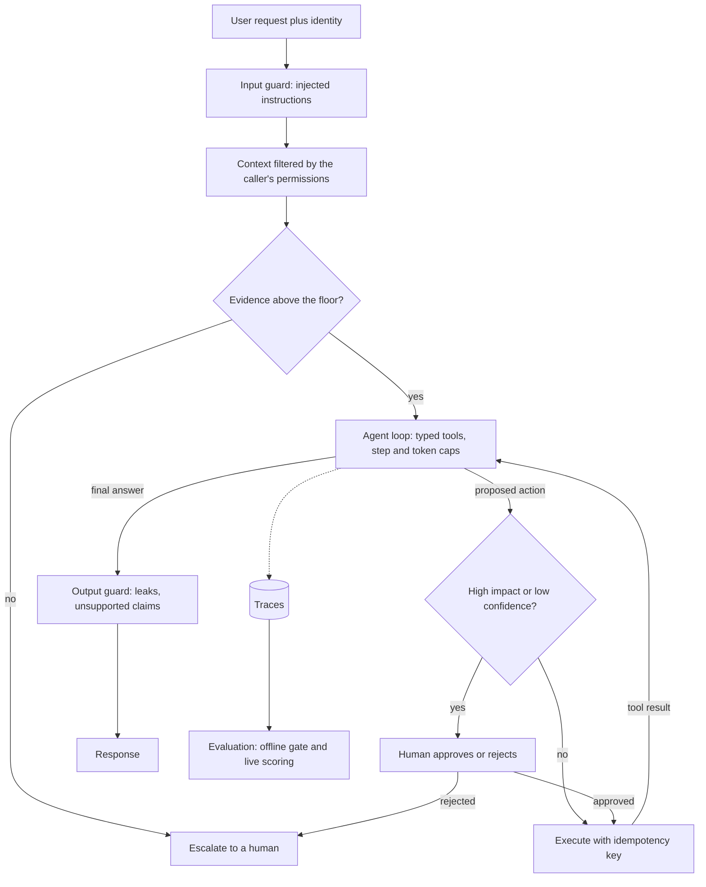
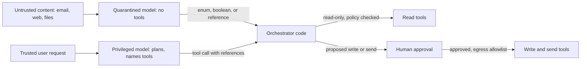

## TL;DR

- A production agent has a measured failure rate, a ceiling on the damage one failure can do, and a known cost per task.
- Build evaluation from the failures you cannot accept, and report $\text{pass}^k$, the chance a task succeeds on all $k$ tries, next to the average.
- Untrusted content, private data, and an outbound channel must never meet in one path. Detectors miss some attacks, so remove a leg by design.
- Start with one agent and a per-stage budget, and add more only when an evaluation shows it pays.

## Why it matters

[AI systems: RAG and agents](./ai-systems-rag-and-agents.md) covers retrieval and the tool loop, which is enough for a demo. Production adds attackers, the same task run thousands of times, tools that change real systems, and a bill for every call. Then an agent fails on the second try, answers from weak evidence, obeys a document, or spends many times a chat's tokens.

## How it works

### Each decision sits on the request path

Each stage on a request's path is a decision that contains one failure.

The floor stops confident answers from weak evidence, the gate stops irreversible mistakes, and evaluation catches silent regressions. Your code checks each call to a typed, allowlisted tool against its schema first. [Agents and tool calling](./ai-systems-rag-and-agents.md#agents-and-tool-calling) covers bounded loops, idempotent tools, and least privilege.

### Evaluation starts from unacceptable failures

Start from what must never happen, in the product's terms: a refund issued twice, or one customer's order shown to another. Zero-tolerance failures become release gates, and the rest get an allowed rate. Write cases that provoke each one, including documents with injected instructions. Measure at three levels:

- **Component.** Retrieval recall, tool-selection accuracy, argument validity, and the guard's catch and false-positive rates locate a failure.
- **End to end.** Judge the final state, not the path. tau-bench compares the final database with an annotated goal state, and Anthropic judges end state because agents find valid paths nobody planned.
- **Live.** Trace every request, score a sample, and have people read a slice. Anthropic's human testers caught failures its automated evaluations missed.

Anthropic began with about 20 real queries, since early changes have large effects. Turn every escalation, complaint, and bad trace into a new case.

### Reliability across repeated tries

tau-bench defines $\text{pass}^k$ as the probability that all $k$ independent tries at a task succeed, averaged over tasks. With $c$ successes in $n$ runs of each task:

$$
\text{pass}^k = \mathbb{E}_{\text{task}}\left[\frac{\binom{c}{k}}{\binom{n}{k}}\right]
$$

$\text{pass}^1$ is the ordinary success rate. $\text{pass@}k$, the chance that at least one try succeeds, fits only when a verifier picks the good attempt.

Two illustrative agents both score $\text{pass}^1 = 0.8$. Agent A succeeds on each task independently with probability 0.8, so $\text{pass}^8 = 0.8^8 \approx 0.17$. Agent B always solves the same 80% of tasks and fails the rest, so $\text{pass}^8 = 0.8$. B's failures are a fixed set you can fix or route to a human.

Published agents look more like A. On tau-bench retail, gpt-4o fell from about 61% at $\text{pass}^1$ to about 25% at $\text{pass}^8$. In tau2-bench's telecom domain, where the user also acts on the shared system, gpt-4.1 scored 34% $\text{pass}^1$ against 74% on retail. To cut variance, cut the model's free choices with narrower tools, fixed plans for known workflows, and plain code where no judgment is needed.

### Guardrails that break the lethal trifecta

Simon Willison's **lethal trifecta** is an agent with access to private data, exposure to untrusted content, and the ability to communicate externally. The model can't reliably tell your instructions from ones hidden in a page or tool result, so an attacker's text can make it send your data out. Detectors catch most attacks, but as Willison puts it, in web application security 95% is a failing grade.

So wherever two legs meet, remove the third. Drop outbound tools once untrusted content is in context, feed an agent holding private data only trusted sources, or give a browsing agent no private data.

When a task needs all three, split it. Beurer-Kellner et al. (2025) give six patterns built on one rule, that untrusted input must not be able to trigger consequential actions. Two of them:

- **Plan-then-execute.** Fix the tool calls from the trusted request before reading untrusted data. Injected text can't add a call but can still steer arguments, so validate those.
- **Dual LLM.** A privileged model plans and calls tools but never reads untrusted text. A quarantined model reads it with no tools and returns symbolic references, which orchestrator code resolves at the tool call.

Here reads pass a policy check, and nothing is written or sent until a person approves it. CaMeL (Debenedetti et al., 2025) adds a policy check at every tool call and solved 77% of AgentDojo tasks with provable security, against 84% undefended. Treat retrieved documents, tool results, MCP tool descriptions, memory, and other agents' outputs as untrusted.

### Propose and dispose

The agent proposes, and a person or a fixed policy disposes. Read-only lookups run automatically, and reversible low-impact writes run with a log and an undo. Irreversible or high-impact actions, such as refunds or outbound messages, wait for approval. Escalate by default when the agent is unsure, a guard fires, a tool keeps failing, or a budget runs out.

**Tune the abstention threshold on labeled data.** Pick a per-request score, such as the top reranker score. Label a few hundred real requests as should-answer or should-escalate, sweep the threshold, and record **coverage**, the share handled without a human, and the **error rate among handled requests**. Raising the threshold lowers both. An illustrative sweep:

| Threshold | Coverage | Errors among handled |
| --- | --- | --- |
| 0.5 | 80% | 3% |
| 0.7 | 61% | 0.8% |

At 10,000 requests a day, 0.5 sends 2,000 to people and gets about 240 of the other 8,000 wrong. At 0.7, 3,900 go to people and about 49 are wrong. Whether 191 fewer errors justify 1,900 more reviews is a business decision. Re-run the sweep after any change to the model, prompt, or index.

**Make approval a durable step.** An approver may answer in a minute or a day. Persist the proposed action, wait for an approval event, and escalate if a timer fires first. Bind the approval to the exact arguments, and execute with an [idempotency key](../03-patterns/idempotency-and-retries.md) so a retry can't refund twice. This is a [long-running task](../03-patterns/long-running-tasks.md) inside a [multi-step process](../03-patterns/multi-step-processes.md). Track the approval rate. Approvers who accept everything have stopped reading.

### Memory tiers, and memory as untrusted input

- **Short-term.** The conversation in the context window. Keep recent turns verbatim and summarize older ones.
- **Working.** The current task's plan, tool results, and approval status, stored durably so a crash or long wait resumes the task.
- **Long-term.** Facts that outlive a session, such as preferences. Retrieve only what this request needs.

Long-term memory is written from user text, documents, and tool results, so it is untrusted input that lasts, and an instruction saved there replays in every later session. Store schema-checked facts with a source and a time to live, scope each to one user or tenant, and filter on every read. Memory never grants authority, because permissions come from the [identity system](../02-building-blocks/identity-and-auth.md).

### When multi-agent pays for its tokens

Azure's architecture guidance calls a single agent with tools often the right default. In Anthropic's research system, a Claude Opus 4 lead with Claude Sonnet 4 subagents, each in its own context window, beat a single Opus 4 agent by 90.2% on an internal research evaluation. On BrowseComp, token usage alone explained 80% of the variance in performance, and the multi-agent system used about 15 times the tokens of chat, against about 4 times for one agent.

So multi-agent pays when sub-questions are independent, a better answer is worth about $15/4 \approx 3.75$ times a single agent's tokens, and a measured single agent falls short. Anthropic calls it a poor fit when agents must share context or depend on each other, as in most coding. If you add agents, scale effort to the query, checkpoint long runs, and recheck the trifecta per agent.

### Budgets per stage

Decide first which number the business feels. Interactive chat feels time to first token, a research job feels cost per completed task, and a regulated workflow feels auditability. Then budget each stage at the p95 and enforce it with timeouts. An illustrative interactive turn with a 6-second target:

| Stage | p95 budget |
| --- | --- |
| Input guard, in parallel with retrieval | 0.2 s |
| Retrieval and rerank | 0.5 s |
| Up to 3 model calls | 4 s |
| Tool calls | 1 s |
| Output guard | 0.3 s |

Each loop step adds a model call, so the step cap is also the latency cap. Cost per task covers every call in the loop, including retries and guards, plus a review per escalation, so the abstention threshold also sets cost. See [back-of-the-envelope estimation](../01-fundamentals/back-of-the-envelope.md).

Loops make prompt caching pay, because every step resends the same instructions, tool definitions, and history. Keep tool schemas in a fixed order and history append-only so each step's prompt extends the last. [LLM serving and inference](./llm-serving-and-inference.md) explains prefix caching.

## Trade-offs

| Decision | Choose the first when | Choose the second when |
| --- | --- | --- |
| Automatic vs human approval | The action is read-only or cheap to undo | It is irreversible, costly, or regulated |
| Single agent vs multi-agent | Steps depend on each other or the budget is tight | Sub-questions are independent and worth several times the tokens |
| Short-term vs long-term memory | Sessions are independent or the data is sensitive | Users return and you can scope and expire what is stored |

Default to one agent with typed tools and a step cap, $\text{pass}^k$ on every change, and approval on irreversible writes.

## On Azure

**Foundry Agent Service.** Hosted agents run under a dedicated Microsoft Entra identity, so grant it least-privilege roles. On the MCP tool, `allowed_tools` limits which tools the agent may call, and `require_approval` set to `always` pauses before each call.

**Guardrails.** Foundry guardrails for agents (preview) check user input, tool calls (preview), tool responses (preview), and output for prompt attacks, indirect attacks, PII (preview), and task adherence (preview). **Prompt Shields** in Azure AI Content Safety ship with document attack detection off, so turn it on for agents that read retrieved content. Network egress controls for hosted agents (preview) allow only listed destinations, which cuts the exit leg. See [networking and security](../04-azure/networking-and-security.md).

**Evidence floor.** Azure AI Search's semantic ranker returns `@search.rerankerScore` from 0 to 4. Its distribution varies slightly and can change with ranking model updates, so re-run the sweep after each.

**Evaluation.** Foundry's agent evaluators include Task Completion and Task Adherence (both preview), Tool Call Accuracy, and Tool Input Accuracy. Traces flow through OpenTelemetry to Application Insights, continuous evaluation scores sampled production traffic, and the AI red teaming agent probes for attacks. Compute $\text{pass}^k$ yourself from $n$ scored runs per task. See [observability](../04-azure/observability.md).

**Approval and multi-agent.** A Durable Functions or Durable Task orchestration can wait for an approval event, indefinitely by default, so race it against a durable timer. Microsoft Agent Framework adds approval-required tools and orchestrations such as handoff and group chat.

**Memory.** Memory in Foundry Agent Service (preview) stores user profile, chat summary, and procedural memories, with per-item CRUD and a default time to live. Learn warns about prompt injection and memory corruption. Memory stores don't support virtual network integration, so private-network workloads keep memory in their own database. See [data choices](../04-azure/data-choices.md).

**Caching and budgets.** [LLM serving and inference](./llm-serving-and-inference.md#on-azure) covers prompt caching on Azure OpenAI. For agents, cache lifetime matters, because a loop that resumes after a long approval wait can start cold. Before GPT-5.6, an idle in-memory cache usually clears within 5 to 10 minutes, and extended retention keeps it up to 24 hours on supported models. On GPT-5.6 and later, a cached prefix lasts at least 30 minutes, and cache writes can be billed. API Management's `llm-token-limit` and `llm-emit-token-metric` policies cap and measure tokens per consumer. See [cost optimization](../04-azure/cost-optimization.md).

**Gotcha.** Model router picks a model per request, but cached tokens help only when the same model handles consecutive requests. Routing between steps of one loop can erase the caching you budgeted, so check `cached_tokens` per step. Foundry's groundedness guardrail (preview) covers model deployments, not agents, so check an agent's draft answer with groundedness detection instead.

## Interview tips

- Open evaluation with what must never happen, and quote reliability as $\text{pass}^k$ next to the average.
- For prompt injection, name the three legs and the one your design removes.
- Tune the abstention threshold with a labeled set and a sweep, then state the coverage and reviewer count.
- Propose multi-agent only after a single agent's measured shortfall, and state its token multiple.

## Further reading

- [The lethal trifecta for AI agents](https://simonwillison.net/2025/Jun/16/the-lethal-trifecta/) (Simon Willison, 2025)
- [Design Patterns for Securing LLM Agents against Prompt Injections](https://arxiv.org/abs/2506.08837) (Beurer-Kellner et al., 2025)
- [Defeating Prompt Injections by Design](https://arxiv.org/abs/2503.18813) (CaMeL, Debenedetti et al., 2025)
- [tau-bench](https://arxiv.org/abs/2406.12045) (Yao et al., 2024) and [tau2-bench](https://arxiv.org/abs/2506.07982) (Barres et al., 2025)
- [How we built our multi-agent research system](https://www.anthropic.com/research/multi-agent-research-system) (Anthropic)
- [Guardrails in Microsoft Foundry](https://learn.microsoft.com/azure/foundry/guardrails/guardrails-overview), [Prompt Shields](https://learn.microsoft.com/azure/ai-services/content-safety/concepts/jailbreak-detection), and [groundedness detection](https://learn.microsoft.com/azure/ai-services/content-safety/concepts/groundedness)
- [Hosted agents](https://learn.microsoft.com/azure/foundry/agents/concepts/hosted-agents), [the MCP tool](https://learn.microsoft.com/azure/foundry/agents/how-to/tools/model-context-protocol), and [memory](https://learn.microsoft.com/azure/foundry/agents/concepts/what-is-memory) in Foundry Agent Service
- [Agent evaluators](https://learn.microsoft.com/azure/foundry/concepts/evaluation-evaluators/agent-evaluators) and [observability in generative AI](https://learn.microsoft.com/azure/foundry/concepts/observability)
- [Prompt caching](https://learn.microsoft.com/azure/foundry/openai/how-to/prompt-caching), [model router](https://learn.microsoft.com/azure/foundry/openai/concepts/model-router), and [AI gateway capabilities in API Management](https://learn.microsoft.com/azure/api-management/genai-gateway-capabilities)
- [External events in durable orchestrations](https://learn.microsoft.com/azure/durable-task/common/durable-task-external-events) and [Agent Framework orchestrations](https://learn.microsoft.com/agent-framework/workflows/orchestrations/)
- [AI agent orchestration patterns](https://learn.microsoft.com/azure/architecture/ai-ml/guide/ai-agent-design-patterns) and [semantic ranking](https://learn.microsoft.com/azure/search/semantic-search-overview)
- *Cracking the AI System Design Interview*, Aishwarya Naresh Reganti and Kiriti Badam (LevelUp Labs, 2026), chapter 12. Recommended companion reading for this topic.
