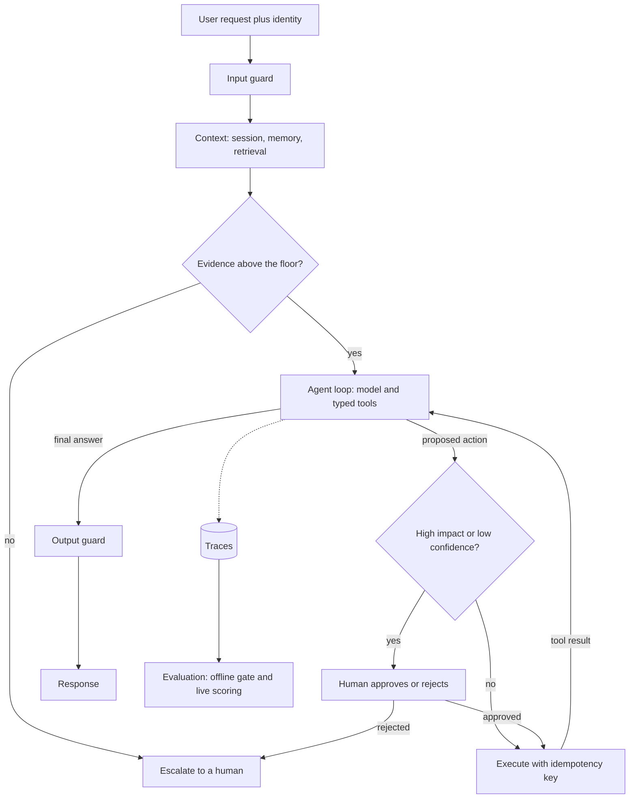
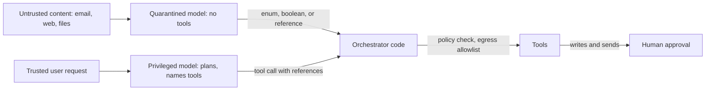
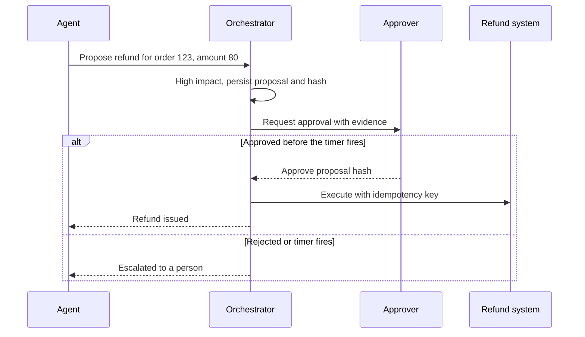

## TL;DR

- A demo agent works on the prompts its builder tried. A production agent has a measured failure rate on real traffic, a ceiling on the damage one failure can do, and a known cost per task.
- Each decision sits at a point on the request's path and contains one failure: guards, an evidence floor, a bounded loop of typed tools, and an approval gate.
- Build evaluation from the failures you cannot accept, and report $\text{pass}^k$, the chance that a task succeeds on all $k$ tries, next to the average.
- Untrusted content, private data, and a way to send data out must never meet in one path. Remove one leg by design, because detectors always miss some attacks.
- Start with one agent and a per-stage latency and cost budget. Add memory, agents, or bigger models when an evaluation shows the gain pays for the tokens.

## Why it matters

[AI systems: RAG and agents](./ai-systems-rag-and-agents.md) covers retrieval and the tool loop, which is enough for a demo. Production adds users who try to break the agent, the same task running thousands of times, tools that change real systems, and a bill for every model call. The failures are specific:

- **Inconsistency.** In the tau-bench study, gpt-4o completed about 61% of retail tasks on one try, but only about 25% of tasks succeeded on all of 8 tries.
- **Confident answers from weak evidence.** Retrieval returned something loosely related, and the model answered from it anyway.
- **Injection that becomes an action.** A retrieved email tells the agent to forward the user's files, and the agent has a tool that can.
- **Poisoned memory.** An injected "fact" saved to memory replays in every later session.
- **Cost blowups.** Anthropic measured its agents using about 4 times the tokens of a chat interaction, and its multi-agent system about 15 times.

## How it works

### Each decision sits on the request path

Follow one request through a production agent. Each stage is a decision, and each one contains a specific failure.

| Stage | Decision | Failure it contains |
| --- | --- | --- |
| Input guard | Screen user text, documents, and tool results for injected instructions | Prompt injection |
| Context | Admit memory and passages filtered by the caller's permissions | Poisoned memory, cross-user leaks |
| Evidence floor | Abstain or escalate when retrieval is weak | Confident answers from weak evidence |
| Agent loop | Typed, allowlisted tools with caps on steps, tokens, and time | Runaway loops, bad arguments |
| Action gate | Send high-impact actions to a human | Irreversible mistakes |
| Output guard | Check for leaked data, unsupported claims, and unknown links | Leaks through the response |
| Traces and evals | Score every change offline and sampled live traffic | Silent regressions |

Typed tools have schemas with enums, ranges, and required fields that your code validates before running anything. Bounded loops, idempotent tools, and least privilege are covered in [agents and tool calling](./ai-systems-rag-and-agents.md#agents-and-tool-calling). The rest of this section covers what that page leaves open.

### Evaluation starts from unacceptable failures

Start from what must never happen, in the product's own terms: a refund issued twice, one customer's order shown to another, a medication in a clinical note that the patient never mentioned. Zero-tolerance failures become release gates, and the rest get an allowed rate. Write cases that try to provoke each one, including documents that carry injected instructions.

Measure at three levels:

- **Component.** Retrieval recall at $k$, tool-selection accuracy, argument validity, and the guard's catch rate and false positives. These tell you where a failure came from.
- **End to end.** Judge the final state, not the path. The tau-bench benchmark compares the database after the conversation with an annotated goal state, and Anthropic's research team judges end state because agents often find valid paths nobody planned.
- **Live.** Trace every production request, score a sample, and have people read a slice. Anthropic found that human testers caught failures its automated evaluations missed.

Start small. Anthropic began with about 20 queries drawn from real usage, because early changes have large effects. Turn every escalation, complaint, and bad trace into a new case, and run the set as a gate on every change.

### Reliability across repeated tries

The tau-bench paper defines $\text{pass}^k$ as the probability that all $k$ independent tries at a task succeed, averaged over tasks. Run each task $n$ times, count the $c$ successes, and estimate it as:

$$
\text{pass}^k = \mathbb{E}_{\text{task}}\left[\frac{\binom{c}{k}}{\binom{n}{k}}\right]
$$

$\text{pass}^1$ is the ordinary success rate. Don't confuse it with $\text{pass@}k$, the chance that at least one try succeeds, which suits settings where a verifier picks the good attempt.

An illustrative case shows why the average is not enough. Two agents both score $\text{pass}^1 = 0.8$. Agent A succeeds on every task independently with probability 0.8, so $\text{pass}^8 = 0.8^8 \approx 0.17$. Agent B always solves the same 80% of tasks and always fails the rest, so $\text{pass}^8 = 0.8$. B's failures are a fixed set you can find, fix, or route to a human. A's are scattered.

Published agents look more like A. On tau-bench retail, gpt-4o fell from about 61% at $\text{pass}^1$ to about 25% at $\text{pass}^8$. The follow-up, tau2-bench, adds a telecom domain where the user also acts on the shared system, and gpt-4.1 scored 34% $\text{pass}^1$ there against 74% on retail. Variance comes from the free choices the model makes at each step, so the structural fix is fewer of them: narrower tools, fixed plans for known workflows, and plain code wherever no judgment is needed.

### Guardrails that break the lethal trifecta

Simon Willison's **lethal trifecta** is an agent with access to private data, exposure to untrusted content, and the ability to communicate externally. The model can't reliably tell your instructions from instructions hidden in a page, email, or tool result, so an attacker's text can direct it to send your data out.

Prompt-attack detectors catch most attacks, but as Willison puts it, in web application security 95% is a failing grade. Keep detectors, and wherever two legs meet, remove the third:

- **Cut the exit.** No outbound tools once untrusted content is in context, an egress allowlist, no rendering of model-written URLs, and approval on every send.
- **Cut the untrusted input.** The agent that holds private data and tools reads only trusted sources.
- **Cut the private data.** The agent that browses the web has no access to private stores or credentials.

When a task needs all three, split them across components. Beurer-Kellner et al. (2025) require that once an agent has ingested untrusted input, that input must not be able to trigger consequential actions. Three of their six patterns:

- **Plan-then-execute.** Fix the tool calls from the trusted request before reading untrusted data. Injected text can't add a call, but it can still change arguments, so constrain those too.
- **LLM map-reduce.** Process each untrusted document in an isolated call with no tools and a constrained output, such as a boolean, and aggregate in code.
- **Dual LLM.** A privileged model plans and calls tools but never reads untrusted text. A quarantined model reads it with no tools and returns symbolic references, which orchestrator code swaps for real values at the tool call.

Untrusted text never reaches the model that can act. CaMeL (Debenedetti et al., 2025) goes further. It derives the program's control and data flow from the trusted query and checks a policy at every tool call. It solved 77% of AgentDojo tasks with provable security, against 84% undefended, so security costs some capability. Treat retrieved documents, tool results, MCP tool descriptions, memory, and other agents' outputs as untrusted.

### Propose and dispose

The agent proposes, and a person or a fixed policy disposes. Read-only lookups run automatically. Reversible, low-impact writes, such as a note on a ticket, run with a log and an undo. Irreversible or high-impact actions, such as large refunds, outbound messages, or writes to a medical record, wait for approval. Escalation is the safe default when the agent is unsure, a guard fires, a tool keeps failing, or a budget runs out.

**Tune the abstention threshold on labeled data.** Pick a score computed for every request, such as the top reranker score or a judge model's groundedness score. Label a few hundred real requests as should-answer or should-escalate, sweep the threshold, and record **coverage**, the share handled without a human, and the **error rate among handled requests**. Raising the threshold lowers both, the same tug-of-war as precision against recall. An illustrative sweep:

| Threshold | Coverage | Errors among handled |
| --- | --- | --- |
| 0.3 | 92% | 7% |
| 0.5 | 80% | 3% |
| 0.7 | 61% | 0.8% |

At 10,000 requests a day, 0.5 sends 2,000 requests to people and gets about 240 of the 8,000 it handles wrong. At 0.7, 3,900 go to people and about 49 are wrong. Whether 191 fewer errors justify 1,900 more reviews is a business decision, and the sweep supplies the numbers. Re-run it after any change to the model, prompt, or index.

**Make approval a durable step.** An approver may answer in a minute or a day. Persist the proposed action, wait for an approval event, and escalate if a timer fires first. Bind the approval to the exact arguments, and execute with an [idempotency key](../03-patterns/idempotency-and-retries.md) so a retry can't refund twice. This is a [long-running task](../03-patterns/long-running-tasks.md) inside a [multi-step process](../03-patterns/multi-step-processes.md).

Track the approval rate too. Approvers who accept nearly everything have stopped reading.

### Memory tiers, and memory as untrusted input

- **Short-term.** The conversation in the context window. Keep recent turns verbatim and summarize older ones.
- **Working.** The plan, tool results, and approval status for the task in progress, in a durable store keyed by task so a crash or a long wait resumes instead of restarting.
- **Long-term.** Facts that outlive a session, such as preferences and past ticket summaries. Retrieve only the items relevant to this request.

Long-term memory is written from conversations that contain user text, documents, and tool results, so it is untrusted input with a long life. An instruction that lands in memory replays in every later session. Write structured facts against a schema instead of free text. Record each item's source and a time to live. Scope every item to one user or tenant and filter on every read. Never let memory grant authority, because permissions come from the [identity system](../02-building-blocks/identity-and-auth.md). Let users see and delete what is stored.

### When multi-agent pays for its tokens

Azure's architecture guidance says to use the lowest complexity that reliably meets the requirement, and calls a single agent with tools often the right default. Multiple agents help when work splits into independent parts. In Anthropic's research system, a Claude Opus 4 lead starts Claude Sonnet 4 subagents that each explore one direction in their own context window. It beat a single Opus 4 agent by 90.2% on Anthropic's internal research evaluation. The mechanism is mostly tokens. On BrowseComp, token usage alone explained 80% of the variance in performance, and the multi-agent system used about 15 times the tokens of chat, against about 4 times for a single agent.

So multi-agent pays when sub-questions are independent, a better answer is worth roughly $15/4 \approx 3.75$ times the tokens of one agent, and a measured single agent falls short. Anthropic calls it a poor fit when agents must share context or steps depend on each other, as in most coding. If you add agents, scale effort to the query, checkpoint long runs so one error doesn't force a restart, and recheck the trifecta per agent. A subagent that reads the web gets no write tools.

### Budgets per stage

Decide first which number the business feels. Interactive chat feels time to first token, a research job feels cost per completed task, and a regulated workflow feels auditability. Then budget each stage at the p95 and enforce it with timeouts. An illustrative budget for an interactive turn with a 6-second target:

| Stage | p95 budget | Main lever |
| --- | --- | --- |
| Input guard | 0.2 s | Run it in parallel with retrieval |
| Retrieval and rerank | 0.5 s | Rerank the top 50, not 500 |
| Model calls, up to 3 | 4 s | Prompt caching, a smaller model for routing steps |
| Tool calls | 1 s | Timeouts, parallel calls |
| Output guard | 0.3 s | Run independent checks in parallel |

Each loop step adds a model call, so the step cap is also the latency cap. Count cost per task over every call in the loop, including retries and guards, plus the human time escalations use:

$$
\text{cost per task} = \sum_{\text{calls}} \left( t_{\text{in}} \, p_{\text{in}} + t_{\text{out}} \, p_{\text{out}} \right) + r_{\text{esc}} \, c_{\text{human}}
$$

Here $t$ is tokens, $p$ is price per token, $r_{\text{esc}}$ is the escalation rate, and $c_{\text{human}}$ is the cost of one review. The second term ties cost to the abstention threshold. See [back-of-the-envelope estimation](../01-fundamentals/back-of-the-envelope.md).

**Prompt caching** matters most in loops, because each step resends the instructions, tool definitions, and history, and only the end changes. Put instructions and tool schemas first in a fixed order, keep history append-only, and place timestamps, user IDs, and retrieved passages after the shared prefix. A request ID near the top makes every request miss. [LLM serving and inference](./llm-serving-and-inference.md) explains prefix caching. Cap steps and tokens per task, and escalate when a cap trips.

## Trade-offs

| Decision | Choose the first when | Choose the second when |
| --- | --- | --- |
| Detectors only vs structural isolation | Untrusted content, private data, and an outbound channel never meet | They can meet, so isolate by design and keep detectors as a second layer |
| Run automatically vs human approval | The action is read-only or cheap to undo | The action is irreversible, costly, or regulated |
| Low vs high abstention threshold | Errors are cheap and reviewers are scarce | Errors are costly and reviewers are available |
| $\text{pass@}k$ vs $\text{pass}^k$ as the launch metric | A verifier picks the best of several attempts | Each run acts on its own, as in customer-facing agents |
| Single agent vs multi-agent | Steps depend on each other or the budget is tight | Sub-questions are independent and a better answer is worth several times the tokens |
| Short-term memory only vs long-term memory | Sessions are independent or the data is sensitive | Users return often and you can scope, expire, and audit what is stored |

A sound default: one agent with typed, allowlisted tools and a step cap; an evaluation set built from unacceptable failures, with $\text{pass}^k$ reported on every change; approval on every irreversible write; no path where all three trifecta legs meet; and a cache-friendly prompt layout from the start.

## On Azure

**Foundry Agent Service.** Hosts prompt agents, and hosted agents that run your code in a container with a dedicated Microsoft Entra identity. Grant that identity least-privilege roles. Microsoft Entra Agent ID governs agent identities across the organization. On the MCP tool, `allowed_tools` limits which tools the agent may call, and `require_approval` set to `always` pauses before each call.

**Guardrails.** Foundry guardrails for agents (preview) intervene at user input, tool call (preview), tool response (preview), and output, covering prompt attacks, indirect attacks, PII (preview), and task adherence (preview). **Prompt Shields** in Azure AI Content Safety detect user prompt attacks, on by default, and document attacks, off by default, so turn document detection on for any agent that reads retrieved content. Network egress controls for hosted agents (preview) allow outbound connections only to listed destinations, which cuts the exit leg at the network. Outside Agent Service, the API Management `llm-content-safety` policy screens prompts at the gateway. See [networking and security](../04-azure/networking-and-security.md) and [API gateway](../02-building-blocks/api-gateway.md).

**Evidence floor.** The semantic ranker's `@search.rerankerScore` in Azure AI Search runs from 0 to 4. Learn warns that its distribution varies slightly and can shift when the ranking model is updated, so keep the floor coarse and re-run the sweep after updates.

**Evaluation.** Foundry's agent evaluators cover system evaluation, such as Task Completion and Task Adherence (both preview), and process evaluation, such as Tool Call Accuracy and Tool Input Accuracy. Traces go through OpenTelemetry to Application Insights, continuous evaluation scores sampled production traffic, and the AI red teaming agent probes for attacks. The evaluators score single runs, so compute $\text{pass}^k$ yourself from $n$ runs per task. See [observability](../04-azure/observability.md).

**Approval and multi-agent.** Durable Functions and the Durable Task SDKs let an orchestration wait for an external event such as an approval. The wait is indefinite by default, so race it against a durable timer. Microsoft Agent Framework ships sequential, concurrent, handoff, group chat, and magentic orchestrations, and its approval-required tools pause a workflow for human review.

**Memory.** Memory in Foundry Agent Service (preview) keeps long-term user profile, chat summary, and procedural memories, with item-level create, read, update, and delete and a default time to live. Learn warns about prompt injection and memory corruption. Memory stores don't support virtual network integration, so a workload that needs private networking keeps memory in its own database. See [data choices](../04-azure/data-choices.md).

**Caching and budgets.** Prompt caching needs at least 1,024 tokens with an identical first 1,024, and one changed character there is a miss. The `cached_tokens` usage field shows hits. Reads are discounted on Standard deployments and up to 100% on Provisioned. In-memory caches clear after 5 to 10 minutes of inactivity, and extended retention keeps them up to 24 hours on supported models. On GPT-5.6 and later, cache writes can be billed. API Management's `llm-token-limit` and `llm-emit-token-metric` policies cap and measure tokens per consumer. See [cost optimization](../04-azure/cost-optimization.md).

**Gotcha.** Model router picks a model per request in Balanced, Cost, or Quality mode, but cached tokens help only when the same model handles consecutive requests. Routing between steps of one agent loop can erase the caching you budgeted, so check `cached_tokens` per step first. Also, Foundry's groundedness guardrail covers model deployments, not agents. For an agent, score groundedness with an evaluator or call groundedness detection (preview) on the draft answer.

## Interview tips

- Draw the request path and put each guard, floor, and gate on it, naming the failure each one contains.
- Open evaluation with what must never happen, then measure it per component, end to end, and live.
- Quote reliability as $\text{pass}^k$ next to the average.
- For prompt injection, name the three legs and the one your design removes. "We added a classifier" invites the question about what it misses.
- Give the abstention threshold a method: a labeled set, a sweep, a chosen error rate, and the coverage and reviewer count that follow.
- Propose multi-agent only after a single agent's measured shortfall, and state its token multiple.

## Further reading

- [The lethal trifecta for AI agents](https://simonwillison.net/2025/Jun/16/the-lethal-trifecta/) (Simon Willison, 2025)
- [Design Patterns for Securing LLM Agents against Prompt Injections](https://arxiv.org/abs/2506.08837) (Beurer-Kellner et al., 2025)
- [Defeating Prompt Injections by Design](https://arxiv.org/abs/2503.18813) (CaMeL, Debenedetti et al., 2025)
- [tau-bench](https://arxiv.org/abs/2406.12045) (Yao et al., 2024) and [tau2-bench](https://arxiv.org/abs/2506.07982) (Barres et al., 2025)
- [How we built our multi-agent research system](https://www.anthropic.com/research/multi-agent-research-system) (Anthropic)
- [Guardrails in Microsoft Foundry](https://learn.microsoft.com/azure/foundry/guardrails/guardrails-overview), [Prompt Shields](https://learn.microsoft.com/azure/ai-services/content-safety/concepts/jailbreak-detection), and [groundedness detection](https://learn.microsoft.com/azure/ai-services/content-safety/concepts/groundedness)
- [Foundry Agent Service](https://learn.microsoft.com/azure/foundry/agents/overview), [the MCP tool](https://learn.microsoft.com/azure/foundry/agents/how-to/tools/model-context-protocol), and [memory](https://learn.microsoft.com/azure/foundry/agents/concepts/what-is-memory)
- [Agent evaluators](https://learn.microsoft.com/azure/foundry/concepts/evaluation-evaluators/agent-evaluators) and [observability in generative AI](https://learn.microsoft.com/azure/foundry/concepts/observability)
- [Prompt caching](https://learn.microsoft.com/azure/foundry/openai/how-to/prompt-caching) and [model router](https://learn.microsoft.com/azure/foundry/openai/concepts/model-router)
- [AI gateway capabilities in API Management](https://learn.microsoft.com/azure/api-management/genai-gateway-capabilities)
- [External events in durable orchestrations](https://learn.microsoft.com/azure/durable-task/common/durable-task-external-events) and [Agent Framework orchestrations](https://learn.microsoft.com/agent-framework/workflows/orchestrations/)
- [AI agent orchestration patterns](https://learn.microsoft.com/azure/architecture/ai-ml/guide/ai-agent-design-patterns) (Azure Architecture Center)
- [Semantic ranking overview](https://learn.microsoft.com/azure/search/semantic-search-overview)
- [Precision vs. Recall vs. F1 Score vs. ROC-AUC](https://thecodinggopher.substack.com/p/precision-vs-recall-vs-f1-score-vs) (The Coding Gopher)
- *Cracking the AI System Design Interview*, Aishwarya Naresh Reganti and Kiriti Badam (LevelUp Labs, 2026), chapter 12. Recommended companion reading for this topic.
