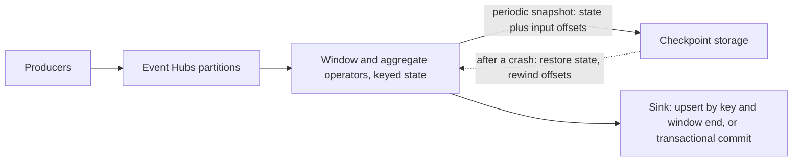

## TL;DR

- A stream processor runs a continuous query over an unbounded, partitioned log. The hard parts are time, state, and failure, not throughput.
- Group events by **event time** (when they happened), not processing time (when you saw them), or a delayed batch from a phone that was offline lands in the wrong window.
- A **watermark** is the processor's estimate that no older events remain. It decides when a window closes, trading latency against completeness. Events behind the watermark are late: drop them, adjust them, or emit a correction.
- "Exactly-once" means effectively once. Checkpoints make state updates happen once despite replays. Output is exactly once only with a transactional or idempotent sink.
- On Azure: Event Hubs is the log, Azure Stream Analytics is the managed SQL processor, and Apache Flink runs on AKS that you operate. HDInsight on AKS, the former managed Flink option, retired on January 31, 2025.

## Why it matters

Ad click counts, fraud scores, IoT alerts, and live dashboards all aggregate events as they arrive. Getting it wrong rarely crashes anything. It produces numbers that look right and are not:

- **Double counting.** A worker restarts, rereads from its last checkpoint, and writes the same aggregates again to a sink that appends.
- **Missing data.** A window closed before a burst of delayed events arrived, and they were dropped without an alert.
- **Wrong buckets.** Windows keyed on arrival time put an hour of buffered events into the minute they arrived.
- **Stalled output.** One idle partition holds back the watermark, and no window ever closes.

Billing and fraud decisions get made on these numbers, so the semantics matter as much as the scale. The [Hello Interview Flink deep dive](https://www.hellointerview.com/learn/system-design/deep-dives/flink) makes a useful counterpoint: many problems that seem to need stream processing can be reduced to batch processing.

## How it works

### The log underneath

The input is a partitioned, replayable log such as an event hub (see [event streaming](../02-building-blocks/event-streaming.md)). Order holds within a partition. Each processor instance owns some partitions and tracks an offset in each. Replay is what makes recovery possible: rewind the offsets and recompute.

### Event time and windows

Every event carries an event time, set by the producer, and an arrival time, set by the broker. Arrival time increases monotonically and is easy, but it measures your pipeline, not the world. Event time measures the world, but arrives out of order, and producer clocks [disagree](./time-clocks-and-ordering.md).

Windows group events by time:

| Window | Shape | Typical question |
| --- | --- | --- |
| Tumbling | Fixed size, no overlap, every event in exactly one window | Clicks per ad per minute |
| Hopping | Fixed size, advances by a smaller hop, so windows overlap | Five-minute average, updated every minute |
| Sliding | Emits whenever an event enters or leaves the window | Alert when more than N failures in any 10 minutes |
| Session | Grows while events keep arriving, closes after a gap of inactivity | Actions per user visit |

### Watermarks and late events

A processor cannot know whether an event from 12:00:59 is still in flight. A **watermark** at time *W* asserts that events older than *W* are no longer expected, so windows ending at or before *W* can emit. A common heuristic sets the watermark to the largest event time seen minus an out-of-order tolerance.

A larger tolerance captures more stragglers and delays every result by that much. A smaller one gives fresh results and more late events. For events behind the watermark, the choices are:

- **Drop** them, and count how many you drop.
- **Adjust** their timestamp into the current window, which keeps the count but skews the time.
- **Emit an update** for the closed window, which only works if the sink accepts upserts.

Watermarks are usually computed per partition, and the operator's watermark is the minimum across its inputs. One quiet partition therefore stalls everything, which is why processors also advance watermarks on wall-clock idleness.

### State and checkpoints

Windowed aggregates, joins, and deduplication all keep state, usually partitioned by key alongside the input. Apache Flink takes consistent snapshots with a variant of the Chandy-Lamport algorithm. Sources inject barriers into the stream. Each operator snapshots its state when the barrier reaches it, and the snapshot records the source offsets the state corresponds to. After a failure, the job restores the last complete snapshot and rewinds the sources to the recorded offsets.

### What exactly-once means

Checkpoint and replay make each event affect internal state exactly once. The output is a separate problem, because a crash between writing results and completing a checkpoint causes those results to be written again on replay. Two fixes:

- **Idempotent sink.** Give every output a deterministic key, such as `(ad_id, window_end)`, and upsert. Replays overwrite the same rows. This is the [idempotency pattern](../03-patterns/idempotency-and-retries.md) applied to a stream.
- **Transactional sink.** Write output inside a transaction that commits only when the checkpoint completes, a form of [two-phase commit](./distributed-transactions.md). Downstream readers see results only after each checkpoint, so latency rises to the checkpoint interval.

## Trade-offs

| Choice | Gains | Costs |
| --- | --- | --- |
| Event time over arrival time | Correct buckets despite delays | Watermarks, tolerances, late-event policy |
| Larger out-of-order tolerance | More complete windows | Every result arrives later |
| Shorter checkpoint interval | Faster recovery, lower transactional-sink latency | More snapshot I/O and overhead |
| Idempotent sink | Simple, low latency | Needs a natural key per output row |
| Transactional sink | Works with append-only consumers | Output latency equals checkpoint interval |
| Managed SQL processor | No cluster to run, built-in time policies | Fewer operators, less control over state |
| Self-run Flink | Full control of state, joins, and custom logic | You operate clusters, upgrades, and savepoints |

## On Azure

**Azure Event Hubs.** Order holds per partition, and delivery is at least once, so consumers must be idempotent. Partition limits are 32 per event hub on Basic and Standard, 100 per event hub on Premium (200 per processing unit across the namespace), and 1,024 on Dedicated. Partition count cannot change on Basic or Standard, so size it up front. Retention is 1 day on Basic, 7 days on Standard, and 90 days on Premium and Dedicated, and replay is possible only within it. The Kafka endpoint is available on Standard and above. Kafka transactions are in public preview on Premium and Dedicated.

**Azure Stream Analytics.** A managed job that runs SQL with tumbling, hopping, sliding, session, and snapshot windows.

- Without `TIMESTAMP BY`, it uses arrival time (`EventEnqueuedUtcTime` for Event Hubs). With it, it uses application time and generates a watermark per input partition: the largest event time seen minus the out-of-order tolerance.
- Events outside the late-arrival tolerance, which defaults to 5 seconds, are dropped or have their time adjusted, depending on your setting.
- `TIMESTAMP BY ... OVER deviceId` creates substreams, each with its own watermark, so one device with a bad clock does not hold back the rest.
- It guarantees exactly-once processing and at-least-once delivery. Delivery is exactly once to Cosmos DB, which it writes by upsert, and to Azure SQL when every output row has a natural key backed by a unique constraint.
- Workers checkpoint every few minutes. When a checkpoint cannot be used, the job replays input, so set input retention to at least the largest window in the query.

**Apache Flink.** HDInsight on AKS retired on January 31, 2025, and Microsoft directs those workloads to Microsoft Fabric or another Azure product. To keep Flink, run it on [AKS](../04-azure/compute-choices.md) with the open-source Flink Kubernetes Operator and connect to Event Hubs through its Kafka endpoint. Flink's exactly-once Kafka sink relies on Kafka transactions, which are still in preview on Event Hubs. A sound default is an idempotent sink such as Cosmos DB upserts.

**Azure Databricks Structured Streaming** offers micro-batch mode by default and a real-time mode for sub-second latency, with exactly-once guarantees to Delta Lake tables. **Microsoft Fabric Eventstreams** ingests from Event Hubs and transforms events without code. See [messaging choices](../04-azure/messaging-choices.md) for picking the log.

**Gotcha.** The 5-second default late-arrival tolerance in Stream Analytics is too small for devices that buffer offline or have drifting clocks. Their events get dropped or re-timed silently and the output looks plausible. Raise the tolerance, use substreams per device, and compare counts against a batch recount over the raw events.

## Interview tips

- For an ad click aggregator, state the full chain: Event Hubs partitioned by ad ID, one-minute tumbling windows on event time, a watermark with a stated tolerance, and an upsert keyed by `(ad_id, window_end)`. Add a periodic batch recount from raw storage to reconcile.
- Say "effectively once" and name what it depends on: replayable input, checkpointed state, and an idempotent or transactional sink.
- Ask how late events can be and what a wrong count costs. The answers set the tolerance and the late-event policy.
- Handle hot keys by pre-aggregating per partition, then combining, or by salting the key and summing the shards.
- Mention that partition count bounds parallelism and is hard to change, then size it from peak throughput.

## Further reading

- [Streaming 101: the world beyond batch](https://www.oreilly.com/radar/the-world-beyond-batch-streaming-101/), Tyler Akidau
- [Apache Flink stateful stream processing](https://nightlies.apache.org/flink/flink-docs-stable/docs/concepts/stateful-stream-processing/)
- [Apache Flink Kafka connector](https://nightlies.apache.org/flink/flink-docs-stable/docs/connectors/datastream/kafka/)
- [Flink Kubernetes Operator](https://nightlies.apache.org/flink/flink-kubernetes-operator-docs-stable/)
- [Azure Stream Analytics windowing functions](https://learn.microsoft.com/azure/stream-analytics/stream-analytics-window-functions)
- [Time handling in Azure Stream Analytics](https://learn.microsoft.com/azure/stream-analytics/stream-analytics-time-handling)
- [Azure Stream Analytics event delivery guarantees](https://learn.microsoft.com/stream-analytics-query/event-delivery-guarantees-azure-stream-analytics)
- [Checkpoint and replay in Azure Stream Analytics](https://learn.microsoft.com/azure/stream-analytics/stream-analytics-concepts-checkpoint-replay)
- [Azure Event Hubs quotas and limits](https://learn.microsoft.com/azure/event-hubs/event-hubs-quotas)
- [Apache Kafka protocol support in Azure Event Hubs](https://learn.microsoft.com/azure/event-hubs/azure-event-hubs-apache-kafka-overview)
- [Use Apache Flink with Azure Event Hubs for Apache Kafka](https://learn.microsoft.com/azure/event-hubs/event-hubs-kafka-flink-tutorial)
- [HDInsight on AKS overview and retirement notice](https://learn.microsoft.com/previous-versions/azure/hdinsight-aks/overview)
- [Azure Databricks Structured Streaming concepts](https://learn.microsoft.com/azure/databricks/structured-streaming/concepts)
- [Hello Interview, Ad Click Aggregator breakdown](https://www.hellointerview.com/learn/system-design/problem-breakdowns/ad-click-aggregator)
