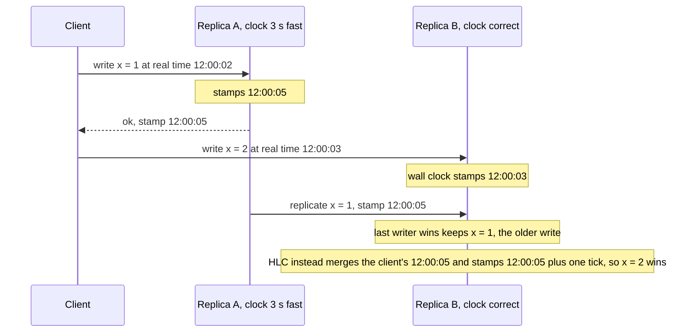

## TL;DR

- No two machines agree on the time. Wall clocks drift, jump when corrected, and stop while a VM is paused. Use them for display, expiry with slack, and log search, not to decide which of two writes on different machines came first.
- **Lamport clocks** give a total order that respects causality. **Vector clocks** also tell you when two events are concurrent, which is what conflict detection needs. **Hybrid logical clocks** (HLC) keep causality while staying close to wall time.
- **TrueTime**, from Google's Spanner paper, exposes clock uncertainty as an interval and waits it out before a commit becomes visible. That wait is the price of using clocks for correctness.
- The cheapest reliable order is a counter from one authority: a partition leader, a log offset, or a broker sequence number. Order inside one partition is cheap. Order across partitions costs coordination.

## Why it matters

Clock bugs rarely fail loudly. They corrupt data in ways that look like ordinary races:

- **Last-writer-wins drops the newer write.** Two replicas stamp writes with their local clocks. The replica whose clock runs fast wins every tie-break, even against a write that happened after it.
- **Two leaders at once.** A node holds a lease until 12:00:10 by its own clock. The VM pauses, resumes, and keeps writing after another node has taken the lease.
- **Negative durations.** A latency measured as the difference of two wall-clock reads goes negative when the time service steps the clock backward.
- **Effect before cause in traces.** Logs merged across services and sorted by timestamp show a response before its request.

[Consistency models](../01-fundamentals/consistency-and-cap.md) describe which orders a reader may observe. Clocks produce those orders.

## How it works

### Physical clocks

A server's clock counts oscillations of a quartz crystal, and the rate varies with temperature and age. A synchronization daemon such as `chronyd` or `ntpd` measures the offset to a reference server and corrects it, either by slewing (running slightly fast or slow until the gap closes) or by stepping (jumping). Network delay limits accuracy: the client cannot tell how much of a round trip was outbound and how much was return, so its offset estimate carries an error of up to half the round-trip time. Leap seconds add another discontinuity.

### Wall clock versus monotonic clock

Operating systems expose two clocks. The time-of-day clock (`CLOCK_REALTIME` on Linux) answers "what time is it" and can jump in either direction. The monotonic clock (`CLOCK_MONOTONIC`, Java's `System.nanoTime`, the monotonic reading inside Go's `time.Time`) only moves forward and is meaningless outside one machine's current boot. Measure durations and timeouts with the monotonic clock. Never compare monotonic readings from two machines.

### Happened-before and Lamport clocks

Lamport's 1978 paper defines **happened-before** ($\rightarrow$). Event $a \rightarrow b$ if they occur in that order on one process, if $a$ sends a message that $b$ receives, or by transitivity. Two events where neither happened before the other are **concurrent**.

A Lamport clock is one counter per process:

1. Increment the counter before each local event.
2. Attach the counter to every message sent.
3. On receive, set the counter to $\max(\text{local}, \text{received}) + 1$.

If $a \rightarrow b$, then $L(a) < L(b)$. The converse does not hold: a smaller number does not prove causality. Breaking ties by process ID yields a total order that every process agrees on.

### Vector clocks

A vector clock holds one counter per process. Each process increments its own entry on every event and merges incoming vectors by taking the element-wise maximum. Compare two vectors element by element. If every entry of $V(a)$ is less than or equal to $V(b)$, and at least one is smaller, then $a \rightarrow b$. If each vector has an entry larger than the other's, the events are concurrent, and a replicated store has found a genuine conflict to merge. Lamport clocks cannot tell you that.

The cost is size. The vector grows with the number of writers, so systems track **version vectors** per replica rather than per client. Dynamo-style stores hand concurrent siblings to the application to merge. [CRDTs](./crdts-and-local-first.md) make that merge automatic.

### Hybrid logical clocks

An HLC timestamp is a pair `(l, c)`. `l` tracks the largest physical time the node has seen, from its own clock or from any message. `c` is a counter that breaks ties when `l` does not advance. The send and receive rules mirror Lamport's, with `l` taking the max of local physical time and the incoming `l`. The result preserves happened-before, stays within the clock-skew bound of real time, and fits in a 64-bit field where a physical timestamp used to go. CockroachDB uses HLC timestamps for MVCC versions. The diagram shows the failure HLC prevents.

HLC fixes this case because the second write is causally after the first, and the client carried that causality to Replica B. HLC cannot order two truly concurrent writes by real time. Nothing can without bounded uncertainty.

### TrueTime and commit wait

The Spanner paper (OSDI 2012) treats clock error as data. `TT.now()` returns an interval `[earliest, latest]` that contains true time. GPS receivers and atomic clocks in each datacenter keep the interval's half-width in the low single-digit milliseconds. To commit, a leader picks timestamp `s = TT.now().latest`, then waits until `TT.now().earliest > s` before releasing locks and acknowledging. After that wait, every node in the system agrees that `s` is in the past. If transaction $T_1$ commits before $T_2$ starts, $T_1$'s timestamp is smaller. That property is **external consistency**, equivalent to linearizability for transactions.

Every write pays the commit wait, about twice the uncertainty. Clocks become a correctness tool only when the uncertainty is bounded and the system waits it out.

### Ordering without clocks

Most production systems avoid cross-machine timestamps entirely. One leader per partition assigns a monotonically increasing number: a Raft log index, a stream partition offset, a broker sequence number, a row version. Order holds within the partition, and you choose the partition key so that everything an invariant covers shares it. A **fencing token** applies the same idea to locks: the lock service hands out a strictly increasing number with each grant, and the protected resource rejects writes carrying a number lower than one it has seen. That works even when the client's clock lies. See [consensus](./consensus-raft-paxos.md) for where those leaders come from.

## Trade-offs

| Mechanism | Gives you | Costs | Use it for |
| --- | --- | --- | --- |
| Wall clock with chrony or NTP | Human-readable time, rough order | Skew, steps, pauses, no causality | Logs, TTLs, expiry with slack |
| Monotonic clock | Correct durations on one machine | Meaningless across machines and reboots | Timeouts, latency, local lease deadlines |
| Lamport clock | Total order consistent with causality | Cannot detect concurrency, unrelated to real time | Log ordering, deterministic tie-breaks |
| Vector or version vector | Detects concurrent writes | Grows with writers, needs a merge function | Multi-writer replication, conflict detection |
| Hybrid logical clock | Causality plus near-wall-clock time in 64 bits | Still assumes bounded skew, must reject peers too far ahead | MVCC timestamps in distributed SQL |
| Bounded uncertainty with commit wait | External consistency | Specialized time infrastructure, wait on every commit | Globally consistent transactions |
| Single sequencer per partition | Gap-free order, no clock involved | One leader's throughput and availability per partition | Logs, queues, per-entity history |

## On Azure

**VM time.** Azure hosts synchronize to Microsoft time servers that take their time from Microsoft-owned Stratum 1 devices with GPS antennas. Newer Linux images run `chronyd` against a `/dev/ptp` clock that exposes the host's time. During memory-preserving maintenance a VM can pause for up to 30 seconds, after which the VMICTimeSync service corrects the time-of-day clock. A process can lose 30 seconds without running any code, so lease holders must check a monotonic deadline before each protected write and still send a fencing token. The documentation gives no uncertainty bound your code can read, so treat VM clocks as approximate.

**Azure Cosmos DB.** Internally, Cosmos DB uses encoded vector clocks for causality and version vectors to detect conflicts between regions with multi-region writes. Resolution is your choice:

- **Last writer wins** is the default, keyed on the system `_ts` property. Both clients received a success response, and after replication only one version survives.
- **A custom numeric path**, API for NoSQL only, makes the highest value win. Store a version number or an HLC value you control. A delete always beats an insert or replace.
- **A custom merge stored procedure**, API for NoSQL only and set at container creation, runs your logic. Unresolved conflicts land in the conflicts feed.

Session consistency gives read-your-writes within one client session, or across clients that share the session token. Accounts with multiple write regions cannot use strong consistency.

**Azure Event Hubs.** Order holds only within a partition. Each event carries its offset, a sequence number, and a service-side enqueue timestamp. A partition key sends one stream's events to one partition, in arrival order. See [event streaming](../02-building-blocks/event-streaming.md).

**Azure Service Bus.** The broker stamps each accepted message with a gap-free, increasing 64-bit sequence number per queue or topic, or per partition for partitioned entities. The documentation recommends it over timestamps for ordering because timestamps lack resolution at high rates and suffer clock skew. The sequence number fixes queue order, not processing order. Processing order needs sessions.

**Gotcha.** Last writer wins on `_ts` across write regions orders by the time each region accepted the write, not by the order your users intended. Two edits to one document in different regions within the replication lag can lose the later one. When the order matters, write a version you control into a custom conflict path, or route all writes for an entity to one home region. See [multi-region active-active](./multi-region-active-active.md).

## Interview tips

- When a design says "sort by timestamp" across services, ask whose clock. Then offer a per-partition sequence number or a version column.
- Name the ordering you need. Per-entity order needs a partition key and a sequencer. Causal order needs vector clocks or HLC. Real-time order across the world needs bounded uncertainty or a single leader.
- For leases and distributed locks, pair a monotonic-clock deadline with a fencing token. A lease alone fails when the holder pauses.
- Use [idempotency keys](../03-patterns/idempotency-and-retries.md), not timestamps, to deduplicate retries. Two retries can share a millisecond, and two distinct requests can too.
- Explain commit wait in one sentence: wait until every clock agrees the commit timestamp has passed, which costs about twice the clock uncertainty per write.

## Further reading

- [Time, Clocks, and the Ordering of Events in a Distributed System](https://lamport.azurewebsites.net/pubs/time-clocks.pdf), Leslie Lamport
- [Logical Physical Clocks and Consistent Snapshots in Globally Distributed Databases](https://cse.buffalo.edu/tech-reports/2014-04.pdf), Kulkarni, Demirbas, and others
- [Spanner: Google's Globally-Distributed Database](https://www.usenix.org/conference/osdi12/technical-sessions/presentation/corbett), OSDI 2012
- [Time sync for Linux VMs in Azure](https://learn.microsoft.com/azure/virtual-machines/linux/time-sync)
- [Azure Cosmos DB conflict resolution policies](https://learn.microsoft.com/azure/cosmos-db/conflict-resolution-policies)
- [Azure Cosmos DB consistency levels](https://learn.microsoft.com/azure/cosmos-db/consistency-levels)
- [Azure Service Bus message sequencing and timestamps](https://learn.microsoft.com/azure/service-bus-messaging/message-sequencing)
- [Azure Event Hubs features and terminology](https://learn.microsoft.com/azure/event-hubs/event-hubs-features)
- [The Coding Gopher, What is a Unix timestamp](https://thecodinggopher.substack.com/p/what-is-a-unix-timestamp-understanding)
- [The Coding Gopher, Blind writes in distributed systems](https://thecodinggopher.substack.com/p/blind-writes-in-distributed-systems)
