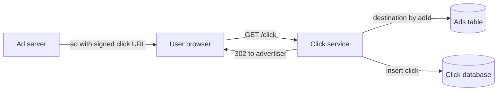
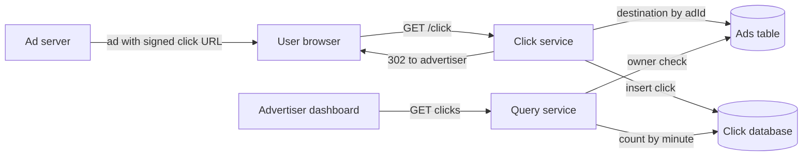
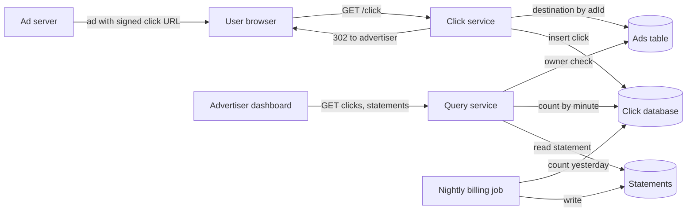
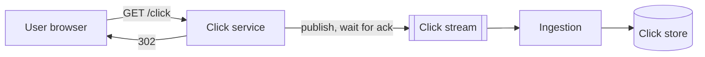
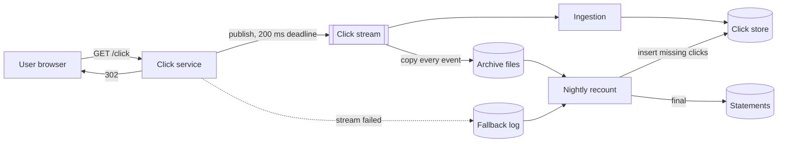
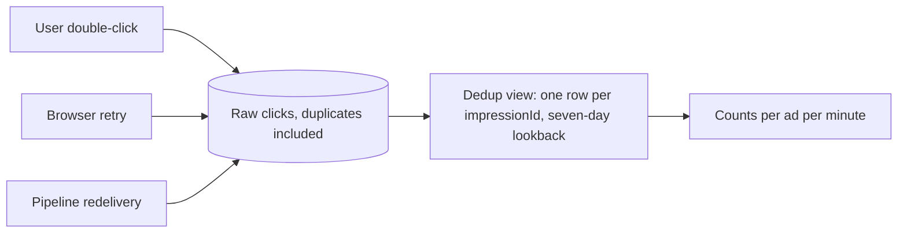
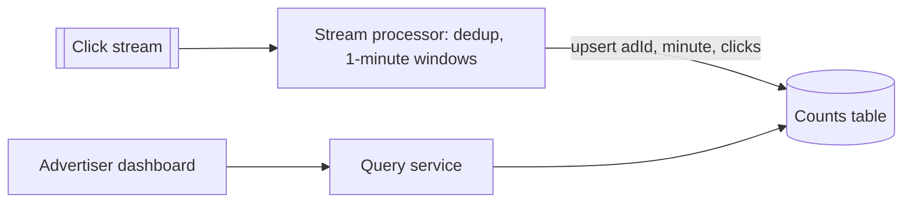
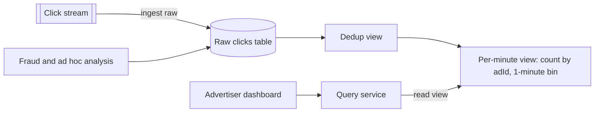
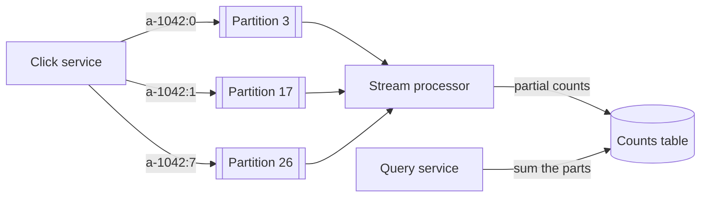
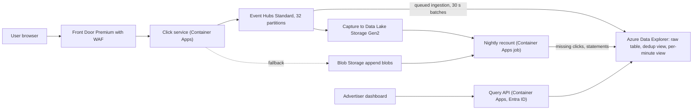

## Understanding the problem

**What is an ad click aggregator?** It is the service that sits between an ad and the advertiser's website. When a user clicks an ad, the click goes to our server first, which records it and sends the user on. Behind it, a pipeline turns raw clicks into counts per ad per minute, which advertisers watch on a dashboard and pay for at the end of the day.

Counting is easy until the counts become invoices. A click counted twice overcharges the advertiser, and a lost click is lost revenue. Duplicates come from everywhere, such as users who double-click, browsers that retry, and pipelines that redeliver after a crash. Meanwhile a user is waiting on every redirect, so none of that bookkeeping may slow them down.

## Functional requirements

1. Users should be able to click an ad and land on the advertiser's website.
2. Advertisers should be able to query click counts for their ads over a time range, at 1-minute granularity or coarser.
3. Advertisers should be able to get a daily statement of billable clicks per ad.

**Below the line (out of scope)**

- **Ad targeting and serving.** Another system decides which ad to show and hands us a click URL. Treat it as a black box.
- **Fraud scoring.** Signed links and rate limits are in. Models that flag bot traffic are a separate system reading the same raw clicks.
- **Conversion tracking.** What the user does on the advertiser's site needs the advertiser's own tag and a different pipeline.
- **Breakdowns by country or device.** Worth naming, because the design below can add them later without new infrastructure.

Users click, advertisers watch, and finance bills. The statement gets its own requirement because it has a stricter bar than the dashboard. A dashboard can run a minute behind, but an invoice has to be right.

## Non-functional requirements

1. **It counts each click exactly once.** Billing depends on it, so no click is lost and no duplicate is counted, whether the duplicate comes from the user, the browser, or the pipeline.
2. **It handles 10,000 clicks a second at peak** across 10 million active ads, including one ad going viral.
3. **Counts are fresh and fast.** A click shows up in queries within about two minutes, and a query returns in under a second.
4. **The redirect never waits on the pipeline.** The user lands on the advertiser's site quickly, even when everything behind the click service is down.

**Below the line**

- **A dashboard that always matches the statement.** The dashboard may lag or briefly undercount. The statement is final only after the nightly recount.
- **Sub-second freshness.** Nobody makes a decision on the last ten seconds of clicks.

Do the math, because it decides the architecture. Assume the peak is ten times the average, so the average is 1,000 clicks a second, about 86 million a day. Call it 100 million. At 500 bytes a click, that is 50 GB a day and about 18 TB a year, and the peak ingest is 5 MB/s. One ad's month at 1-minute granularity is at most 43,200 rows. Those numbers are modest. 100 million rows a day is small for a columnar store, so we can keep every raw click instead of counting in flight, which makes exact deduplication and new breakdowns easy. The [top-k leaderboard](./top-k-leaderboard.md), at 70 billion events a day, can't. See [back-of-the-envelope estimation](../01-fundamentals/back-of-the-envelope.md).

:::tip
Say the 5 MB/s out loud. Candidates who hear "ad clicks" and reach for a stream processor before doing the arithmetic miss that this scale lets them keep every raw event, and keeping them is what makes the rest of the design simple.
:::

## Core entities

- **Advertiser.** The customer who owns ads and pays for clicks.
- **Ad.** One creative with its destination URL, owned by one advertiser.
- **Impression.** One showing of an ad to one user, with an ID the ad server signs.
- **Click.** One click on an impression, recorded by our click service.

The impression is what makes exactly-once possible. A user who clicks the same ad twice clicks the same impression twice, so its ID is the natural key for deduplication. I'd hold off on fields until each entity has a store.

## API

The click endpoint is public and anonymous. The advertiser endpoints are REST behind a sign-in. See [API design](../01-fundamentals/api-design.md) for the conventions.

Requirement 1 is the link inside every ad. There is no token, because the user is anonymous. The ad server puts the impression ID, the ad ID, the time it showed the ad, and an HMAC signature over all three into the URL, so the click service can tell a real impression from a made-up one.

```http
GET /click?imp=i-7f3a9c41&ad=a-1042&t=1790812800&sig=Hk2vQ9
Host: clk.example

302 Found
Location: https://<placeholder>/spring-sale
```

The destination comes from the ad record, looked up by `ad`, never from the query string, so the endpoint can't be used as an open redirect.

Requirement 2 is the dashboard's query. The advertiser comes from the bearer token, and an ad that belongs to someone else returns `404`, as if it didn't exist.

```http
GET /v1/ads/a-1042/clicks?from=2026-10-01T00:00Z&to=2026-10-02T00:00Z&granularity=1m
Authorization: Bearer <token>

200 OK
{ "adId": "a-1042", "granularity": "1m", "points": [ { "t": "2026-10-01T00:00Z", "clicks": 37 }, { "t": "2026-10-01T00:01Z", "clicks": 41 } ] }
```

Requirement 3 returns one day's statement for the caller's ads. Until the nightly job has run for that day, the answer is built from live counts and marked `provisional`.

```http
GET /v1/statements/2026-10-01
Authorization: Bearer <token>

200 OK
{ "date": "2026-10-01", "status": "final", "ads": [ { "adId": "a-1042", "clicks": 51234 } ] }
```

## High-level design

### Data flow

1. The ad server shows an ad whose link carries a signed impression ID.
2. The user clicks, and the click service records the click and redirects the user to the advertiser.
3. Raw clicks are stored and turned into counts per ad per minute.
4. Advertisers query those counts from a dashboard.
5. Each night, a job counts the previous day and writes statements.

We'll build it one requirement at a time. Lost clicks, duplicates, query speed, and viral ads wait for the deep dives.

### 1) Users can click an ad and land on the advertiser's website



- **Ad server.** Out of scope. It shows the ad and builds the click URL.
- **Click service.** Stateless. It checks the signature, records the click, and redirects.
- **Ads table.** Each ad's advertiser and destination URL. The click service caches it in memory, since ads change rarely and every click needs one.
- **Click database.** One row per click.

1. When the ad server shows an ad, it generates a random impression ID and signs it together with the ad ID and the time.
2. The user clicks, and the browser sends `GET /click` to our service.
3. The click service checks the signature and the age. A bad signature or an impression more than a day old still gets redirected, because the user did nothing wrong, but the click isn't counted.
4. It looks up the destination by ad ID.
5. It inserts the click row.
6. It returns `302 Found` with the destination in `Location`.

The click row holds:

- `impressionId`, from the signed URL.
- `adId`, the ad that was clicked.
- `clickTime`, set by our server, because the browser's clock can't be trusted.
- `ipPrefix` and `userAgent`, kept for fraud review. Store only the network part of the IP address, not the whole address.

Why send the click through our server at all? The alternative links straight to the advertiser and fires a tracking beacon from JavaScript. Ad blockers drop the beacon, a page that unloads first loses it, and a user who copies the link skips it. Billing needs every click, and one extra hop to a nearby server costs a few milliseconds.

:::tip
Say 302, not 301. Browsers cache a 301, so the user's next click on that ad goes straight to the advertiser and never reaches you. The [URL shortener](./url-shortener.md) has the same trap.
:::

### 2) Advertisers can query click counts over a time range



- **Query service.** Checks who is asking and turns the request into a count over the click database.

1. The dashboard calls the clicks endpoint with the advertiser's token.
2. The query service reads the advertiser from the token and checks that the ad belongs to them.
3. It counts distinct impression IDs per minute for that ad over the range. Counting impressions instead of rows already drops a double-click.
4. For hourly or daily granularity, it groups by wider buckets.

This works on day one and fails at scale, because each query scans raw rows while 10,000 inserts a second land on the same table. Deep dive 3 fixes it.

### 3) Advertisers can get a daily statement



- **Nightly billing job.** Counts one day of clicks per ad and writes statements.
- **Statements.** One record per advertiser per day.

1. An hour after midnight UTC, once late inserts have landed, the job counts distinct impression IDs per ad for the previous day.
2. It writes one statement per advertiser with a count per ad and status `final`.
3. The query service serves statements to their owners, the same way it serves counts.

The statement record holds:

- `advertiserId` and `date`, its key.
- `ads`, the billable clicks per ad.
- `status`, `provisional` or `final`.

The job counts from the same database the dashboard reads, so a click that never made it there is missing from both. Deep dive 1 gives the job an independent copy to check against.

## Deep dives

The design works end to end at low volume. Now make it hold up against each non-functional requirement.

### 1) How do we record every click without slowing the redirect?

This serves requirements 1 and 4. The click is money, so it has to survive, but the user is waiting, so recording it can't take long.

#### Bad solution: Insert into the database before redirecting

**Approach.** Keep the high-level design. The click service inserts the row, waits for the commit, and then returns the 302.

**Challenges.** The redirect is now as slow as the database's slowest write. At 10,000 inserts a second plus index upkeep, one database falls behind at peak, which is exactly when a campaign launches, and every user waits. When the database is down, the service must either hold the user or drop the click, and neither is acceptable.

#### Good solution: Publish to a durable stream, then redirect

**Approach.** Put a durable, replicated log between the click service and storage. The click service publishes the click, waits for the stream to acknowledge it, which takes a few milliseconds, and redirects. Consumers write to storage at their own pace. The stream keeps events for days, so a consumer that falls behind or breaks can replay, and a burst at peak becomes a backlog instead of a timeout. See [event streaming](../02-building-blocks/event-streaming.md).



**Challenges.** The stream is now in the redirect path. A slow or unavailable stream brings back the same choice, hold the user or drop the click, only less often. And the stream protects a click only up to the ack. A bad deploy of the ingestion step, a broken field mapping, or a dropped batch loses clicks after it, and nothing notices.

#### Great solution: Publish with a deadline, fall back, and recount nightly

**Approach.** Keep the stream and add three things.

1. Give the publish a deadline. The click service retries for at most about 200 ms. If the stream still hasn't acknowledged, it appends the click to a fallback log in separate blob storage and redirects anyway. The user always lands, and the click is written somewhere durable.
2. Archive the stream. The stream also copies every event to cheap files, partitioned by time, without going through the ingestion step.
3. Recount every night. The billing job now counts distinct impression IDs per ad per hour from the archive plus the fallback log, and compares with the click store. For each hour that differs, it inserts the clicks whose impression IDs are missing from the store, and only then writes final statements.

Inserting only missing IDs means the recount can never add a duplicate, which deep dive 2 depends on.



**Challenges.** Clicks in the fallback log reach the dashboard only after the nightly job, so during a stream outage the dashboard undercounts for hours. If blob storage fails at the same moment as the stream, the click is lost, a risk you accept because the two are independent services. The archive adds about 18 TB a year, and the recount is one more job to watch. A final statement now waits for it too, so finance sees yesterday's number in the morning.

In a 45-minute interview I'd draw the stream with the deadline and the fallback, then give the nightly recount two sentences, because "what if the stream is down?" is the follow-up every interviewer asks.

### 2) How do we count each click exactly once?

This serves requirement 1. Duplicates enter at three points. A user double-clicks, a browser or proxy retries the request, and the pipeline redelivers events after a consumer crashes.

:::warning
Deduplication is only as good as its key. If impression IDs weren't signed, a bot could mint a fresh ID for every request and each fake click would be unique. The signature and the one-day age limit are what make the impression ID safe to dedupe on.
:::

#### Bad solution: Check a cache in the click service

**Approach.** Before publishing, the click service runs set-if-absent on the impression ID in a shared cache, with a one-day expiry. If the key already existed, it skips the publish and redirects.

**Challenges.** It catches double-clicks and nothing that happens after it, such as redelivery in the pipeline. Worse, it can lose clicks. If the service sets the key and then crashes or fails to publish, the browser's retry finds the key and is skipped, so a click that never reached the stream is treated as counted. A cache failover that forgets keys lets duplicates back through.

#### Good solution: Keyed state in a stream processor

**Approach.** Add a stream processor between the stream and the store. It keeps every impression ID seen in the last day as state keyed by that ID, and drops repeats before counting. A day at the average rate is under 100 million keys, small state for a processor. It checkpoints its state together with its read position, so after a crash it resumes from a consistent point. See [stream processing](../05-advanced/stream-processing.md).

**Challenges.** The checkpoint makes the processor's state exactly once, not its output. After a restart it re-emits results since the last checkpoint, so the sink must upsert by key or the counts double. Clicks the recount inserts and clicks from the fallback log skip the processor unless you route them back through it. And you now run stateful jobs, with checkpoints, upgrades, and state migrations.

#### Great solution: Deduplicate in the analytics store, at the last hop

**Approach.** Write raw clicks, duplicates and all, into the analytics store and deduplicate there. A deduplication view keeps one row per impression ID, and every count reads that view, never the raw table. Because it is the last hop, it catches duplicates from every source, including a click whose publish timed out after the stream had already taken it, so it also landed in the fallback log. Tell the view that duplicates arrive within seven days of each other, matching the stream's retention, so it compares new rows against a week of data instead of all history. The one-day age limit on impressions is too short for this. It bounds when the click service accepts a click, but a consumer that falls behind or replays can redeliver that click for as long as the stream keeps it. See [idempotency and retries](../03-patterns/idempotency-and-retries.md).



**Challenges.** It needs a store that maintains deduplication incrementally, which narrows the choice of store. The raw table holds duplicates, so anything that reads it directly, such as a fraud model, must dedupe on its own. And the seven-day lookback is a promise every writer must keep. The stream can't redeliver anything older, but any other writer that adds a duplicate more than seven days after the original counts it twice, which is why the recount inserts only missing IDs and never replays whole hours.

In a 45-minute interview I'd name the three sources of duplicates first, then put deduplication at the last hop and say why that spot catches all three. The cache check is worth one sentence about the click it can lose.

### 3) How do advertisers get sub-second queries on fresh counts?

This serves requirement 3. A popular ad at 1,000 clicks a second piles up 2.6 billion rows in a month, and its advertiser wants that month on one chart in under a second.

#### Bad solution: Count raw rows at query time

**Approach.** Keep the high-level design. Each query counts distinct impression IDs per minute over the raw click rows for one ad and range.

**Challenges.** A month for that popular ad reads 2.6 billion rows from a row store built for inserts, while 10,000 inserts a second compete for the same disks. Counting distinct values needs memory that grows with the number of impressions. The query takes minutes, and a crowd of advertisers refreshing dashboards slows the inserts too.

#### Good solution: Count in the stream with 1-minute windows

**Approach.** Extend the stream processor from deep dive 2. After deduplicating, it groups clicks into 1-minute tumbling windows per ad and upserts one row per ad per minute into a table the query service reads. A month is at most 43,200 rows per ad, read by key in milliseconds. Hourly and daily views are sums over those rows.



**Challenges.** Raw clicks never reach a queryable store, so a new breakdown, such as clicks by country, needs a new job and starts with no history. A click arriving after its window closes needs a lateness rule or a correction path. And the processor now holds window state on top of dedup state, all in the stateful job from deep dive 2.

#### Great solution: Raw clicks in a columnar store with incremental views

**Approach.** Ingest raw clicks from the stream straight into a columnar analytics store, and let the store maintain the aggregates. On top of the dedup view from deep dive 2, define a second view that counts clicks per ad per 1-minute bin. The store updates it as rows arrive, so a query reads at most 43,200 precomputed rows per ad per month instead of billions of raw ones. A columnar store reads only the columns a query names and compresses them well, so 18 TB a year of raw clicks stays affordable. A new breakdown is one more view over the same raw table, with history from day one.



**Challenges.** Freshness now depends on how often the store folds new rows into its views, which on Azure is why requirement 3 says two minutes. You store every click, 50 GB a day, where the windowed design stored a few rows per ad. And it holds only at this scale. At tens of billions of clicks a day, keeping and deduplicating raw rows gets expensive, and you count in the stream as the [top-k leaderboard](./top-k-leaderboard.md) does.

In a 45-minute interview I'd show the arithmetic that justifies keeping raw clicks, then draw the two views. The windowed stream is the answer interviewers expect, so say why this scale lets you skip it.

### 4) What happens when one ad goes viral?

This serves requirement 2. A stream is split into partitions, and each partition has a throughput ceiling, about 1 MB/s of ingress on Event Hubs Standard. One ad drawing 5,000 clicks a second is 2.5 MB/s on its own.

#### Bad solution: Partition by ad ID

**Approach.** Publish each click with the ad ID as its partition key, so all of an ad's clicks land in one partition, in order. A stream processor counting per ad then finds each ad's clicks in one place.

**Challenges.** The viral ad pushes 2.5 MB/s into a partition that takes about 1 MB/s. The partition throttles, publishes miss the 200 ms deadline, and clicks spill into the fallback log, which the dashboard won't show until morning. Every other ad that hashed to that partition slows down with it.

#### Good solution: Salt the hot keys

**Approach.** Keep the ad ID as the key, but for ads above a threshold, append a suffix from 0 to 7 taken from a hash of the impression ID, such as `a-1042:3`. The hot ad's clicks spread over up to eight partitions, and every copy of one impression still lands in the same one. The processor counts each salted key separately, and the query service sums the parts. See [sharding and partitioning](../02-building-blocks/sharding-and-partitioning.md).



**Challenges.** Something has to decide which ads are hot, and an ad goes viral faster than a daily list updates. Each query on a salted ad reads eight rows per minute, and every reader has to know to sum them.

#### Great solution: Don't key by ad at all

**Approach.** With the design from deep dive 3, nothing downstream needs an ad's clicks in one partition. The store deduplicates by impression ID and counts by ad across all of its rows, wherever they came from. So publish with no partition key and let the stream spread events evenly. A viral ad becomes part of the 5 MB/s peak the stream is already sized for, spread over every partition like any other traffic.

**Challenges.** It works only because grouping happens in the store. If you later move counting into a stream processor, you need keys back, because with no key one impression's duplicates land in different partitions. You also give up per-ad ordering in the stream, which this design never used.

In a 45-minute interview I'd explain salting when the interviewer raises the viral ad, then point out that this design doesn't need it. Knowing why the problem disappears scores higher than solving it.

## On Azure

Front Door and a click service on Container Apps take the clicks, Event Hubs carries them, Azure Data Explorer stores and counts them, and Event Hubs Capture keeps the archive for the nightly recount.



| Component | Azure service | Tier or setting, and why |
| --- | --- | --- |
| Edge | Azure Front Door | Premium, for the WAF's Microsoft-managed rules and bot protection, plus a rate limit rule on `/click`. |
| Click service | Azure Container Apps | Scales on HTTP concurrency across zones. Ads cached in memory by `adId`. Publishes with no partition key. |
| Click stream | Azure Event Hubs | Standard, 10 throughput units (TUs) with auto-inflate on, 32 partitions, 7-day retention. |
| Archive | Event Hubs Capture to Data Lake Storage Gen2 | Avro files per time window, ZRS. |
| Fallback log | Azure Blob Storage | Append blobs in a separate ZRS account. |
| Analytics store | Azure Data Explorer | Queued ingestion from Event Hubs into a `Clicks` table, with the table's batching time cut to 30 seconds. `ClicksDedup` view with `take_any(*)` by `impressionId` and a 7-day lookback, matching the stream's retention. `ClicksPerMinute` view with `count()` by `adId` and `bin(clickTime, 1m)` on top of it. A `Statements` table. |
| Query API | Azure Container Apps | Microsoft Entra ID sign-in. Maps the caller to an advertiser ID and adds it to every query. |
| Nightly recount | Azure Container Apps jobs | Schedule trigger with a cron expression. Reads Capture files and fallback blobs, inserts missing clicks, writes statements. |

### Why these choices

- **Event Hubs Standard, sized by event count.** A throughput unit admits 1 MB/s or 1,000 events a second, whichever comes first, and a namespace can have up to 40 ([scalability](https://learn.microsoft.com/azure/event-hubs/event-hubs-scalability)). The 10,000-click peak is only 5 MB/s, so at one click per event the event count binds first, and 10 TUs run at 100% at peak. Above that, ingress is throttled with a `ServiceBusy` error, so turn on auto-inflate, which adds TUs as load grows. Standard allows 32 partitions and 7 days of retention ([quotas](https://learn.microsoft.com/azure/event-hubs/event-hubs-quotas)), and its partition count can't change after creation, so create the event hub with all 32.
- **Capture for the archive.** Capture writes events to storage as Avro files, closing each file when a size or time window fills, whichever comes first. It runs on Standard, Premium, and Dedicated, not Basic, and it reads Event Hubs' own storage without using the egress the TUs allow ([Capture](https://learn.microsoft.com/azure/event-hubs/event-hubs-capture-overview)). So the archive doesn't compete with Data Explorer for egress, and it doesn't depend on the data connection the recount is checking.
- **Azure Data Explorer with two views.** Data Explorer is a columnar engine built for fast queries over large volumes of event data ([overview](https://learn.microsoft.com/azure/data-explorer/data-explorer-overview)), and it ingests from Event Hubs directly, so there is no stream job to run ([Event Hubs ingestion](https://learn.microsoft.com/azure/data-explorer/ingest-data-event-hub-overview)). A materialized view can sit on another view only when the first is a `take_any(*)` deduplication view, which is the shape deep dive 2 needs ([materialized views](https://learn.microsoft.com/kusto/management/materialized-views/materialized-view-overview)). A lookback tells that view how far apart duplicates can arrive, which makes deduplication much cheaper ([create materialized view](https://learn.microsoft.com/kusto/management/materialized-views/materialized-view-create)). Query the per-minute view with `materialized_view()`, which reads only the materialized part, because querying a whole view built on another view performs poorly.
- **Front Door Premium.** Custom WAF rules, rate limits included, work on Standard, but Microsoft-managed rule sets and bot protection need Premium ([tier comparison](https://learn.microsoft.com/azure/frontdoor/standard-premium/tier-comparison)). A rate limit rule counts each socket IP separately by default, which may be a proxy in front of many users, so set the threshold with an office behind one address in mind ([rate limiting](https://learn.microsoft.com/azure/web-application-firewall/afds/waf-front-door-rate-limit)).
- **Stream Analytics as the plan for growth.** If volume outgrows raw ingestion, a Stream Analytics job with 1-minute tumbling windows takes over counting. It guarantees exactly-once processing but at-least-once delivery, so write to Azure Cosmos DB, which it upserts, or to Azure SQL with a unique key on ad and minute ([event delivery guarantees](https://learn.microsoft.com/stream-analytics-query/event-delivery-guarantees-azure-stream-analytics)).

### Zones and regions

In regions with availability zones, Event Hubs turns on zone redundancy automatically in every tier ([Event Hubs reliability](https://learn.microsoft.com/azure/reliability/reliability-event-hubs)). Run the click service, the query API, and Data Explorer across zones, and use ZRS for the archive and the fallback account.

For a regional outage, run the click service, a second Event Hubs namespace, and a second Data Explorer cluster in another region. Data Explorer doesn't support Event Hubs geo-disaster recovery alias namespaces, so create two data connections, one for the primary namespace and one for the secondary, and have the click service publish to the secondary when the primary fails ([Event Hubs ingestion](https://learn.microsoft.com/azure/data-explorer/ingest-data-event-hub-overview)). A click published to both during the switch is harmless, because the dedup view keys on impression ID.

### Gotcha

Data Explorer's queued ingestion seals a batch at 5 minutes, 500 items, or 1 GB by default, whichever comes first ([batching policy](https://learn.microsoft.com/kusto/management/batching-policy)). Left on the defaults, the dashboard runs minutes behind and breaks requirement 3 on day one. Set the `Clicks` table's batching time to 30 seconds, the top of the low-latency range Learn lists, and no lower, because tiny batches cost more and can raise end-to-end latency.

Streaming ingestion looks like the better fix, since it targets latency under a second. But Learn suggests queued ingestion once one table takes more than 4 GB an hour, and `Clicks` takes 18 GB an hour at peak. Streaming also lets the cursor that materialized views follow lag the data by up to 60 seconds ([streaming ingestion](https://learn.microsoft.com/azure/data-explorer/ingest-data-streaming)). Either way the views add their own delay on top, so promise advertisers about two minutes and load-test that number end to end.

See [data choices](../04-azure/data-choices.md), [messaging choices](../04-azure/messaging-choices.md), and [regions, zones, and resiliency](../04-azure/regions-zones-and-resiliency.md).

## What is expected at each level

### Mid-level

I expect you to route the click through your server with a 302 and look up the destination by ad ID, then get raw clicks into a store advertisers can query. You know a double-click shouldn't count twice, even if your first answer is a cache check. I'd lead you to the stream and to precomputed counts, and a design that counts at query time and moves to windows once I point at 2.6 billion rows is fine here. Signing the impression ID is a plus.

### Senior

You do the arithmetic early and use 5 MB/s and 100 million rows a day to argue for keeping raw clicks. You put a durable stream behind the redirect and answer "what if the stream is down?" with a deadline and a fallback, not a stuck user. You name the three sources of duplicates, place deduplication where it catches all of them, and explain why the impression ID must be signed. You can describe salting for a viral ad and say why this design doesn't need it.

### Staff+

You treat the counts as invoices. You separate the dashboard's freshness from the statement's correctness and add a nightly recount from an independent archive before I ask. You see that the cache check can lose clicks, that a processor's checkpoint makes its state exactly once but not its output, and that the recount must insert missing clicks rather than replay hours or the lookback lets duplicates through. And you check the plan against the platform, such as event count binding before bytes on Event Hubs, batching defaults that would leave the dashboard minutes late, and the ingestion choice behind the two-minute promise.

## Further reading

- [Hello Interview: Design an ad click aggregator](https://www.hellointerview.com/learn/system-design/problem-breakdowns/ad-click-aggregator)
- [The Coding Gopher: UUIDs explained](https://thecodinggopher.substack.com/p/uuids-explained)
- [The Coding Gopher: ETL explained](https://thecodinggopher.substack.com/p/etl-explained)
- [Azure Data Explorer ingestion from Event Hubs](https://learn.microsoft.com/azure/data-explorer/ingest-data-event-hub-overview)
- [Event Hubs Capture](https://learn.microsoft.com/azure/event-hubs/event-hubs-capture-overview)
- [Materialized views in Azure Data Explorer](https://learn.microsoft.com/kusto/management/materialized-views/materialized-view-overview)
- [Event streaming](../02-building-blocks/event-streaming.md), [event-driven architecture, CQRS, and event sourcing](../03-patterns/event-driven-cqrs-event-sourcing.md), [scaling writes](../03-patterns/scaling-writes.md)
