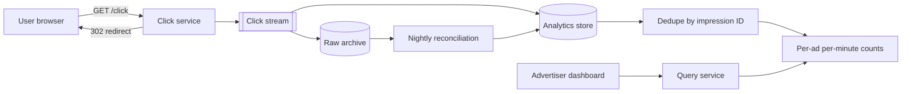
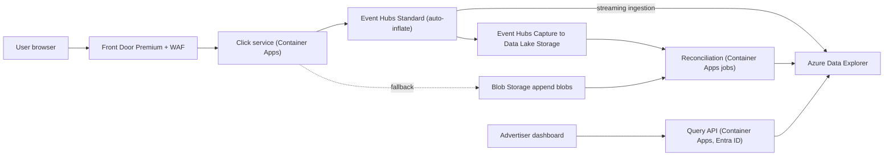

## TL;DR

The click goes to your server first: it verifies a signed impression ID, publishes a click event to a durable stream, and answers with a 302 redirect to the advertiser. The stream feeds an analytics store that deduplicates by impression ID and maintains per-ad, per-minute counts that advertisers query directly. At 10,000 clicks per second there is no need to pre-aggregate in a stream processor; storing raw clicks keeps deduplication exact and leaves room for new breakdowns later. A copy of every event goes to cheap storage for a nightly reconciliation job that catches anything the real-time path lost. On Azure: Front Door with WAF, a click service on Container Apps, Event Hubs Standard with Capture, Azure Data Explorer with streaming ingestion and materialized views, and Data Lake Storage for the reconciliation copy.

## Requirements

### Functional

- A user clicks an ad and is redirected to the advertiser's site.
- Advertisers query click counts for their ads over a time range, at 1-minute granularity or coarser.

Out of scope: ad targeting and serving, fraud scoring beyond basic checks, conversion tracking, and demographic breakdowns.

### Non-functional

- Peak 10,000 clicks per second across 10 M active ads.
- Each click counted once, even if the user double-clicks or the system retries.
- No lost clicks: billing depends on these numbers.
- Advertiser queries return in under a second; data is queryable within about a minute of the click.
- The redirect adds as little latency as possible.

## Capacity estimates

Assumptions: average rate one tenth of peak, 500-byte click events.

| Quantity | Arithmetic | Result |
| --- | --- | --- |
| Average click rate | 10,000 ÷ 10 | 1,000 clicks/s |
| Clicks per day | 1,000 × 86,400 s | about 86 M, call it 100 M |
| Ingest bandwidth at peak | 10,000 × 500 B | 5 MB/s |
| Raw storage per day | 100 M × 500 B | about 50 GB |
| Raw storage per year | 50 GB × 365 | about 18 TB |
| Per-minute rows, upper bound | at most one row per click | 100 M per day, usually far fewer |
| Rows for one ad over 30 days at 1-minute granularity | 30 × 1,440 | 43,200 |

The numbers are modest. 5 MB/s fits in a handful of stream throughput units, and 100 M rows a day is small for a columnar analytics store. That changes the design compared with [top-k](./top-k-leaderboard.md): you can keep every raw click, which makes exact deduplication and later drill-downs easy.

## Core entities and API

### Entities

- **Impression**: created by the ad server when an ad is shown. `impressionId`, `adId`, `shownAt`, plus an HMAC signature over those fields.
- **Click**: `impressionId`, `adId`, `clickTime`, `userAgent`, `ipPrefix`.
- **ClicksPerMinute**: `adId`, `minute`, `clicks`.

### API

```text
GET /click?imp={impressionId}&ad={adId}&sig={signature}
  -> 302 Location: https://advertiser.example/landing

GET /ads/{adId}/clicks?from=2026-10-01T00:00Z&to=2026-10-02T00:00Z&granularity=1m|1h|1d
  -> 200 { adId, granularity, points: [{ t, clicks }] }
```

The click endpoint takes no advertiser URL from the client. It looks up the destination by `adId`, so it cannot be abused as an open redirect.

## High-level design



1. The ad server signs an impression ID into each ad's click URL.
2. On click, the click service verifies the signature, looks up the destination, publishes the click, and returns a 302.
3. The analytics store ingests raw clicks from the stream, deduplicates by impression ID, and keeps per-minute counts per ad.
4. A second consumer writes the same stream to cheap storage. A nightly job recounts from there and repairs any gaps.
5. Advertisers query counts through a query service that enforces they only see their own ads.

## Deep dives

### 1. Redirect and tracking

| Option | How it works | Trade-off |
| --- | --- | --- |
| Client-side redirect plus a tracking beacon | The link points at the advertiser; JavaScript fires a beacon on click | No added latency, but beacons get blocked or lost when the page unloads, and users can copy the link and skip tracking entirely. |
| Server-side redirect | The link points at the click service, which records the click and returns a 302 | Adds one round trip, but every click passes through you. |

**Pick: server-side redirect.** Billing needs every click, and the extra hop is a few milliseconds at an edge close to the user. Use 302, not 301: a browser caches a 301 and would skip your server on the next click, the same trap as in the [URL shortener](./url-shortener.md).

Publish before redirecting, with a short retry budget (about 200 ms). If publishing still fails, redirect anyway and append the click to a fallback blob that reconciliation reads. The user always lands, and the click is not lost.

### 2. Counting each click once

Duplicates come from users double-clicking, browsers retrying, and the pipeline itself redelivering after a failure.

| Option | Where it runs | Trade-off |
| --- | --- | --- |
| Check-and-set in a cache at the click service | `SET imp:{id} NX EX 86400` before publishing | Stops duplicates early, but a cache failover can forget keys, and pipeline retries after this point are not covered. |
| Keyed state in a stream processor | Dedupe by impression ID in the aggregation job | Covers pipeline retries, but you operate the state and its expiry. |
| Deduplicate in the analytics store | Keep one row per impression ID, then count | Covers every duplicate source in one place; needs a store that does this efficiently. |

**Pick: deduplicate in the analytics store,** because it is the last hop and therefore catches duplicates from every earlier one. The signed impression ID matters as much as the dedupe: without the signature, a bot could mint new IDs and every fake click would be "unique." See [idempotency and retries](../03-patterns/idempotency-and-retries.md).

### 3. Aggregation: stream processor or analytics store

| Option | How it works | Trade-off |
| --- | --- | --- |
| Stream processor with 1-minute tumbling windows writing counts | Count per ad per minute in the stream, write only aggregates | Small output, but raw clicks are gone; a new breakdown (by country) means a new job and no history. |
| Ingest raw clicks into a columnar store with incremental aggregates | Store every click; the store maintains per-minute counts as data arrives | More storage, but exact dedupe, any future breakdown, and one system to query. |

**Pick: raw clicks in the analytics store** at this scale. The arithmetic decides it: 100 M rows a day is cheap to keep. At 70 B events a day, as in [top-k](./top-k-leaderboard.md), you pre-aggregate in the stream instead. See [stream processing](../05-advanced/stream-processing.md).

### 4. Hot ads and partitioning

If the stream is partitioned by `adId`, a viral ad sends all its clicks to one partition. With a stream processor counting per ad, you would split hot keys by appending a suffix (`adId:0` to `adId:7`) and sum the parts later. Here the analytics store aggregates, so the stream needs no per-ad ordering: send events without a partition key and let the stream spread them evenly. See [sharding and partitioning](../02-building-blocks/sharding-and-partitioning.md).

### 5. Reconciliation

Real-time pipelines lose data in rare, hard-to-see ways: a misconfigured ingestion mapping, a dropped batch, a bug in a deploy. Every night, a batch job recounts distinct impression IDs per ad per hour from the raw archive and from the fallback blobs, compares with the analytics store, and re-ingests any hour that differs. Advertiser invoices use reconciled numbers.

## On Azure



| Component | Azure service | Tier or setting, and why |
| --- | --- | --- |
| Edge | Azure Front Door | Premium with WAF managed rules and rate limiting to shed basic bot traffic before it reaches the click service. |
| Click service | Azure Container Apps | Scales on HTTP concurrency; destination URLs cached in memory, keyed by `adId`. |
| Click stream | Azure Event Hubs | Standard: 10 TUs covers peak, auto-inflate for bursts, 32 partitions, 7-day retention for replay. |
| Raw archive | Event Hubs Capture to Data Lake Storage Gen2 | Avro files partitioned by time; ZRS. |
| Analytics store | Azure Data Explorer | Streaming ingestion from Event Hubs. `Clicks` raw table, `ClicksDedup` view (`take_any(*)` by `impressionId`, lookback 1 day), `ClicksPerMinute` view (`count()` by `adId`, `bin(clickTime, 1m)`) built on it. |
| Query API | Azure Container Apps | Microsoft Entra ID auth; maps the caller to their advertiser ID and adds it to every query. |
| Reconciliation | Container Apps jobs | Nightly; reads Capture files and fallback blobs and re-ingests any hour that differs. |

### Why these choices

- **Event Hubs Standard is enough.** One throughput unit allows 1,000 events/s of ingress, so 10 TUs cover the 10,000/s peak, and auto-inflate adds TUs when ingress exceeds them ([scalability](https://learn.microsoft.com/azure/event-hubs/event-hubs-scalability)). Capture is available on Standard, Premium, and Dedicated ([Capture](https://learn.microsoft.com/azure/event-hubs/event-hubs-capture-overview)). Move to Premium if you need more than 7 days of replay.
- **Azure Data Explorer** is a columnar analytics engine built for fast queries over large volumes of event data ([overview](https://learn.microsoft.com/azure/data-explorer/data-explorer-overview)). It ingests directly from Event Hubs, so there is no stream job to operate ([Event Hubs ingestion](https://learn.microsoft.com/azure/data-explorer/ingest-data-event-hub-overview)).
- **Deduplication view with a lookback.** A materialized view can only be built on another view when the first is a `take_any(*)` deduplication view ([materialized views](https://learn.microsoft.com/kusto/management/materialized-views/materialized-view-overview)). A lookback tells the view the maximum time between two records with the same key, which makes deduplication much cheaper ([create materialized view](https://learn.microsoft.com/kusto/management/materialized-views/materialized-view-create)). One day matches the impression's validity.
- **Stream Analytics as the alternative.** If you outgrow raw ingestion, a Stream Analytics job with a 1-minute tumbling window writing to Azure SQL or Cosmos DB gives exactly-once delivery of aggregates ([event delivery guarantees](https://learn.microsoft.com/stream-analytics-query/event-delivery-guarantees-azure-stream-analytics)).

### Zones and regions

Event Hubs is zone redundant in all tiers in regions with availability zones ([Event Hubs reliability](https://learn.microsoft.com/azure/reliability/reliability-event-hubs)). Deploy Container Apps and Azure Data Explorer across zones and use ZRS for the archive. For regional failure, run a second Event Hubs namespace and Data Explorer cluster in another region. Azure Data Explorer does not support Event Hubs geo-disaster-recovery alias namespaces, so create two namespaces and have the click service publish to the secondary when the primary fails ([Event Hubs ingestion](https://learn.microsoft.com/azure/data-explorer/ingest-data-event-hub-overview)). The impression ID dedupe makes double-publishing during failover harmless.

### Gotcha

By default, Azure Data Explorer batches queued ingestion for up to 5 minutes, 500 items, or 1 GB, whichever comes first ([batching policy](https://learn.microsoft.com/kusto/management/batching-policy)). An Event Hubs connection left on the defaults shows clicks to advertisers several minutes late. Streaming ingestion brings this under a second, but it must be enabled on the cluster and set by a streaming ingestion policy on the table ([streaming ingestion](https://learn.microsoft.com/azure/data-explorer/ingest-data-streaming)). Even then, the cursor that materialized views use to process new data can lag up to 60 seconds, so promise advertisers "within a couple of minutes," not "real time."

See [data choices](../04-azure/data-choices.md), [messaging choices](../04-azure/messaging-choices.md), and [regions, zones, and resiliency](../04-azure/regions-zones-and-resiliency.md).

## Interview tips

- Start with the click path and the 302. Interviewers check that you route the click through your server and know why not 301.
- Do the arithmetic early. 10,000 per second is moderate; say so, and let it justify a simpler pipeline than you would use for billions of events.
- Name the three sources of duplicates: user, client retry, pipeline redelivery. Then say where you dedupe and why that spot catches all three.
- Expect "what if the stream is down?" Redirect anyway, write to a fallback, reconcile.
- Expect "what about a hot ad?" Explain hot-key splitting, then explain why this design does not need it.
- Follow-ups: click fraud (rate limits per IP prefix, anomaly detection on the raw table), and adding a country breakdown (one more view on the same raw data).

## Further reading

- [Hello Interview: Design an ad click aggregator](https://www.hellointerview.com/learn/system-design/problem-breakdowns/ad-click-aggregator)
- [The Coding Gopher: UUIDs explained](https://thecodinggopher.substack.com/p/uuids-explained)
- [Azure Data Explorer ingestion from Event Hubs](https://learn.microsoft.com/azure/data-explorer/ingest-data-event-hub-overview)
- [Event Hubs Capture](https://learn.microsoft.com/azure/event-hubs/event-hubs-capture-overview)
- [Event streaming](../02-building-blocks/event-streaming.md), [event-driven architecture, CQRS, and event sourcing](../03-patterns/event-driven-cqrs-event-sourcing.md), [scaling writes](../03-patterns/scaling-writes.md)
