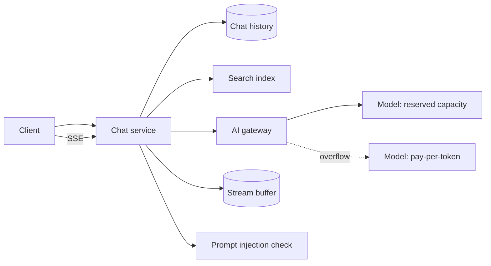
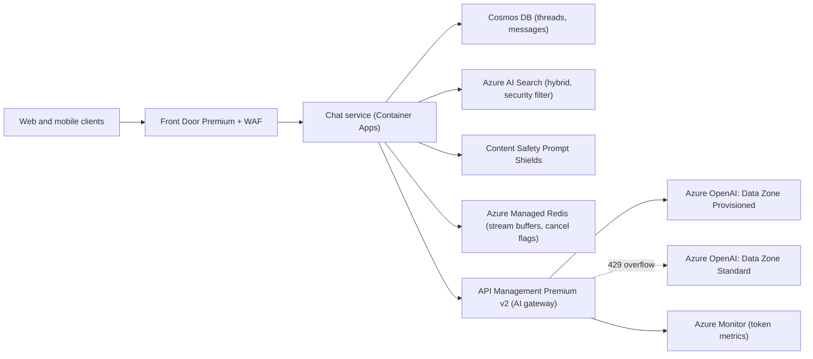

## TL;DR

Treat the model as a remote dependency with limited, expensive capacity. The chat service saves the user's message, retrieves relevant document chunks, builds a prompt from a summary of older turns plus the recent ones, and calls the model through a gateway that enforces per-user token limits and routes to reserved capacity first. Tokens stream to the client over server-sent events (SSE) from a short-lived buffer, so a dropped connection resumes where it left off and a cancel stops generation. On Azure: Container Apps for the chat service, API Management as the AI gateway with `llm-token-limit` and a priority backend pool, Azure OpenAI in Microsoft Foundry Models with a Data Zone Provisioned deployment plus Data Zone Standard spillover, Azure AI Search hybrid retrieval with security filters, Cosmos DB for chat history, Azure Managed Redis for stream buffers, and Content Safety Prompt Shields.

## Requirements

### Functional

- Send a prompt in a chat and receive a streamed response.
- List past chats and resume one, with earlier context carried into the next prompt.
- Ground answers in the organization's documents, with citations, showing each user only documents they can access.
- Stop a response mid-stream.

Out of scope: training or hosting the model, editing or branching messages, images and audio, and tool-calling agents (see [AI systems, RAG, and agents](../05-advanced/ai-systems-rag-and-agents.md)).

### Non-functional

- Time to first token under about 1 second at p95, excluding model queueing. Users judge speed by when text starts, not when it ends.
- A response survives a client reconnect, and in-flight responses survive a deploy.
- Fairness: one heavy user or tenant cannot exhaust shared model capacity; paid tiers get better service.
- Cost grows roughly linearly with conversation length, not quadratically.
- Safety: block prompt-injection attempts in both user input and retrieved documents.
- Prompts and documents stay within one data zone (for example the EU) for compliance.

## Capacity estimates

Assumptions: 1 M daily active users, 5 prompts each per day, 3× peak to average, 4,000 input tokens per request (500 system prompt, 2,000 history, 1,500 retrieved), 400 output tokens, 50 output tokens per second.

| Quantity | Arithmetic | Result |
| --- | --- | --- |
| Prompts per day | 1 M × 5 | 5 M |
| Average prompt rate | 5 M ÷ 86,400 s | about 58/s |
| Peak prompt rate | 58 × 3 | about 175/s |
| Generation time per response | 400 tokens ÷ 50 tokens/s | 8 s |
| Concurrent streams at peak (Little's law) | 175/s × 8 s | about 1,400 |
| Peak input tokens per minute | 175 × 4,000 × 60 | 42 M TPM |
| Peak output tokens per minute | 175 × 400 × 60 | 4.2 M TPM |
| Tokens per day | 5 M × 4,400 | 22 B |
| History storage per day | 5 M × 2 messages × 2 KB | 20 GB, about 1.8 TB at 90-day retention |
| 20-turn chat, full history resent each turn, 300 tokens per turn | 300 × (1 + 2 + ... + 20) = 300 × 210 | 63,000 input tokens for 6,000 tokens of conversation |

Tokens per minute, not requests per second, is the capacity unit. Model quota is granted in TPM, and 42 M input TPM at peak is a quota conversation, not a server count. The last row shows why long chats need context management: resending the full history makes input tokens grow with the square of the number of turns.

## Core entities and API

### Entities

- **Thread**: `threadId`, `userId`, `tenantId`, `title`, `summary`, `summaryThroughMessageId`, `updatedAt`.
- **Message**: `threadId`, `messageId`, `role` (`user` or `assistant`), `content`, `citations`, `status` (`streaming`, `complete`, `stopped`, `failed`), `usage` (`inputTokens`, `outputTokens`).
- **Chunk** (search index): `chunkId`, `docId`, `content`, `vector`, `sourceUrl`, `allowedGroups`.

### API

```text
POST /threads                                   -> 201 { threadId }
GET  /threads?cursor=...                        -> 200 { threads, nextCursor }
GET  /threads/{threadId}/messages?cursor=...    -> 200 { messages, nextCursor }

POST /threads/{threadId}/messages { content }   -> 202 { userMessageId, responseId }
GET  /responses/{responseId}/stream             -> 200 text/event-stream
     (header Last-Event-ID: 57 to resume after event 57)
POST /responses/{responseId}/cancel             -> 202
```

Splitting "send" from "stream" is deliberate: the response exists on the server independently of any connection to it, which is what makes resume and cancel possible.

## High-level design



1. The client posts a message. The chat service saves it, creates a response ID, and returns `202`.
2. A generation task on the same service loads the thread summary and recent messages, retrieves chunks the user is allowed to see, and checks the user input and chunks for prompt-injection attacks.
3. It calls the model through the AI gateway with streaming on. The gateway enforces token limits and picks a backend.
4. Each chunk of tokens is appended to a stream buffer keyed by response ID, with an increasing event ID.
5. The client opens the SSE stream; the service reads from the buffer and forwards events. On reconnect, it resumes from `Last-Event-ID`.
6. When generation ends, the full message and token usage are saved to history and the buffer expires a few minutes later.

## Deep dives

### 1. Streaming, resume, and cancel

**Transport.** SSE is one-way server to client over plain HTTP, with a built-in `Last-Event-ID` reconnect header. WebSockets are two-way, which this flow does not need, and require more from proxies and load balancers. A managed pub/sub service helps when several devices watch one chat. **Pick: SSE**, and send cancel as a separate `POST`. See [real-time updates](../03-patterns/real-time-updates.md).

**Where tokens live while streaming.**

| Option | Behavior on disconnect | Trade-off |
| --- | --- | --- |
| Pipe model output straight to the client connection | The response is lost; the user must regenerate and pay again | Simplest. |
| Write each token chunk to the history database | Resumable | One database write per few tokens: about 1,400 streams × 10 writes/s = 14,000 writes/s of tiny updates. |
| Append to an in-memory stream with a TTL, persist once at the end | Resumable from any instance | One more component, and a crash loses only the in-flight part. |

**Pick: an in-memory stream per response** (a Redis stream: `XADD` per chunk, `XREAD` from the last ID on reconnect, `EXPIRE` 10 minutes after completion). Any chat service instance can serve the reconnect, because the stream is not tied to the generating instance.

**Cancel.** `POST /cancel` sets a flag next to the stream. The generating task checks it between chunks, closes the upstream model request, saves the partial text with status `stopped`, and frees the user's concurrency slot.

**Deploys.** Generation is tied to the instance that runs it. Give instances a shutdown grace period longer than the longest response so in-flight generations finish while new ones go to new instances. If an instance dies anyway, mark the message `failed` and show a retry button. See [long-running tasks](../03-patterns/long-running-tasks.md).

### 2. Model capacity and routing

You do not schedule GPUs on a managed model service; you schedule quota.

| Option | Strength | Weakness |
| --- | --- | --- |
| One pay-per-token deployment | No commitment, highest default quota | Latency varies with shared load; you get `429` when you hit quota. |
| Reserved throughput only | Predictable latency, cached input tokens can be free | You pay for peak capacity all day, and overflow has nowhere to go. |
| Reserved for the baseline, pay-per-token for overflow | Predictable latency for most traffic, no hard ceiling | A gateway has to route and fail over between them. |
| Self-host open models on GPU nodes | Full control of scheduling and batching | You run GPUs, drivers, and inference servers. See [LLM serving and inference](../05-advanced/llm-serving-and-inference.md). |

**Pick: reserved capacity sized for the daily baseline, with pay-per-token overflow behind a gateway.** The gateway sends traffic to the reserved deployment first and, when it answers `429`, trips a circuit breaker for the duration in `Retry-After` and sends traffic to the overflow deployment.

### 3. Fairness and quotas

Rate limiting by requests is wrong here: one request can be 200 tokens or 100,000. Limit by tokens.

- **Per user:** a tokens-per-minute limit stops one user from flooding the pool. Exceeding it returns `429` with `Retry-After`.
- **Per tenant:** a monthly token quota matches what the customer pays for. Exceeding it returns `403`.
- **Per tier:** paid tiers get higher limits and priority access to reserved capacity; free-tier traffic goes only to the overflow deployment.
- **Concurrency:** cap open streams per user (for example 3) so a script cannot hold hundreds of slots.

This is the [rate limiter](./rate-limiter.md) design with tokens instead of requests as the unit. See also [API gateway](../02-building-blocks/api-gateway.md).

### 4. Controlling context cost

| Option | Cost | Quality |
| --- | --- | --- |
| Resend full history every turn | Grows with turns squared; long chats hit the context limit | Best recall until it fails outright. |
| Sliding window of the last N turns | Flat | Forgets anything older than N turns. |
| Rolling summary plus last N turns, plus retrieval of relevant older turns | Flat, plus a small summarization call every few turns | Keeps key facts; occasionally drops a detail. |

**Pick: rolling summary plus the last 6 turns.** Every 6 turns, a cheap model rewrites `Thread.summary` to include the turns that fell out of the window. For very long threads, also embed older turns and retrieve the most relevant ones.

**Prompt caching** cuts cost further. Put the stable parts first (system prompt, tool definitions, then the thread summary) and the changing parts last, so consecutive requests share a long identical prefix that the model service can reuse.

### 5. Grounding and prompt-injection safety

- **Retrieval.** Run keyword and vector search together and merge the rankings (hybrid search), then rerank the top results. Keyword search catches exact product names and error codes that embeddings blur; vectors catch paraphrases. See [search](../02-building-blocks/search.md).
- **Permissions.** Store the groups allowed to read each chunk on the chunk, and filter every query by the caller's groups. Filtering after retrieval is wrong: it can return zero results when the top 5 were all forbidden, and a bug leaks data into the prompt.
- **Injection.** A retrieved document can contain "ignore previous instructions and..." Scan both the user's input and the retrieved chunks before they reach the model. Treat retrieved text as data in the prompt, clearly delimited.
- **Citations.** Ask the model to cite chunk IDs, and render only citations that match chunks you actually sent.

## On Azure



| Component | Azure service | Tier or setting, and why |
| --- | --- | --- |
| Edge | Azure Front Door | Premium with WAF; test that SSE responses stream through without buffering. |
| Chat service | Azure Container Apps | Scales on concurrent requests; shutdown grace period longer than the longest generation. |
| AI gateway | Azure API Management | Premium v2: availability zones and access to backends in a virtual network. `llm-token-limit` per user and per tenant, `llm-emit-token-metric` for chargeback, priority backend pool with circuit breaker. |
| Model | Azure OpenAI in Microsoft Foundry Models | Data Zone Provisioned for baseline (priority 1), Data Zone Standard for overflow (priority 2). Both keep processing inside the data zone. |
| Retrieval | Azure AI Search | S1 or higher for capacity; hybrid search with semantic ranker; `allowedGroups` filter on every query. |
| History | Azure Cosmos DB for NoSQL | `messages` container with hierarchical key `/userId,/threadId`, one item per message, TTL 90 days. `threads` container keyed by `/userId`. |
| Stream buffers | Azure Managed Redis | Balanced tier; one Redis stream per response, expiring 10 minutes after completion. |
| Safety | Azure AI Content Safety | Prompt Shields on user input and retrieved documents. |

### Why these choices

- **Deployment types.** Foundry Models offers Global, Data Zone, and Regional deployments, each as pay-per-token Standard or reserved Provisioned, plus Batch at a 50% discount for asynchronous jobs ([deployment types](https://learn.microsoft.com/azure/foundry/foundry-models/concepts/deployment-types)). Data Zone keeps processing within the EU or US zone, which meets the residency requirement without pinning to one region's capacity.
- **API Management as the AI gateway.** Its backend load balancer supports priority-based routing, which is how you send traffic to provisioned (PTU) deployments first, and its circuit breaker takes its trip duration from the backend's `Retry-After` header ([AI gateway capabilities](https://learn.microsoft.com/azure/api-management/genai-gateway-capabilities)). Standard v2 and Premium v2 are the v2 tiers with availability zones; multi-region gateways require classic Premium ([API Management reliability](https://learn.microsoft.com/azure/reliability/reliability-api-management)).
- **Token limits.** `llm-token-limit` returns `429` when a tokens-per-minute limit is exceeded and `403` when a quota is exceeded ([policy reference](https://learn.microsoft.com/azure/api-management/llm-token-limit-policy)).
- **Prompt caching** discounts cached input tokens on Standard deployments and up to 100% on Provisioned deployments, for prompts whose identical prefix is at least 1,024 tokens ([prompt caching](https://learn.microsoft.com/azure/foundry/openai/how-to/prompt-caching)). A long, stable system prompt pays for itself.
- **Azure AI Search hybrid search** runs full-text and vector queries in parallel and merges them with Reciprocal Rank Fusion ([hybrid search](https://learn.microsoft.com/azure/search/hybrid-search-overview)); per-user trimming uses a filter on a group field ([security filters](https://learn.microsoft.com/azure/search/search-security-trimming-for-azure-search)).
- **Prompt Shields** detects user prompt attacks and document attacks, meaning hidden instructions in documents, emails, or web pages ([Prompt Shields](https://learn.microsoft.com/azure/ai-services/content-safety/concepts/jailbreak-detection)).
- **Cosmos DB for history.** Each chat read is a single-partition query on `/userId,/threadId` ([hierarchical partition keys](https://learn.microsoft.com/azure/cosmos-db/hierarchical-partition-keys)), and TTL deletes old messages without a cleanup job ([time to live](https://learn.microsoft.com/azure/cosmos-db/time-to-live)). For long-term memory across threads, see [agentic memories](https://learn.microsoft.com/azure/cosmos-db/gen-ai/agentic-memories).
- **Semantic caching is optional.** API Management can serve similar prompts from a cache with `llm-semantic-cache-lookup`, but it needs Azure Managed Redis with RediSearch, which can be enabled only when you create the cache ([semantic caching](https://learn.microsoft.com/azure/api-management/azure-openai-enable-semantic-caching)). For personal, grounded chats, hit rates are low; use it for FAQ-style first turns.

### Zones and regions

Enable zone redundancy on Container Apps, API Management Premium v2, Cosmos DB, and Azure Managed Redis. For regional failure, deploy the stack in a second region within the same data zone, add a Cosmos DB region, and let Front Door route by health. Model capacity is the scarcest resource during a regional failover, so confirm that the overflow deployment has quota for the full load. See [regions, zones, and resiliency](../04-azure/regions-zones-and-resiliency.md).

### Gotcha

`llm-token-limit` counts independently at each gateway where it applies, including regional gateways in a multi-region deployment and workspace gateways; it does not aggregate across the instance ([policy reference](https://learn.microsoft.com/azure/api-management/llm-token-limit-policy)). Run two regions and a user with a 50,000 TPM limit effectively gets 100,000. The same is true for two separate API Management instances. Also, when `stream: true`, prompt and completion tokens are estimated rather than counted exactly, so treat the limits as approximate and reconcile billing from the token usage the model returns at the end of each stream.

See [compute choices](../04-azure/compute-choices.md), [data choices](../04-azure/data-choices.md), and [cost optimization](../04-azure/cost-optimization.md).

## Interview tips

- Say "the model is a black box with limited capacity" early, then spend the time on streaming, quotas, and context, where the system design actually is.
- Show the quadratic history arithmetic. It turns "summarize old turns" from a nice idea into a requirement.
- Expect "what happens if the user refreshes mid-response?" Separate send from stream, buffer by response ID, resume with `Last-Event-ID`.
- Expect "how do you stop one customer from using all the capacity?" Token-based limits per user and tenant, tiered routing, and a concurrency cap.
- Mention permission filtering inside the search query, not after it. Leaking a document into a prompt is a data breach.
- Follow-ups: tool calling and agents, evaluation of answer quality, and multi-device sync of one chat.

## Further reading

- [Hello Interview: Design ChatGPT](https://www.hellointerview.com/learn/system-design/problem-breakdowns/chatgpt)
- [The Coding Gopher: Polling vs long polling vs SSE vs WebSockets](https://thecodinggopher.substack.com/p/polling-vs-long-polling-vs-sse-vs)
- [AI gateway capabilities in API Management](https://learn.microsoft.com/azure/api-management/genai-gateway-capabilities)
- [What is Microsoft Foundry?](https://learn.microsoft.com/azure/foundry/what-is-foundry)
- [AI systems, RAG, and agents](../05-advanced/ai-systems-rag-and-agents.md), [LLM serving and inference](../05-advanced/llm-serving-and-inference.md), [caching](../02-building-blocks/caching.md)
