## Understanding the problem

**What is a distributed model downloader?** It is the service that copies a new model checkpoint onto every GPU host in a cluster before training or serving starts. The orchestrator says "put version 7 on these 1,000 hosts", and a few minutes later every host holds the same 500 GB of weights on local disk, checked byte for byte.

The givens are the interview prompt. The model is 500 GB, there are 1,000 GPU hosts, the shared link to the external model repository carries 10 GB/s, and each host's NIC carries 10 GB/s. Every byte has to match what was published, because a flipped bit in a weight file gives a model that runs and answers wrong. Three resources can set the finish time, so name them early. They are the external link, bandwidth between hosts, and each host's disk write speed.

:::info
This prompt circulates as an Anthropic interview question. That is unconfirmed, and the design below stands on its own as a standard infrastructure round.
:::

## Functional requirements

1. The orchestrator should be able to start a job that distributes one model version to a set of hosts.
2. Every surviving host should end with a verified, bit-identical copy of that version on local disk.
3. The orchestrator should be able to watch a job's progress and learn which hosts finished and which failed.
   - Optionally, it can cancel a job.

**Below the line (out of scope)**

- **Loading weights into GPU memory.** The serving framework owns that. The downloader's only part is handing its loader the manifest so it can re-hash pieces as it reads them (deep dive 3). See [LLM serving and inference](../05-advanced/llm-serving-and-inference.md).
- **Delta updates between versions.** Content-addressed pieces make this a follow-up, not a redesign.
- **Several models at once.** Deep dive 4 shows what changes.
- **Cross-region distribution.** Each region stages its own copy and runs the same design.

Before any math, I'd ask the interviewer these questions, because each one moves a number:

- Is each host's 10 GB/s per direction, or shared between sending and receiving?
- How fast can a host write to local disk?
- Are links between racks oversubscribed?
- Does the repository support range requests and publish hashes?
- Do hosts already hold an older version?
- Should a failed host be retried, or dropped from the job?

## Non-functional requirements

1. **It finishes within 2x of the bandwidth floor.** That is under 100 s if host links are full duplex and under 200 s if sending and receiving share 10 GB/s. The floor assumes perfect pipelining, so 2x leaves room for scheduling gaps and the tail.
2. **It never exceeds 10 GB/s** on the external link or on any host. Agents enforce these as hard caps.
3. **No single failure restarts the job.** A dead host, seed, or coordinator costs at most the pieces in flight on it, plus a fresh pull of any chunk only it held. Failed hosts are dropped and reported.
4. **No host ever loads a corrupted or tampered byte.** Integrity beats speed.
5. **The same architecture runs from 100 to 10,000 hosts.** Seed counts and coordinator layout change, and the components don't.

**Below the line**

- **Upload incentives.** Every host is yours and cooperates.
- **Control API latency.** The orchestrator starts a few jobs a day.

The naive number frames everything else. See [back-of-the-envelope estimation](../01-fundamentals/back-of-the-envelope.md).

$$
\begin{aligned}
\text{every host pulls} &= \frac{1{,}000 \times 500\ \text{GB}}{10\ \text{GB/s}} = 50{,}000\ \text{s} \approx 13.9\ \text{h} \\
\text{external floor} &= \frac{500\ \text{GB}}{10\ \text{GB/s}} = 50\ \text{s} \\
\text{per-host floor, full duplex} &= \frac{500\ \text{GB in}}{10\ \text{GB/s}} = 50\ \text{s} \\
\text{per-host floor, shared} &\approx \frac{500\ \text{GB in} + 500\ \text{GB out}}{10\ \text{GB/s}} \approx 100\ \text{s}
\end{aligned}
$$

The shared case doubles because the average host sends about as much as it receives. Hosts receive $999 \times 500\ \text{GB} = 499.5\ \text{TB}$ from each other, and someone has to upload all of it.

The property that shapes this design is the gap between the cluster and its front door. Aggregate host bandwidth is $1{,}000 \times 10\ \text{GB/s} = 10\ \text{TB/s}$, a thousand times the external link. So each byte crosses the external link once and peers do the rest. The full-duplex floor is also tight. Finishing in 50 s means uploading $499.5\ \text{TB} \div 50\ \text{s} \approx 9.99\ \text{TB/s}$ against $10\ \text{TB/s}$ of capacity, so every host uploads at nearly line rate for the whole job. No design where some hosts only receive can reach it.

:::tip
Ask the duplex question before you draw anything. It decides whether the floor is 50 s or 100 s, and assuming full duplex silently promises a time the hosts may not reach.
:::

## Core entities

- **Model version.** One immutable checkpoint, such as `fm-7@2026-11-01`.
- **Manifest.** The signed list of every piece hash for a version.
- **Chunk and piece.** A chunk is a 64 MB range the coordinator tracks. A piece is a 4 MB slice of a chunk, the unit that moves on the wire and gets verified.
- **Job.** One distribution of one version to one host set.
- **Host.** A GPU machine running an agent, with a bitmap of the chunks it holds.
- **Lease.** A time-limited claim on work, such as "seed 12 pulls chunks 400 to 555 until 10:04:30".

## API

The orchestrator calls a small REST API, a handful of requests per job. Its identity comes from its workload identity token, never the body. See [API design](../01-fundamentals/api-design.md).

Requirement 1 starts a job. It returns at once, because the job runs for a minute or more.

```http
POST /v1/jobs
Authorization: Bearer <workload identity token>
{ "modelVersion": "fm-7@2026-11-01", "manifest": "models/fm-7/2026-11-01/manifest.json", "hostPool": "gpu-pool-a" }

202 Accepted
{ "jobId": "j-2187", "status": "seeding", "hosts": 1000 }
```

Requirements 2 and 3 are watched through one status read, which lists failed hosts with a reason.

```http
GET /v1/jobs/j-2187
Authorization: Bearer <workload identity token>

200 OK
{ "status": "running", "hosts": { "verified": 412, "transferring": 583, "failed": 5 },
  "failedHosts": [ { "host": "gpu-0417", "reason": "heartbeat-timeout" } ] }
```

A cancel stops every agent, which deletes its partial file.

```http
DELETE /v1/jobs/j-2187
Authorization: Bearer <workload identity token>

202 Accepted
```

Host-to-coordinator and host-to-host calls are internal gRPC over mutual TLS, introduced below where they first matter.

## High-level design

### Data flow

1. The orchestrator starts a job, and the coordinator records it.
2. Host agents learn about the job and fetch the signed manifest.
3. A few seed hosts pull disjoint ranges from the repository, so each byte normally crosses the external link once.
4. Every host fetches missing pieces from any host that has them, verifies each, writes it, and starts serving it.
5. Hosts report progress, and the coordinator tells the orchestrator who finished and who failed.

### 1) The orchestrator can start a distribution job

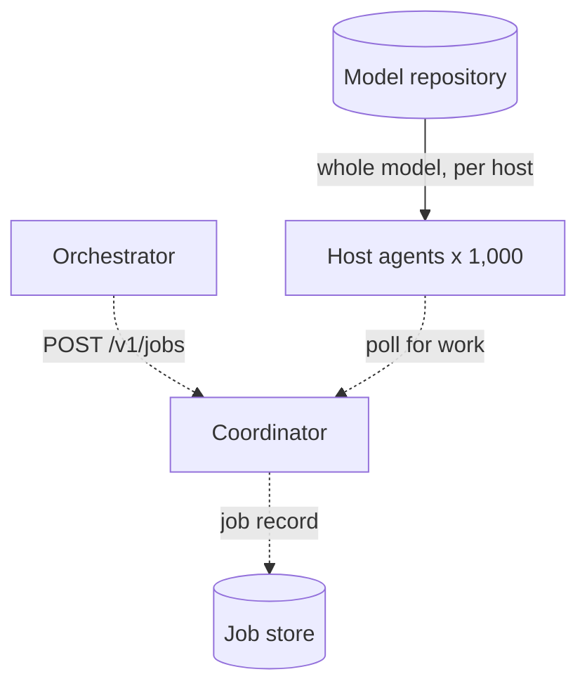

Dashed arrows are control and solid arrows carry model bytes. The coordinator never touches a model byte, which keeps it small and easy to replace.

- **Orchestrator.** The scheduler that needs the model on its hosts before it launches work.
- **Coordinator.** Owns jobs and, later, decides who fetches what from whom.
- **Job store.** A durable record of each job.
- **Host agent.** A daemon on every GPU host that downloads, verifies, and serves.

1. The orchestrator sends `POST /v1/jobs`. The coordinator writes the job record with status `seeding`.
2. Each agent polls, sees the job, and fetches the manifest.
3. Each agent preallocates a 500 GB file and downloads the model from the repository.

The job record holds `jobId`, `modelVersion`, `manifestPath`, `hosts`, and `status` (`seeding`, `running`, `done`, or `cancelled`).

This works and takes 13.9 hours, because 1,000 hosts share one 10 GB/s link. The next requirement fixes that.

### 2) Every surviving host ends with a verified, bit-identical copy

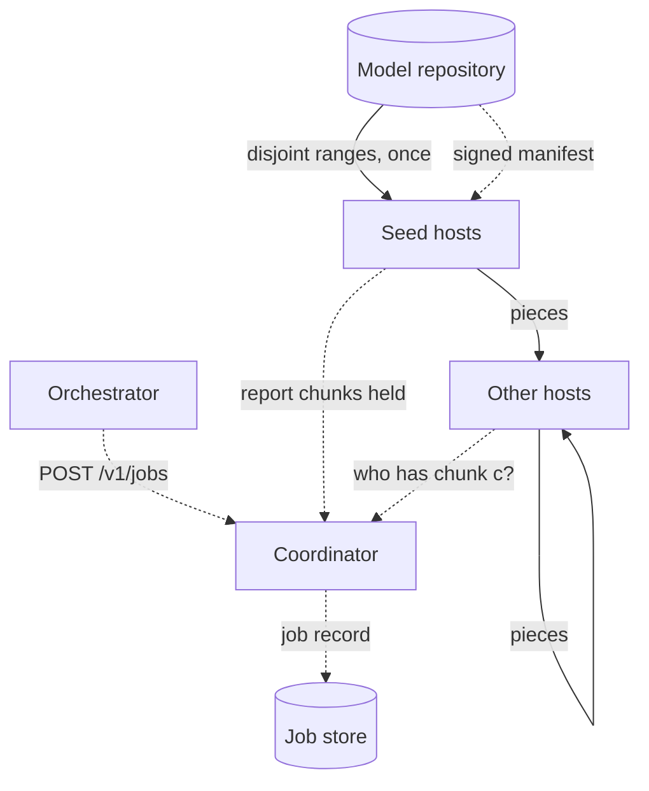

- **Manifest.** Published with the model. It lists each chunk's offset and the SHA-256 of each 4 MB piece.
- **Seed hosts.** Ordinary GPU hosts the coordinator picks to pull from the repository. Every other host only talks to peers.
- **Chunk bitmap.** One bit per chunk per host. The coordinator keeps a copy in memory.

1. The coordinator gives each seed a disjoint block of chunks to pull with HTTP range requests.
2. A seed verifies each piece against the manifest, writes it at its offset with `pwrite`, and reports finished chunks.
3. Any other host asks which hosts hold the chunks it lacks, and requests pieces from them.
4. Each host verifies every piece before writing it, and serves it as soon as it is on disk.
5. When the bitmap is full, every piece has passed its check, so the agent renames `fm-7.partial` to its final name and reports success.

Writing at offsets into a preallocated file means there is no reassembly step. The internal calls so far are:

- `claimRange(jobId)` returns a block of chunks for a seed.
- `report(jobId, newChunks)` updates the host's bitmap.
- `sources(jobId, chunkIds)` returns holders of each chunk.
- `getPiece(chunk, piece)` is host to host and returns 4 MB.

At 64 MB per chunk the model is 7,813 chunks, so cluster state is $7{,}813 \times 1{,}000 \approx 7.8\ \text{M bits} \approx 1\ \text{MB}$ in memory. This is the metadata and bytes split that [file sync](./file-sync.md) uses for uploads, pointed the other way.

### 3) The orchestrator can watch progress and learn which hosts finished or failed

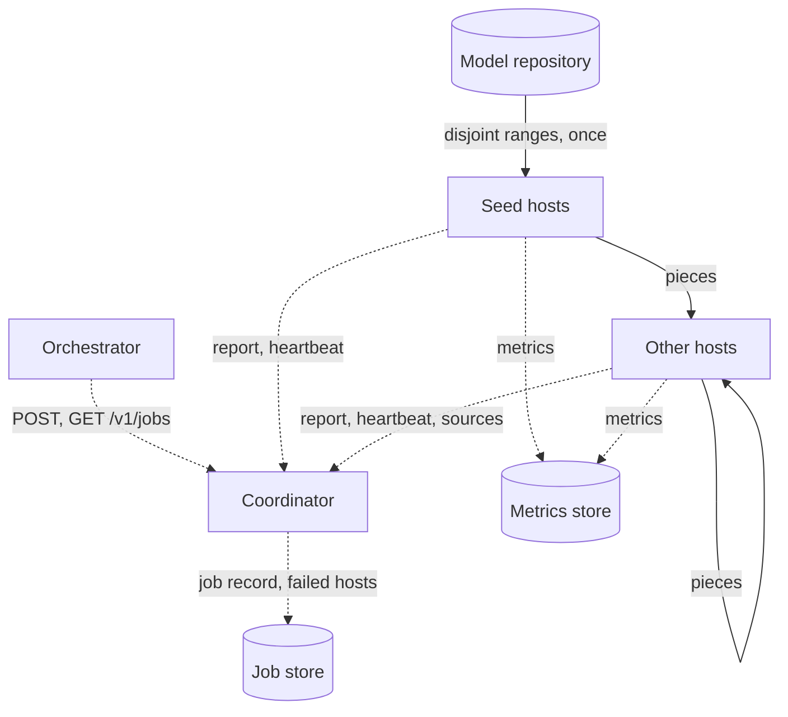

- **Heartbeat.** Each agent's `report`, sent every 250 ms even with nothing new, so silence means trouble.
- **Metrics store.** Per-host throughput and progress for dashboards and alerts.

1. A host at 10 GB/s finishes about 156 chunks a second, so each 250 ms report carries about 39 chunk IDs, and 1,000 hosts send 4,000 reports a second.
2. An agent that passes its final check calls `complete(jobId, root)`, and the coordinator marks it `verified`.
3. A host that misses heartbeats is marked `failed` in the job record with a reason.
4. The orchestrator polls `GET /v1/jobs/j-2187` until no host is transferring.

Counts lag by a few hundred milliseconds. A `verified` mark never lags, because only the host's own final check sets it.

## Deep dives

Now make the design meet each non-functional requirement.

### 1) How do we finish close to the bandwidth floor?

This serves requirements 1 and 2. The floor is 50 s with full duplex and 100 s with shared links.

#### Bad solution: Every host pulls from the repository

**Approach.** Each agent downloads all 500 GB from the repository with parallel range requests.

**Challenges.** The external link carries 500 TB, so the job takes 13.9 hours while 10 TB/s of host bandwidth sits idle.

#### Good solution: Pull once, then forward along a chain or tree

**Approach.** One seed pulls the model and forwards each piece to the next host as soon as it verifies it. In a chain every host receives and sends at 10 GB/s, and pipelining 4 MB pieces adds one piece time per hop, so 999 hops cost $999 \times 0.4\ \text{ms} \approx 0.4\ \text{s}$. A tree cuts the depth to about 10 levels at a price. A binary tree's inner hosts send two copies at 5 GB/s each, and its 500 leaves never upload.

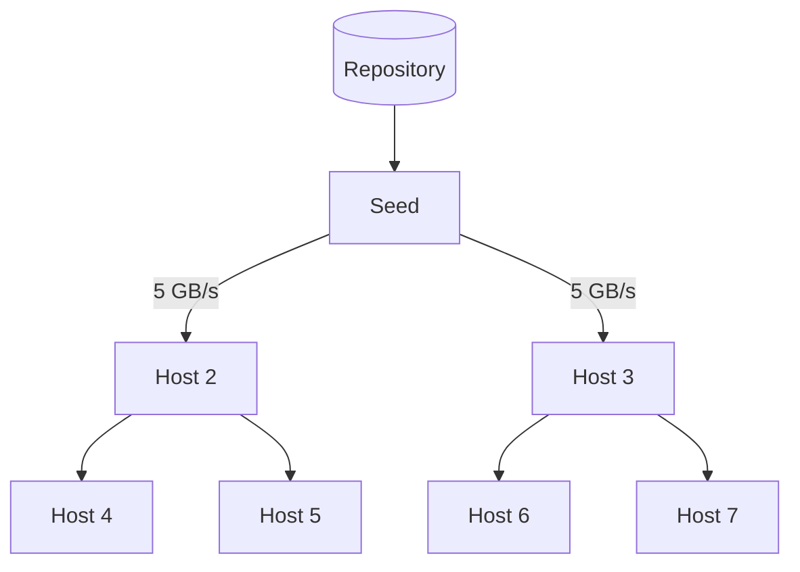

| Topology | Time on healthy hosts | When a host dies or slows | Verdict |
| --- | --- | --- | --- |
| Chain | About 50 s full duplex, 100 s shared | Everything after it stalls | Fast and fragile |
| Binary tree | About 100 s full duplex | Its subtree stalls | Needs repair logic |
| Ring broadcast, as in collective libraries | Near the floor on a uniform network | One slow host slows the ring | Good on a fixed, healthy group |
| Hardware multicast | Very fast where supported | Needs its own loss recovery | An optional accelerator |
| Swarm with a scheduler | Near the floor | Any holder can serve any chunk | The great solution |

**Challenges.** A fixed topology moves at its slowest link. One degraded NIC throttles everything behind it, and a dead host cuts the chain or orphans a subtree until something rebuilds it.

:::warning
A tree looks efficient on a whiteboard and fails the upload math. The full-duplex floor needs every host uploading at nearly 10 GB/s, and half of a binary tree uploads nothing.
:::

#### Great solution: Disjoint seeds and a swarm with a central scheduler

**Approach.** Pick about 50 seeds, two per rack if the cluster has 25 racks of 40 hosts. Give each a disjoint block of chunks and rate-limit them together to 10 GB/s, so each pulls about 200 MB/s and every chunk normally crosses the external link once. Within a second the cluster holds 50 different chunks to trade. Every other host pulls work when it has spare capacity and asks for sources. The coordinator ranks sources with four rules.

1. **Rarest first.** Hand out the chunks held by the fewest hosts, so none stays a single point of loss and every host has something others want. Bram Cohen's BitTorrent paper describes the same rule.
2. **Rack aware.** Prefer a source in the same rack, then the same pod, so most transfers skip the oversubscribed spine.
3. **Capacity aware.** Cap each host's concurrent transfers so neither direction passes 10 GB/s, or so the two together don't pass it on a shared link, and pick the least-loaded holder.
4. **Endgame mode.** For the last 1 to 2% of chunks, request each from several holders and keep the first copy that verifies. Cohen's paper names this too.

Each chunk a host finishes makes it a new source, so senders double each round until all 1,000 hosts send and receive at once. Agents keep 8 to 32 piece requests in flight to hide round trips.

Chunk size trades coordinator work against pipelining. Hashes live at the 4 MB piece, so a host verifies and writes each piece as it arrives instead of waiting for the whole chunk. The coordinator tracks 64 MB chunks to keep its decisions few, so a host becomes a source for a chunk once all 16 of its pieces are on disk.

| Tracked chunk | Chunks in 500 GB | Scheduling decisions per second, cluster-wide | Seed's first shareable chunk |
| --- | --- | --- | --- |
| 4 MB | 125,000 | 2.5 million | 0.02 s |
| 64 MB | 7,813 | 156,000 | 0.32 s |
| 1 GB | 500 | 10,000 | 5 s |

Pick the middle row. At 4 MB the bitmap is still only about 16 MB, so memory isn't the limit. 2.5 million source lookups a second through one service is. At 1 GB a seed at 200 MB/s holds nothing to share for 5 s, 10% of the floor, and there are fewer chunks than hosts.

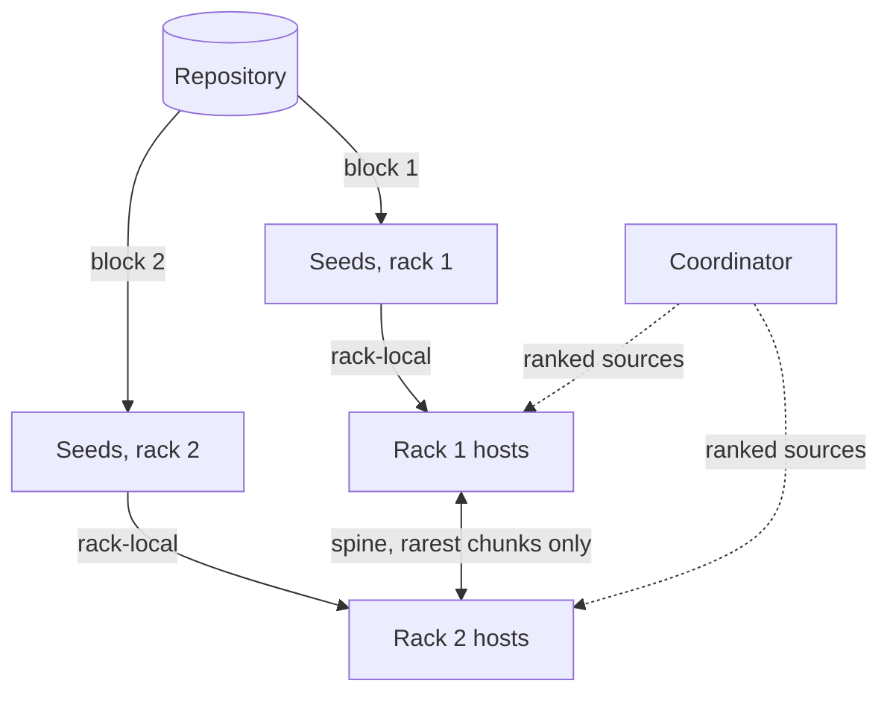

:::info
Public BitTorrent spends much of its design on making peers upload, through tit-for-tat. Inside your own cluster every host cooperates, so keep rarest first and endgame mode and drop the incentives.
:::

**Challenges.** The scheduler is real code with policy to tune, such as seed count and how rack-aware to be. The disk shows up here too. If a host writes slower than 10 GB/s, the floor becomes $500\ \text{GB} \div \text{write speed}$, so an assumed 5 GB/s disk doubles it to 100 s. Use large aligned direct writes on a separate thread from the network, and measure the disks before you promise a time.

In a 45-minute interview I'd draw the great solution, use the tree only to show why no host can sit idle, and quote the chunk-size table.

### 2) How does the job survive failures of hosts, seeds, and the coordinator?

This serves requirement 3. Assume a few hosts fail in any job.

#### Bad solution: Push assignments and restart on failure

**Approach.** The coordinator assigns every host its sources up front and locks each assignment. When something dies, it restarts the job.

**Challenges.** At 1,000 hosts something crashes often enough that the job may never finish. A lock held by a dead host never releases, and pushed work ignores which hosts are fast.

#### Good solution: Leases, heartbeats, and resumable bitmaps

**Approach.** Every claim is a lease with a deadline, not a lock. A seed's `claimRange` returns a block valid for 10 s, renewed by each `report`. A seed that goes quiet loses its lease, and the next seed to ask gets the unfinished chunks. A finished chunk can be lost too, when every host holding it dies or is quarantined. The coordinator counts live holders per chunk, and a chunk that drops to zero goes back into the chunks `claimRange` hands out, for another pull from the repository. Rarest first copies each new chunk within a second or two of its pull, so that window stays short. Writing a piece twice at the same offset is harmless, so retries need no cleanup. See [idempotency and retries](../03-patterns/idempotency-and-retries.md).

Each agent persists its bitmap next to the partial file, and records a bit only after that piece's bytes are synced to disk, so a restarted host can trust its bitmap and asks only for what it lacks. A host that misses 4 heartbeats, one second of silence, drops out of every source list. A requester switches source after a short timeout, and repository errors get backoff with jitter. See [resilience patterns](../03-patterns/resilience-patterns.md).

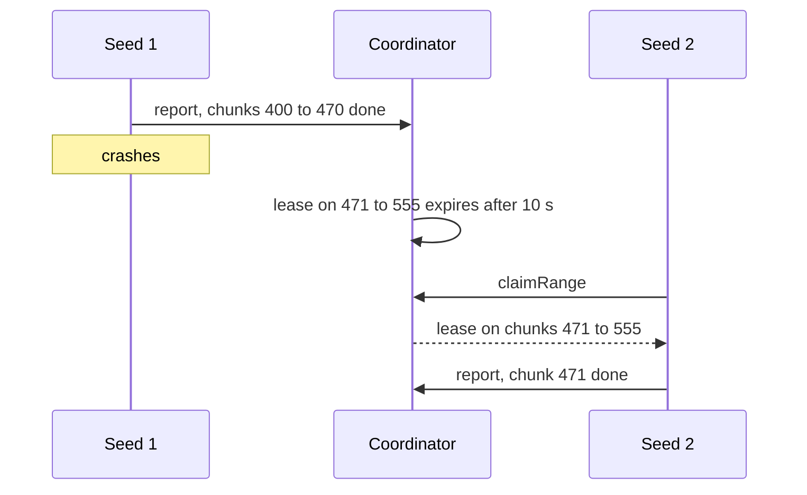

**Challenges.** The coordinator is now the single point of failure. If it dies, no leases, sources, or status reach anyone.

#### Great solution: A replicated coordinator with small state, and hosts that keep trading

**Approach.** Make the coordinator cheap to replace. Run one leader and two standbys, elected through a lease of their own. Persist only what can't be rebuilt, the job record, host set, and failed hosts, a few tens of kilobytes. Each host's bitmap on its own disk is the source of truth, so a new leader asks every agent for it and rebuilds the 1 MB map in about a second. Every write carries the leader's epoch, and the job store and agents reject any epoch lower than the highest they have seen, so a deposed leader that wakes up can't overwrite the new one. See [consensus with Raft and Paxos](../05-advanced/consensus-raft-paxos.md).

Agents cache their source lists. While the coordinator is down, hosts keep trading with peers they know, and only new leases and fresh sources pause.

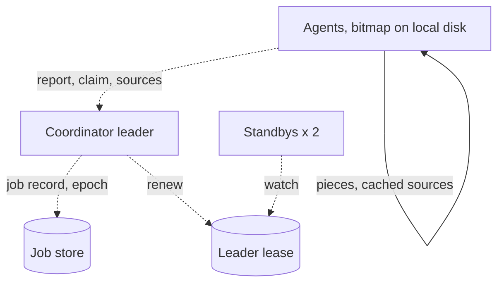

| Failure | Detected by | What happens |
| --- | --- | --- |
| Host dies mid-transfer | Missed heartbeats | Peers use other holders, and the host is marked failed |
| Seed dies during the pull | Lease expiry | Another seed resumes the block, and chunks with no live holder are pulled again |
| Slow peer | Low throughput | The requester switches, and endgame mode covers the tail |
| Corrupt piece | Hash mismatch | Discard, refetch, strike the sender (deep dive 3) |
| Rack loss | Many hosts silent | Other racks continue, and lost hosts go to repair |
| Coordinator crash | Leader lease expiry | A standby takes over and rebuilds from hosts |
| Repository errors | 5xx or timeouts | Backoff with jitter, resume by range |

**Challenges.** A failover stalls new leases for a few seconds of a 50 s job. A thousand hosts answering a rebuild at once is a small thundering herd, so agents add jitter. A partition can leave hosts trading on one side while the leader marks them failed, so the job record must accept a late `complete`.

In a 45-minute interview I'd present leases and resumable bitmaps, then add "hosts are the source of truth for their own bitmaps", because that sentence makes the coordinator replaceable.

### 3) How do we guarantee every host loads exactly the bytes that were published?

This serves requirement 4. Bad bytes come from NICs, disks, buggy peers, or tampering.

#### Bad solution: One whole-file checksum at the end

**Approach.** The repository publishes one SHA-256 of the model, and each host hashes its file after download.

**Challenges.** A bad piece is found only at the end, with no way to tell which piece, so the host starts over. Meanwhile it has served that piece to peers, and the corruption spread before anyone checked. The final hash also costs a full 500 GB re-read.

#### Good solution: Per-piece hashes in a manifest

**Approach.** Publish the SHA-256 of every 4 MB piece. A host hashes each piece on arrival and only writes and serves pieces that match, so a mismatch costs one 4 MB refetch. Seeds check what they pull too, so a bad response stops at the edge.

**Challenges.** The manifest is now the thing to protect. Whoever hands out a different manifest makes every host accept the wrong weights while every check passes.

#### Great solution: A signed manifest, a Merkle root, verify before serving, and an atomic rename

**Approach.** At publish time, build a Merkle tree over the piece hashes. Then sign one digest with a key only the publishing pipeline can use. The digest covers the model version, total size, piece size, the offset of every chunk, and the root. Agents ship with the public key. A host checks the signature, checks that the signed version is the one the job asked for, so an old manifest can't be replayed, then checks that the 125,000 piece hashes, about 4 MB, reproduce the root. Because every host fetches the whole list, a signed SHA-256 of the whole manifest would work too. The tree earns its place when a host checks pieces with short proofs before it holds the full list. No peer or coordinator can change what "correct" means after those checks, and every piece follows one rule.

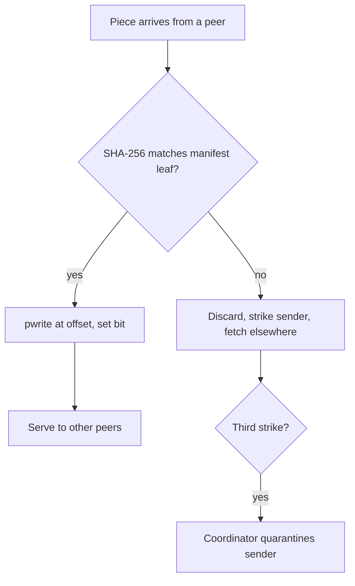

After the last piece, the agent flushes, confirms every bit is set, and renames the file to its final name. A rename within one file system is atomic, so the loader sees no model or the whole verified model. Bytes can still go bad after the check, on the write or later on the disk. Peers are covered, because every receiver verifies what it is sent and strikes the sender. The host's own copy is checked at load. Loading belongs to the serving framework, so the agent hands its loader the manifest, and the loader re-hashes each piece as it reads it into GPU memory. That costs CPU but no extra disk pass, unlike a separate 500 GB re-read at the end, and the agent refetches any piece that fails from a peer. Keep a sampled audit for copies that sit idle on disk.

Budget the CPU. Assume one core hashes SHA-256 at about 1 GB/s, and measure it on your hardware. Then 10 GB/s of pieces needs about 10 cores per host. BLAKE3 is faster than SHA-256 on one core and, because it is a Merkle tree internally, also spreads across threads and SIMD lanes. Its authors report the multithreaded `b3sum` tool as an order of magnitude faster than `sha256sum` on typical desktop hardware. Measure its single-core rate before you count on it to save cores.

**Challenges.** Signing adds a key to guard and a publish step before any job. Strikes need care, because a host with a bad NIC can look malicious. And verification proves the bytes match the manifest, not that the model is good.

In a 45-minute interview I'd go straight to per-piece hashes, say why the check happens before a piece is served, and add the signature when asked about a compromised peer.

### 4) How does this grow to 10,000 hosts and several models at once?

This serves requirement 5.

#### Bad solution: One coordinator over one flat swarm

**Approach.** Keep deep dive 1's design and add hosts.

**Challenges.** State still fits, at $7{,}813 \times 10{,}000 \approx 78\ \text{M bits} \approx 10\ \text{MB}$, but the decision rate doesn't. The coordinator makes 1.56 million source decisions and takes 40,000 reports a second, and more random peer pairs sit across the spine.

#### Good solution: Hierarchical coordinators, one seed set per pod

**Approach.** Split the cluster into pods of about 1,000 hosts, each with its own coordinator running deep dive 1's design. A root coordinator owns the job and gives each pod a share of the external pull. Pod seeds fetch the chunks they lack from other pods' seeds, so every chunk crosses the external link once and enters each pod once.

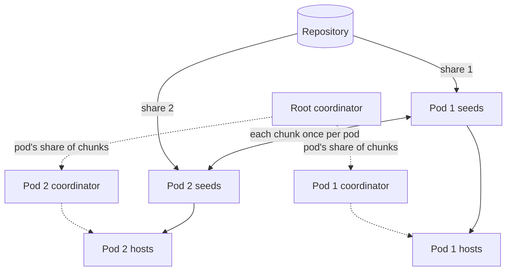

**Challenges.** Pod coordinators are more failures to handle, though deep dive 2's rebuild works at each level. And nothing stops two jobs fighting over the same 10 GB/s.

#### Great solution: Add quotas, preheating, and a regional cache

**Approach.** Give each job a share of the external link and of each NIC by priority class, so a 500 GB rollout can't starve an urgent fix. Preheat, starting a job before the rollout needs it, so the copy runs while the old model still serves. Stage each version once in a cache inside the region, so the slow external hop happens once per version. Content-addressed pieces let a host skip any piece it already holds from an earlier version.

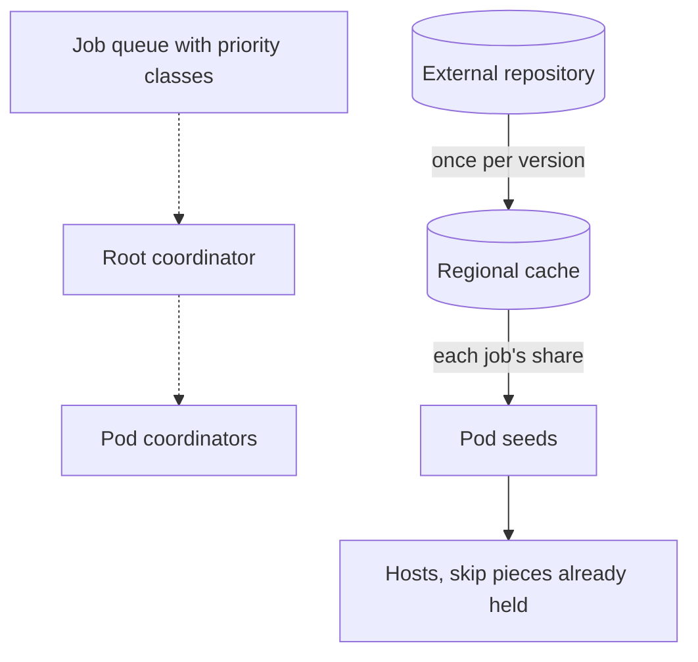

**Challenges.** Low-priority jobs run well past their floor. Preheating spends disk and bandwidth on versions that might be rolled back.

In a 45-minute interview I'd sketch the hierarchy in two sentences and spend the rest on quotas, because two models at once is the common follow-up.

## On Azure

The interview's 10 GB/s per host is close to a real Azure number, and the real InfiniBand number moves the bottleneck.

**GPU hosts.** ND H100 v5 (`Standard_ND96isr_H100_v5`) has 8 H100 GPUs, 96 vCPUs, 80,000 Mbps of front-end bandwidth across 8 NICs, 3.2 Tbps of InfiniBand, and 8 NVMe disks totalling 28 TiB ([ND H100 v5](https://learn.microsoft.com/azure/virtual-machines/sizes/gpu-accelerated/ndh100v5-series)). ND H200 v5 lists the same network and disks ([ND H200 v5](https://learn.microsoft.com/azure/virtual-machines/sizes/gpu-accelerated/nd-h200-v5-series)). The bandwidth limit applies to outbound traffic, and inbound isn't measured or limited directly ([VM network throughput](https://learn.microsoft.com/azure/virtual-network/virtual-machine-network-throughput)).

$$
\begin{aligned}
\text{front end} &= 80{,}000\ \text{Mbps} = 10\ \text{GB/s out} \\
\text{InfiniBand} &= 3.2\ \text{Tbps} = 400\ \text{GB/s} \\
500\ \text{GB over InfiniBand} &= 500\ \text{GB} \div 400\ \text{GB/s} = 1.25\ \text{s}
\end{aligned}
$$

The front end matches the interview's given, and uncapped inbound puts you in the full-duplex case. Peers should use InfiniBand wherever they can, because it is 40 times faster. Then disk writes and hashing set the rate, since even all 96 vCPUs at the assumed 1 GB/s each hash under 100 GB/s. If the GPUs are training, distribution traffic competes with the job's collectives, so cap it or use the front end.

**Model staging.** Stage each version in Azure Blob Storage in the cluster's region, the regional cache from deep dive 4, behind a private endpoint on the Microsoft backbone ([private endpoints](https://learn.microsoft.com/azure/storage/common/storage-private-endpoints)). Seeds read with ranged Get Blob calls ([Get Blob](https://learn.microsoft.com/rest/api/storageservices/get-blob)). A standard general-purpose v2 account in the listed major regions defaults to 200 Gbps of egress, 50 Gbps elsewhere, with increases on request ([account targets](https://learn.microsoft.com/azure/storage/common/scalability-targets-standard-account)). That is 25 GB/s, so the external floor drops to $500\ \text{GB} \div 25\ \text{GB/s} = 20\ \text{s}$. A single block blob targets up to 3,000 requests a second ([blob targets](https://learn.microsoft.com/azure/storage/blobs/scalability-targets)). At 25 GB/s, 4 MiB ranges would need about 6,000 a second, so seeds read 64 MB chunks, about 390 a second. Azure Machine Learning registries can catalog versions and replicate them across regions ([registries](https://learn.microsoft.com/azure/machine-learning/how-to-manage-registries)), but seeds still read Blob.

**Buy instead of build.** Dragonfly is a CNCF project, accepted in 2018 and graduated on October 28, 2025 ([CNCF](https://www.cncf.io/projects/dragonfly/)). Its scheduler picks the best parents for each download, seed peers act as roots, and a peer on each node uploads and downloads ([Dragonfly docs](https://d7y.io/docs/)). It installs on Kubernetes with Helm ([quick start](https://d7y.io/docs/getting-started/quick-start/kubernetes/)), and a post on the CNCF blog lists Azure Blob Storage among Dragonfly's backends, with an example where a 130 GB model on 200 nodes cuts origin traffic from 26 TB to about 130 GB ([CNCF blog](https://www.cncf.io/blog/2026/04/06/peer-to-peer-acceleration-for-ai-model-distribution-with-dragonfly/)). Azure Container Registry caps layers at 195 GiB ([ACR tiers](https://learn.microsoft.com/azure/container-registry/container-registry-skus)), so a 500 GB OCI artifact needs at least three layers. I'd build the coordinator in the interview and run Dragonfly in production unless the InfiniBand layout needs a custom scheduler.

**A shared file system instead.** Azure Managed Lustre imports from Blob ([Blob integration](https://learn.microsoft.com/azure/azure-managed-lustre/blob-integration)) and mounts in AKS through a CSI driver ([overview](https://learn.microsoft.com/azure/azure-managed-lustre/amlfs-overview)). Its top tier is 500 MBps per TiB, with a 128 TiB default maximum and up to 1,024 TiB ([create a file system](https://learn.microsoft.com/azure/azure-managed-lustre/create-file-system-portal)). Throughput comes with capacity, and every host reading its own copy reads 500 TB.

$$
\begin{aligned}
128\ \text{TiB} \times 500\ \text{MBps/TiB} &\approx 64\ \text{GB/s} \Rightarrow 500\ \text{TB} \div 64\ \text{GB/s} \approx 2.2\ \text{h} \\
1{,}024\ \text{TiB} \times 500\ \text{MBps/TiB} &\approx 512\ \text{GB/s} \Rightarrow 500\ \text{TB} \div 512\ \text{GB/s} \approx 16\ \text{min}
\end{aligned}
$$

Lustre wins when many hosts read different files, such as training data. For one file onto every host, peer-to-peer wins, because every new copy adds bandwidth.

**Orchestration and state.** AKS supports GPU node pools ([GPU nodes](https://learn.microsoft.com/azure/aks/gpu-cluster)), and the agent runs as a DaemonSet. Slurm shops can use Azure CycleCloud Workspace for Slurm ([CCWS](https://learn.microsoft.com/azure/cyclecloud/overview-ccws)) and run the agent as a system service. AKS manages InfiniBand only for GB200 and GB300 sizes, in preview ([Grace Blackwell on AKS](https://learn.microsoft.com/azure/aks/use-grace-blackwell-series-gpus)). On H100 node pools you install the NVIDIA Network Operator yourself ([RDMA over InfiniBand on AKS](https://azure.github.io/aks-rdma-infiniband/)), so test it before you plan around it and keep the front end as the fallback. The coordinator runs as three replicas that elect a leader with a Kubernetes Lease, the object kubelets use for heartbeats ([Leases](https://kubernetes.io/docs/concepts/architecture/leases/)). The job record goes in Azure Cosmos DB for NoSQL, well under the 2 MB item limit ([limits](https://learn.microsoft.com/azure/cosmos-db/concepts-limits)).

**Security.** Grant Storage Blob Data Reader ([storage roles](https://learn.microsoft.com/azure/role-based-access-control/built-in-roles/storage)) on the model container only to the managed identity of a seed-eligible host group, so most hosts never hold storage access. Pods get Microsoft Entra tokens through Workload ID ([Workload ID](https://learn.microsoft.com/azure/aks/workload-identity-overview)). Azure Key Vault holds the signing key and signs a digest with ES256, RS256, or PS256 ([Sign](https://learn.microsoft.com/rest/api/keyvault/keys/sign/sign)), once per version, and hosts verify locally. A Key Vault Premium HSM-backed key already sits on FIPS 140-3 Level 3 validated HSMs. Use Managed HSM if policy also requires a single-tenant HSM ([Managed HSM](https://learn.microsoft.com/azure/key-vault/managed-hsm/overview)).

**Observability.** Agents export to Azure Monitor managed service for Prometheus ([overview](https://learn.microsoft.com/azure/azure-monitor/metrics/prometheus-metrics-overview)) with Azure Managed Grafana dashboards ([overview](https://learn.microsoft.com/azure/managed-grafana/overview)). A workspace defaults to 1 million active time series ([limits](https://learn.microsoft.com/azure/azure-monitor/service-limits)), and one series per chunk per host would be 7.8 million. So agents emit per-host progress, and the coordinator emits one histogram of how many hosts hold each chunk. See [observability](../04-azure/observability.md).

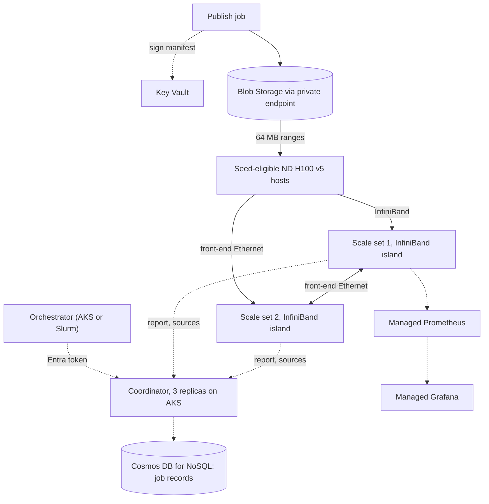

| Component | Azure service | Setting, and why |
| --- | --- | --- |
| GPU hosts | ND H100 v5 or ND H200 v5 | 10 GB/s out, 3.2 Tbps InfiniBand, 28 TiB NVMe |
| Model staging | Blob Storage | Standard GPv2, private endpoint, 64 MB range reads |
| Coordinator | AKS | Three replicas, Kubernetes Lease election |
| Host agents | AKS DaemonSet or CycleCloud Workspace for Slurm | One per GPU host |
| Job record | Cosmos DB for NoSQL | One item per job |
| Signing key | Key Vault or Managed HSM | Signs the manifest digest at publish |
| Identity | Managed identity and Workload ID | Blob read for seed-eligible hosts only |
| Metrics | Managed Prometheus and Grafana | Per-host series and one chunk histogram |
| Buy option | Dragonfly on AKS | Blob backend, CNCF graduated |

### Why these choices

- **Blob over a shared file system.** Blob serves the one pull per version at 25 GB/s, and peers multiply it. Even the largest 500 MBps/TiB Lustre file system, about a petabyte, takes about 16 minutes to give every host its own copy.
- **Hosts hold their own progress.** NVMe disks are temporary storage, and data might be lost on maintenance, redeploy, or stop ([temporary disk](https://learn.microsoft.com/azure/virtual-machines/managed-disks-overview)). A host that comes back empty reports an empty bitmap and rejoins.

### Gotcha

InfiniBand doesn't span the fleet. A scale set uses InfiniBand only within one placement group, scale sets are isolated from each other, and a placement group caps at 100 VMs by default, 300 on request ([set up InfiniBand](https://learn.microsoft.com/azure/virtual-machines/setup-infiniband)). So 1,000 hosts form at least four islands. A scheduler that assumes any pair can use InfiniBand sees cross-island transfers fail or fall back to the front end. Treat each island as a rack, put seed-eligible hosts in every island, and let chunks cross islands once each over the front end.

See [compute choices](../04-azure/compute-choices.md), [networking and security](../04-azure/networking-and-security.md), and [data choices](../04-azure/data-choices.md).

## What is expected at each level

### Mid-level

I expect you to do the naive math, land on "pull once, then share between hosts", and draw a coordinator that tracks who holds which chunk. You should chunk the model and verify each chunk against a hash. I'd prompt you on the duplex question and on a dying host, and resuming a failed host from its last chunk is a pass. I wouldn't hold chunk-size math, Merkle roots, or the hierarchy against you.

### Senior

I look for the duplex and disk questions before the math, both floors derived, and the three possible bottlenecks named. You keep the coordinator off the data path and say why. You reject the tree because its leaves don't upload, and reach rarest first and rack awareness on your own. You use leases instead of locks, persist bitmaps on hosts, and verify every piece before serving it.

### Staff+

I look for you to notice that the full-duplex floor needs nearly every host uploading at line rate, and to let that drive the topology. You justify chunk size by decision rate, not memory. You make the coordinator replaceable by treating hosts as the source of truth and fencing a stale leader. You raise the signed manifest before I ask, and budget cores for hashing. On Azure you find the InfiniBand island limit and the per-blob request target, and say when Managed Lustre beats the swarm.

## Further reading

- [Dragonfly documentation](https://d7y.io/docs/)
- [CNCF: Peer-to-peer acceleration for AI model distribution with Dragonfly](https://www.cncf.io/blog/2026/04/06/peer-to-peer-acceleration-for-ai-model-distribution-with-dragonfly/)
- [Uber Kraken](https://github.com/uber/kraken)
- [BEP 3: The BitTorrent protocol specification](https://www.bittorrent.org/beps/bep_0003.html)
- [Bram Cohen: Incentives build robustness in BitTorrent](https://bittorrent.org/bittorrentecon.pdf)
- [BLAKE3](https://github.com/BLAKE3-team/BLAKE3)
- [Hello Interview: Handling large blobs](https://www.hellointerview.com/learn/system-design/patterns/large-blobs)
- [The Coding Gopher: TCP vs. UDP Explained](https://thecodinggopher.substack.com/p/tcp-vs-udp-explained)
- [The Coding Gopher: Partitioning, Sharding, and Chunking Explained](https://thecodinggopher.substack.com/p/partitioning-sharding-and-chunking)
- [Blob storage](../02-building-blocks/blob-storage.md), [large blobs](../03-patterns/large-blobs.md), [networking essentials](../01-fundamentals/networking-essentials.md), [identity and auth](../02-building-blocks/identity-and-auth.md)
