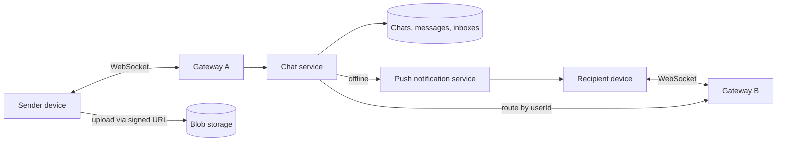
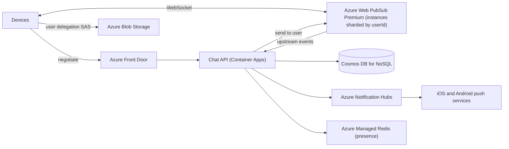

## TL;DR

Clients hold a persistent WebSocket to a connection gateway. The chat service persists every message before acknowledging it, assigns a per-chat sequence number, writes an inbox entry for each recipient device, and pushes the message to whichever gateway holds each device. Devices acknowledge delivery, which deletes their inbox entries; offline devices drain their inbox on reconnect and get a push notification meanwhile. Undelivered messages expire after 30 days. Media goes straight to blob storage and travels as a link. On Azure: Azure Web PubSub Premium (sharded by user) for connections, Cosmos DB for NoSQL for chats, messages, and inboxes with TTL, Notification Hubs for offline push, and Blob Storage with user delegation SAS for media.

## Requirements

### Functional

- Start 1:1 chats and group chats of up to 100 participants.
- Send and receive text messages in real time.
- Receive messages sent while offline, for up to 30 days.
- Send images and video (as attachments).
- Use the same account on several devices (phone, laptop, tablet).

Out of scope: voice and video calls, end-to-end encryption key management, read receipts, and message search. End-to-end encryption changes what the server can read, not the delivery architecture, so mention it and move on.

### Non-functional

- Delivery latency under 500 ms when the recipient is online.
- Guaranteed delivery: once the sender sees "sent", the message is never lost.
- Per-chat ordering: everyone in a chat sees messages in the same order.
- Store messages on the server no longer than needed (delete on delivery, hard cap of 30 days).
- Billions of users; survive the loss of any single server or zone.

## Capacity estimates

Assumptions: 1 B daily active users, 20 messages sent per user per day, 20% of DAU online at peak, 1.5 devices per user, 300 B per message (encrypted text plus metadata), most chats 1:1.

| Quantity | Arithmetic | Result |
| --- | --- | --- |
| Messages sent | 1 B × 20 ÷ 86,400 s | about 230,000 msg/s average, 500,000 peak |
| Recipient deliveries | 230,000 × about 1.5 recipient devices (1:1 dominant, some groups) | about 350,000 deliveries/s average |
| Concurrent connections | 1 B × 20% × 1.5 devices | about 300 M WebSockets at peak |
| Message storage per day | 20 B × 300 B | 6 TB/day |
| Worst-case retained | 6 TB × 30 days (if nothing were ever delivered) | 180 TB ceiling |
| Realistic retained | most delivered within minutes and deleted | a small fraction of the ceiling |

The connection count is the defining number. 300 million open sockets need a gateway tier that does nothing but hold connections and forward bytes, kept separate from the business logic so you can deploy chat logic without dropping 300 million sockets.

## Core entities and API

### Entities

- **User**: `id`, `phone`, `lastSeenAt`.
- **Device**: `id`, `userId`, `pushToken`.
- **Chat**: `id`, `participants` (up to 100), `lastSeq`.
- **Message**: `chatId`, `seq`, `id` (client-generated UUID), `senderId`, `body`, `attachments`, `createdAt`.
- **InboxEntry**: `deviceId`, `chatId`, `seq`. One per undelivered message per recipient device.

### Protocol

Clients speak a small set of commands over the WebSocket. HTTP is used only for setup and media.

```text
client -> server  sendMessage { chatId, clientMsgId, body, attachments }
server -> client  ack         { clientMsgId, seq }          // persisted, safe to show "sent"
server -> client  newMessage  { chatId, seq, senderId, body, ... }
client -> server  delivered   { chatId, upToSeq }            // per device
client -> server  sync        { cursors: { chatId: lastSeq } }

POST /v1/chats                    { participants }        -> 201 { chatId }
POST /v1/attachments              { contentType, size }   -> 200 { uploadUrl, attachmentUrl }
```

The `clientMsgId` makes `sendMessage` idempotent: a client that loses its connection before seeing the `ack` resends with the same ID and the server returns the existing `seq`. See [idempotency and retries](../03-patterns/idempotency-and-retries.md).

## High-level design



### Send path

1. The sender's gateway forwards `sendMessage` to the chat service.
2. The chat service assigns the next `seq` for the chat and writes the message and the chat's new `lastSeq` atomically.
3. It writes an inbox entry for each recipient device, then sends `ack` to the sender.
4. It looks up which gateway holds each recipient device and forwards `newMessage`. Recipients that are offline get a push notification instead.

### Receive path

1. The recipient device shows the message and sends `delivered { chatId, upToSeq }`.
2. The chat service deletes that device's inbox entries up to `upToSeq`. When every device has acknowledged a message, the message itself can be deleted; a 30-day TTL catches the rest.
3. On reconnect, the device sends `sync` with its last known `seq` per chat, and the service replays everything newer from its inbox.

The inbox is what makes delivery guaranteed. Real-time push is the fast path and is allowed to fail, because the inbox is always the fallback.

## Deep dives

### 1. Routing a message to the right gateway

With hundreds of gateways, the chat service must find the one holding the recipient's socket.

| Option | How it works | Trade-off |
| --- | --- | --- |
| Connection registry | Gateways write `deviceId -> gatewayId` to a shared store on connect; the chat service looks it up and calls that gateway | An extra lookup per delivery, and stale entries after crashes. |
| Pub/sub per user | Each gateway subscribes to a channel per connected user; the chat service publishes to `user:{id}` | Simple, no registry. The pub/sub layer is at-most-once and becomes a very high fan-in component. |
| Deterministic placement | Hash `userId` to a gateway cluster; the client connects to that cluster, and the chat service sends there | No lookup at all. Rebalancing moves users when the cluster count changes, so use consistent hashing to move only a fraction. |

**Pick: deterministic placement with consistent hashing,** with each placement unit being a managed real-time service instance that knows which of its connections belong to which user. All of a user's devices land on the same unit, so "send to this user" reaches every device in one call. When you add units, consistent hashing moves about 1/N of users, who reconnect once. See [consistent hashing](../02-building-blocks/consistent-hashing.md) and [real-time updates](../03-patterns/real-time-updates.md).

### 2. Guaranteed delivery and multiple devices

Three places a message can be lost: before it is persisted, between persistence and push, and on the recipient device before it is shown.

- **Persist before ack.** The sender never sees "sent" until the message is durable. If the server dies first, the client resends with the same `clientMsgId`.
- **Inbox per device, not per user.** A laptop that was closed for a week must still catch up even though the phone acknowledged everything. Per-user inboxes would delete the message when the first device acknowledges it.
- **Acknowledge after display.** The device sends `delivered` only after writing the message to local storage.

The alternative some designs use is no inbox: each device keeps a cursor per chat and pulls `seq > cursor` on reconnect. That avoids the inbox write but requires keeping every message until the slowest device catches up or 30 days pass, and it makes "which chats changed while I was away" a scan over all of a user's chats. **Pick: per-device inbox,** because it makes reconnect a single-partition read and lets you delete messages as soon as delivery completes, which is also the privacy requirement.

### 3. Ordering and gaps

Timestamps from clients are skewed, and timestamps from many servers disagree by milliseconds, so neither orders a busy group chat reliably. See [time, clocks, and ordering](../05-advanced/time-clocks-and-ordering.md).

**Pick: a per-chat sequence number**, assigned by the chat service when it persists the message. A chat has at most 100 participants, so even a busy group produces a few messages per second, and a single counter per chat is not a bottleneck. Clients render by `seq` and detect gaps: if a device holds 41 and receives 43, it requests 42 through `sync`. Gaps are normal (a push arrives before a retried one), so the client fills them instead of treating them as errors.

### 4. Presence, heartbeats, and last seen

A TCP connection can die silently (a phone enters a tunnel). Without heartbeats, the gateway believes the device is online and the push goes nowhere, though the inbox still saves the message. Use a protocol-level ping every 30 seconds and treat two missed pings as disconnect.

"Last seen" is read rarely and written constantly. Write it to an in-memory store with a TTL on connect, heartbeat, and disconnect, and fetch it only when a user opens a chat. Do not broadcast presence changes to every contact; for a user with 500 contacts that turns every phone unlock into 500 messages.

### 5. Media

Never send a 50 MB video through the WebSocket. The client asks for an upload URL, uploads directly to blob storage, then sends a normal message containing the attachment URL. Recipients download from storage. Gateways and the chat service never touch the bytes. See [large blobs](../03-patterns/large-blobs.md) and [blob storage](../02-building-blocks/blob-storage.md).

## On Azure



| Component | Azure service | Tier or setting, and why |
| --- | --- | --- |
| Connection gateway | Azure Web PubSub | Premium_P2, which scales an instance from 100 to 1,000 units at 1,000 concurrent connections per unit, so about 1 M connections per instance. Users hashed across instances. Premium is the tier with availability zone support and geo-replication. |
| Chat service | Azure Container Apps | Stateless, zone-redundant environment. Receives Web PubSub events and client commands; calls the Web PubSub REST API to send to users. |
| Chats and messages | Azure Cosmos DB for NoSQL | `messages` container partitioned on `/chatId`, holding message items and one chat metadata item per chat. Default TTL 2,592,000 s (30 days). |
| Inboxes | Azure Cosmos DB for NoSQL | `inbox` container partitioned on hierarchical `/userId, /deviceId`, so reconnect is a single-partition query. Same 30-day TTL. |
| Presence and last seen | Azure Managed Redis | Balanced tier, keys with TTL, high availability on. |
| Offline push | Azure Notification Hubs | Sends through the platform push services on iOS and Android. Standard, the tier Microsoft recommends for medium to large production apps and the one with per-message telemetry for debugging failed pushes. |
| Media | Azure Blob Storage | Upload and download with a user delegation SAS scoped to one blob and minutes of validity. Lifecycle rule deletes attachments after 30 days. |

### Why these choices

- **Web PubSub sharding.** At 300 M concurrent sockets and about 1 M per Premium_P2 instance ([service limits](https://learn.microsoft.com/azure/azure-resource-manager/management/azure-subscription-service-limits)), you need roughly 300 instances. The negotiate endpoint returns the client URL for the instance that `hash(userId)` maps to, and the chat service sends to that instance. Web PubSub's send-to-user reaches all of a user's connections, which covers multi-device delivery. Each unit includes 1 M messages per day, so 300,000 units include far more than the roughly 30 B deliveries per day this design needs.
- **Reliable subprotocol.** Web PubSub's reliable subprotocols give clients a reconnection token, so a brief network drop resumes the same session instead of starting a new one ([reliable clients](https://learn.microsoft.com/azure/azure-web-pubsub/howto-develop-reliable-clients)). The inbox still covers longer gaps.
- **Sequence numbers with a transactional batch.** Read the chat metadata item to get `lastSeq` and its ETag. Submit a transactional batch in the chat's partition that replaces the metadata item with `lastSeq + 1`, conditioned on the ETag, and creates the message with `id = clientMsgId`. Batches are ACID within one logical partition ([transactional batch](https://learn.microsoft.com/azure/cosmos-db/transactional-batch)). A concurrent sender causes a `412` on the ETag and a retry. A resent message causes a `409` on the create, which tells the service to return the existing `seq`.
- **TTL instead of a cleanup job.** Set a default TTL of 30 days on both containers. Explicit deletes on acknowledgement remove most data much sooner ([time to live](https://learn.microsoft.com/azure/cosmos-db/time-to-live)).
- **User delegation SAS.** Microsoft recommends a user delegation SAS, signed with Microsoft Entra credentials rather than the account key, so you can revoke it without rotating keys ([SAS overview](https://learn.microsoft.com/azure/storage/common/storage-sas-overview)).

**When to self-host the gateway instead.** At this scale, hundreds of managed instances is a cost and operations question. The alternative is your own WebSocket gateway on AKS with a connection registry in Azure Managed Redis. Pick that when the per-unit price of managed connections exceeds the cost of running and patching your own fleet, or when you need a custom binary protocol. Below a few million concurrent connections, Web PubSub is the simpler choice by a wide margin.

### Zones and regions

Web PubSub Premium supports zone-redundant deployment and geo-replication ([Web PubSub reliability](https://learn.microsoft.com/azure/reliability/reliability-web-pubsub)). Enable zone redundancy on Cosmos DB in each region and on the Container Apps environment. For multi-region, home each user in a region (by phone number country or sign-up region), keep their inbox there, and route cross-region messages through the recipient's home region. Give each home region its own Cosmos DB account with a single write region and a read region elsewhere for failover, so sequence assignment never races across regions.

### Gotcha

The `messages` container's chat metadata item and all messages for a chat share one logical partition, which caps at 10,000 RU/s ([partitioning](https://learn.microsoft.com/azure/cosmos-db/partitioning)). That is plenty for a 100-person group. It is not plenty if product later adds broadcast channels with a million subscribers on the same design. Channels need fan-out on read and a different partitioning scheme, so cap group size in the API, not just in the UI.

See [messaging choices](../04-azure/messaging-choices.md) and [data choices](../04-azure/data-choices.md).

## Interview tips

- Separate "connection holding" from "chat logic" early. It answers deploys, scaling, and failure isolation in one move.
- Say "the inbox is the source of truth; push is an optimization". It shows you understand guaranteed delivery.
- Expect "how do you order messages?" Per-chat sequence numbers, assigned on persist, with client gap filling. Do not say "timestamps".
- Expect "what about a user with three devices?" Inbox per device and send-to-user across connections.
- Expect "what if a gateway dies?" Clients reconnect (possibly to a different instance after rehashing), call `sync`, and the inbox replays. No message is lost because nothing durable lived on the gateway.
- Do not propose WebSockets for media or HTTP polling for messages. Both are traps an interviewer will probe.

## Further reading

- [Hello Interview: Design a messaging app like WhatsApp](https://www.hellointerview.com/learn/system-design/problem-breakdowns/whatsapp)
- [The Coding Gopher: Intro to WebSockets](https://thecodinggopher.substack.com/p/a-deep-dive-into-websockets)
- [The Coding Gopher: Polling vs. long polling vs. SSE vs. WebSockets vs. webhooks](https://thecodinggopher.substack.com/p/polling-vs-long-polling-vs-sse-vs)
- [Azure Web PubSub overview](https://learn.microsoft.com/azure/azure-web-pubsub/overview)
- [Azure Notification Hubs FAQ](https://learn.microsoft.com/azure/notification-hubs/notification-hubs-push-notification-faq)
- [Real-time updates](../03-patterns/real-time-updates.md), [message queues](../02-building-blocks/message-queues.md), [identity and auth](../02-building-blocks/identity-and-auth.md)
