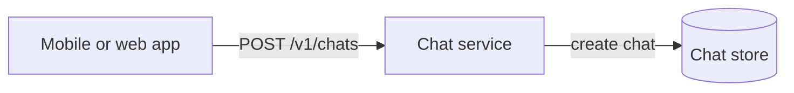
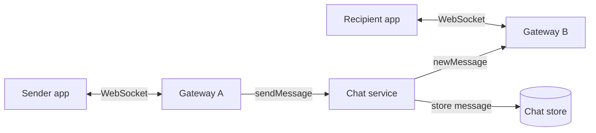
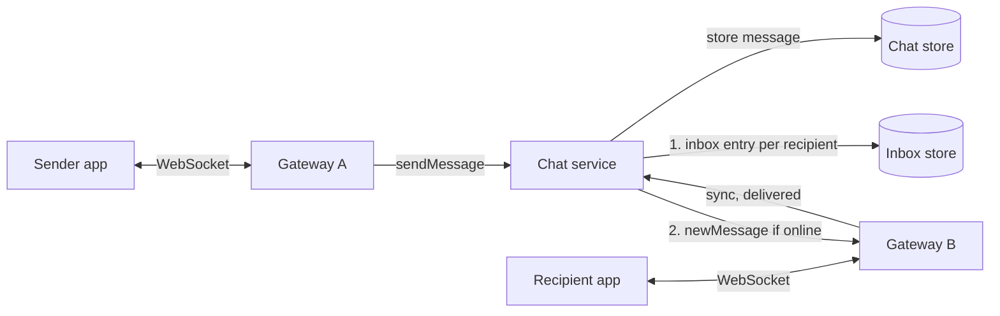
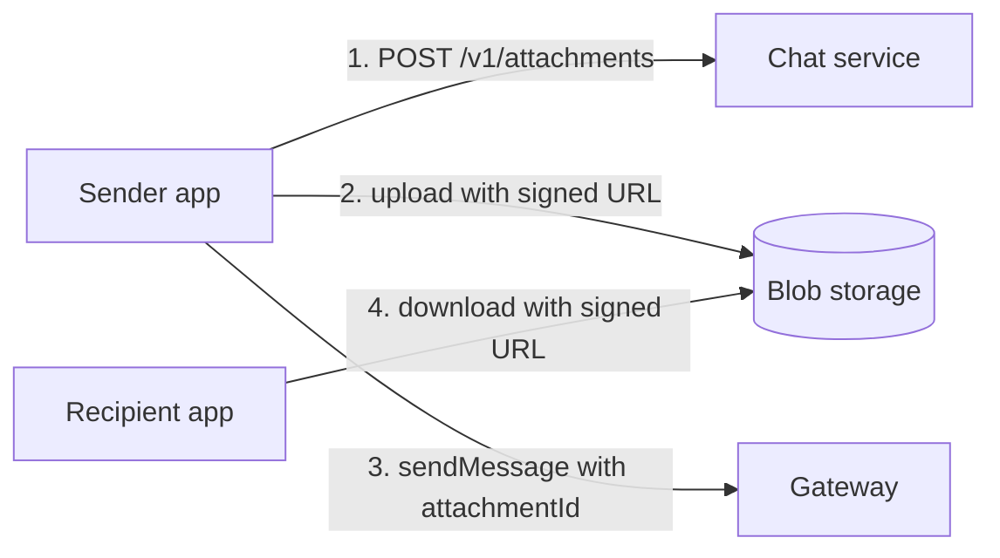
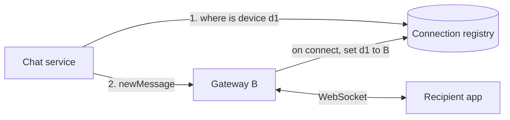
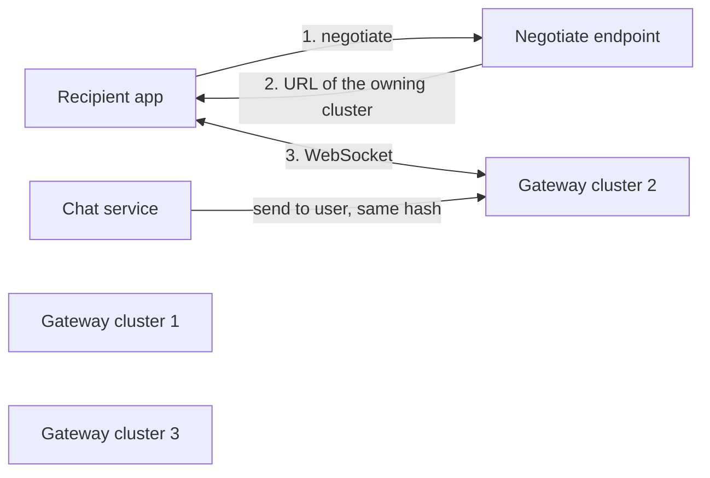
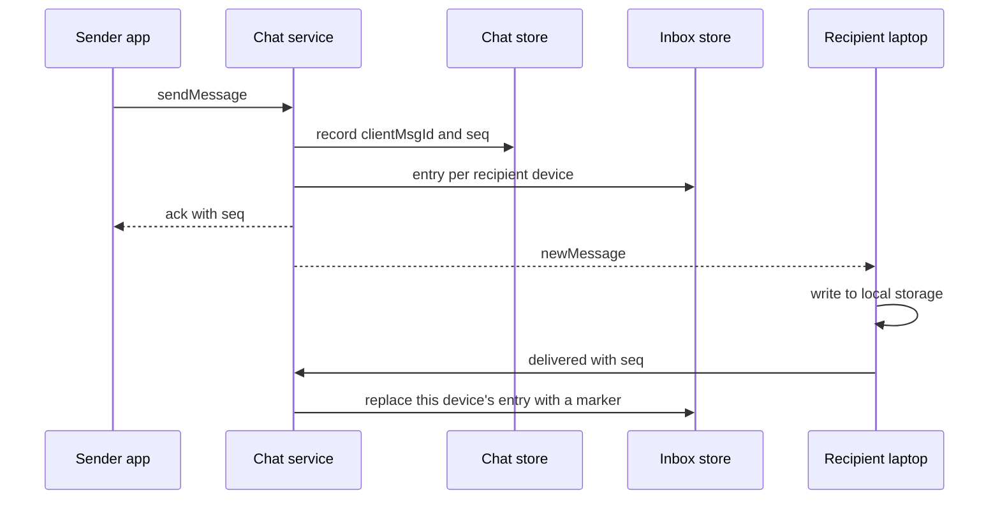
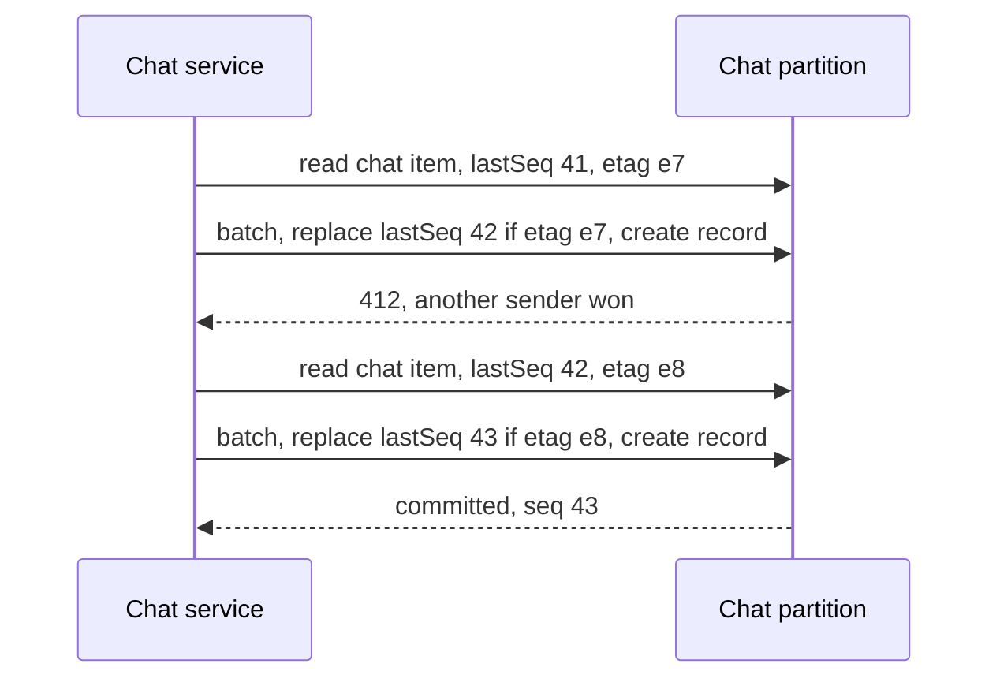
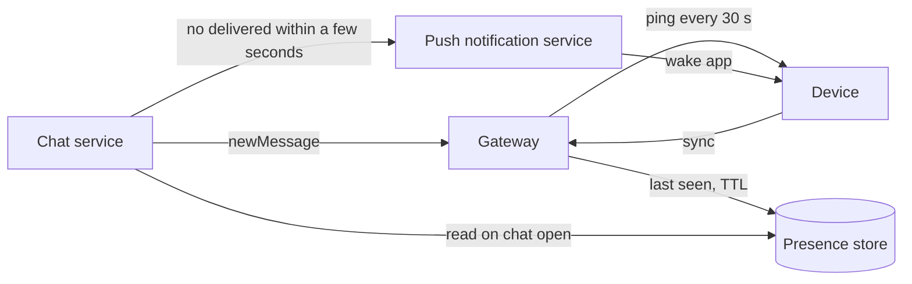
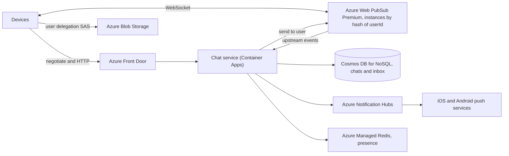

## Understanding the problem

**What is a chat messaging app?** It lets people send text, photos, and video to one person or a small group, the way WhatsApp or Messenger does. Each phone or laptop keeps a connection open, so a message shows up within moments. A message sent to someone whose phone is off waits on the server and arrives when the phone comes back.

Two things make it hard. About 300 million devices are connected at once, and each connection has to stay open for hours while carrying almost nothing. And "sent" is a promise. Once the sender sees it, the message has to reach every one of the recipient's devices, in the same order everyone else in the chat sees, even if a server dies mid-delivery. The server should also keep as little as possible, deleting each message once it is delivered.

## Functional requirements

1. Users should be able to start a 1:1 chat or a group chat of up to 100 people.
2. Users should be able to send and receive messages in real time.
   - Every device signed in to the account receives them.
3. Users should be able to receive messages sent while they were offline, for up to 30 days.
4. Users should be able to send images and video.

**Below the line (out of scope)**

- **Voice and video calls.** They need a media relay and a different protocol. Nothing here carries them.
- **End-to-end encryption key management.** It changes what the server can read, not how messages move, so the delivery design is the same.
- **Read receipts and typing indicators.** They are small events on the same connection, delivered the same way as messages.
- **Message search.** Server-side search needs history on the server, which conflicts with deleting messages on delivery.
- **Broadcast channels with millions of members.** They need fan-out on read, not a copy per device. The On Azure gotcha explains why the API caps group size.

I kept chat creation, live delivery, offline delivery, and media because each one adds a distinct piece to the design. The items above reuse those pieces or need a different system.

## Non-functional requirements

1. **Delivery is fast.** An online recipient sees a message within 500 ms.
2. **Delivery is guaranteed.** Once the sender sees "sent", the message reaches every recipient device, even if a server or zone fails.
3. **Order is consistent.** Everyone in a chat sees its messages in the same order.
4. **The server keeps as little as possible.** A message is deleted once every recipient device has it, and never kept longer than 30 days.
5. **It scales to billions of users.** About 1 billion are active each day, with 300 million devices connected at peak. Losing any one server or zone doesn't lose messages.

**Below the line**

- **Order across chats.** Two messages in different chats can arrive in either order. Nobody compares them.
- **History on a new device.** The server deletes delivered messages, so a new device starts empty. Moving history between a user's devices happens device to device.

The connection count is the number to watch. Assume 1 billion daily active users who each send 20 messages a day. That is $20\text{B messages} \div 86{,}400\ \text{s} \approx 230{,}000$ a second, peaking around 500,000. Most chats are 1:1, and users average about 1.5 devices, so each message reaches about 1.5 recipient devices, or 350,000 deliveries a second. If 20% of users are online at peak with 1.5 devices each, that is 300 million open WebSockets. At 300 bytes a message, a day of messages is 6 TB. If nothing were ever delivered, 30 days would hold 180 TB, but nearly everything is delivered within minutes and deleted. Those numbers decided two things. Holding sockets needs its own tier. An event loop built on epoll can keep hundreds of thousands of idle sockets on one server, but if that server also runs chat logic, every deploy drops them all. And the store's real load is writes and deletes, not storage. See [back-of-the-envelope estimation](../01-fundamentals/back-of-the-envelope.md) for the method.

:::tip
Split holding connections from chat logic early and say why. That one move answers deploys, scaling, and gateway failures before the interviewer asks.
:::

## Core entities

- **User.** An account, identified by phone number.
- **Device.** A phone, laptop, or tablet signed in to a user's account. Each device has its own connection and push token.
- **Chat.** A 1:1 or group conversation with up to 100 participants.
- **Message.** Text and attachment links sent by one participant into one chat.

Each store in the high-level design lists the fields it holds, and nothing more.

## API

Messages flow both ways all the time, so each device holds one WebSocket. Polling every few seconds from 300 million devices would cost about 100 million mostly empty requests a second. Server-sent events only push one way, and devices send as often as they receive. See [real-time updates](../03-patterns/real-time-updates.md) for the comparison.

The WebSocket carries five commands:

```text
client -> server  sendMessage { chatId, clientMsgId, body, attachments }
server -> client  ack         { clientMsgId, seq }
server -> client  newMessage  { chatId, seq, senderId, body, attachments }
client -> server  delivered   { chatId, seqs }
client -> server  sync        { }
```

`ack` tells the sender the message is stored, which is when the app shows "sent". `delivered` lists the messages a device has stored, and `sync` asks for everything waiting for this device. The `clientMsgId` is a UUID the app generates before sending. A device that loses its connection before seeing `ack` resends with the same ID, and the server answers with the original `seq` instead of storing a second copy. The app resends for at most 23 hours, inside the day the server remembers the ID (deep dive 2), then marks the message failed. See [idempotency and retries](../03-patterns/idempotency-and-retries.md).

Creating a chat and uploading media are ordinary HTTP calls. A chat is created once, and media bytes don't belong on the socket.

```http
POST /v1/chats
Authorization: Bearer <token>
{ "participants": ["40213377", "77120954"] }

201 Created
{ "chatId": "c_8f31a2" }
```

```http
POST /v1/attachments
Authorization: Bearer <token>
{ "contentType": "video/mp4", "sizeBytes": 48211337 }

200 OK
{ "attachmentId": "att_19c2", "uploadUrl": "media.example.net/att_19c2?<signature>" }
```

## High-level design

Each requirement adds what it needs and nothing else. The deep dives fix what breaks at 300 million connections.

### 1) Users can start a chat



- **App.** The client on each of a user's devices.
- **Chat service.** A stateless service that owns chats and messages.
- **Chat store.** A partitioned document store, partitioned by chat ID.

1. The app sends `POST /v1/chats` with the participants.
2. The chat service checks the caller is a participant and that there are at most 100.
3. For a 1:1 chat it derives `chatId` from the two sorted user IDs, so a second create returns the same chat. A group gets a new ID.
4. It writes the chat item and returns `201 Created`.

The chat item holds `chatId`, the partition key, plus `participants` and `createdAt`.

### 2) Users can send and receive messages in real time



- **Gateway.** Holds WebSockets and forwards frames. It has no chat logic, so you can deploy the chat service without dropping 300 million sockets.
- **Chat service.** Now also stores and routes messages.
- **Chat store.** Now also holds messages, in the same partition as their chat.

1. The sender's app sends `sendMessage` over its socket, and the gateway forwards it to the chat service.
2. The chat service checks that the sender is in the chat.
3. It stores the message with `messageId` set to the `clientMsgId`, plus `chatId`, `senderId`, `body`, `attachments`, and `createdAt`.
4. It sends `ack` back to the sender, and the app shows "sent".
5. It finds the gateway holding each recipient's socket and sends `newMessage` there. Finding that gateway among hundreds is deep dive 1.

Storing before acknowledging is the first half of the delivery guarantee. If the chat service dies before step 3, the sender never sees "sent" and resends.

### 3) Users receive messages sent while offline



- **Inbox store.** One entry per undelivered message per recipient, partitioned by user ID.

1. Before it acknowledges the sender, the chat service writes an inbox entry for each recipient, holding `userId`, `chatId`, and `messageId`. Each entry gets a 30-day TTL.
2. It pushes `newMessage` to recipients who are online.
3. A recipient's app stores the message, shows it, and sends `delivered`. The service deletes the recipient's inbox entries that `delivered` names.
4. A recipient who was offline reconnects and sends `sync`. The service reads that user's inbox partition, sends everything in it, and deletes entries as `delivered` comes back.

The inbox is the guarantee, and the push is an optimization that is allowed to fail. If a push goes to a dead gateway, the entry is still waiting at the next `sync`. I'd key the inbox by user for now and flag that a second device breaks it, which deep dive 2 fixes.

### 4) Users can send images and video



- **Blob storage.** Holds attachments, written and read with short-lived signed URLs.

1. The sender's app asks for an upload URL, with the content type and size.
2. It uploads the file straight to blob storage.
3. It sends a normal `sendMessage` whose `attachments` field carries the attachment ID.
4. The recipient's app requests a download URL for that ID and fetches the file from storage.

The chat service and the gateways never touch media bytes. A lifecycle rule deletes attachments after 30 days to match the message limit. See [large blobs](../03-patterns/large-blobs.md) and [blob storage](../02-building-blocks/blob-storage.md).

:::warning
Never send media over the WebSocket. A 50 MB video holds up every message queued behind it on that connection and drags the bytes through gateways sized for tiny frames.
:::

## Deep dives

The design works on a whiteboard. The deep dives make it hold at 300 million connections, one requirement at a time.

### 1) How does a message find the gateway that holds the recipient's socket?

This serves requirement 1. There are hundreds of gateways, and the chat service has to reach the right one within the 500 ms budget.

#### Bad solution: Send every message to every gateway

**Approach.** The chat service sends each `newMessage` to all gateways. The one that holds the recipient's socket delivers it, and the rest drop it.

**Challenges.** Every delivery costs one internal message per gateway. At 350,000 deliveries a second and 300 gateways, that is over 100 million internal messages a second, almost all of them thrown away. Adding gateways to hold more sockets makes every delivery more expensive.

#### Good solution: Look up the gateway in a connection registry

**Approach.** When a device connects, its gateway writes `deviceId → gatewayId` to a shared in-memory registry with a TTL that the heartbeat refreshes. The chat service looks up each recipient device and calls that gateway directly.



**Challenges.** Each delivery adds a registry read, 350,000 a second. When a gateway crashes, its registry entries point at a dead server until their TTL expires, and pushes to it fail. The inbox still holds those messages, so they arrive late, not never. Pub/sub with one channel per user removes the lookup, but most pub/sub layers deliver at most once and turn into a very high fan-in hub.

#### Great solution: Place each user on a gateway cluster by hashing their ID

**Approach.** Hash `userId` onto a ring of gateway clusters with consistent hashing. When the app connects, it first calls a negotiate endpoint, which returns the address of the cluster that owns that user. The chat service computes the same hash to send, so it needs no lookup. Each cluster tracks its own connections by user, which a managed real-time service does for you. All of a user's devices land on the same cluster, so one "send to user" call reaches every device. See [consistent hashing](../02-building-blocks/consistent-hashing.md).



**Challenges.** Adding a cluster moves about $1/N$ of users, whose devices reconnect once to their new owner. During that window some devices sit on the old cluster, so the chat service sends to both owners until the move finishes, and the inbox covers anything missed. A cluster failure disconnects its whole share of users at once, so clients reconnect with jittered backoff instead of all at the same instant.

In a 45-minute interview I'd draw the registry first, because it's the easiest to explain, then switch to hashing once the interviewer asks what the lookup costs at 350,000 deliveries a second.

### 2) How does every device get every message after "sent"?

This serves requirements 2 and 4. A message can be lost in three places. It can be lost before it is stored, between storing it and pushing it, or on the device before the app saves it. A user with a phone and a laptop also has two devices that each need every message.

#### Bad solution: One inbox per user, cleared on the first acknowledgement

**Approach.** Keep the high-level design. Each user has one inbox, and any device's `delivered` deletes the entries.

**Challenges.** The phone acknowledges a message and deletes it before the laptop, closed all week, ever sees it. The laptop's `sync` comes back empty, and the user's history differs by device.

#### Good solution: A cursor per device over the chat's message log

**Approach.** Drop the inbox. Keep every message in its chat's partition in `seq` order. Each device stores, per chat, the last `seq` it has, and on reconnect asks each chat for anything newer.

**Challenges.** The server can't delete a message until the slowest device of every participant has read past it, so nearly everything stays for the full 30 days. That conflicts with requirement 4. Reconnect also turns into a scan. A user in 300 chats queries 300 partitions to find the few that changed.

#### Great solution: An inbox entry per device that carries the message

**Approach.** Write one inbox entry per recipient device, including the sender's other devices, partitioned by device. Each entry carries the whole message, about 300 bytes, so `sync` is a single-partition read with no second lookup. A device acknowledges a message only after writing it to local storage, and that acknowledgement replaces only that device's entry with a marker that has no body and expires in a day. `sync` skips markers. The chat partition no longer needs the body. It keeps a small record of each message's `clientMsgId` and `seq` for a day to catch resends, which outlasts the app's 23 hours of resending, so a delivered message leaves the server when its last device acknowledges it.



**Challenges.** Writes multiply by devices. A message to a 100-person group writes about 150 inbox entries before the sender sees "sent", and inserting each costs about 5.5 RU in Cosmos DB, so 350,000 deliveries a second average about 1.9 million RU/s and peak near 4 million. Markers on acknowledgement add more on top. If the service crashes after recording the message but before every entry exists, the sender never got `ack` and resends. The resend finds the existing record and fills in the entries from its body. Each entry's ID is the chat ID plus `seq`, and the resend uses create, not upsert, so an entry that still exists or a device's marker refuses it with `409`. A device that already acknowledged never gets the message again, because its marker lives a day and resends stop after 23 hours.

:::tip
Say "the inbox is the source of truth and the push is an optimization" out loud. It tells the interviewer you know where the guarantee lives.
:::

In a 45-minute interview I'd state the three loss points, then go straight to per-device inboxes, because the phone-and-laptop question comes up almost every time.

### 3) How does everyone in a chat see messages in the same order?

This serves requirement 3. In a busy group, two people often send within the same second.

#### Bad solution: Order by the sender's clock

**Approach.** Each app stamps `createdAt` from its own clock, and every app sorts by it.

**Challenges.** Phone clocks drift by seconds or minutes, and some users set them by hand. A reply can sort above the question it answers, and each device can show a different order if clocks change mid-chat.

#### Good solution: Order by the server's clock

**Approach.** The chat service stamps `createdAt` when it stores the message, and apps sort by that.

**Challenges.** Many chat service replicas handle one chat, and their clocks disagree by milliseconds, so two near-simultaneous messages can still sort differently than they were stored. A timestamp also can't reveal a gap. A device holding messages at 10:01:02 and 10:01:05 can't tell whether one between them is missing. See [time, clocks, and ordering](../05-advanced/time-clocks-and-ordering.md).

#### Great solution: A sequence number per chat, assigned when the message is stored

**Approach.** Keep `lastSeq` on the chat item. To store a message, the chat service reads the chat item and its ETag, then submits one transactional batch in the chat's partition. The batch replaces the chat item with `lastSeq + 1`, on the condition that the ETag hasn't changed, and creates the message record with `id = clientMsgId`. If another sender won the race, the replace fails with `412` and the service retries with the new `lastSeq`. If the create fails with `409`, the message is a resend, and the service returns the `seq` it already has. Apps sort by `seq` and treat a jump as a gap. A device holding 41 that receives 43 sends `sync`, and 42 arrives from its inbox.



**Challenges.** Every message now costs a read, a replace, and a create in one partition. A replace costs twice an insert, so the write side is about 16.5 RU a message before any inbox entries. A chat has at most 100 people sending a few messages a second, so one counter per chat is never the bottleneck, and `412` retries stay rare. Gaps are normal, because a push can overtake an earlier one. Most fill on the next `sync`, but an empty `sync` doesn't prove 42 is gone, since 42 can be stored while its inbox entries are still being written. So the app acknowledges only the `seq` values it has, shows 43, and slots 42 in above it when a later push or `sync` brings it. A gap that never fills belongs to a sender whose app crashed and stopped resending. That sender never saw "sent".

In a 45-minute interview I'd rule out both clocks in one breath each and spend the time on the batch and the gap fill, because "how do you handle a gap?" is the follow-up.

### 4) How do we notice dead connections and reach devices that are offline?

This serves requirements 1 and 2. A phone that goes into a tunnel drops off the network without closing its socket. A phone that's asleep needs a push notification to know anything arrived.

#### Bad solution: Trust the socket and broadcast presence

**Approach.** Treat a device as online while its TCP connection is open. Whenever a user comes online or goes offline, send the change to every contact so their apps can show it.

**Challenges.** A dead TCP connection can look open for minutes, so the gateway keeps pushing into it and the user gets nothing until the inbox catches up on reconnect. Broadcasting presence is worse. A user with 500 contacts turns every phone unlock into 500 messages, and phones unlock all day.

#### Good solution: Heartbeats, push on missing acknowledgement, and last seen on demand

**Approach.** The gateway pings each socket every 30 seconds and closes it after two missed pongs. If a device hasn't sent `delivered` within a few seconds of a push, or has no socket at all, the chat service sends a push notification through the phone platform's push service. The notification wakes the app, which connects and sends `sync`. Last seen is written to an in-memory store with a TTL on connect, heartbeat, and disconnect, and read only when someone opens a chat with that user.



**Challenges.** A 30-second ping across 300 million sockets is 10 million pings a second, which the gateways absorb because a ping is a few bytes. Two missed pings means a dead socket can take up to a minute to notice, and the push timer covers that window. Push services are best effort, so a dropped notification only delays the message until the user opens the app. Last seen is a few seconds stale, which nobody notices.

In a 45-minute interview I'd give this two minutes. Heartbeats and push are expected, and the point to make is that presence is read on demand, never broadcast.

## On Azure

One region is shown. Each user is homed in one region, and that region holds their connections and inbox.



| Component | Azure service | Tier or setting, and why |
| --- | --- | --- |
| Gateway clusters | Azure Web PubSub | Premium_P2, which scales one instance from 100 to 1,000 units at 1,000 concurrent connections per unit, so about 1 million connections per instance. Users are hashed across instances. Premium adds zone redundancy and geo-replication. |
| Chat service | Azure Container Apps | Stateless, zone-redundant environment. Receives Web PubSub upstream events and calls the Web PubSub REST API to send to users. |
| Chats and sequence records | Azure Cosmos DB for NoSQL | `chats` container partitioned on `/chatId`, holding the chat item and a one-day record per message. |
| Inboxes | Azure Cosmos DB for NoSQL | `inbox` container on the hierarchical key `/userId`, `/deviceId`, so each device drains one logical partition. Default TTL 2,592,000 seconds, which is 30 days. An acknowledgement marker sets its own TTL of 86,400 seconds, one day. |
| Presence and last seen | Azure Managed Redis | Balanced tier, keys with TTL, high availability on. |
| Offline push | Azure Notification Hubs | Standard, which sends through the iOS and Android push services. |
| Media | Azure Blob Storage | Upload and download with a user delegation SAS scoped to one blob for a few minutes. A lifecycle rule deletes attachments after 30 days. |

### Why these choices

- **Web PubSub capacity.** At 300 million sockets and about 1 million per Premium_P2 instance, you need roughly 300 instances, or 300,000 units ([service limits](https://learn.microsoft.com/azure/azure-resource-manager/management/azure-subscription-service-limits)). The same page sets a default quota of 150 units per subscription per region, so this design needs a quota increase before the first load test. The negotiate endpoint returns the client URL for the instance that the hash of `userId` maps to. Web PubSub's send-to-user reaches every connection a user has, which covers multiple devices ([key concepts](https://learn.microsoft.com/azure/azure-web-pubsub/key-concepts)).
- **Web PubSub billing.** Only outbound traffic is billed, counted in 2 KB increments, and upstream events to the chat service count as outbound ([billing model](https://learn.microsoft.com/azure/azure-web-pubsub/concept-billing-model)). A day here has about 20 billion upstream sends, 20 billion acks, 30 billion deliveries, and up to 30 billion upstream `delivered` events, roughly 100 billion billable messages. Each unit includes 1 million messages a day, so 300,000 units include 300 billion.
- **Reliable subprotocol.** Web PubSub's reliable subprotocols give each client a connection ID and a reconnection token. A client that drops for less than about a minute recovers the same session without losing messages. After that, recovery reports possible loss and the client starts over ([reliable clients](https://learn.microsoft.com/azure/azure-web-pubsub/howto-develop-reliable-clients)). The inbox covers longer gaps.
- **Sequence numbers with a transactional batch.** Batches are ACID within one logical partition, up to 100 operations ([transactional batch](https://learn.microsoft.com/azure/cosmos-db/transactional-batch)). A lost ETag race returns `412` and a duplicate create returns `409` ([status codes](https://learn.microsoft.com/rest/api/cosmos-db/http-status-codes-for-cosmosdb)).
- **Request units.** A replace costs twice an insert, and an unindexed 1 KB insert costs about 5.5 RU ([request cost](https://learn.microsoft.com/azure/cosmos-db/optimize-cost-reads-writes)). At 500,000 messages a second, the sequence batch costs about 8 million RU/s and inbox inserts about 4 million, roughly 12 million RU/s at peak before acknowledgements. That is far past the default maximum of 1,000,000 RU/s per container, which a support ticket raises ([service quotas](https://learn.microsoft.com/azure/cosmos-db/concepts-limits)). Splitting users across home-region accounts divides it further.
- **TTL instead of a cleanup job.** Expired items stop showing in queries at once, and the background delete uses spare RUs ([time to live](https://learn.microsoft.com/azure/cosmos-db/time-to-live)). Acknowledgement strips the body from most entries far sooner, and each marker it leaves expires a day later.
- **Notification Hubs Standard.** Microsoft recommends Standard for medium and large production apps, and it adds per-message telemetry for debugging failed pushes ([FAQ](https://learn.microsoft.com/azure/notification-hubs/notification-hubs-push-notification-faq)). Standard includes 10 million pushes a month per subscription, so nearly every push here is beyond the included volume. Price that before you commit.
- **User delegation SAS.** It is signed with Microsoft Entra credentials, not the account key, which is why Microsoft recommends it ([SAS overview](https://learn.microsoft.com/azure/storage/common/storage-sas-overview)).

**When to self-host the gateway.** Hundreds of managed instances is a cost and operations question. The alternative is your own WebSocket gateway on AKS with a connection registry in Azure Managed Redis, which is the good solution from deep dive 1. Pick it when managed connection units cost more than running and patching your own fleet, or when you need a custom binary protocol. Below a few million concurrent connections, Web PubSub is far simpler.

### Zones and regions

Web PubSub Premium turns on zone redundancy automatically and lets you configure geo-replication. A zone or region failover still drops connections, so clients must reconnect ([Web PubSub reliability](https://learn.microsoft.com/azure/reliability/reliability-web-pubsub)). Make Cosmos DB zone-redundant in each region and create the Container Apps environment zone-redundant, a setting you can't add later ([Container Apps reliability](https://learn.microsoft.com/azure/reliability/reliability-container-apps)). For multiple regions, home each user in one region, by phone number country or sign-up region, and keep their inbox there. A message to a user homed elsewhere goes to that region's chat service. Give each home region its own Cosmos DB account with one write region and a read region elsewhere for failover, so sequence numbers are never assigned in two regions at once.

### Gotcha

A chat's item and its message records share one logical partition, which caps at 10,000 RU/s ([partitioning](https://learn.microsoft.com/azure/cosmos-db/partitioning)). At about 16.5 RU a message, that is roughly 600 messages a second for one chat, plenty for 100 people and not enough for a broadcast channel with a million members. Enforce the group cap in the API, not just the app. Separately, if the media storage account has blob soft delete on, a lifecycle delete only soft-deletes, and attachments stay for the soft-delete retention period past 30 days ([lifecycle management](https://learn.microsoft.com/azure/storage/blobs/lifecycle-management-overview)). Keep that retention short or turn soft delete off for that account.

See [messaging choices](../04-azure/messaging-choices.md), [data choices](../04-azure/data-choices.md), and [regions, zones, and resiliency](../04-azure/regions-zones-and-resiliency.md) to compare these services with their alternatives.

## What is expected at each level

### Mid-level

You should build all four requirements with a WebSocket for messages and HTTP for setup and media. That means a gateway the chat service can reach, messages stored before "sent", an inbox that holds messages for offline users, and media uploaded straight to storage. With a prompt, you should get from a broadcast to a registry for routing, and from timestamps to a sequence number for order. I'd expect to ask about the second device. If you can't fix it yet but can see that a per-user inbox breaks it, that's enough.

### Senior

You separate the gateway from chat logic early and say what it buys. You size the 300 million sockets and route with a registry or hashing, and you defend the choice. You find the three places a message can be lost, and you reach per-device inboxes on your own, with `clientMsgId` making resends safe. For order, you explain how a per-chat sequence is assigned without a race, and how clients fill gaps. You may need a nudge on dead sockets or presence broadcast, but you fix them quickly once I ask.

### Staff+

You treat the gateway fleet and the store as cost centers and show the arithmetic. That includes 300 instances against a 150-unit default quota, about 100 billion billable messages a day, and roughly 12 million RU/s at peak. You make "delete on delivery" exact by keeping the body only in inboxes, and you walk through the crash between recording a message and writing its entries. You say when to self-host the gateway instead of buying it, and you home users in regions so sequence numbers have one writer. You raise the partition cap that keeps groups small before anyone asks for channels.

## Further reading

- [Hello Interview: Design a messaging app like WhatsApp](https://www.hellointerview.com/learn/system-design/problem-breakdowns/whatsapp)
- [The Coding Gopher: Intro to WebSockets](https://thecodinggopher.substack.com/p/a-deep-dive-into-websockets)
- [The Coding Gopher: Polling vs. Long Polling vs. SSE vs. WebSockets vs. Webhooks](https://thecodinggopher.substack.com/p/polling-vs-long-polling-vs-sse-vs)
- [The Coding Gopher: Consistent Hashing 101](https://thecodinggopher.substack.com/p/consistent-hashing-for-dummies)
- [The Coding Gopher: epoll and kqueue: How Operating Systems Learned to Wait Efficiently](https://thecodinggopher.substack.com/p/epoll-and-kqueue-how-operating-systems)
- [Azure Web PubSub overview](https://learn.microsoft.com/azure/azure-web-pubsub/overview)
- [Azure Notification Hubs FAQ](https://learn.microsoft.com/azure/notification-hubs/notification-hubs-push-notification-faq)
- [Real-time updates](../03-patterns/real-time-updates.md), [consistent hashing](../02-building-blocks/consistent-hashing.md), [identity and auth](../02-building-blocks/identity-and-auth.md)
