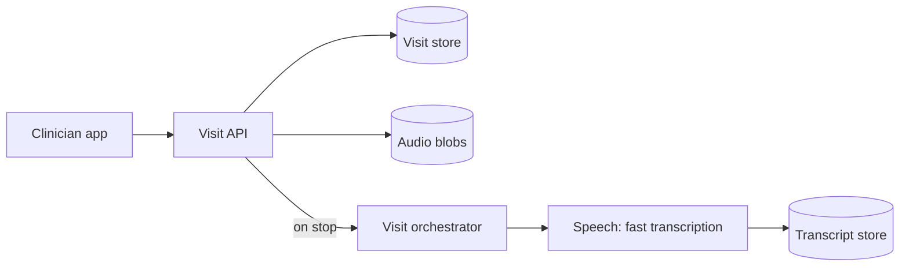
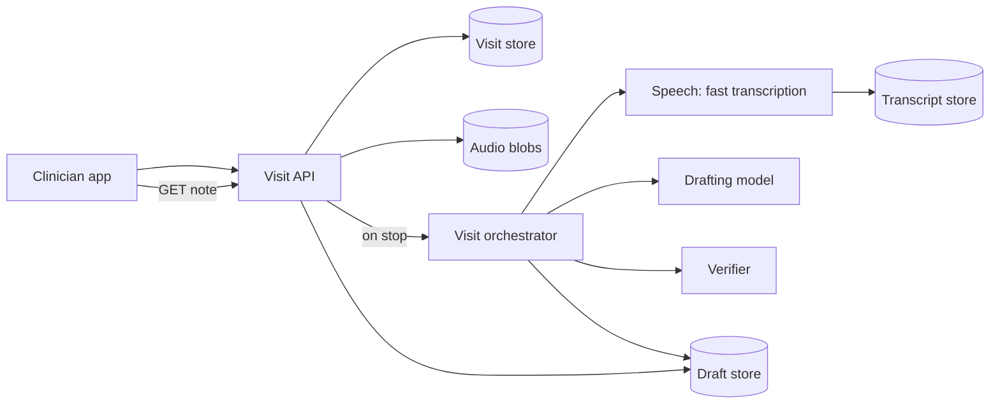
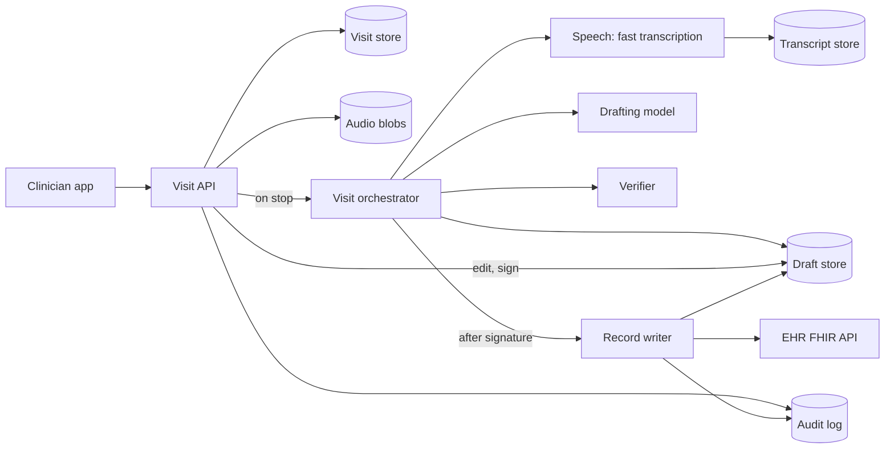
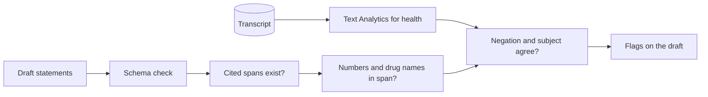
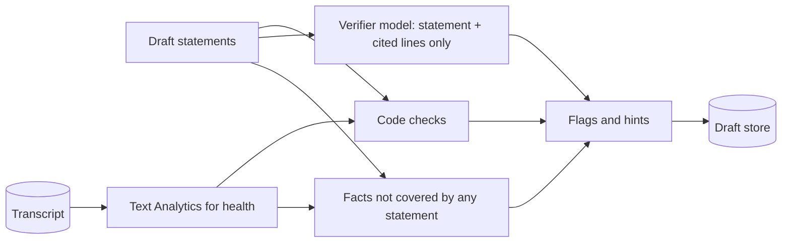
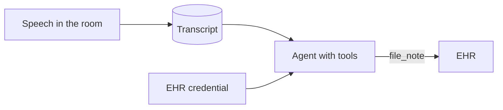
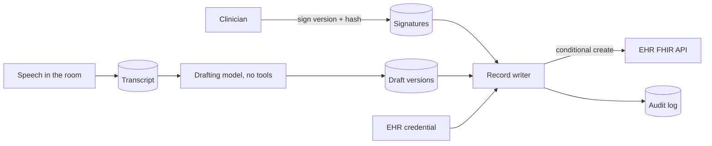
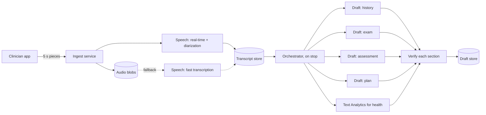
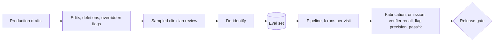
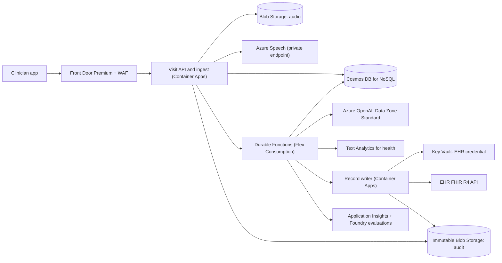

## Understanding the problem

**What is an ambient clinical scribe?** It is an app that listens to a clinician's visit with a patient and drafts the note. The clinician taps record once the patient agrees, talks as usual, and taps stop. About a minute later a draft is waiting in the clinic's note format. The clinician edits and signs it, and only then does it go into the patient's electronic health record (EHR).

Two things make it hard. The dangerous output is a fluent sentence that is wrong. A dose nobody said, or "denies chest pain" turned into "reports chest pain", reads like a correct line, and once signed it is what the next clinician believes. And every word spoken in the room reaches the model, while the system holds patient data and a path into the record.

Settle the model's job before drawing a box. It may draft statements and point at the transcript lines behind each one. It may never sign, write to the EHR, place an order, or add a medication or dose that nobody said, and it calls no tools. The steps are the same for every visit, so this is a fixed pipeline, not an agent loop ([fixed pipeline vs agent loop](../05-advanced/ai-systems-rag-and-agents.md#trade-offs)). The human gate and its guardrails are the patterns in [production AI agents](../05-advanced/production-ai-agents.md), and here the gate is the product. The page designs software. The clinician decides what the note says.

## Functional requirements

1. Clinicians should be able to record a visit after the patient consents and get a transcript that shows who said what.
2. Clinicians should be able to get a draft note within about a minute of stopping, with every statement linked to the transcript lines it came from and every unsupported statement flagged.
3. Clinicians should be able to edit the draft, resolve its flags, and sign it. Only a signed note reaches the EHR.

**Below the line (out of scope)**

- **Orders and prescriptions.** Each needs its own approval and checks, and a far larger write path.
- **Billing codes.** A different reviewer, accuracy target, and record.
- **Reading the patient's chart into the draft.** More patient data in front of the model, and a reconciliation problem.
- **Other languages, specialties, and care settings.** These change templates and the eval set more than the architecture.

I kept record, draft, and sign because together they are the loop the clinician feels. Most cuts add a second write path or more patient data in front of the model, the two things this design keeps small.

## Non-functional requirements

1. **No fabricated statement reaches the clinician unflagged.** Target at most 1 unflagged fabricated statement per 10,000. Separately, capture at least 95% of the key facts a clinician labels, such as medications, doses, allergies, and denied symptoms. Keep flags to a median of two or fewer per note, because a flag clinicians learn to click past protects no one. These are numbers you set with the health system's clinical safety lead, not industry constants. Fabrication and omission get separate targets because they pull in opposite directions. Tell a model to be careful and it drops facts. Tell it to be thorough and it fills gaps. One accuracy score would hide which way it moved.
2. **The draft is ready within 60 seconds at p95**, from stop to a reviewable note. Clinicians review between patients. A draft that arrives after the next patient walks in gets reviewed at the end of the day from memory, which is when wrong statements get signed.

   | Stage | p95 budget |
   | --- | --- |
   | Finish the transcript after stop | 5 s |
   | Draft the note | 25 s |
   | Verify statements and compute flags | 20 s |
   | Save and notify the app | 5 s |
   | Slack | 5 s |

3. **Nothing reaches the EHR without the treating clinician's signature on that exact version, and each signed version is filed once.** This is an invariant, not a percentage. Recording keeps working when the backend is down, because audio stays on the device until the backend confirms each piece.
4. **Patient data stays in one place, and every touch is recorded.** All protected health information (PHI) stays in one US geography, encrypted and reachable only over private endpoints. Each step sees only what it needs, so the drafter gets one visit's transcript and the note template, never the chart. HIPAA's Security Rule requires audit controls that record and examine activity in information systems that contain or use electronic PHI (45 CFR 164.312(b)). Every read, edit, signature, and filing goes to an append-only audit log.
5. **Scale to a health system with 2,000 clinicians, each seeing 20 visits a day.**

**Below the line**

- **Active-active across regions.** Recording continues on the device during an outage, so a failover of a few minutes costs a delay, not a note.
- **Cost per note.** Worth tuning once the quality targets hold.

The number that decides something here is audio, not tokens. Assume 15-minute visits spread over a 10-hour clinic day, with a peak of 1.5 times the average.

$$
\begin{aligned}
\text{audio per day} &= 40{,}000\ \text{visits} \times 15\ \text{min} = 600{,}000\ \text{min} \\
\text{concurrent streams} &= \frac{600{,}000\ \text{min}}{600\ \text{min}} = 1{,}000\ \text{on average},\ \approx 1{,}500\ \text{at peak}
\end{aligned}
$$

Real-time speech to text allows 100 concurrent requests per Speech resource on the S0 tier by default, and the limit is adjustable ([Speech quotas](https://learn.microsoft.com/azure/ai-services/speech-service/speech-services-quotas-and-limits)). At 1,500 streams you need a quota increase or several resources on day one, so say it in the first five minutes, not at launch review.

Tokens are modest by comparison. Call a 15-minute transcript 3,000 tokens. Drafting runs four section calls, each with the transcript and instructions, and verification sends each section's statements with only their cited lines.

$$
\begin{aligned}
\text{input per visit} &\approx 4 \times 4{,}000 + 4 \times 1{,}500 = 22{,}000\ \text{tokens} \\
\text{visits ending per minute} &\approx \frac{40{,}000}{600} \approx 67,\ \text{or } 100\ \text{at peak} \\
\text{peak input} &\approx 100 \times 22{,}000 = 2.2\ \text{million tokens per minute}
\end{aligned}
$$

Pay-per-token versus reserved capacity works as in the [AI chat assistant](./ai-chat-assistant.md). What shapes this design is the write gate. Everything before the signature is a proposal, and only a human turns a proposal into a record.

## Core entities

- **Visit.** One encounter, with its patient, clinician, consent record, and status.
- **Transcript.** Segments with a stable span ID, a speaker, timestamps, and text.
- **Draft note.** A versioned note made of statements. Each statement carries the span IDs that support it and any flags against it.
- **Signature.** Who signed which version, the hash of that version's text, and when.
- **Audit event.** One append-only record per read, edit, signature, or filing.
- **Eval case.** A visit transcript with clinician labels, used to test every change before release.

## API

The API is REST. The app polls for the draft or gets a push notification when it is ready. Nothing streams, for the reason in the tip below. The clinician comes from the Microsoft Entra ID token on every call, never the body.

Requirement 1 starts a visit. The consent record is part of the request, and the API refuses a visit without one.

```http
POST /v1/visits
Authorization: Bearer <token>
{ "patientRef": "Patient/8812", "consent": { "obtainedAt": "2026-10-14T09:02:00Z", "method": "verbal" } }

201 Created
{ "visitId": "v_5c1e", "status": "recording" }
```

The app uploads audio in 5-second pieces, each with a sequence number. Sending piece 42 twice stores piece 42 once.

```http
PUT /v1/visits/v_5c1e/audio/42
Authorization: Bearer <token>
Content-Type: audio/wav
<5 seconds of 16 kHz mono audio>

204 No Content
```

Stopping hands the visit to the pipeline.

```http
POST /v1/visits/v_5c1e/stop
Authorization: Bearer <token>

202 Accepted
{ "status": "drafting" }
```

Requirement 2 reads the draft. Each statement lists its evidence and its flags.

```http
GET /v1/visits/v_5c1e/note
Authorization: Bearer <token>

200 OK
ETag: "3"
{ "version": 3, "status": "ready",
  "sections": [ { "name": "medications", "statements": [
    { "id": "st7", "text": "Takes lisinopril 10 mg each morning.", "evidence": ["s14", "s15"], "flags": [] } ] } ] }
```

Requirement 3 edits and signs. An edit names the version it started from, and a sign request carries the hash of the text the app displayed.

```http
PATCH /v1/visits/v_5c1e/note
Authorization: Bearer <token>
If-Match: "3"
{ "statementId": "st9", "text": "No chest pain since the last visit.", "resolveFlag": "edited" }

200 OK
ETag: "4"
```

```http
POST /v1/visits/v_5c1e/note/sign
Authorization: Bearer <token>
{ "version": 4, "contentHash": "sha256:<hex>" }

202 Accepted
{ "status": "signed" }

409 Conflict   (open blocking flag, stale version, or hash mismatch)
```

:::tip
Don't stream the draft. Half a note whose later statements haven't been checked invites the clinician to start approving early, and a complete, verified draft in 60 seconds beats a partial one in 10. Streaming and resume are covered in the [AI chat assistant](./ai-chat-assistant.md).
:::

## High-level design

### 1) Clinicians record a consented visit and get a diarized transcript

Start with the simplest thing that works. Record on the phone, upload as you go, and transcribe the whole file after stop. Deep dive 3 moves transcription into the visit.



**Components.** The clinician app, the Visit API, a visit store, blob storage for audio, one orchestration per visit, a speech-to-text service with diarization, and a transcript store.

1. The app calls `POST /v1/visits`. The Visit API saves `{visitId, patientRef, clinicianId, consent, status}` with status `recording`.
2. The app uploads each 5-second piece with `PUT` and deletes it from the phone only after the `204`. A retry overwrites the same piece ([idempotency and retries](../03-patterns/idempotency-and-retries.md)), so a dropped connection costs a delay, never audio.
3. On stop, the API confirms every sequence number arrived, joins the pieces into one file, and starts the visit's orchestration.
4. The orchestrator sends the file to transcription with diarization on and saves segments as `{visitId, spanId, speaker, startMs, endMs, text}`. Span IDs are short and stable, like `s14`, because the model will cite them.

Diarization says which segments share a speaker, not who the speaker is. The draft step maps speakers to roles, and verification treats a wrong mapping as a failure, since a relative's history written as the patient's is a fabrication.

### 2) Clinicians get a draft note with evidence and flags



**Components.** Added are the drafting model, a verifier, and a draft store.

1. The orchestrator builds the prompt from the clinic's note template and the transcript, with each line prefixed by its span ID. That is everything the model sees.
2. The model returns JSON that must match a schema, enforced with structured outputs, so every statement arrives with an `evidence` list of span IDs. A response that fails the schema is retried, never patched by hand.
3. The verifier checks each statement against the lines it cites and attaches flags. Deep dive 1 builds it.
4. The orchestrator saves version 1 as `{visitId, version, sections, statements, flags, status}` and notifies the app.

### 3) Clinicians edit, resolve flags, and sign, and only signed notes reach the EHR



**Components.** Added are a record writer, the health system's EHR, and an audit log. I'd ask which interface the EHR exposes and assume a FHIR R4 API.

1. Each edit is a `PATCH` with `If-Match` on the version, so a phone and a desktop can't silently overwrite each other. Every edit makes a new version.
2. A blocking flag must be resolved before signing, by editing the statement, deleting it, or confirming it with a short reason.
3. On sign, the API checks that the caller is the visit's clinician, the version is the latest, no blocking flag is open, and the stored version's hash matches the one the app sent, so the clinician signs what was on screen. It saves `{visitId, version, clinicianId, contentHash, signedAt}` and raises an event to the visit's orchestration, which has waited since the draft was saved ([multi-step processes](../03-patterns/multi-step-processes.md)).
4. The orchestration hands the visit ID and version to the record writer, which checks everything again, creates the document in the EHR, and sets the status to `filed`.
5. Each step appends an audit event.

The pipeline's actions, and who may take each one:

| Action | Arguments | Side effect | Caller | Gate |
| --- | --- | --- | --- | --- |
| `transcribe` | visit ID, audio | Writes transcript segments | Orchestrator | None, internal data only |
| `draftNote` | transcript, template | Writes a draft version | Orchestrator | None, the output is a proposal |
| `verifyStatements` | statements, cited spans | Writes flags | Orchestrator | None |
| `editNote` | visit ID, version, change | Writes a new draft version | Clinician | `If-Match` on the version |
| `signNote` | visit ID, version, hash | Writes a signature | Clinician | Treating clinician, latest version, no open blocking flag, hash matches |
| `fileNote` | visit ID, version | Creates the EHR document | Record writer only | A valid signature on that version's hash |

The model takes none of these actions. It returns JSON, and code decides what happens next.

## Deep dives

### 1) How do we stop a fabricated statement from reaching the clinician unflagged?

This serves non-functional requirement 1.

#### Bad solution: Ask the model how sure it is

**Approach.** Add a `confidence` field to each statement and flag anything under 0.8. It is one prompt change and no new components.

**Challenges.** The number comes from the same generation that made the error. A model that wrote "20 mg" where the patient said "ten" isn't measuring anything when it writes 0.95 beside it. The score isn't calibrated to this failure, and the clinician gets a number instead of a reason to look.

#### Good solution: Evidence links that code checks

**Approach.** Make evidence mandatory in the schema, then check it with code. A statement with no evidence, or citing a span ID outside this visit, is flagged. Every number with a unit and every drug name must appear in a cited line, after normalizing spoken forms such as "ten milligrams" to "10 mg". Then run Text Analytics for health over the transcript. Its assertion detection marks "chest pain" as negative when the patient denies it, and marks a condition as belonging to someone other than the patient when a relative had it ([assertion detection](https://learn.microsoft.com/azure/ai-services/language-service/text-analytics-for-health/concepts/assertion-detection)). A statement that contradicts either is flagged.



**Challenges.** These checks catch shape errors, like a missing citation, a wrong number, or a flipped negation. They miss a statement that cites the right lines and still says something those lines don't, such as "symptoms worsening" when the patient said "about the same". The normalization rules also need an owner, since every specialty adds terms.

#### Great solution: An independent verifier and a backward check for omissions

**Approach.** Keep the code checks and add a second model call per section that sees each statement with only its cited lines and returns supported, partly supported, or unsupported with a one-line reason. Less context is the point, since the rest of the draft can't talk it into agreeing, and the reason becomes the flag text. Then check the other direction. Any medication, dose, or allergy that Text Analytics for health found about the patient and no statement covers becomes a non-blocking hint, "mentioned in the visit, not in the note", because the clinician may omit a fact on purpose.



**Challenges.** It adds a model call per section and uses most of the 20-second verification budget. A verifier from the same model family may share the drafter's blind spots, so deep dive 4 measures its recall on its own. And if most flags are wrong, clinicians click through them, so tune against the two-per-note budget, not recall alone.

:::info
Text Analytics for health is provided "AS IS", and Microsoft says it isn't intended or made available for use as a medical device, clinical support, or diagnostic tool ([overview](https://learn.microsoft.com/azure/ai-services/language-service/text-analytics-for-health/overview)). In this design it only raises flags for a clinician to look at. It never puts a fact into the note.
:::

In a 45-minute interview I'd draw the Good rung, name the independent verifier as the next step, and save the time for the write gate.

### 2) How do we guarantee nothing reaches the EHR unsigned, whatever is said in the room?

This serves non-functional requirement 3. Simon Willison's lethal trifecta names three capabilities that must not meet in one system, which are access to private data, exposure to untrusted content, and a way to communicate externally ([the lethal trifecta](https://simonwillison.net/2025/Jun/16/the-lethal-trifecta/)). A scribe has all three by default. The transcript is patient data, anything said in the room is untrusted, and filing to the EHR or loading a link on the review screen are ways out. You can't remove the first two without removing the product, so break the third by construction ([guardrails in production AI agents](../05-advanced/production-ai-agents.md)).

#### Bad solution: A filing tool behind an instruction

**Approach.** Run the drafter as an agent with a `file_note` tool and a system prompt that says to call it only after the clinician approves. The agent holds the EHR credential so the tool works.



**Challenges.** The rule is text, and so is the transcript. A sentence in the room that reads like an instruction competes with the system prompt, and one success files a note nobody signed. Even if the prompt holds, you can't show an auditor that it held on every visit.

#### Good solution: No tools, and a signed status

**Approach.** Remove every tool, so the model returns JSON and nothing else. When the clinician signs, the API sets the draft's status to `signed`, and the orchestrator files any signed note with the EHR credential it holds.

**Challenges.** The gate is a field in a store the pipeline itself writes. A bug that sets it, or an edit that lands after the signature, files text the clinician never approved, and `signed` doesn't record which text was signed. The credential also sits in the process that handles transcript text and model output.

#### Great solution: A record writer that checks a signed hash

**Approach.** Move filing into its own service with its own managed identity, the only one allowed to read the EHR credential. Signing binds the clinician, the version, and a SHA-256 hash of that version's text. The writer rereads the version, recomputes the hash, checks the signature and flags, and only then creates a FHIR `DocumentReference` with `docStatus` set to final and the clinician as `authenticator` ([DocumentReference](https://hl7.org/fhir/R4/documentreference.html)). An `If-None-Exist` header on an identifier built from the visit ID and version turns a retry into `200 OK`, not a duplicate ([conditional create](https://hl7.org/fhir/R4/http.html)). Every check is audited, and the review screen renders statements as plain text, so a link or image in model output is never fetched.



**Challenges.** It adds a service and an identity to run. A change after filing needs an amendment, a new signed document that `relatesTo` the old one with the code `replaces`. And FHIR R4 marks conditional create as trial use and doesn't expect every server to implement it, so confirm the EHR supports it. If not, search by identifier before creating, and rely on one orchestration per visit so two writers never race.

:::warning
Rendering the draft as Markdown reopens the third leg. An image reference in a statement makes the clinician's browser request that URL, carrying whatever the model put in it, the moment the note opens. Willison lists loading an image and offering a link to click among the ways a tool can pass data to an attacker.
:::

This deep dive is the heart of the problem, so in 45 minutes I'd go straight to the Great rung.

### 3) How is the draft ready within a minute of the visit ending?

This serves non-functional requirement 2. Look at the budget first. Transcription gets 5 seconds after stop, so almost all of the transcript has to exist before stop.

#### Bad solution: Batch transcription after the visit

**Approach.** On stop, submit the file as a batch transcription job and poll until it finishes.

**Challenges.** Batch transcription is scheduled best effort. At peak, a job can take up to 30 minutes to start and up to 24 hours to finish ([batch transcription](https://learn.microsoft.com/azure/ai-services/speech-service/batch-transcription)). That's fine for re-running the eval set overnight and useless against a 60-second target.

#### Good solution: Fast transcription after the visit

**Approach.** This is the high-level design. Send the joined file to fast transcription, which runs synchronously and faster than real time with predictable latency, and supports diarization ([fast transcription](https://learn.microsoft.com/azure/ai-services/speech-service/fast-transcription-create)). Files must be under 500 MB and under 5 hours, far beyond any visit ([Speech quotas](https://learn.microsoft.com/azure/ai-services/speech-service/speech-services-quotas-and-limits)).

**Challenges.** All the audio waits for stop, so transcription time grows with the visit and eats the drafting budget. The draft runs as one long call, and verification waits for it. Fast and batch transcription also share 600 requests per minute per resource, which 100 visits a minute at peak fits inside with little room for re-runs.

#### Great solution: Stream during the visit and fan out after it

**Approach.** The ingest service feeds each audio piece into a real-time transcription session with diarization, so at stop only the last few seconds remain ([diarization](https://learn.microsoft.com/azure/ai-services/speech-service/get-started-stt-diarization)). A phrase list of the clinic's common drug names helps recognition without training a model ([phrase lists](https://learn.microsoft.com/azure/ai-services/speech-service/improve-accuracy-phrase-list)). Audio still lands in blobs, so if streaming fails the orchestrator sends the stored file to fast transcription. After stop, it drafts each section in its own call, transcript first so the calls share a cacheable prompt prefix, and verifies each section as soon as it returns. Text Analytics for health runs during drafting.



**Challenges.** Each visit in progress holds a real-time session, so 1,500 streams need a quota increase or several resources behind the ingest service. A real-time diarization session runs at most 240 minutes, so rotate sessions on very long visits ([Speech quotas](https://learn.microsoft.com/azure/ai-services/speech-service/speech-services-quotas-and-limits)). Sections can contradict each other, so the verifier adds a check across sections. Drafting during the visit is the other option, but each new minute of talk can revise what came before, so you'd pay for drafts nobody reads and still need a final pass.

In a 45-minute interview I'd draw the Great rung and name the concurrency quota, since it's the number most likely to block launch.

### 4) How do we know the scribe is safe before launch, and notice when it drifts?

This serves non-functional requirement 1, and it's how you show the numbers in it are true.

#### Bad solution: A demo set and one score

**Approach.** Run 20 recorded visits, compare each draft to the clinician's own note with a text-overlap score, and ship when the average clears a threshold.

**Challenges.** Overlap scores reward wording. A note with one invented dose overlaps a correct note almost perfectly. Twenty visits say nothing about a 1-in-10,000 rate. And one score blends fabrication with omission, the trade-off you most need to see.

#### Good solution: A labeled set scored on fabrication and omission separately

**Approach.** Build an eval set from scripted visits with actors and from consented real visits, de-identified before engineers see them. Clinicians label each visit's key facts and mark each draft statement supported or not. Score fabrication rate, unsupported statements over all statements, and omission recall, key facts captured over key facts labeled, as separate numbers, plus flag precision. A model judge can scale the labels once you've measured its agreement with clinicians on a held-out slice. Every change to the prompt, model version, template, or verifier must clear all three before release. In [precision and recall](https://thecodinggopher.substack.com/p/precision-vs-recall-vs-f1-score-vs) terms, omission is a recall problem and flags are a precision problem.

**Challenges.** Labels are expensive, and the end-to-end target is tiny. If $n$ statements come back clean, the 95% upper bound on the true failure rate $p$ lands near $3/n$, the rule of three. For 1 in 10,000 that is about 30,000 clean statements, roughly 750 notes at 40 statements each, for every release.

$$
\begin{aligned}
P(\text{no failures in } n) &= (1-p)^n \le 0.05 \\
n &\ge \frac{\ln 20}{-\ln(1-p)} \approx \frac{3}{p} \\
p = 10^{-4} \;&\Rightarrow\; n \approx 30{,}000\ \text{statements}
\end{aligned}
$$

#### Great solution: Measure the parts, repeat the runs, and watch production

**Approach.** Split the target into parts you can measure. Estimate the drafter's fabrication rate $h$ on labeled statements and the verifier's recall $r$ on known fabrications, real ones from pilot reviews plus injected ones made to look like them. The unflagged rate is about $h(1-r)$. If the drafter fabricates 1 statement in 100, the verifier needs 99% recall, and by the same rule 300 caught fabrications in a row show it, a set you can build. Run every eval visit $k$ times and report $\text{pass}^k$, the share of visits where all $k$ runs have zero unflagged fabrications, because output varies between runs and a clinician sees only one. The τ-bench paper proposed this metric for reliability over repeated trials ([τ-bench](https://arxiv.org/abs/2406.12045)). In production, run continuous evaluation on sampled drafts, watch what clinicians delete, rewrite, or override, and add the de-identified disagreements to the eval set.



**Challenges.** The product $h(1-r)$ assumes the verifier misses fabrications at random, and it won't. Misses cluster on subtle ones, which injected examples imitate worst, so weight real fabrications and treat the estimate as optimistic. Clinician edits are noisy, since many are about style. And the eval set is patient conversations, so it needs production's access control and audit.

In a 45-minute interview I'd present the Good rung with its separate metrics and the rule-of-three sizing, then reach for the split into $h$ and $r$ if the interviewer asks how you'd ever prove 1 in 10,000.

## On Azure

Everything runs in one US geography, behind private endpoints, under Microsoft's HIPAA business associate agreement.



| Component | Azure service | Tier or setting, and why |
| --- | --- | --- |
| Edge | Azure Front Door | Premium with WAF, for managed rules and Private Link to the origin. |
| Visit API, ingest, record writer | Azure Container Apps | Zone-redundant environment, with the record writer as its own app and identity. |
| Audio | Azure Blob Storage | Private endpoint, deleted on the health system's retention schedule. |
| Transcription | Azure Speech in Foundry Tools | S0, raised real-time concurrency quota, diarization, phrase lists. |
| Clinical entities | Text Analytics for health in Azure Language | Assertion detection for negation and subject. |
| Drafting and verifier models | Azure OpenAI in Microsoft Foundry Models | Data Zone Standard in the US, structured outputs, modified abuse monitoring. |
| Orchestration | Azure Functions with Durable Functions | Flex Consumption with virtual network integration, Durable Task Scheduler backend. |
| Visits, drafts, signatures | Azure Cosmos DB for NoSQL | Partition key `/visitId`, local auth disabled, signatures in their own container. |
| Audit log | Azure Blob Storage | Locked time-based retention with protected append writes. |
| EHR credential | Azure Key Vault | A vault for the record writer alone. |
| Test EHR | FHIR service in Azure Health Data Services | Synthetic patients for integration tests. |
| Eval data | De-identification service in Azure Health Data Services | De-identify transcripts before they join the eval set. |
| Tracing and evaluation | Application Insights, Foundry evaluations | Sampled continuous evaluation, no transcript text in traces. |

### Why these tiers

- **Speech.** Real-time diarization needs the Speech SDK, since the short-audio REST API doesn't support it ([diarization](https://learn.microsoft.com/azure/ai-services/speech-service/get-started-stt-diarization)). Private endpoints require a custom domain ([Speech private endpoints](https://learn.microsoft.com/azure/ai-services/speech-service/speech-services-private-link)). Audio and transcription logging is off by default, so leave it off and keep the transcript store as the only copy ([logging](https://learn.microsoft.com/azure/ai-services/speech-service/logging-audio-transcription)).
- **Text Analytics for health.** The REST API is asynchronous and keeps results for 24 hours, while the container runs synchronously ([call the API](https://learn.microsoft.com/azure/ai-services/language-service/text-analytics-for-health/how-to/call-api)), so choose the container if the privacy office objects to results sitting on the service for a day.
- **Azure OpenAI.** Data Zone deployments process prompts only within the chosen data zone, here the US ([deployment types](https://learn.microsoft.com/azure/foundry/foundry-models/concepts/deployment-types)). Data at rest, including the abuse monitoring store, stays in the customer's geography, and prompts aren't used to train models ([data privacy](https://learn.microsoft.com/azure/foundry/responsible-ai/openai/data-privacy)). Structured outputs enforce the JSON Schema ([structured outputs](https://learn.microsoft.com/azure/foundry/openai/how-to/structured-outputs)), and a transcript-first prompt clears the 1,024-token prefix that prompt caching needs ([prompt caching](https://learn.microsoft.com/azure/foundry/openai/how-to/prompt-caching)).
- **Durable Functions.** An orchestration can wait for an external event, which Learn describes for approvals ([external events](https://learn.microsoft.com/azure/azure-functions/durable/durable-functions-external-events)), so each visit's orchestration waits on the signature. Use the Durable Task Scheduler as the managed backend ([Durable Task Scheduler](https://learn.microsoft.com/azure/azure-functions/durable/durable-task-scheduler/durable-task-scheduler)). Flex Consumption adds virtual network integration and needs at least two always-ready instances per function group for zone redundancy ([Flex Consumption](https://learn.microsoft.com/azure/azure-functions/flex-consumption-plan)).
- **Cosmos DB.** `/visitId` keeps a visit's versions and flags in one partition. Disable local auth so every request carries an Entra ID identity, and scope a role assignment to a single container ([role-based access](https://learn.microsoft.com/azure/cosmos-db/how-to-setup-rbac)). Data-plane actions split create from replace and upsert ([data plane actions](https://learn.microsoft.com/azure/cosmos-db/nosql/security/reference-data-plane-actions)), so with signatures in their own container, the API's role there can create signatures but never rewrite them.
- **Audit log.** Protected append writes let you add blocks to an append blob under a retention policy while existing blocks can't be changed or deleted ([container-level WORM](https://learn.microsoft.com/azure/storage/blobs/immutable-container-level-worm-policies)). A locked policy can't be deleted and its period can only be extended ([immutable storage](https://learn.microsoft.com/azure/storage/blobs/immutable-storage-overview)), so set it with the health system's compliance team.
- **FHIR service and de-identification.** The [FHIR service](https://learn.microsoft.com/azure/healthcare-apis/fhir/overview) supports conditional create ([supported features](https://learn.microsoft.com/azure/healthcare-apis/fhir/fhir-features-supported)), so it can stand in for the EHR in tests. The de-identification service redacts or replaces 27 entity types, including the 18 HIPAA identifiers ([de-identification](https://learn.microsoft.com/azure/healthcare-apis/deidentification/overview)).
- **Tracing and evaluation.** Foundry runs evaluators continuously on sampled production traffic ([observability](https://learn.microsoft.com/azure/foundry/concepts/observability)). Traces can capture inputs and outputs, and Learn says to redact personal data before telemetry ([tracing](https://learn.microsoft.com/azure/foundry/observability/concepts/trace-agent-concept)), so log span IDs and flag reasons, not transcript text.
- **HIPAA.** Microsoft offers a HIPAA business associate agreement by default through the Product Terms for in-scope Azure services ([HIPAA on Azure](https://learn.microsoft.com/azure/compliance/offerings/offering-hipaa-us)). Confirm every service above is in scope. The agreement covers Microsoft's side, and who can open a transcript or how long audio lives is still your design.

### Zones and regions

Turn on zone redundancy for Container Apps, Cosmos DB, and the Flex Consumption app, and use zone-redundant storage for blobs. For a regional failure, run a second stack in another US region with its own Speech and Language resources and a model deployment in the same data zone, and add that region to Cosmos DB. Recording continues on the phone, so failover delays drafts but loses no audio. See [regions, zones, and resiliency](../04-azure/regions-zones-and-resiliency.md) and [networking and security](../04-azure/networking-and-security.md).

### Gotcha

Prompts and completions that Azure OpenAI's abuse monitoring flags may be reviewed by authorized Microsoft employees ([abuse monitoring](https://learn.microsoft.com/azure/foundry/openai/concepts/abuse-monitoring)). For transcripts of medical visits, the privacy office will want that settled before launch. Customers approved for modified abuse monitoring through the Limited Access form don't get human review. It's an application, not a setting, so file it when you start building.

See [observability](../04-azure/observability.md) and [data choices](../04-azure/data-choices.md) for the general reasoning.

## What is expected at each level

### Mid-level

I expect you to get the pipeline on the board without help, from record and upload through transcribe, draft, review, sign, and file. When I ask what stops the model from inventing a dose, a nudge toward evidence links that code checks is fine. You should know the EHR write happens only after signing, even if your check lives in the same service that drafts. I wouldn't hold deep dive 4's split into drafter and verifier rates against you.

### Senior

I look for you to say what the model may and may not do before you draw, and to keep it out of the write path unprompted. You drive deep dive 1 to an independent verifier, explain why fabrication and omission are measured apart, and find that the Speech quota, not tokens, is the scale constraint. In deep dive 2 you move the EHR credential into a separate writer and bind the signature to a hash of the exact version. I may need to point you at the review screen as a way out for data, or at duplicate filings on retry.

### Staff+

I look for you to name the trifecta and break it by construction, not instruction, and to treat the EHR write as the only consequential action. You size the eval set with the rule of three, see that 1 in 10,000 is provable only by measuring drafter and verifier separately, and name the independence assumption that makes that estimate optimistic. You raise operating details I'd otherwise drag out, like abuse monitoring's human review, results kept on a service for a day, transcript text in traces, and amendments after filing. You treat flag precision as a safety number.

## Further reading

- [Simon Willison: The lethal trifecta for AI agents](https://simonwillison.net/2025/Jun/16/the-lethal-trifecta/)
- [τ-bench: A Benchmark for Tool-Agent-User Interaction in Real-World Domains](https://arxiv.org/abs/2406.12045)
- [The Coding Gopher: Precision vs. Recall vs. F1 Score vs. ROC-AUC](https://thecodinggopher.substack.com/p/precision-vs-recall-vs-f1-score-vs)
- [What is Text Analytics for health?](https://learn.microsoft.com/azure/ai-services/language-service/text-analytics-for-health/overview)
- [HL7 FHIR R4: DocumentReference](https://hl7.org/fhir/R4/documentreference.html)
- [HIPAA on Azure](https://learn.microsoft.com/azure/compliance/offerings/offering-hipaa-us)
- [Production AI agents](../05-advanced/production-ai-agents.md), [AI systems, RAG, and agents](../05-advanced/ai-systems-rag-and-agents.md), [multi-step processes](../03-patterns/multi-step-processes.md), [AI chat assistant](./ai-chat-assistant.md)
- *Cracking the AI System Design Interview*, Aishwarya Naresh Reganti and Kiriti Badam (LevelUp Labs, 2026), chapter 11. Recommended companion reading for this case.
