## Understanding the problem

**What is a customer-support agent?** It is a chat on a retailer's website and app where a model answers shoppers and does simple account work for them. It answers from the help center, looks up and cancels orders, and starts refunds. When it isn't sure, it hands the conversation to a human support agent with everything it has learned.

The model is trusted to read, explain, and propose. It is never trusted to decide policy, move money, or touch an order the signed-in customer doesn't own. Two things make that hard. A fluent wrong answer about a return window costs more than an honest "let me get someone", so the system has to know when it doesn't know. And the agent reads untrusted text from customers and past tickets while holding tools that change real orders.

## Functional requirements

1. Customers should be able to ask a question and get an answer drawn from the help center, with a link to the article it came from.
   - When the help center doesn't cover the question, the agent says so and offers a person.
2. Customers should be able to check, cancel, and request refunds on their own orders.
   - A cancel needs the customer's confirmation. A refund waits for a support agent's approval.
3. Customers should be able to reach a person at any point without repeating themselves.
4. Customers should be able to come back days later and have the agent know their relevant past tickets.

**Below the line (out of scope)**

- **Voice and other languages.** Each adds a stage and its own eval set on top of the same core.
- **Streaming and model capacity.** SSE, stream resume, and reserved versus pay-per-token capacity work as in the [AI chat assistant](./ai-chat-assistant.md).
- **Help-center ingestion.** I'd assume an indexer keeps the chunked, embedded index fresh.
- **Several cooperating agents.** One agent with five tools fits this job, and splitting it adds tokens before one agent is even measured.

These four are a support desk's job, which is to answer, act, escalate, and remember.

## Non-functional requirements

1. **No invented policy.** Fewer than 0.5% of answers make a claim the cited help-center text doesn't support, measured apart from the abstention rate so refusing everything can't meet it. A wrong refund window is a promise the company may have to keep, while an abstention costs a few minutes of a person's time.
2. **Escalate when it should.** The agent hands off at least 95% of the conversations labeled as needing a person, such as a legal threat. Total handoffs stay under 20%, for the staffing reason below.
3. **Actions are safe by construction.** The agent reaches only the signed-in customer's orders, a cancel takes effect at most once, and no money moves until a named support agent approves. Order state is read live at action time, choosing consistency over availability.
4. **Replies feel like chat.** A help-center answer arrives within 4 s at p95 and a reply that calls a tool within 5 s, with a progress status inside 500 ms.
5. **A handoff never loses context, and an outage degrades to a person.** If the model or search is down, new conversations go straight to the human queue.

The latency budget for a reply that calls one tool, at p95:

| Stage | Budget |
| --- | --- |
| Load the conversation and memory notes | 50 ms |
| Prompt-injection check on the message, in parallel with retrieval | 300 ms |
| Hybrid retrieval and rerank | 500 ms |
| Model call that picks a tool | 800 ms |
| Order system call | 300 ms |
| Model call that writes a 150-token answer | 2,500 ms |
| Groundedness check on the answer | 500 ms |

The injection check hides behind retrieval, so the total is $50 + 500 + 800 + 300 + 2{,}500 + 500 = 4{,}650\ \text{ms}$. Writing the answer dominates, so answers stay short. The customer sees an answer only after the groundedness check passes, for reasons deep dive 1 explains.

**Below the line**

- **Satisfaction scores.** Tracked, but deep dive 5 explains why they can't be the gate.
- **Cost per conversation.** Token budgets work as in the AI chat assistant.

Every handoff and every approval spends a person's time, and that shapes this design most. Take 40,000 conversations a day, the 20% handoff ceiling, and 8 minutes for a person to finish a case:

$$
\begin{aligned}
\text{handoffs} &= 40{,}000 \times 0.20 = 8{,}000\ \text{a day} \\
\text{human time} &= 8{,}000 \times 8\ \text{min} \approx 1{,}070\ \text{h a day} \\
\text{staff} &\approx 1{,}070 / 7\ \text{h a shift} \approx 150\ \text{people}
\end{aligned}
$$

Each point of handoff rate is 400 cases, about 53 hours, or 8 people. So the abstention floor in deep dive 1 is a business threshold, not a model setting. Traffic is small by comparison. At 5 turns a conversation, $200{,}000 / 86{,}400 \approx 2.3$ turns a second, and about 23 in a holiday peak hour.

## Core entities

- **Customer.** A signed-in shopper. The token carries the customer ID.
- **Conversation.** One support chat, with its messages and a status of agent, waiting on approval, with a person, or closed.
- **Help-center chunk.** A passage of a help-center article, with the article's URL for the citation.
- **Action.** One tool call that changes something, with its arguments, status, idempotency key, and approver.
- **Ticket.** The closed record of a conversation. Its notes are the agent's long-term memory.
- **Eval case.** A scripted customer goal, plus the order-system state that should exist when it's done.

Fields come later, next to the store that holds each one.

## API

The product API is REST, plus a server-sent events (SSE) stream for replies that resumes the way the [AI chat assistant's](./ai-chat-assistant.md) does. The customer comes from the `Authorization` token, never the body. Tools the agent calls are internal and never appear here.

A conversation starts when the customer opens the chat, for requirement 1.

```json
POST /v1/conversations
-> 201 { "conversationId": "cv_7Q2", "status": "agent" }
```

Each message returns an event stream with answers for requirement 1 and proposed actions for requirement 2.

```json
POST /v1/conversations/{conversationId}/messages
{ "text": "Where is order 58-1193? I want to cancel it." }
-> 200 text/event-stream
event: status   data: { "text": "Checking order 58-1193" }
event: action   data: { "actionId": "ac_44", "kind": "cancel_order", "orderId": "58-1193",
                        "items": 2, "total": "64.10", "needs": "customer_confirmation" }
event: answer   data: { "text": "...", "citations": [{ "articleId": "kb-212", "url": "help.shop.example/cancel" }] }
```

The customer confirms a proposed cancel with one call, for requirement 2.

```json
POST /v1/conversations/{conversationId}/actions/{actionId}/confirm
-> 200 { "actionId": "ac_44", "status": "done" }
```

The customer can ask for a person at any time, for requirement 3.

```json
POST /v1/conversations/{conversationId}/handoff
{ "reason": "customer_request" }
-> 202 { "ticketId": "tk_908", "position": 4 }
```

Approvers with the `refund-approver` role use two console endpoints, for requirement 2.

```json
GET /v1/approvals?status=pending
-> 200 { "items": [{ "approvalId": "ap_19", "orderId": "58-1193", "amount": "64.10",
                     "eligible": true, "rule": "return-30d-unused" }] }

POST /v1/approvals/{approvalId}/decision
{ "decision": "approve", "note": "Photo matches the item" }
-> 200 { "approvalId": "ap_19", "status": "approved" }
```

Requirement 4 has no endpoint. Memory loads on the server when a conversation starts.

## High-level design

### 1) Customers can get an answer grounded in the help center

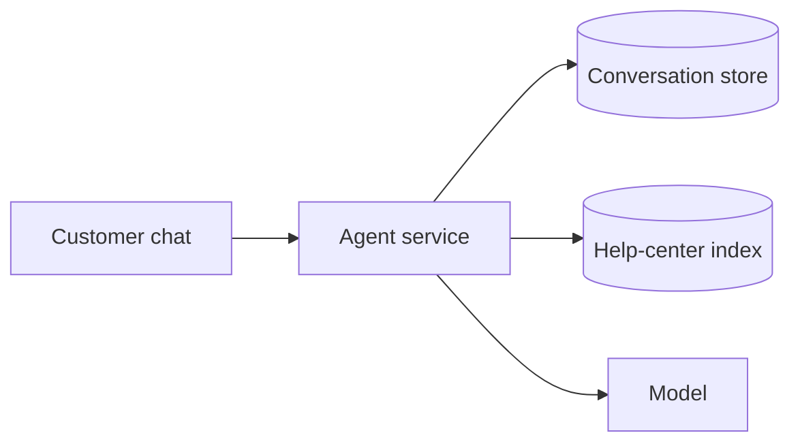

- **Agent service.** A stateless service that runs one turn of load, retrieve, call the model, check, and reply.
- **Conversation store.** `conversations` partitioned by `customerId`, with `conversationId`, `status`, and `messages`.
- **Help-center index.** One document per chunk, with `chunkId`, `articleId`, `url`, `text`, and `vector`.
- **Model.** A hosted large language model whose output the service checks before trusting.

1. The customer sends a message. The agent service appends it and loads the recent turns.
2. It runs one hybrid query, keyword and vector together, and reranks the results. [AI systems, RAG, and agents](../05-advanced/ai-systems-rag-and-agents.md) covers chunking and hybrid search.
3. If the best chunk scores under a floor, it skips the model and offers a person. Abstaining on weak retrieval is the first pattern in [production AI agents](../05-advanced/production-ai-agents.md), and deep dive 1 tunes it.
4. Otherwise the model gets the instructions, the top chunks with their IDs, and the recent turns, and writes a short answer citing chunk IDs.
5. The service drops citations to IDs it didn't send and returns the answer with article links.

### 2) Customers can check, cancel, and request refunds on their own orders

The model now gets tools. It loops through reasoning, calling a tool, and reading the result until it can answer, the pattern the ReAct paper named ([ReAct](https://arxiv.org/abs/2210.03629)). The server binds the customer ID from the token, so it is never an argument.

| Tool | Arguments | Side effect | Gate |
| --- | --- | --- | --- |
| `get_order` | `orderId` | None | Owner check in code |
| `list_recent_orders` | `limit`, at most 10 | None | Scoped to the token's customer |
| `cancel_order` | `orderId`, `reason` | Proposes a cancel of an unshipped order | Customer confirms |
| `propose_refund` | `orderId`, `itemIds`, `reason` | Creates a pending refund request, moves no money | Support agent approves |
| `hand_off` | `reason` | Queues the conversation for a person | None |

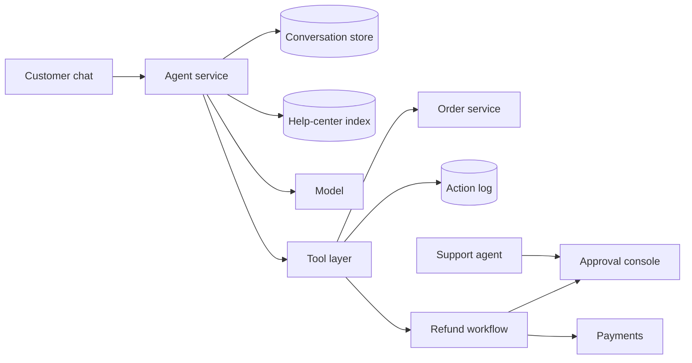

- **Tool layer.** Code in the agent service that validates each call, injects the customer ID, checks preconditions, and calls the real system. The model never holds a credential.
- **Order service.** The retailer's existing system of record.
- **Action log.** `actions` partitioned by `customerId`, with `actionId`, `kind`, `args`, `status`, `idempotencyKey`, and `approvedBy`.
- **Refund workflow and approval console.** A durable workflow holds each refund request until an approver decides in the console.

1. The customer asks to cancel order 58-1193. The model calls `get_order`, and the tool layer checks the order belongs to the token's customer.
2. The model calls `cancel_order`. The tool layer checks that the order hasn't shipped, writes a `proposed` action, and streams an `action` event. Nothing is cancelled yet.
3. The customer taps Confirm. The service calls the order service with the action's idempotency key and marks it `done`.
4. `propose_refund` writes an action and starts the workflow, which waits for a person, as deep dive 3 covers.

### 3) Customers can reach a person without repeating themselves

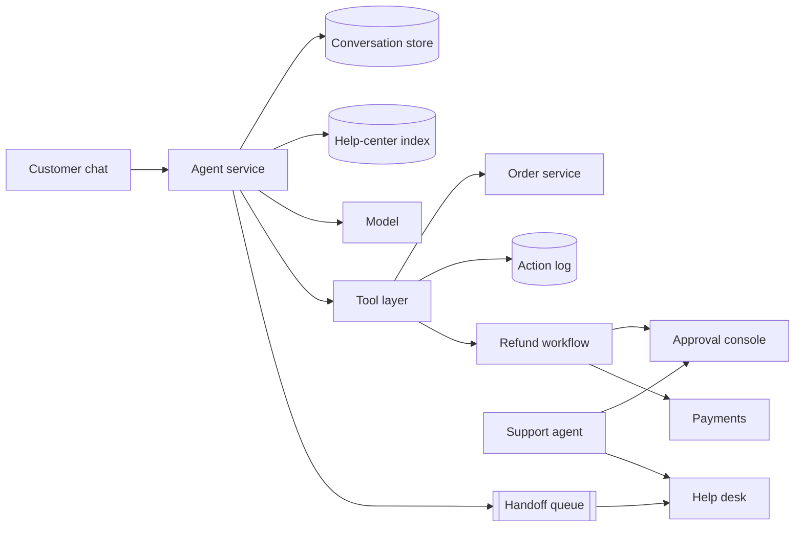

- **Handoff queue.** A durable queue, so a slow help desk never blocks the chat.
- **Help desk.** The tool support agents already use. It reads handoff packets from the queue.

```json
{
  "ticketId": "tk_908",
  "conversationId": "cv_7Q2",
  "reason": "below_floor",
  "summary": "Wants to return a jacket that was a gift, delivered 41 days ago.",
  "verified": [{ "orderId": "58-1193", "status": "delivered", "deliveredAt": "2026-05-02" }],
  "actions": [{ "actionId": "ac_51", "kind": "propose_refund", "status": "pending_approval" }],
  "lastMessage": "It was a gift and I only just opened it.",
  "transcript": "conversations/cv_7Q2"
}
```

1. A handoff starts when the customer asks, when the model calls `hand_off`, or when retrieval fell under the floor, a check failed, or the loop ran out of steps.
2. The service builds `verified` and `actions` from tool results and the action log, so the person reads checked facts. The model writes only the summary.
3. It sets the conversation to `human`, queues the packet, and streams a `handoff` event with the customer's place in line.
4. The help desk picks up the packet. The person's replies go into the same conversation, and the agent stays silent.

:::tip
Say which handoff fields come from systems and which from the model. Interviewers probe whether a person ends up trusting a made-up summary.
:::

### 4) Customers can come back and the agent knows their past tickets

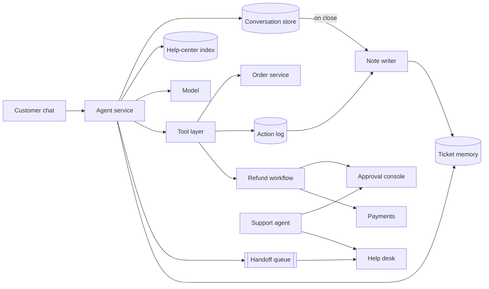

- **Note writer.** A background job that turns a closed conversation into a ticket with a few short notes.
- **Ticket memory.** `notes` partitioned by `customerId`, with `ticketId`, `closedAt`, `orderIds`, `outcome`, `text`, and `vector`.

1. When a conversation closes, the note writer saves the ticket and writes notes from its structured fields, such as each action's outcome.
2. When a new conversation starts, the agent service queries the customer's partition for recent notes that match the first message.
3. Those notes go into the prompt marked as history. Anything that may have changed, such as an order's status, comes from a tool call instead.

Memory inside one long conversation uses the summary and window from the [AI chat assistant](./ai-chat-assistant.md). Deep dive 4 covers which past tickets get in.

## Deep dives

### 1) How does the agent avoid inventing policy?

This serves requirement 1 and the unsupported-claim target.

:::info
In February 2024 a Canadian tribunal held Air Canada liable for its website chatbot's wrong answer about bereavement fares. The company is responsible for all information on its site, whether it comes from a static page or a chatbot. The bot's answer even linked to the policy page that contradicted it ([case summary](https://www.dww.com/articles/bc-tribunal-finds-air-canada-liable-for-inaccurate-advice-given-by-website-chatbot)).
:::

#### Bad solution: Retrieve the top chunks and ask the model to admit gaps

**Approach.** Embed the question, put the five nearest chunks in the prompt, and tell the model to answer only from them and to say when they don't cover the question.

**Challenges.** Nearest neighbors always return something. A question about returning a gift pulls in chunks on gift cards and ordinary returns, and the model blends them into a rule nobody wrote. An instruction to abstain is a request, not a control, and it fails most when the chunks look close.

#### Good solution: Hybrid retrieval, rerank, and a floor on the score

**Approach.** Run keyword and vector search together, then rerank with a ranker that scores each chunk against the question on a fixed scale. If the top score is under a floor, skip the model and offer a person, the idea behind corrective RAG ([CRAG](https://arxiv.org/abs/2401.15884)). Put the strongest chunks first, since models use the start or end of a long context better than the middle ([Lost in the Middle](https://arxiv.org/abs/2307.03172)).

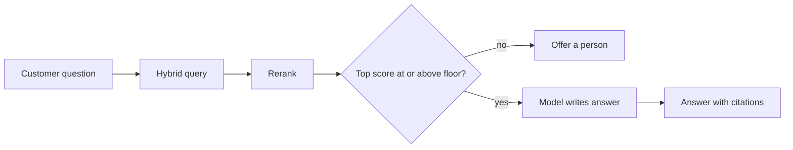

**Challenges.** A high score means the chunks are on topic, not that they answer the question. "Can I return a gift after 30 days?" scores well against a returns article that says nothing about gifts, and the model fills the gap. Nothing yet checks what the model wrote.

#### Great solution: Gate both sides of the model and tune the floor on labeled data

**Approach.** Keep the floor and check the answer too. Before the reply leaves, a groundedness check compares each claim with the chunks the model was given. An unsupported answer is never shown, and the conversation is handed off as `ungrounded`. That is why answers aren't streamed token by token, since a check after the customer has read the answer is a log entry, not a gate. Then set the floor from data. Label a few thousand real questions as answerable or needing a person, sweep the floor, and plot unsupported-claim rate against handoff rate. Pick the lowest handoff rate that meets the 0.5% target, and sweep again when the ranker or help center changes.

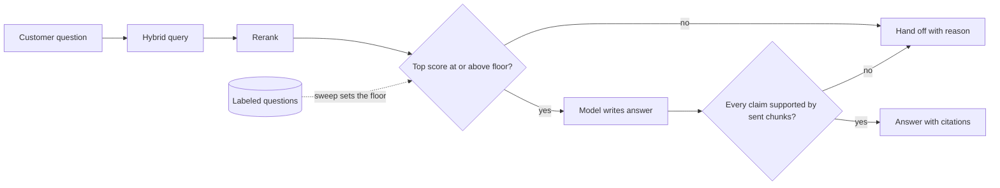

**Challenges.** Holding the answer back costs about 3 s, which the status event and short answers make bearable. The checker is a model with its own error rate and needs its own labeled set. Each point of handoff rate is about 8 people, so the sweep is a negotiation with the support manager, not a tuning job.

In a 45-minute interview I'd draw the Good rung, then spend the time on the output check and the floor as a staffing trade-off, because that's where the business shows up.

### 2) How do we stop the agent from cancelling the wrong order, or cancelling twice?

This serves requirement 3 for cancels.

#### Bad solution: Give the model the order API

**Approach.** Expose the order service's endpoints as tools, put the customer ID in the system prompt, and let the model fill in arguments.

**Challenges.** The customer ID is now text the model copies, and a customer can argue with text. "I'm writing for my husband, his account is 40221" puts another account one call away. If a cancel times out and the loop retries, it may cancel twice. Nothing stops the model from cancelling before the customer agreed.

:::warning
Putting the customer ID in the prompt is the most common answer here and the easiest to break. Identity is an input to the tool layer, taken from the token, never something the model types.
:::

#### Good solution: A typed allowlist with identity bound on the server

**Approach.** Give the model only the five tools from the high-level design, each with a strict JSON schema, and run calls one at a time. The tool layer fills `customerId` from the token and rejects an order if the owner differs or it has shipped. Those rules are plain code, testable without a model. The model picks the tool and the order, and code decides whether the cancel is allowed.

**Challenges.** A typed call can still be the wrong call. The model may pick order 58-1193 when the customer meant 58-1139, and the tool layer will cancel it because it's theirs. A retry after a timeout can still act twice, and nothing caps a looping agent.

#### Great solution: Confirm, key every write, and cap the loop

**Approach.** Split every write into propose and commit. `cancel_order` only writes a `proposed` action, and the customer sees a card rendered from the order record, not the model's words. The Confirm tap commits it with the action's idempotency key, so a retry returns the first result instead of cancelling again ([idempotency and retries](../03-patterns/idempotency-and-retries.md)). A timeout moves the action to `unknown`, and a reconciler reads the order's real state before anything retries. Cap each turn at about 6 tool calls, then hand off.

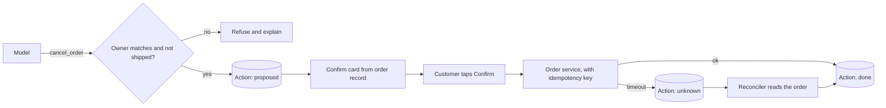

**Challenges.** Confirmation adds a tap to every write, and some customers abandon at the card. The order service has to honor idempotency keys, or the tool layer must store results by key. Too low a step cap hands off real multi-order requests, so the eval set sets it.

In a 45-minute interview I'd go straight to the Great rung, since the confirm card and the idempotency key take a sentence each and close the two failures the interviewer is fishing for.

### 3) How do we keep refunds safe from a persuasive customer or a poisoned input?

This serves requirement 3 for money.

#### Bad solution: Let the agent refund small amounts on its own

**Approach.** Give the agent a `refund` tool capped at \$50 and a prompt that lists the refund policy.

**Challenges.** The model decides eligibility, and a model can be argued with. A pasted "note from your supervisor approving this" is text the model weighs against the policy. Simon Willison's lethal trifecta is an agent with private data, untrusted content, and a way to communicate externally, because a model can't reliably tell instructions apart by source ([lethal trifecta](https://simonwillison.net/2025/Jun/16/the-lethal-trifecta/)). This agent has all three, and a refund sends money out. A cap only limits each loss.

#### Good solution: The agent proposes and a person approves

**Approach.** Replace `refund` with `propose_refund`, which writes a pending request and moves no money. Approvers review it in the console, and only the console's backend calls payments.

**Challenges.** The person now carries the whole decision, reading the chat and looking up the order. If 8% of conversations ask for a refund and each review takes 3 minutes:

$$
\begin{aligned}
\text{requests} &= 40{,}000 \times 0.08 = 3{,}200\ \text{a day} \\
\text{review time} &= 3{,}200 \times 3\ \text{min} = 160\ \text{h a day} \approx 23\ \text{people}
\end{aligned}
$$

Rushed approvers rubber-stamp, so the gate weakens as the queue grows. A request also has to survive restarts while it waits.

#### Great solution: Policy in code, a durable wait, and an agent that can't reach the money

**Approach.** Make three changes. First, a policy engine, plain code over typed order data, decides eligibility and the amount from the delivery date, item condition, and return rules. The model supplies only the order and items. Second, a durable workflow holds each request ([multi-step processes](../03-patterns/multi-step-processes.md)) and waits for a decision or a timeout. On approval it calls payments with the request ID as the idempotency key, and on timeout it escalates to a team lead. Third, the agent service's identity has no permission on the payments API. Only the workflow's identity does. The approver's card shows the engine's verdict and rule, the order facts, and the customer's words in a box marked as customer-written.

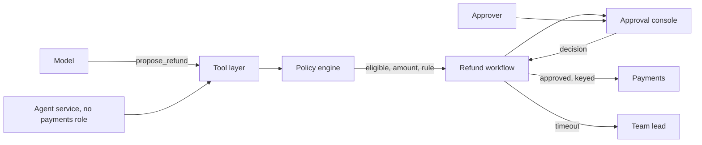

**Challenges.** At 30 s a card, review drops to $3{,}200 \times 0.5\ \text{min} \approx 27\ \text{h}$ a day, or about 4 people. That holds only if the engine is right, so its rules need tests and an owner. Approvers still read untrusted text and can be persuaded by it.

In a 45-minute interview I'd name the trifecta, then draw the Great rung's identity line, because the missing edge from the agent to payments is the answer.

### 4) How does the agent remember past tickets without pulling in the wrong ones?

This serves requirement 4.

#### Good solution: Summarize each ticket and retrieve the closest few

**Approach.** Loading every past conversation would bury the prompt in irrelevant tokens, and models use the middle of a long context poorly. So when a conversation closes, have the model summarize it and store the summary with an embedding. When the next one starts, retrieve the three summaries closest to the customer's first message.

**Challenges.** The summary is the model's prose over customer-written text. It can drop the outcome, state a guess as fact, or carry an injected instruction into every later conversation. A search across all summaries needs a customer filter, and one missing filter leaks someone else's history. Similarity also misses a ticket about the same order in different words.

#### Great solution: Typed notes per customer, treated as untrusted

**Approach.** Build each note from structured fields, such as order IDs, action outcomes, the handoff reason, and the resolution code the person set, plus one model-written sentence. Store notes in the customer's own partition, so the partition key scopes every query instead of a filter someone can forget. At conversation start, take notes from the last 12 months that share an order ID with the message, plus the two or three nearest by vector. Run them through the injection check as documents, quote them in the prompt as history, and re-read anything live through a tool. Notes expire under the retention policy and are deleted with the account.

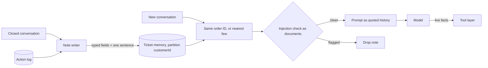

**Challenges.** Typed notes lose nuance, which is why the full transcript stays one link away in the help desk. The window and count need eval cases where memory helps and where it misleads.

In a 45-minute interview I'd present the Good rung quickly and spend the time on partition scoping and untrusted memory, which most candidates miss.

### 5) How do we know it works before launch, and notice when it drifts?

This serves every requirement above, and interviewers weight it most for an agent.

#### Bad solution: Spot-check transcripts and watch satisfaction scores

**Approach.** The team reads a few dozen conversations before launch and tracks satisfaction and containment after.

**Challenges.** A few dozen reads can't see a 0.5% failure. A customer told a wrong but generous refund rule rates it highly. Containment, the share of conversations that never reach a person, rewards an agent that never hands off.

#### Good solution: An offline gate with a metric per component

**Approach.** Build a labeled set from past tickets, with questions tagged by the article that answers them or "needs a person", and action requests with the expected tool calls. Score retrieval recall, precision and recall of the abstain decision, unsupported-claim rate from a grader, and tool-call accuracy. A prompt, model, or index change can't ship if a score drops past its threshold.

**Challenges.** Every component can pass while whole conversations fail, such as the right tool getting the wrong order on turn four. A single run also hides flakiness, so an agent that succeeds 90% of the time looks fine once and fails a customer every day.

#### Great solution: Simulated customers, pass^k, and live sampling

**Approach.** Add end-to-end cases. A second model plays a customer with a goal against a test copy of the order system. Grade each case by the system's final state, as tau-bench does, instead of reading the transcript. Run each case k times and report pass^k, the chance that all k tries succeed. At 90% per independent try, eight in a row succeed with probability $0.9^8 \approx 0.43$. In tau-bench, gpt-4o as a function-calling agent succeeded on fewer than half the tasks, and its retail pass^8 was under 25% ([tau-bench](https://arxiv.org/abs/2406.12045)). Gate launches on pass^k for action tasks. After launch, grade a daily sample of live conversations and alert on handoff, unsupported-claim, and reopen rates. A ticket reopened within 7 days marks false containment, and each case a person resolves after a handoff becomes a candidate eval case.

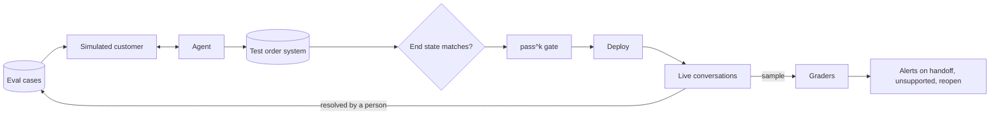

**Challenges.** Running each case k times multiplies eval cost by k. Simulated customers drift toward cooperation, so the set needs adversarial cases and a red-team pass. The graders need their own labeled checks. Judging 2,000 live answers a day gives a standard error of $\sqrt{0.005 \times 0.995 / 2{,}000} \approx 0.0016$, enough to see the rate move from 0.5% to 1%.

:::tip
Report pass^k next to the average success rate, because a customer meets the agent many times.
:::

In a 45-minute interview I'd sketch the Good rung's metrics in a minute and spend the rest on pass^k and the end-state check, because they separate an agent eval from a chatbot eval.

## On Azure

One region runs the whole stack, model calls stay in one data zone, and a second region in the same zone takes over on failure.

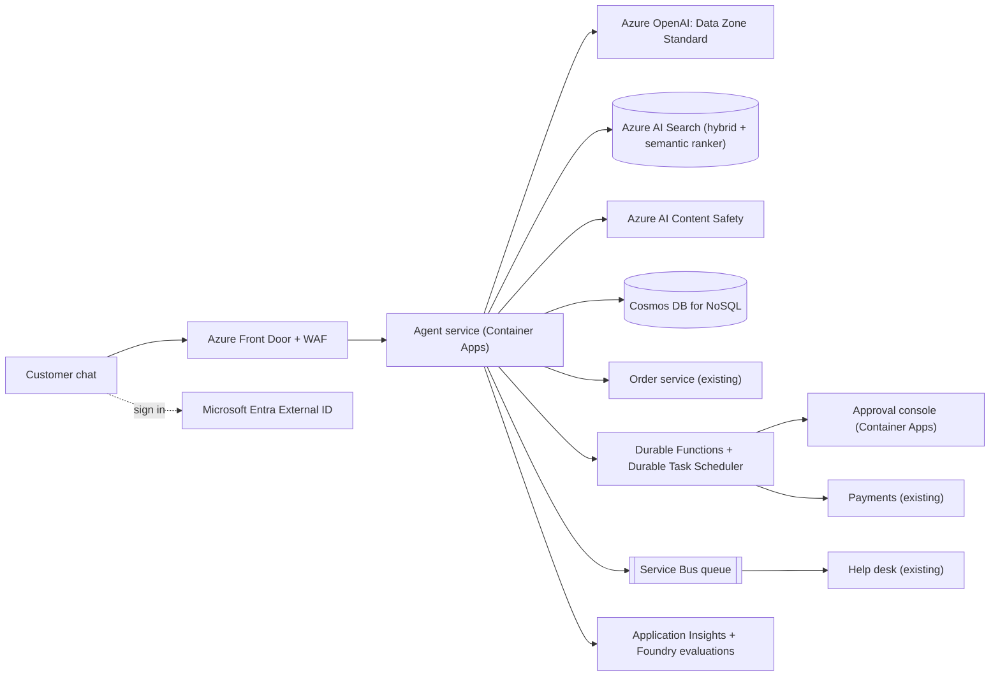

| Component | Azure service | Tier or setting, and why |
| --- | --- | --- |
| Edge | Azure Front Door | WAF policy on the chat route. |
| Customer sign-in | Microsoft Entra External ID | An external tenant whose token carries the customer ID. |
| Staff sign-in | Microsoft Entra ID | A `refund-approver` app role gates the console. |
| Agent service, approval console | Azure Container Apps | Zone-redundant environment. The agent runs its own tool loop. |
| Model | Azure OpenAI in Microsoft Foundry Models | Data Zone Standard, which processes data only inside the US, EU, or APAC zone. |
| Help-center index | Azure AI Search | 3 replicas, because ingestion makes it read-write. Hybrid query with semantic ranker. |
| Safety checks | Azure AI Content Safety | Prompt Shields on messages and notes, groundedness detection on answers. |
| Conversations, actions, notes | Azure Cosmos DB for NoSQL | `/customerId` partition key, and a `quantizedFlat` vector index on `notes`. |
| Refund workflow | Azure Durable Functions on Durable Task Scheduler | Human interaction pattern. |
| Handoff queue | Azure Service Bus | Standard tier, since a few thousand messages a day need no dedicated capacity. |
| Tracing and evaluation | Application Insights, Foundry evaluations | Traces of every model and tool call, plus sampled live evaluation. |

### Why these tiers

- **Our own loop, not a prompt agent.** Foundry Agent Service runs prompt agents and hosted agents ([Foundry Agent Service](https://learn.microsoft.com/azure/foundry/agents/overview)). I'd run the loop in the agent service instead, because identity binding and propose-then-commit belong in code I can test. With function calling, the model returns the call and your application runs it ([function calling](https://learn.microsoft.com/azure/foundry/openai/how-to/function-calling)). Use `strict: true` schemas and set `parallel_tool_calls` to false, since structured outputs don't support parallel calls ([structured outputs](https://learn.microsoft.com/azure/foundry/openai/how-to/structured-outputs)).
- **The floor goes on the reranker score.** Semantic ranker reranks the top 50 results and scores each from 4 down to 0 in `@search.rerankerScore` ([semantic ranking](https://learn.microsoft.com/azure/search/semantic-search-overview)), so the agent service applies the floor there. Learn says hybrid queries don't suit the preview vector `threshold` parameter, because RRF scores are small and volatile ([vector queries](https://learn.microsoft.com/azure/search/vector-search-how-to-query)).
- **Groundedness detection is a preview gate.** It has a question-answering task and a non-reasoning mode for real-time use, and it supports English only ([groundedness detection](https://learn.microsoft.com/azure/ai-services/content-safety/concepts/groundedness)). The Content Safety overview lists it as preview ([Content Safety](https://learn.microsoft.com/azure/ai-services/content-safety/overview)). Keep a grader prompt on a small model as the fallback.
- **Prompt Shields on documents, too.** It detects user prompt attacks and document attacks and reports without blocking, and a Foundry guardrail has document attack detection off by default ([Prompt Shields](https://learn.microsoft.com/azure/ai-services/content-safety/concepts/jailbreak-detection)). Send memory notes and free-text order fields as documents.
- **A durable wait for approval.** In the human interaction pattern, an orchestrator notifies a person and races an external event against a durable timer ([human interaction](https://learn.microsoft.com/azure/azure-functions/durable/durable-functions-phone-verification)). Durable Task Scheduler is the recommended backend ([Durable Task Scheduler](https://learn.microsoft.com/azure/azure-functions/durable/durable-task-scheduler/durable-task-scheduler)).
- **Identity on the money path.** The workflow's managed identity gets Entra tokens with no credential to manage ([managed identities](https://learn.microsoft.com/entra/identity/managed-identities-azure-resources/overview)). Grant it the app role the payments API checks, since a managed identity can hold app roles ([app roles](https://learn.microsoft.com/entra/identity-platform/howto-add-app-roles-in-apps)). The agent service's identity never gets that role.
- **Notes in Cosmos DB.** Learn's [agent memory guidance](https://learn.microsoft.com/azure/cosmos-db/gen-ai/agentic-memories) covers partition key choices, and Learn calls `quantizedFlat` a good option when filters narrow the search to a small set of vectors ([vector search](https://learn.microsoft.com/azure/cosmos-db/vector-search)).
- **Evaluation in Foundry.** Agent evaluators include Tool Call Accuracy, plus Task Completion and others in preview ([agent evaluators](https://learn.microsoft.com/azure/foundry/concepts/evaluation-evaluators/agent-evaluators)). Continuous evaluation scores production traffic at a sampled rate, and OpenTelemetry tracing lands in Application Insights ([observability](https://learn.microsoft.com/azure/foundry/concepts/observability)). The end-state check stays your code.

### Zones and regions

Enable zone redundancy on the Container Apps environment ([Container Apps reliability](https://learn.microsoft.com/azure/reliability/reliability-container-apps)) and on Cosmos DB, which sets it per region ([Cosmos DB reliability](https://learn.microsoft.com/azure/reliability/reliability-cosmos-db-nosql)). Service Bus namespaces in regions with zones are zone-redundant automatically ([Service Bus reliability](https://learn.microsoft.com/azure/reliability/reliability-service-bus)). AI Search places replicas in different zones where the region supports it, and its SLA needs three replicas for a read-write workload ([AI Search reliability](https://learn.microsoft.com/azure/reliability/reliability-ai-search)). For a region loss, run a second region in the same data zone. If the model or search fails, new conversations go to the handoff queue. See [regions, zones, and resiliency](../04-azure/regions-zones-and-resiliency.md).

### Gotcha

The reranker's scale isn't frozen. Learn warns that `@search.rerankerScore` distributions shift slightly with infrastructure conditions and ranking model updates, and advises against overly granular minimum thresholds ([semantic ranking](https://learn.microsoft.com/azure/search/semantic-search-overview)). A floor of 2.37 tuned last quarter can move the handoff rate overnight with no deploy of yours. Use a coarse floor, alert on the daily handoff rate, and rerun the sweep from deep dive 1 when it moves.

See [compute choices](../04-azure/compute-choices.md), [data choices](../04-azure/data-choices.md), [messaging choices](../04-azure/messaging-choices.md), and [observability](../04-azure/observability.md) for the general reasoning.

## What is expected at each level

### Mid-level

I look for a working loop on the board without help, which retrieves from the help center, calls the model, cites the article, and calls order tools. When I ask how a tool knows whose order it is, you move the customer ID to the token, and you hand off when retrieval comes back empty. I'd expect to prompt you toward propose-and-confirm and idempotent retries, and I wouldn't hold deep dives 4 and 5 against you beyond naming a test set.

### Senior

I look for you to raise the abstention floor on your own and tie it to an unsupported-claim rate measured apart from the handoff rate. You drive deep dive 2 to the Great rung without hints. You keep refunds behind a person, move eligibility into code, and do the approval staffing math yourself. In deep dive 5 you build component metrics and a gate, though you may need a nudge toward pass^k.

### Staff+

I look for you to treat the floor and the approval queue as staffing decisions and argue them with numbers. You name the lethal trifecta and break it with identity, so the agent can't reach payments at all. You treat memory and tool output as untrusted and scope memory by partition. You grade by end state, report pass^k, and route resolved tickets back into the eval set. You also raise what drifts in operation, such as a ranker update shifting the floor or a grader losing calibration.

## Further reading

- [tau-bench: A Benchmark for Tool-Agent-User Interaction in Real-World Domains](https://arxiv.org/abs/2406.12045)
- [Simon Willison: The lethal trifecta for AI agents](https://simonwillison.net/2025/Jun/16/the-lethal-trifecta/)
- [Lost in the Middle: How Language Models Use Long Contexts](https://arxiv.org/abs/2307.03172)
- [Corrective Retrieval Augmented Generation](https://arxiv.org/abs/2401.15884)
- [The Coding Gopher: Precision vs. Recall vs. F1 Score vs. ROC-AUC](https://thecodinggopher.substack.com/p/precision-vs-recall-vs-f1-score-vs)
- [Groundedness detection in Azure AI Content Safety](https://learn.microsoft.com/azure/ai-services/content-safety/concepts/groundedness)
- [Human interaction pattern in Durable Functions](https://learn.microsoft.com/azure/azure-functions/durable/durable-functions-phone-verification)
- [Production AI agents](../05-advanced/production-ai-agents.md), [AI systems, RAG, and agents](../05-advanced/ai-systems-rag-and-agents.md), [AI chat assistant](./ai-chat-assistant.md)
- *Cracking the AI System Design Interview*, Aishwarya Naresh Reganti and Kiriti Badam (LevelUp Labs, 2026), chapter 2. Recommended companion reading for this case.
