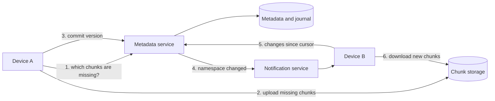
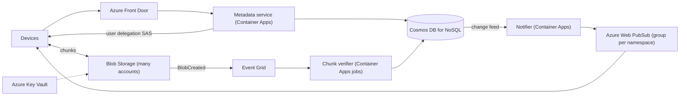

## TL;DR

Split every file on the client into chunks, hash each chunk, and store chunks as separate blobs named by their hash within the owner's namespace. A file version is then just an ordered list of chunk hashes in the metadata store, so editing a 2 GB file uploads only the chunks that changed, and identical chunks are stored once. Clients upload and download chunks directly to and from blob storage with short-lived signed URLs; the API servers only handle metadata. Each namespace (a user's root or a shared folder) has an append-only change journal with a sequence number; devices keep a cursor, get a lightweight "something changed" notification, and pull the journal since their cursor. On Azure: Blob Storage (sharded across accounts) with user delegation SAS, Cosmos DB for NoSQL for files, versions, journal, and shares, and Azure Web PubSub for change notifications.

## Requirements

### Functional

- Upload and download files from any device.
- Changes made on one device appear on the user's other devices automatically.
- Share a file or folder with other users, who see it in their own tree.
- Keep previous versions of a file.

Out of scope: real-time collaborative editing (that needs [CRDTs](../05-advanced/crdts-and-local-first.md) or operational transforms, a different system), full-text search, and team admin controls.

### Non-functional

- Files up to 50 GB, uploaded over unreliable networks, resumable.
- A change syncs to other online devices within seconds.
- Never lose or corrupt a file. Durability beats availability for writes.
- Minimize transferred bytes: upload and download only what changed.
- Files are private by default and readable only by owners and people they share with.

## Capacity estimates

Assumptions: 500 M users, 100 M daily active, 2 GB stored per user on average, 20 file changes per active user per day, 100 KB of changed data per change after chunk deduplication, 1,000 files per user, 500 B of metadata per file.

| Quantity | Arithmetic | Result |
| --- | --- | --- |
| Total stored bytes | 500 M × 2 GB | 1 EB |
| File changes | 100 M × 20 ÷ 86,400 s | about 23,000 changes/s |
| Upload bandwidth | 2 B changes × 100 KB ÷ 86,400 s | about 2.3 GB/s |
| Metadata | 500 M × 1,000 files × 500 B | 250 TB |
| Chunk size | 50 GB file ÷ 8 MB | 6,400 chunks for the largest file |
| Chunk list for largest file | 6,400 × 32 B hash | 200 KB |
| Online devices | 100 M DAU × 1.5 | 150 M long-lived connections at peak |

Storage volume forces sharding across many storage accounts. The 200 KB chunk list for a 50 GB file fits inside a single metadata document, which keeps "get file version" a single read. The connection count is the same problem as [chat messaging](./chat-messaging.md) but with tiny, infrequent messages.

## Core entities and API

### Entities

- **Namespace**: `id`, `ownerId`, `type` (`personal`, `shared`), `lastSeq`, `storageAccount`.
- **File**: `namespaceId`, `path`, `fileId`, `currentVersion`, `isDeleted`.
- **FileVersion**: `fileId`, `version`, `size`, `chunks` (ordered list of SHA-256 hashes), `createdBy`, `createdAt`.
- **Chunk**: content-addressed blob `{namespaceId}/{sha256}`.
- **JournalEntry**: `namespaceId`, `seq`, `path`, `fileId`, `version`, `op` (`put`, `delete`, `move`).
- **Share**: `namespaceId`, `granteeUserId`, `role` (`viewer`, `editor`), `mountPath`.

### API

```http
POST /v1/uploads           { namespaceId, path, size, chunkHashes: [...], baseVersion }
  -> 200 { missingChunks: [{ hash, uploadUrl }] }
PUT  <uploadUrl>           (chunk bytes, direct to blob storage)
POST /v1/commits           { namespaceId, path, chunkHashes, baseVersion }
  -> 200 { fileId, version, seq } | 409 { conflict: true, currentVersion }
GET  /v1/namespaces/{id}/changes?cursor=<seq>&limit=1000
  -> 200 { entries: [...], cursor, hasMore }
GET  /v1/files/{fileId}/versions/{v}   -> { chunks: [{ hash, downloadUrl }] }
POST /v1/shares            { namespaceId, granteeEmail, role }
```

`baseVersion` is the version the client edited. If the server's current version differs, the commit returns `409` and the client saves a conflicted copy rather than overwriting someone else's edit. See [API design](../01-fundamentals/api-design.md).

## High-level design



1. Device A chunks the file and asks which chunk hashes the namespace lacks.
2. It uploads only those, in parallel, directly to storage with signed URLs.
3. It commits the new version: the server verifies every chunk exists, writes the version, and appends a journal entry with the next sequence number in one transaction.
4. The notification service tells every online device subscribed to that namespace that it changed.
5. Device B pulls journal entries after its cursor.
6. It downloads only the chunks it does not already have locally and reassembles the file.

## Deep dives

### 1. Uploading large files

| Option | Problem |
| --- | --- |
| Upload the whole file through the API | API servers carry 2.3 GB/s of opaque bytes, and a dropped connection restarts a 50 GB upload. |
| Direct upload of one large blob with a signed URL | Resumable only if the client tracks progress; every edit re-uploads the whole file. |
| Chunk on the client, upload chunks as content-addressed blobs | More client logic and more objects, but resumable, parallel, and deduplicated by construction. |

**Pick: client-side chunks as content-addressed blobs.** Resume is trivial: the server's "missing chunks" answer is the resume point. Parallel uploads use the client's full uplink. Two versions of a file that share 95% of their bytes share 95% of their chunks. See [large blobs](../03-patterns/large-blobs.md).

Fixed 8 MB chunks are simple, but inserting one byte at the start of a file shifts every boundary, so every chunk changes. Content-defined chunking (boundaries chosen where a rolling hash of the content hits a pattern) keeps boundaries stable around an edit, so only the chunks near the edit change. Use content-defined chunking with an 8 MB average for large files.

### 2. Trusting client-supplied hashes

If a chunk's name is its hash and the client chooses the name, a buggy or malicious client can upload bytes that do not match the hash. Every file that later references that hash is corrupted.

- **Trust the client.** Cheap. Corruption is silent and spreads.
- **Verify on commit, synchronously.** The server re-reads each new chunk and hashes it before accepting the commit. Correct, but a 50 GB commit takes minutes.
- **Verify asynchronously before the chunk becomes shareable.** Accept the upload with transport-level integrity checks, then a verifier hashes each new chunk and marks it verified. Commits referencing unverified chunks wait until verification finishes.

**Pick: asynchronous verification,** plus transport integrity checks on every upload. Scope deduplication to the namespace, not globally. Global deduplication lets a user learn whether anyone else has a file ("upload hash X, see whether the server asks for it"), which is a privacy leak. Per-namespace deduplication still catches the common case: new versions of the same file.

### 3. Sync: how devices learn about changes

| Option | Cost | Latency |
| --- | --- | --- |
| Poll the full tree | Proportional to tree size, every poll | Poll interval |
| Poll the journal with a cursor | Small, but 150 M devices polling every 30 s is 5 M req/s of mostly empty responses | Up to 30 s |
| Long poll or push a "changed" signal, then pull the journal | One message per change per online device | Seconds |

**Pick: push a signal, pull the data.** The notification carries only `{namespaceId, latestSeq}`. The device compares it with its cursor and pulls entries. This keeps the notification path stateless and tiny, and makes the journal the single source of truth: a missed notification costs latency, never correctness, because the next pull catches up. Devices also poll the journal every few minutes as a safety net. See [real-time updates](../03-patterns/real-time-updates.md).

The journal is per namespace with a strictly increasing sequence. That gives each device a simple cursor and makes "what changed while I was offline for a week" one range read.

### 4. Conflicts

Two devices edit the same file offline, then both reconnect. The commit includes `baseVersion`. The first commit wins. The second gets `409`, and its client writes its bytes as `report (conflicted copy from laptop).docx`. This is optimistic concurrency at the file level ([handling contention](../03-patterns/handling-contention.md)). Merging content automatically is out of scope for a general file store because the server cannot understand arbitrary file formats.

### 5. Sharing

Storing permissions on each file means sharing a folder of 100,000 files writes 100,000 rows, and listing "shared with me" scans everything. Instead, a shared folder is its own namespace, and a **Share** row grants a user access to that namespace and says where it mounts in their tree. Listing "shared with me" is a query on shares by grantee. The device subscribes to change notifications for each namespace it has mounted. Revoking access deletes one row.

## On Azure



| Component | Azure service | Tier or setting, and why |
| --- | --- | --- |
| Chunk storage | Azure Blob Storage | Standard general-purpose v2, ZRS or GZRS. Hundreds of accounts; each namespace is assigned to one. Hot tier for recent chunks, lifecycle to cool for old versions. |
| Signed URLs | User delegation SAS | Scoped to a single chunk blob, write-only for uploads, read-only for downloads, minutes of validity. |
| Metadata, versions, journal, shares | Azure Cosmos DB for NoSQL | `namespaces` container on `/namespaceId` holds files, versions, and journal entries. `shares` container on `/granteeUserId`. Autoscale. |
| Commit transaction | Cosmos DB transactional batch | Writes the version, updates the file, and appends the journal entry atomically within the namespace partition. |
| Change notification | Cosmos DB change feed to Azure Web PubSub | Notifier reads journal inserts and sends `{namespaceId, seq}` to a Web PubSub group per namespace. Premium for zone redundancy. |
| Chunk verification | Event Grid plus Container Apps jobs | Hash each new chunk, mark verified or quarantine. |
| Keys | Azure Key Vault | Customer-managed keys for storage encryption if required. |

### Why these choices

- **Sharding storage accounts.** A standard storage account defaults to 5 PiB of capacity and 20,000 to 40,000 requests per second depending on region ([standard account targets](https://learn.microsoft.com/azure/storage/common/scalability-targets-standard-account)). At 1 EB you need at least 200 accounts for capacity alone, more for request rate. A namespace-to-account map in Cosmos DB lets you add accounts and place new namespaces on the emptiest one.
- **Transport integrity.** Put Block accepts `Content-MD5` or `x-ms-content-crc64`; storage compares it with what arrived and rejects mismatches with `400` ([Put Block](https://learn.microsoft.com/rest/api/storageservices/put-block)). That catches corruption in transit. It does not prove the SHA-256 name is right, which is why the verifier exists.
- **Chunk list in one document.** A Cosmos DB item can be up to 2 MB ([limits](https://learn.microsoft.com/azure/cosmos-db/concepts-limits)). A 50 GB file's 6,400 hashes take about 200 KB in binary or about 450 KB as hex strings in JSON, so a version fits in one item and loads in one point read.
- **Atomic commit plus sequence.** A transactional batch is ACID across up to 100 operations in one logical partition ([transactional batch](https://learn.microsoft.com/azure/cosmos-db/transactional-batch)). Read the namespace item's `lastSeq` and ETag, then batch: replace the namespace item with `lastSeq + 1` conditioned on the ETag, upsert the file, create the version, create the journal entry. Concurrent commits to one namespace retry on `412`.
- **Signed URLs, not a CDN, for private chunks.** A CDN helps when many people read the same bytes. Personal file chunks are read by one user's few devices, so cache hit rates would be near zero. Serve them directly from Blob Storage. Use Front Door only for public share links of popular files.
- **Encryption.** Azure Storage encrypts all data at rest and it cannot be disabled ([encryption at rest](https://learn.microsoft.com/azure/storage/common/storage-service-encryption)). Add customer-managed keys in Key Vault if customers require control of the key.

### Zones and regions

Use ZRS so a zone loss never loses a chunk, or GZRS when you also need a copy in a second region ([redundancy](https://learn.microsoft.com/azure/storage/common/storage-redundancy)). Cosmos DB with zone redundancy in the primary region and a read region in the pair. Keep a single write region: commits on a namespace must be serialized, and multi-region writes would let two regions assign the same sequence number.

### Gotcha

Putting a namespace's files, versions, and journal in one logical partition makes commits atomic, but a logical partition caps at 20 GB and 10,000 RU/s ([partitioning](https://learn.microsoft.com/azure/cosmos-db/partitioning)). A personal namespace never gets close. A large team's shared drive with millions of files and long version history can. Split large team spaces into one namespace per top-level folder, prune old journal entries once every device's cursor has passed them, and move old versions to a separate container keyed by `fileId`.

See [data choices](../04-azure/data-choices.md) and [blob storage](../02-building-blocks/blob-storage.md).

## Interview tips

- Draw the split between metadata (small, transactional) and content (huge, immutable chunks) in the first five minutes. Most of the design follows from it.
- Explain why chunking gives you resume, parallelism, deduplication, and delta sync at once.
- Expect "how does device B know something changed?" Signal plus cursor-based pull, with a periodic poll as a safety net.
- Expect "what about two people editing the same file?" Version precondition, `409`, conflicted copy.
- Do not propose a global deduplication pool without mentioning the privacy leak and the hash-trust problem.
- Follow-ups: LAN sync between devices on the same network, bandwidth throttling, selective sync (download metadata, fetch chunks on open), and compression (compress each chunk before upload, skip for already-compressed formats).

## Further reading

- [Hello Interview: Design a file storage service like Dropbox](https://www.hellointerview.com/learn/system-design/problem-breakdowns/dropbox)
- [The Coding Gopher: Partitioning, sharding, and chunking explained](https://thecodinggopher.substack.com/p/partitioning-sharding-and-chunking)
- [Azure Storage SAS overview](https://learn.microsoft.com/azure/storage/common/storage-sas-overview)
- [Azure Cosmos DB transactional batch](https://learn.microsoft.com/azure/cosmos-db/transactional-batch)
- [Blob storage](../02-building-blocks/blob-storage.md), [idempotency and retries](../03-patterns/idempotency-and-retries.md), [identity and auth](../02-building-blocks/identity-and-auth.md)
