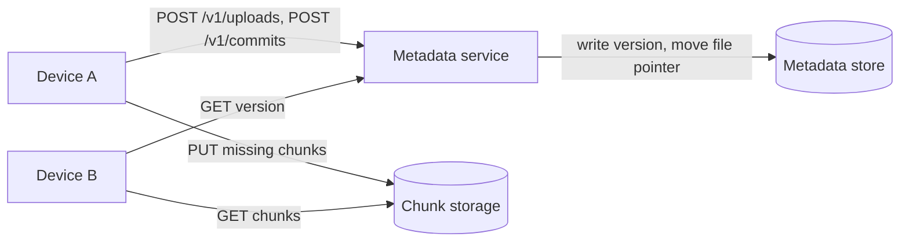
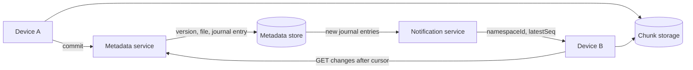
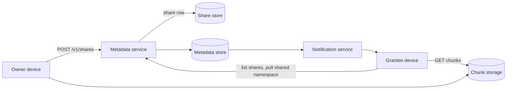
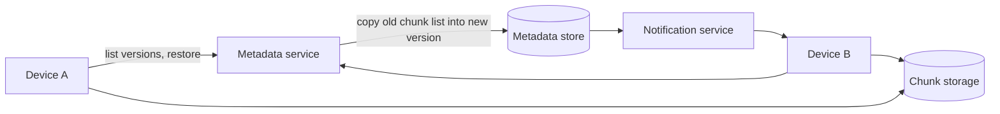
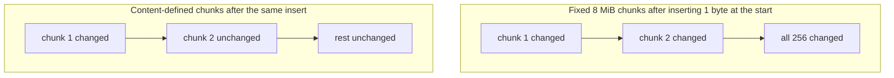
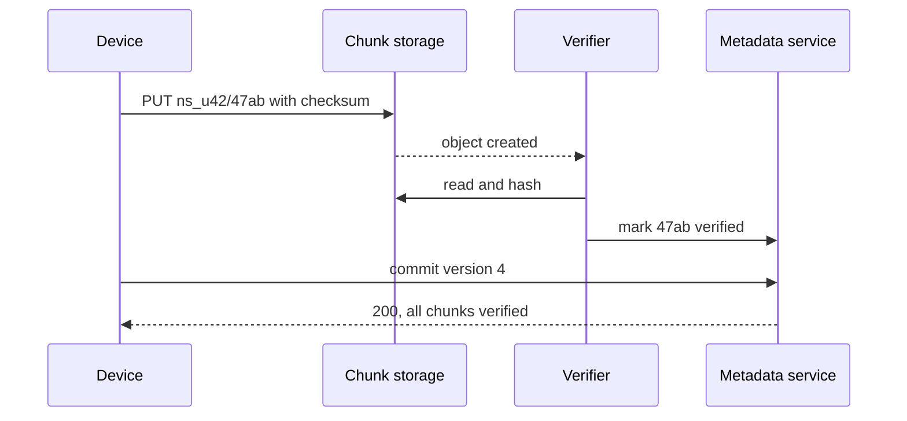
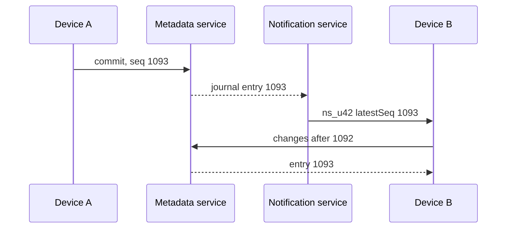
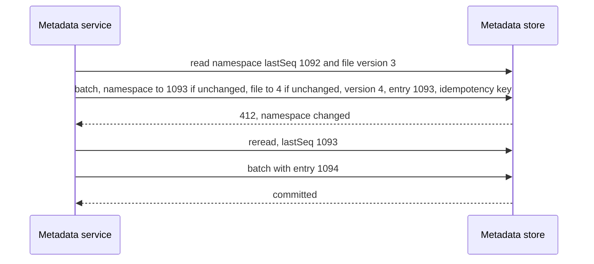
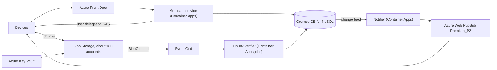

## Understanding the problem

**What is a file sync service?** It is a folder that lives on every device you own. Save a file on your laptop and it appears on your phone a few seconds later, and you can share a folder with someone else who sees it in their own tree. Think Dropbox or OneDrive. The service keeps the bytes in the cloud and a record of every change, so each device can catch up to the latest state.

Two things make it hard. Files run from a few bytes to 50 GB, and people edit big files in place, so sending the whole file on every save wastes hours of upload. And a sync service is trusted with things people can't recreate, so a commit must never be lost or half-applied, even when two devices edit the same file at once.

## Functional requirements

1. Users should be able to upload a file on one device and download it on another.
2. Users should be able to have changes sync to their other devices automatically.
3. Users should be able to share a folder with other users, who see it in their own tree.
4. Users should be able to see and restore earlier versions of a file.

**Below the line (out of scope)**

- **Real-time co-editing.** Two people typing in one document needs [CRDTs](../05-advanced/crdts-and-local-first.md) or operational transforms, which is a different system.
- **Sharing a single file.** Share its folder, or send a public link, which is a signed download behind a CDN.
- **Full-text search.** It indexes file contents in a separate pipeline. See [search](../02-building-blocks/search.md).
- **Team admin and quotas.** They are policy on top of the same namespaces.

I trimmed to upload, sync, share, and versions because a user needs the first two on day one, and the other two are why people trust the service with work files. Everything else sits on the same chunks and journal.

## Non-functional requirements

1. **Never lose or corrupt a committed file.** Once a commit returns success, the bytes survive a zone loss and match what the client sent. Writes choose consistency over availability, so a commit fails outright rather than half-succeeding.
2. **Large files move efficiently.** Files up to 50 GB upload over unreliable networks and resume, and an edit sends only the parts that changed.
3. **Changes reach other devices fast.** A change appears on the user's other online devices within about 5 seconds.
4. **Private by default.** Only the owner and the people they share with can read a file, and revoking a share takes effect within 5 minutes.
5. **It holds 1 EB for 500 million users.** About 100 million use it each day.

**Below the line**

- **Merging offline edits.** Two offline edits to one file produce a conflicted copy, not a merge. The server can't understand arbitrary file formats.
- **Wiping a revoked user's devices.** A device that already downloaded a file keeps its copy. The 5 minutes covers access through the service.

The split between small metadata and huge content shapes this design more than anything else. Assume 2 GB stored per user, 20 changes per active user a day, and about 100 KB of new data per change once unchanged parts are skipped. That is 1 EB at rest, 2 billion commits a day, about 23,000 a second, and about 200 TB of new bytes a day, roughly 18 Gb/s. Metadata is about 250 TB, at 1,000 files per user and 500 bytes per file. That decided two things. Bytes go straight between devices and object storage, so the API only handles metadata. And metadata needs a transactional store, because a commit must write a version and its change record together or not at all. See [back-of-the-envelope estimation](../01-fundamentals/back-of-the-envelope.md) for the method.

:::tip
Draw the split between metadata and content in your first five minutes. Content is huge and never changes once written, metadata is small and transactional, and most of the design follows from that.
:::

## Core entities

- **Namespace.** A tree of files with one owner and one change journal. Each user has a personal namespace, and each shared folder is its own.
- **File.** A path in a namespace that points at its current version.
- **File version.** One saved state of a file, recorded as an ordered list of chunk hashes.
- **Chunk.** A piece of file content, stored once per namespace and named by its hash.
- **Journal entry.** One change to a namespace, with a sequence number that only goes up.
- **Share.** A grant that lets a user see a namespace and says where it appears in their tree.

I'd tell the interviewer that fields come later, next to the store that holds them.

## API

REST carries metadata, and one WebSocket per device carries change signals. Chunk bytes go to and from storage on signed URLs, never through the API. The user always comes from the bearer token. See [API design](../01-fundamentals/api-design.md) for the conventions.

Requirement 1 starts by asking which chunks the server lacks. The device sends every chunk hash of the file, and the server answers with a signed write URL for each missing one.

```http
POST /v1/uploads
Authorization: Bearer <token>
{ "namespaceId": "ns_u42", "path": "/Taxes/2025.pdf", "size": 18874368, "chunkHashes": ["9f2c...e1", "47ab...0c", "d310...7a"] }

200 OK
{ "missingChunks": [ { "hash": "47ab...0c", "uploadUrl": "https://<chunk-host>/ns_u42/47ab...0c?<signature>" } ] }
```

Once the missing chunks are up, the device commits the new version. `baseVersion` is the version the device edited. The `Idempotency-Key` makes a retried commit return the first result, instead of a 409 against its own earlier success.

```http
POST /v1/commits
Authorization: Bearer <token>
Idempotency-Key: 0c1e7b52-93a4-4f0e-8d2b-6a5f3c9e1d47
{ "namespaceId": "ns_u42", "path": "/Taxes/2025.pdf", "chunkHashes": ["9f2c...e1", "47ab...0c", "d310...7a"], "baseVersion": 3 }

200 OK
{ "fileId": "f_81d", "version": 4, "seq": 1093 }

409 Conflict   (someone committed after baseVersion)
{ "currentVersion": 5 }
```

The other device reads a version to download it. Every chunk comes with a signed read URL.

```http
GET /v1/files/f_81d/versions/4
Authorization: Bearer <token>

200 OK
{ "size": 18874368, "chunks": [ { "hash": "9f2c...e1", "downloadUrl": "https://<chunk-host>/ns_u42/9f2c...e1?<signature>" } ] }
```

Requirement 2 is a pull by cursor. A device asks for every change after the last sequence number it applied.

```http
GET /v1/namespaces/ns_u42/changes?cursor=1092&limit=1000
Authorization: Bearer <token>

200 OK
{ "entries": [ { "seq": 1093, "op": "put", "path": "/Taxes/2025.pdf", "fileId": "f_81d", "version": 4 } ], "cursor": 1093, "hasMore": false }
```

Requirement 2 also needs a push channel, so a device knows when to pull. The server's messages carry only a namespace and its latest sequence number.

```http
GET /v1/notifications
Authorization: Bearer <token>
Upgrade: websocket

101 Switching Protocols
{ "namespaceId": "ns_u42", "latestSeq": 1093 }   (server message)
```

Requirement 3 is a share on a folder, and a delete to revoke it.

```http
POST /v1/shares
Authorization: Bearer <token>
{ "namespaceId": "ns_u42", "folderPath": "/Trip photos", "granteeEmail": "sam@example.com", "role": "editor" }

201 Created
{ "sharedNamespaceId": "ns_s907", "granteeUserId": "u_77", "role": "editor" }
```

```http
DELETE /v1/shares/ns_s907/u_77
Authorization: Bearer <token>

204 No Content
```

Requirement 4 lists a file's versions and restores one.

```http
GET /v1/files/f_81d/versions
Authorization: Bearer <token>

200 OK
{ "versions": [ { "version": 4, "size": 18874368, "createdBy": "u_42", "createdAt": "2026-03-02T09:14:00Z" } ] }
```

```http
POST /v1/files/f_81d/restore
Authorization: Bearer <token>
{ "version": 2 }

200 OK
{ "version": 5, "seq": 1101 }
```

## High-level design

Build one requirement at a time, starting with the fewest boxes that work. Smarter chunking, verification, and push wait for the deep dives.

### 1) Users can upload a file on one device and download it on another



- **Device A and B.** The sync client on a laptop or phone. It watches the local folder and does the chunking and hashing.
- **Metadata service.** A stateless service for files, versions, and signed URLs. It never sees file bytes.
- **Metadata store.** A transactional store of files and versions, partitioned by namespace.
- **Chunk storage.** Object storage with one object per chunk, named `{namespaceId}/{sha256}`.

1. Device A splits the file into 8 MiB chunks and hashes each with SHA-256.
2. It sends `POST /v1/uploads` with the hashes. The service checks which chunk objects already exist in the namespace and signs a write URL for each missing one.
3. The device uploads missing chunks in parallel, straight to chunk storage. If the connection drops, it calls `/v1/uploads` again, and the server's answer is the resume point.
4. The device sends `POST /v1/commits`. The service confirms every chunk exists, writes a version row with the chunk list, and points the file at it.
5. Device B reads the version, gets a signed read URL per chunk, downloads the chunks it lacks, and reassembles the file.

The metadata store needs these fields for now:

- **File.** `namespaceId` as the partition key, `fileId`, `path`, `currentVersion`, and `isDeleted`.
- **File version.** `fileId`, `version`, `size`, `chunks` as an ordered list of hashes, `createdBy`, and `createdAt`.

A 50 GB file is about 6,000 chunks, and its hash list is about 400 KB as hex in JSON. That fits one document, so loading any version is one read.

### 2) Users' changes sync to their other devices automatically



- **Change journal.** An append-only list of entries per namespace, kept in the metadata store.
- **Notification service.** Holds a WebSocket per online device and tells it when a namespace it follows has moved.

1. The commit now also appends a journal entry with the namespace's next sequence number, in the same transaction as the version.
2. Each device keeps a cursor, the last sequence number it applied.
3. The notification service sees the new entry and sends `{namespaceId, latestSeq}` to every online device that follows the namespace.
4. Device B sees `latestSeq` ahead of its cursor, pulls the entries after it, downloads chunks it lacks, and advances the cursor.
5. A device that was offline for a week does the same pull when it reconnects, as one range read.

New fields:

- **Namespace.** `id`, `ownerId`, and `lastSeq`, the latest sequence number handed out.
- **Journal entry.** `namespaceId`, `seq`, `op` as one of `put`, `delete`, or `move`, `path`, `fileId`, and `version`.

### 3) Users can share a folder



- **Share store.** One row per grantee and shared namespace.

1. The owner shares a folder. If the folder isn't its own namespace yet, the service moves it into a new one and leaves a mount point in the owner's tree.
2. The service writes a share row for the grantee and adds the grantee to the namespace's member list.
3. The grantee's devices list their shares, mount the namespace at its mount path, and pull its journal from the start.
4. Every request checks that the caller owns the namespace or holds a share before it signs any URL. URLs last 5 minutes, so a revoke stops reads within 5 minutes.

New fields:

- **Share.** `granteeUserId` as the partition key, `namespaceId`, `role` as `viewer` or `editor`, and `mountPath`.
- **Namespace.** Adds `members`, the user IDs the notification service sends to.

### 4) Users can see and restore earlier versions



1. Every commit already writes a new version row and keeps the old ones, so listing versions is a query by file ID.
2. A restore is a new commit whose chunk list is a copy of the old version's. No bytes move, because the chunks are already stored.
3. The restore appends a journal entry like any commit, so every device syncs it.
4. A cleanup job deletes version rows past the retention window, 30 days in this design. Chunks that nothing references any more become garbage, which deep dive 2 collects.

## Deep dives

The design works for a few users and small files. Now harden it against each non-functional requirement, one problem at a time.

### 1) How does an edit to a 2 GB file send only what changed?

This serves requirement 2. A 2 GB file in 8 MiB chunks is 256 chunks. How many of them an edit touches decides how long the next sync takes.

#### Bad solution: Upload the whole file on every save

**Approach.** Treat each file as one object. On save, upload the whole file to a new object and point the version at it.

**Challenges.** Each save of a 2 GB file sends 2 GB. A 50 GB file can't resume, so a drop near the end starts over. Nothing is shared between versions, so 30 days of versions can cost 30 copies of the file.

#### Good solution: Fixed-size chunks

**Approach.** The high-level design. Cut the file every 8 MiB and upload only chunks whose hash is new. An edit that overwrites bytes in place or appends to the end changes one or two chunks.

**Challenges.** An insert shifts every boundary after it. Insert one byte at the start of a 2 GB file and all 256 chunks change, so the device re-uploads the whole file.

#### Great solution: Content-defined chunking

**Approach.** Slide a rolling hash over the bytes and cut wherever the hash's low bits match a fixed pattern. Bound chunks to 2 MiB minimum and 32 MiB maximum around an 8 MiB average. Boundaries now depend on content, not on offset, so an insert changes the chunk it lands in, and the cuts fall back into step right after it. See [large blobs](../03-patterns/large-blobs.md).



**Challenges.** The client reads every byte twice, once for the rolling hash and once for SHA-256, which costs battery on a phone. Chunk sizes vary, so the minimum size is what bounds the hash list for a 50 GB file. Compressed and encrypted formats change throughout on any edit, so no chunking helps them.

In a 45-minute interview I'd name fixed chunks, show the insert problem in one sentence, and land on content-defined chunking.

### 2) How do we skip duplicate chunks without trusting the client or leaking files?

This serves requirements 1 and 4. Chunks are named by their hash, and the client computes the hash. A chunk the server already has never needs uploading again, which is where the savings come from, and also where the risk is.

:::warning
Don't propose a global dedupe pool without naming its two problems. The client chooses the hash, and the server's answer reveals what other users stored.
:::

#### Bad solution: One global pool that trusts client hashes

**Approach.** Name chunks by hash alone, across all users. If any user has stored a chunk, the server tells the next uploader it isn't missing.

**Challenges.** A buggy client can upload bytes that don't match their name, and every file in every account that uses that hash is now corrupt. A client can also claim a file by hash without having it, then download it. And anyone can learn whether a file exists anywhere by sending its hashes and watching which ones the server asks for.

#### Good solution: A global pool with server-side verification

**Approach.** Keep the global pool, but the server hashes each new chunk before any version may point at it. Mismatched uploads are deleted.

**Challenges.** The existence leak remains, since the missing-chunks answer still reveals what other users stored. Hashing a 50 GB upload at commit time makes the commit take minutes. Deleting a chunk now needs a reference count across all users.

#### Great solution: Per-namespace chunks, verified as they land

**Approach.** Name chunks `{namespaceId}/{sha256}`, so the missing-chunks answer only reveals what the namespace already holds. Most repeats are new versions of the same file, which share a namespace anyway. Every upload carries a transport checksum the store checks on arrival. A verifier, started by the store's object-created event, hashes each chunk while the rest of the file is still uploading and marks it verified. The commit accepts only verified chunks, so by the time the last chunk lands, most of the work is done.



**Challenges.** A popular file stored by a million users is stored a million times. Garbage collection becomes a mark-and-sweep per namespace, since a chunk is garbage only when no retained version in its namespace lists it. The sweep must skip chunks younger than a grace period, so it never deletes one that an upload in flight is about to commit.

In a 45-minute interview I'd go straight to per-namespace chunks and spend the time on why global dedupe leaks, because that is the follow-up interviewers save for this problem.

### 3) How does a change reach other devices within 5 seconds?

This serves requirement 3. Assume each daily user has 1.5 devices and about half of those 150 million are online at peak, so 75 million devices are waiting to hear about changes.

#### Bad solution: Poll the whole tree

**Approach.** Every 30 seconds each device lists its whole tree and diffs it against local state.

**Challenges.** Each poll returns about 500 KB for a 1,000-file tree. Across 75 million devices that is about 1.25 TB a second of listings that almost never changed, and a change still takes up to 30 seconds to arrive.

#### Good solution: Poll the journal by cursor

**Approach.** The high-level design's pull, on a timer. Each device asks for changes after its cursor every 30 seconds, and an empty answer is a few bytes.

**Challenges.** It is 2.5 million requests a second, nearly all empty, and still up to 30 seconds late. Polling every 5 seconds to meet the requirement makes it 15 million a second.

#### Great solution: Push a signal, pull the data

**Approach.** Each device holds one WebSocket. The notification service tails the journal and sends `{namespaceId, latestSeq}` to every member of the namespace, and the device pulls by cursor. The journal stays the only source of truth, so a lost signal costs latency, never correctness. Each device also pulls on every reconnect and polls once every 10 minutes as a safety net, about 125,000 requests a second in total. See [real-time updates](../03-patterns/real-time-updates.md).



**Challenges.** Seventy-five million open connections is a fleet of its own, sized by connections rather than requests. A folder shared with 10,000 people turns one commit into 10,000 sends, so coalesce to at most one signal per namespace per second. When a gateway fails, every device on it reconnects and pulls at once, so clients add random jitter before reconnecting.

:::info
The signal carries no file data on purpose. It can be dropped, duplicated, or reordered, and the device still converges, because it always pulls from the journal by cursor.
:::

In a 45-minute interview I'd draw the push-then-pull sequence and say what happens when a signal is lost.

### 4) How do commits stay ordered and never get lost?

This serves requirement 1. Two devices can edit the same file offline, and two commits can reach one namespace in the same millisecond.

#### Bad solution: Last write wins

**Approach.** A commit points the file at the new version, whatever the file pointed at before.

**Challenges.** The second of two offline edits silently replaces the first, and that edit is gone. That breaks requirement 1 on day one.

#### Good solution: A version precondition and a conflicted copy

**Approach.** The commit carries `baseVersion`. If the file has moved past it, the server returns 409, and the client saves its bytes as `report (conflicted copy from laptop).docx` and commits that as a new file. Otherwise the service writes the version, moves the file pointer, and appends a journal entry with `lastSeq + 1`. See [handling contention](../03-patterns/handling-contention.md).

**Challenges.** Those are three separate writes. A crash between them leaves a version no journal entry announces, so other devices never sync it. Two concurrent commits can read the same `lastSeq` and write two entries with one sequence number, and a device's cursor skips one of them.

#### Great solution: One atomic batch, conditioned on the namespace

**Approach.** Keep a namespace's namespace item, files, versions, and journal in one partition. Read the namespace item and the file with their ETags, the version tags the store bumps on every write. Then send one atomic batch that replaces the namespace item with `lastSeq + 1` if its ETag still matches, replaces the file if its ETag still matches, creates the version, creates the journal entry, and records the idempotency key. All five land or none do. A concurrent commit fails the ETag check with 412, rereads, and retries.



**Challenges.** Every commit in a namespace contends on one item, so a busy team folder retries often. One partition holds the whole namespace, which caps its size, as the Azure gotcha shows. A change that touches thousands of files, such as moving a big folder, can't fit in one batch and needs a multi-step job that writes its journal entry last.

In a 45-minute interview I'd go to the batch and explain the crash between writes, since that is the gap the precondition alone leaves.

### 5) How do we share a folder with thousands of files?

This serves requirement 4. A shared folder can hold 100,000 files, and new ones arrive after the share.

#### Bad solution: A permission row on every file

**Approach.** Sharing writes an access row for the grantee on each file in the folder. Every read checks the file's rows.

**Challenges.** Sharing 100,000 files is 100,000 writes, and so is revoking. A file added later needs its own rows. Listing what is shared with me scans every file.

#### Good solution: The shared folder becomes its own namespace

**Approach.** Each shared folder is a namespace, and one share row per grantee grants access to all of it. Rows are partitioned by grantee, so listing what is shared with me is a single-partition query. New files inherit access because they land in the namespace. Revoking deletes one row, and signed URLs expire within 5 minutes. See [identity and auth](../02-building-blocks/identity-and-auth.md).

**Challenges.** Sharing an existing folder means a one-time move of its files and chunks into the new namespace, which takes a while for a large folder. A share inside a shared folder needs a rule, either forbidding it or nesting one namespace inside another. A folder shared with 10,000 people means 10,000 sends per commit, which deep dive 3 coalesces.

In a 45-minute interview I'd state namespaces as the unit of sharing and the one-row revoke, then move on.

## On Azure

One region holds each namespace's metadata and chunks, with zone redundancy throughout. Devices reach the API through Front Door and talk to Blob Storage directly.



| Component | Azure service | Tier or setting, and why |
| --- | --- | --- |
| API entry | Azure Front Door | Global entry for the metadata API. Chunks bypass it. |
| Chunk storage | Azure Blob Storage | Standard general-purpose v2 with ZRS. About 180 accounts, each namespace assigned to one. Hot tier, with a last-access rule moving chunks nobody has read for 30 days to cool. |
| Signed URLs | User delegation SAS | Scoped to one chunk blob, write-only for uploads and read-only for downloads, valid for 5 minutes. |
| Metadata, versions, journal | Azure Cosmos DB for NoSQL | `namespaces` container on `/namespaceId` holds namespace items, files, versions, and journal entries. Autoscale. |
| Shares | Azure Cosmos DB for NoSQL | `shares` container on `/granteeUserId`. |
| Commit | Cosmos DB transactional batch | Namespace item, file, version, journal entry, and idempotency record in one atomic batch. |
| Change notification | Cosmos DB change feed to Azure Web PubSub | The notifier reads journal inserts and sends `{namespaceId, latestSeq}` to each member user. Premium_P2 instances. |
| Chunk verification | Event Grid and Container Apps jobs | Hash each new chunk, then mark it verified or delete it. |
| Keys | Azure Key Vault | Customer-managed keys for storage encryption when customers require them. |

### Why these choices

- **Sharding storage accounts.** A standard account defaults to 5 PiB of capacity and 20,000 to 40,000 requests a second depending on region, and a subscription gets 250 accounts per region by default, 1,000 on request ([account limits](https://learn.microsoft.com/azure/storage/common/scalability-targets-standard-account)). 1 EB over 5 PiB is about 180 full accounts. Chunk traffic is a few reads and writes per commit, under 100,000 a second in total and a few hundred per account, so capacity sets the count. A namespace-to-account map in Cosmos DB places new namespaces on the emptiest account.
- **Transport integrity.** Put Block accepts `Content-MD5` or `x-ms-content-crc64` and rejects a mismatch with 400 ([Put Block](https://learn.microsoft.com/rest/api/storageservices/put-block)). Send one, since sending both is also a 400. It catches damage in transit but doesn't prove the SHA-256 name, which is why the verifier exists.
- **Chunk list in one item.** A Cosmos DB item can be up to 2 MB ([limits](https://learn.microsoft.com/azure/cosmos-db/concepts-limits)). At the 2 MiB minimum chunk size, a 50 GB file is at most about 24,000 hashes, about 1.6 MB as hex in JSON, so a version always fits one item.
- **Atomic commit plus sequence.** A transactional batch is ACID with snapshot isolation within one logical partition, up to 100 operations and a 2 MB payload ([transactional batch](https://learn.microsoft.com/azure/cosmos-db/transactional-batch)). The 2 MB payload also caps the version item inside it, which is one more reason for the minimum chunk size.
- **Change feed ordering.** The change feed is ordered per partition key, but items written in one transactional batch share a timestamp and can arrive in any order ([change feed](https://learn.microsoft.com/azure/cosmos-db/change-feed)). The notifier sends the highest `seq` it has seen rather than trusting arrival order.
- **Web PubSub sizing.** A Premium_P2 instance scales from 100 to 1,000 units and holds up to 1 million concurrent connections ([scaling](https://learn.microsoft.com/azure/azure-web-pubsub/howto-scale-manual-scale)). Seventy-five million devices need about 75 instances, with users hashed to instances so the notifier knows where to send. The default quota is 150 units per subscription per region, so request an increase early. One user can hold many connections, so a send to a user reaches all of that user's devices on the instance ([concepts](https://learn.microsoft.com/azure/azure-web-pubsub/key-concepts)).
- **Signed URLs, not a CDN, for private chunks.** A CDN pays off when many people read the same bytes. Personal chunks are read by one user's few devices, so hit rates would be near zero. Serve them from Blob Storage directly.
- **Encryption.** Azure Storage encrypts all data at rest with AES-256, and it can't be turned off ([encryption at rest](https://learn.microsoft.com/azure/storage/common/storage-service-encryption)). Add customer-managed keys in Key Vault when customers need to control the key.

### Zones and regions

Use ZRS so a zone loss never loses a chunk, or GZRS when you also need a copy in a second region ([redundancy](https://learn.microsoft.com/azure/storage/common/storage-redundancy)). Run Cosmos DB with zone redundancy and a single write region. With multiple write regions, two regions could accept commits to one namespace and resolve the clash by last writer wins on the `_ts` timestamp by default ([conflict types](https://learn.microsoft.com/azure/cosmos-db/conflict-resolution-policies)), which is the bad solution from deep dive 4. Web PubSub Premium is zone redundant on its own in supported regions, but a zone or region failover drops connections ([Web PubSub reliability](https://learn.microsoft.com/azure/reliability/reliability-web-pubsub)). Clients reconnect and pull, which deep dive 3 already requires.

### Gotcha

Keeping a namespace's files, versions, and journal in one logical partition is what makes commits atomic, but a logical partition caps at 20 GB and 10,000 RU/s ([partitioning](https://learn.microsoft.com/azure/cosmos-db/partitioning)). A personal namespace never gets close. A large team drive with millions of files and a long history can. Split big team spaces into one namespace per top-level folder, prune journal entries once every device's cursor has passed them, and move versions older than a week to a separate container keyed by `fileId`. A device whose cursor falls behind the pruned point does a full listing instead.

See [data choices](../04-azure/data-choices.md), [messaging choices](../04-azure/messaging-choices.md), and [regions, zones, and resiliency](../04-azure/regions-zones-and-resiliency.md) for the general reasoning.

## What is expected at each level

### Mid-level

I expect you to separate metadata from content and send bytes straight to object storage on signed URLs. You should chunk files and explain how chunks give you resume and partial uploads. A polling sync loop is fine at first, as long as you can say what it costs. I'd expect to prompt you toward a journal with a cursor and toward conflicts. I wouldn't hold content-defined chunking or garbage collection against you.

### Senior

You draw the metadata and content split early and size it. You reach a per-namespace journal with a cursor, push a signal, and explain why a lost signal is harmless. You handle conflicts with a version precondition and a conflicted copy, and you see that the version, file pointer, and journal entry must commit together. You bring up the hash-trust problem when dedupe comes up. You may need a nudge toward content-defined chunking.

### Staff+

You treat this as a system you will run. You raise the existence leak in global dedupe without my asking and scope dedupe to the namespace, then explain the garbage collection that choice costs. You make the commit a single atomic write and know the partition limit it creates and how to split a big team drive. You put a number on connections and polling, and you plan for reconnect storms and fan-out to large shares. You also tie revocation to signed URL lifetime and say what a revoked user keeps.

## Further reading

- [Hello Interview: Design a File Storage Service Like Dropbox](https://www.hellointerview.com/learn/system-design/problem-breakdowns/dropbox)
- [The Coding Gopher: Partitioning, Sharding, and Chunking Explained](https://thecodinggopher.substack.com/p/partitioning-sharding-and-chunking)
- [The Coding Gopher: Polling vs. Long Polling vs. SSE vs. WebSockets vs. Webhooks](https://thecodinggopher.substack.com/p/polling-vs-long-polling-vs-sse-vs)
- [Azure Storage SAS overview](https://learn.microsoft.com/azure/storage/common/storage-sas-overview)
- [Azure Cosmos DB transactional batch](https://learn.microsoft.com/azure/cosmos-db/transactional-batch)
- [Scale an Azure Web PubSub instance](https://learn.microsoft.com/azure/azure-web-pubsub/howto-scale-manual-scale)
- [Blob storage](../02-building-blocks/blob-storage.md), [idempotency and retries](../03-patterns/idempotency-and-retries.md), [real-time updates](../03-patterns/real-time-updates.md)
