## Understanding the problem

**What is a news feed?** It is the list of recent posts from the accounts you follow, newest first, that fills the screen when you open a social app. Anyone can follow anyone, and a new post should reach every follower within moments.

Two things make it hard. Follower counts are wildly uneven. A typical account has a few hundred followers, the largest have 100 million, and some users follow thousands of accounts. Any design that does work per follower when a post is written, or per followed account when a feed is read, breaks at one of those extremes. Reads also pile up on a few posts. One celebrity post can be read 50 million times in an hour, so a single cache key sees more traffic than most databases.

## Functional requirements

1. Users should be able to publish a post with text and optional photos or video.
2. Users should be able to follow another account.
   - Following is one-way and needs no approval. Unfollowing undoes it.
3. Users should be able to view a feed of posts from the accounts they follow, newest first.
   - They scroll back through older posts one page at a time.

**Below the line (out of scope)**

- **Ranking.** A ranked feed scores a larger candidate set read from the same precomputed lists, so the storage design doesn't change. Deep dive 1 shows where it plugs in.
- **Likes and comments.** They are counters and threads hanging off a post. They don't change how a post reaches followers.
- **Privacy and audience controls.** A per-post audience becomes a filter on the read path. It costs interview time without changing fan-out.
- **Ads.** A separate service splices them into the page at read time.

I trimmed to post, follow, and read because those three already contain the whole fan-out problem. Everything on the list above layers on top of them later.

## Non-functional requirements

1. **The feed loads fast.** A page of 25 posts returns in under 500 ms at the 99th percentile, through a peak of about 230,000 feed loads a second.
2. **New posts arrive within a minute.** Followers see a new post within one minute. Feeds choose availability over consistency, so two followers may see the same post a few seconds apart.
3. **Feeds stay up.** Feed reads are 99.99% available. When a component fails, the user gets an older feed, not an error page.
4. **It scales to 2 billion users with no follow limits.** About 1 billion are active each day. An account may follow any number of accounts, and the largest accounts have 100 million followers.

**Below the line**

- **Perfect order across authors.** Two posts written milliseconds apart by different authors may swap places. Nobody can tell.
- **Full speed at any depth.** The fast path covers the newest 200 posts, about eight pages. A user who scrolls deeper can wait a little longer.

The numbers that matter come from follower skew. Assume each active user posts every other day and opens the feed 10 times a day. That is 1 billion × 0.5 ÷ 86,400 seconds, about 5,800 posts a second, and about 116,000 feed loads a second, doubling to 230,000 at peak. Every follow edge has one follower and one followee, so the average number of follows equals the average number of followers, about 200. Copying each post into every follower's feed then costs 5,800 × 200, or 1.16 million feed writes a second. Spread across a cluster, that is affordable. A single post from a 100-million-follower account is 100 million writes on its own, and that is not. Those two numbers decided the design. Precompute feeds for ordinary accounts and handle the largest accounts another way (deep dive 2). See [back-of-the-envelope estimation](../01-fundamentals/back-of-the-envelope.md) for the method.

:::tip
Name both extremes before you draw anything. One user follows 5,000 accounts, and one account has 100 million followers. Interviewers wait to see whether you raise them unprompted.
:::

## Core entities

- **User.** An account that posts, follows, and reads.
- **Post.** Text and media references from one author. It can't change after a short edit window.
- **Follow.** A one-way edge from a follower to the account they follow.
- **Feed.** The ordered list of post IDs one user sees. It is derived from posts and follows, so it can always be rebuilt.

Fields wait until the high-level design, where each store lists only the ones it needs.

## API

Three REST endpoints are enough. The app pulls the feed when it opens and as the user scrolls, so nothing needs a push channel. A "new posts" banner could use server-sent events later. See [API design](../01-fundamentals/api-design.md) for the conventions.

Publishing a post is one create call. The author comes from the bearer token, never from the body. Media goes straight to blob storage first, so the post carries only media IDs. The `Idempotency-Key` header stops a retried request from posting twice.

```http
POST /v1/posts
Authorization: Bearer <token>
Idempotency-Key: 7d2f0c4e-1b9a-4e55-8f3d-6a0c2b9e4d17
{ "text": "First light over the bay this morning", "mediaIds": ["med_81f2"] }

201 Created
{ "postId": "1849203857712640001", "createdAt": "2026-10-24T14:02:11Z" }
```

Requirement 2 is a follow. `PUT` makes it idempotent, so a double tap on Follow is harmless. `DELETE` on the same path unfollows.

```http
PUT /v1/me/following/40213377
Authorization: Bearer <token>

204 No Content
```

Requirement 3 is a paged read. The cursor encodes the `postId` of the last post returned. An offset would skip or repeat posts when new ones arrive at the top between page loads. A cursor doesn't.

```http
GET /v1/feed?limit=25&cursor=<opaque>
Authorization: Bearer <token>

200 OK
{ "posts": [ { "postId": "1849203857712640001", "authorId": "40213377",
               "text": "First light over the bay this morning", "createdAt": "2026-10-24T14:02:11Z" } ],
  "nextCursor": "<opaque>" }
```

## High-level design

Take the requirements in order and draw only what each one needs. Caches, queues, and the celebrity problem come later.

### 1) Users can publish a post

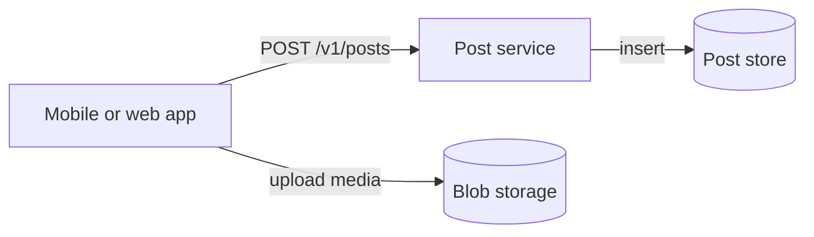

- **App.** The client a user posts and reads from.
- **Post service.** A stateless service that validates a post and writes it.
- **Post store.** A partitioned document store that holds every post.
- **Blob storage.** Holds photos and video. The app uploads straight to it with a short-lived signed URL, so media bytes never pass through the post service. See [large blobs](../03-patterns/large-blobs.md).

1. The app uploads any media to blob storage and gets back media IDs.
2. It sends `POST /v1/posts` with the text, the media IDs, and an idempotency key.
3. The post service takes the author from the token, checks the text length and media IDs, and assigns a `postId`.
4. It inserts the post and returns `201 Created`. One new item in the post store is the only state change.

The post store needs these fields:

- `postId`, a 64-bit ID whose high bits are the creation time in milliseconds, so sorting by ID sorts by time.
- `authorId`, the partition key. Requirement 3 explains why.
- `text` and `mediaUrls`.
- `createdAt`.

At about 1 KB a post and 500 million posts a day, the store grows by 500 GB a day, roughly 180 TB a year. That rules out a single database node and not much else.

### 2) Users can follow another account

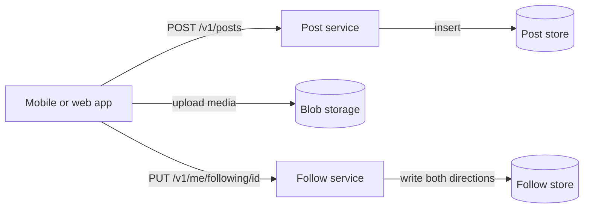

- **Follow service.** A stateless service that records and removes follow edges.
- **Follow store.** The follow graph, with two copies of every edge.

1. The app sends `PUT /v1/me/following/40213377`.
2. The follow service writes the edge keyed by the follower. That copy answers "whom do I follow?" from one partition.
3. It writes the same edge keyed by the followee. That copy answers "who follows this account?" from one partition, which fan-out needs later.
4. It returns `204 No Content`. A repeated PUT rewrites the same two items, so a retry after a half-finished write repairs the missing copy.

Each copy holds `followerId`, `followeeId`, and `createdAt`. I'd skip a graph database here. Nothing walks more than one hop, and two key-value copies answer both questions with single-partition reads.

### 3) Users can view a feed of posts from accounts they follow

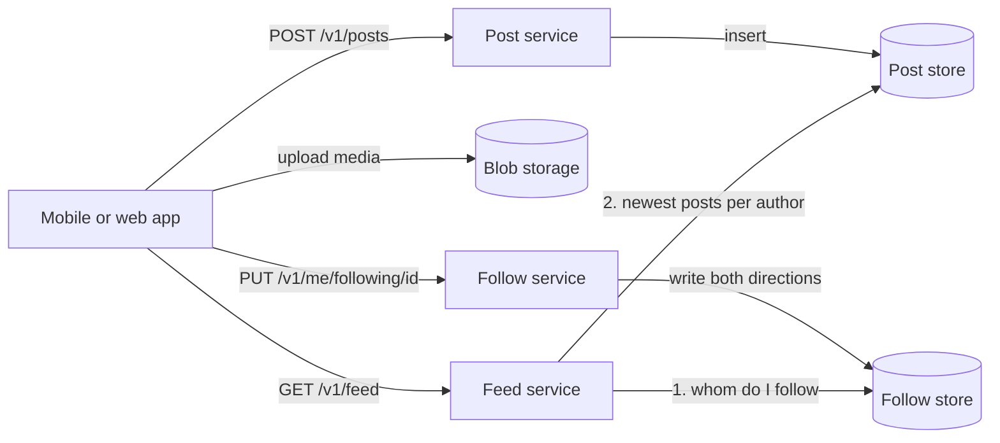

- **Feed service.** A stateless service that assembles one page of the feed.
- **Follow store.** Now read by follower.
- **Post store.** Now also read by author.

1. The app sends `GET /v1/feed?limit=25`.
2. The feed service reads the user's follow list from the follower-keyed copy.
3. For each followed account, it asks the post store for that author's newest 25 posts. Posts are partitioned on `authorId` and sorted by `postId`, so each request is a range read inside one partition.
4. It merges the results by `postId`, keeps the newest 25, and returns them with a cursor built from the last one.
5. For the next page, the app sends the cursor back, and step 3 asks each author only for posts older than it.

Nothing is precomputed, so a new post shows up on the very next read. This works for a user who follows 30 accounts. I'd tell the interviewer it won't survive a user who follows 5,000 and park that for deep dive 1.

## Deep dives

The design works for small accounts. Each deep dive below takes one failure at scale and fixes it.

### 1) How does a feed load in under 500 ms when its owner follows thousands of accounts?

This serves requirement 1.

#### Bad solution: Merge every followed account at read time

**Approach.** Keep the high-level design. Each page load queries every followed account's newest posts in parallel and merges them. This is called fan-out on read.

**Challenges.** A page costs one query per followed account. At an average of 200 follows and 230,000 loads a second at peak, that is 46 million queries a second. A user who follows 5,000 accounts sends 5,000 queries for one page, and the page is only as fast as the slowest of them, so one slow partition decides that user's latency. Every scroll repeats the whole merge.

#### Good solution: Precompute each feed when a post is written

**Approach.** Keep a feed list per user in Redis, newest first, capped at 200 entries. Each entry is a `postId` and an `authorId`, 8 bytes each. When a post is saved, a fan-out worker reads the author's followers from the followee-keyed copy and pushes the entry onto each follower's list, then trims the list to 200. The post request returns before fan-out starts. A feed read becomes one range read of 25 entries, followed by a point read for each of the 25 posts. This is fan-out on write. See [scaling reads](../03-patterns/scaling-reads.md).

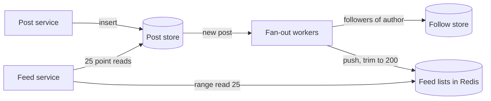

**Challenges.** The list read is fast, but each page still makes 25 point reads. At peak that is 230,000 × 25, or 5.75 million post reads a second, which is now the largest load in the system. Writes multiply too, to 1.16 million list pushes a second on average and 100 million for one celebrity post (deep dive 2). A new follow also shows nothing until the followed account posts again, so backfill on follow by copying that account's newest 20 posts into the follower's list in the background.

#### Great solution: Precomputed lists plus a post cache read in one round trip

**Approach.** Put a post cache in front of the post store. After the range read, the feed service asks the cache for all 25 posts in one pipelined multi-get. Only the misses go to the store, as point reads by `postId` and `authorId`. That is why each list entry carries the author, since a point read needs the partition key. A day of posts is 500 GB, but reads concentrate on a much smaller share, so the cache holds the hot set and evicts the rest. At a 95% hit ratio the store sees about 290,000 point reads a second at peak instead of 5.75 million. See [caching](../02-building-blocks/caching.md).

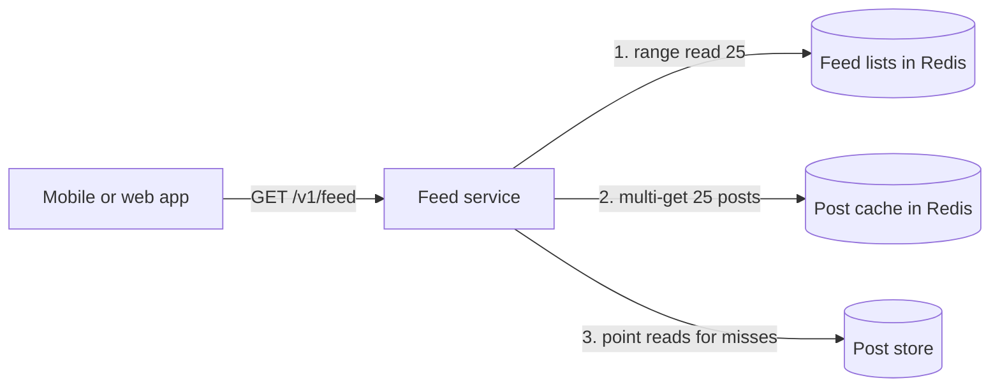

**Challenges.** A page now costs two cache round trips and a few store reads, well inside 500 ms. The design still copies every post into hundreds of lists, which deep dive 2 bounds. A viral post concentrates on one cache key (deep dive 3). And 3.2 TB of feed lists have to live somewhere (deep dive 4).

:::info
Ranking reuses this path. Read a few hundred candidates from the same list instead of 25, score them with a model, and cache the ranked page for a short time.
:::

In a 45-minute interview I'd name fan-out on read, show the 46 million queries a second, and go straight to the great solution, because hydration is the step most candidates forget.

### 2) How does one post reach 100 million followers within a minute?

This serves requirements 2 and 4. Fan-out on write is cheap on average and ruinous at the top of the follower curve.

#### Bad solution: One fan-out job per post

**Approach.** After saving a post, the post service publishes one message to a queue. A worker takes it, reads every follower, and pushes the post into each list before it acknowledges the message.

**Challenges.** It fails in two places. The post service writes the post and then publishes the message, so a crash between the two leaves a post that never reaches any feed. That is the dual-write problem. And one worker owns all 100 million pushes for a celebrity post. Even at 100,000 pushes a second that takes over 16 minutes, and a crash at follower 60 million either restarts the job or loses the rest.

#### Good solution: Trigger from the change feed and fan out in chunks

**Approach.** Drop the publish step. A fan-out planner reads new posts from the post store's change feed, so saving the post and starting its fan-out are one durable write. That is the transactional outbox idea without a separate outbox table, covered in [event-driven, CQRS, and event sourcing](../03-patterns/event-driven-cqrs-event-sourcing.md). The planner pages through the author's followers and enqueues one message per 1,000 followers. Workers scale out on queue depth and process chunks in parallel. A crash retries one chunk of 1,000, not the whole post. See [message queues](../02-building-blocks/message-queues.md).

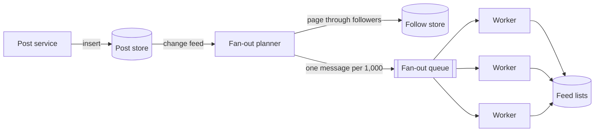

**Challenges.** Delivery is at least once, and a list push isn't idempotent, so a retried chunk pushes some posts twice. Dedupe by `postId` when the feed service builds a page. The merge in the great solution below needs that step anyway. The celebrity post still costs 100 million pushes. Workers sized for the 1.16-million-a-second baseline would need about 90 seconds for it even with nothing else queued, and a few big accounts posting in the same minute push everyone's posts past the one-minute bound. Many of those pushes are wasted, too, because plenty of followers won't open the app before the post falls off their 200-entry list.

#### Great solution: Push for most accounts, pull for the largest

**Approach.** Mark an account as high-fanout once it passes 100,000 followers. The planner skips fan-out for those authors and appends their posts to a short "recent posts by author" list in the post cache instead. The feed service keeps the set of high-fanout accounts each user follows, reads those lists, and merges them into the page by `postId`. Ordinary accounts keep fan-out on write. A typical user follows fewer than ten high-fanout accounts, so a page adds a handful of cache reads. Flip the flag with hysteresis, on at 100,000 followers and off at 80,000, so an account hovering near the line doesn't flap between modes and leave gaps in its followers' feeds. This is hybrid fan-out.

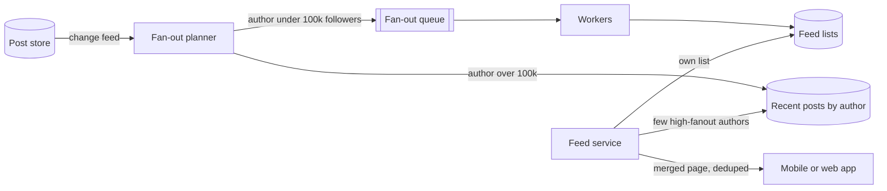

**Challenges.** The threshold is a dial. Lower it and reads get slower. Raise it and the fan-out queue gets spikier. Watch fan-out lag and feed p99 together when you move it. A user who follows hundreds of celebrities would pay hundreds of reads a page. Capping the pulled authors would lose posts, because a skipped author's posts are in no list the page reads, and the cursor then moves past them for good. Instead, merge that user's pulled lists into one list in the post cache with a 30-second TTL, inside the one-minute bound, so each page reads that list and their own. When an account drops back to push, its recent posts exist only in the pulled list, so fan out its newest 20 posts once at the switch. The recent-posts list of a 100-million-follower account also becomes the hottest key in the system, which is deep dive 3.

:::warning
Don't stop at "pull for celebrities". The interviewer will ask what happens when an account crosses the line. Without hysteresis, an account at 99,990 followers flips modes every few minutes. Each flip back to push also needs a one-time fan-out of the author's recent posts, or followers lose them.
:::

In a 45-minute interview I'd start from the good solution, show the 100 million writes, and land on hybrid. Interviewers expect hybrid, so the points come from the numbers that break each extreme and from the hysteresis.

### 3) How do we keep one viral post from overloading a cache shard?

This serves requirements 1 and 3. A celebrity post read 50 million times in an hour averages about 14,000 reads a second, and the first minutes run far above that. Every one of those reads asks the post cache for the same key, which lives on one shard. That shard also serves thousands of other keys, so one viral post slows every page whose posts hash there.

#### Bad solution: Give the hot shard a bigger node

**Approach.** Scale the cache up, or move the shard that holds the hot key to a larger node.

**Challenges.** It buys a constant factor. The next viral post lands on whichever shard its key hashes to, so you end up sizing every shard for the worst key of the day.

#### Good solution: Copy hot posts under several keys

**Approach.** When a post's read rate crosses a threshold, write it under several keys, `post:123:r0` through `post:123:r7`, which hash to different shards. Readers pick a suffix at random. That post's load spreads across eight shards, and the extra memory applies only to hot posts.

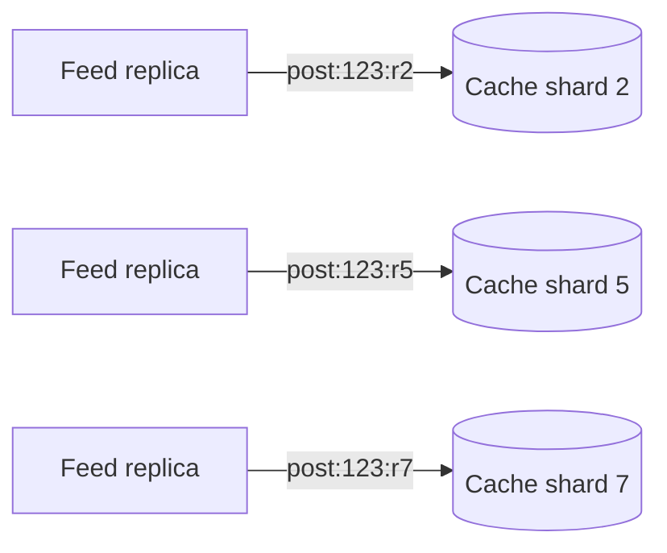

**Challenges.** Detecting heat lags the spike by seconds, and the spike is when it matters most. An edit or delete has to reach every copy. Every read still crosses the network to a shard.

#### Great solution: Keep the hottest posts in each feed replica's memory

**Approach.** Give every feed service replica a small in-process cache of the hottest posts and of the recent-posts lists for high-fanout accounts, with a 5-second TTL. A replica fetches a hot post at most once every 5 seconds, however many pages it serves. With 500 replicas, 50 million reads an hour become at most 500 × 720, or 360,000, cache reads an hour for that post. Keep replicated keys for the long tail of warm posts that aren't hot enough to earn a slot in every replica.

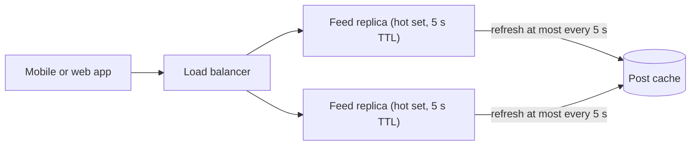

**Challenges.** An edit or delete takes up to 5 seconds to leave every replica, which the one-minute freshness bound allows. Each replica spends memory on the hot set, so size it in hundreds of entries, not millions. A fresh deploy starts every replica cold and sends a burst to the cache, so roll deploys out gradually.

In a 45-minute interview I'd present the in-process cache with the 360,000 arithmetic and give replicated keys one sentence.

### 4) How do we hold 3.2 TB of feeds without paying for all of it in RAM?

This serves requirements 3 and 4. One billion active users × 200 entries × 16 bytes is 3.2 TB of raw feed data, before per-entry overhead and replicas. Most of it belongs to people who open the app once a week.

#### Bad solution: One database item per feed entry

**Approach.** Store each feed entry as its own item in the document database, partitioned by user. Storage is cheap and durable.

**Challenges.** Every fan-out push becomes a replicated database write, and trimming to 200 adds a delete for each one. Cosmos DB charges about 5.5 RU to insert a 1 KB item without indexing, and a 16-byte entry costs about the same, so 1.16 million pushes a second would cost on the order of 6 million RU/s before the trims. That's six times the default ceiling for one container and the most expensive option on this list.

#### Good solution: Every feed list in RAM

**Approach.** Keep the lists in an in-memory Redis cluster sharded by user ID. Every push and read is a sub-millisecond list operation.

**Challenges.** You pay for RAM to hold feeds nobody will read today. The 3.2 TB, plus a replica of each shard for high availability, is over 6 TB of memory. The feeds are also only as durable as the cluster. Lose it and every user's feed is gone.

#### Great solution: RAM plus flash, and rebuild what's missing

**Approach.** Use a Redis tier that keeps keys and hot values in RAM and moves cold values to NVMe flash. Active users' lists stay in memory, and lists of users who haven't opened the app in days drift to flash. Give each list a TTL of about 30 days that resets on every read, so dormant users drop out entirely. When a list is missing because it expired, was evicted, or belongs to a new user, the feed service rebuilds it on read. It runs the fan-out-on-read path from the high-level design once, over the last few days of posts, and writes the list back. The feed lists become a cache, not a source of truth, so losing them costs latency, not data.

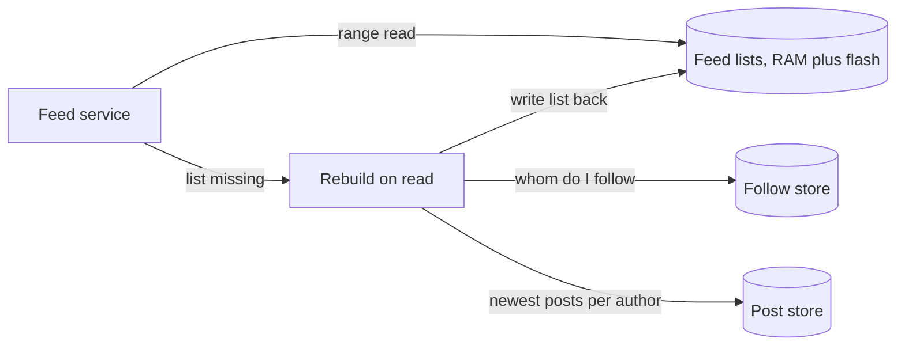

**Challenges.** A user returning after a long absence waits through one slow page while their list rebuilds or moves back from flash. Losing a whole cluster turns into a rebuild storm against the post store, so rate-limit rebuilds and serve a shorter page built from the user's most-read follows until the list exists. The flash tier also gives up some Redis features, which the On Azure gotcha covers.

In a 45-minute interview I'd spend three sentences here, on RAM plus flash, a TTL for dormant users, and rebuild on read, because the rebuild path is what lets you call the feed a cache.

## On Azure

One region is shown. The deep dives' components map one to one onto Azure services.

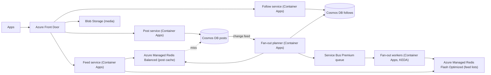

| Component | Azure service | Tier or setting, and why |
| --- | --- | --- |
| Edge and media delivery | Azure Front Door | Standard or Premium. Caches media from Blob Storage with a long `max-age` on versioned URLs, and routes API calls to the services. |
| Feed, post, and follow services, planner, workers | Azure Container Apps | Zone-redundant environment. Workers scale on Service Bus queue length through a KEDA scale rule. Consider AKS if you outgrow per-environment limits. |
| Posts | Azure Cosmos DB for NoSQL | Container partitioned on `/authorId`, so "newest posts by author" is a single-partition query for both the rebuild path and the pull path. Autoscale throughput. |
| Follow graph | Azure Cosmos DB for NoSQL | Two containers. `following` is partitioned on `/followerId`. `followers` uses the hierarchical key `/followeeId`, `/followerId`, so a 100-million-follower account can pass the 20 GB logical partition limit. |
| Fan-out trigger | Cosmos DB change feed | Latest version mode, read by the change feed processor inside the planner. |
| Fan-out queue | Azure Service Bus | Premium, for dedicated messaging units and predictable throughput during fan-out spikes. A chunk dead-letters after the default 10 delivery attempts. |
| Feed lists | Azure Managed Redis | Flash Optimized. Moves less-used values from RAM to NVMe, which suits terabytes of mostly idle feeds. Shard lists by user ID across several instances. |
| Post cache and recent posts by author | Azure Managed Redis | Balanced, all in RAM, because hydration is the hottest read. |
| Media | Azure Blob Storage | The app uploads directly with a user delegation SAS. See [large blobs](../03-patterns/large-blobs.md). |

### Why these choices

- **Partition posts on `/authorId`.** It turns the pull side of hybrid fan-out and the rebuild path into cheap single-partition queries sorted by time. Point reads for hydration need both `id` and the partition key, which is why each feed entry stores `authorId` next to `postId`.
- **Hierarchical keys for followers.** A logical partition normally caps at 20 GB and 10,000 RU/s ([partitioning](https://learn.microsoft.com/azure/cosmos-db/partitioning)). With subpartitioning, a key prefix such as one celebrity's `followeeId` can exceed both, and a query on that prefix still routes only to the partitions that hold it ([hierarchical partition keys](https://learn.microsoft.com/azure/cosmos-db/hierarchical-partition-keys)). The planner pages through 100 million followers without hitting one partition's throughput cap.
- **Change feed as the outbox.** The post write and the fan-out trigger share one durable write, so no post exists without its fan-out eventually starting. The change feed processor checkpoints for you and delivers at least once, which is why the read path dedupes by `postId`. Latest version mode doesn't capture deletes ([change feed](https://learn.microsoft.com/azure/cosmos-db/change-feed)), so delete a post by first writing a `deleted` flag the planner can see, and let a TTL remove the item later.
- **Request units.** A point read of a 1 KB item costs 1 RU, and inserting a 1 KB item without indexing costs about 5.5 RU ([request cost](https://learn.microsoft.com/azure/cosmos-db/optimize-cost-reads-writes)). At a 95% post-cache hit ratio, hydration misses cost about 290,000 RU/s at peak, and 5,800 inserts a second cost at least 32,000 RU/s, more once indexed. Both fit under the default maximum of 1,000,000 RU/s per container, which a support ticket can raise ([service quotas](https://learn.microsoft.com/azure/cosmos-db/concepts-limits)). The feed lists would not fit, which is why they live in Redis.
- **Flash Optimized for feed lists.** Azure Managed Redis Flash Optimized moves less frequently accessed data from RAM to NVMe. Microsoft notes this can reduce performance, which is acceptable for feeds of inactive users and is why the post cache stays on an all-RAM tier ([Azure Managed Redis overview](https://learn.microsoft.com/azure/redis/overview)). The largest Flash Optimized size outside preview holds about 1,440 GB, and the 1,920 GB and 4,500 GB sizes are in preview, so 3.2 TB of raw lists needs at least three instances. Size the count from a load test, because Redis's per-entry overhead adds to the raw figure.
- **Post cache size.** In-memory Azure Managed Redis sizes above 350 GB are in preview. Keep each post cache instance at or below that size and add instances, sharded by post ID, when the hit ratio asks for more.
- **Container Apps scaling.** A KEDA scale rule on Service Bus queue depth scales workers out during a fan-out spike and back in afterwards ([scaling](https://learn.microsoft.com/azure/container-apps/scale-app)).

### Zones and regions

Make Cosmos DB zone-redundant in every region. Microsoft's [Cosmos DB reliability](https://learn.microsoft.com/azure/reliability/reliability-cosmos-db) guide says this doesn't measurably slow requests. The Container Apps environment needs zone redundancy too, and you can set it only when you create the environment ([Container Apps reliability](https://learn.microsoft.com/azure/reliability/reliability-container-apps)). Turn on high availability for both Redis instances, which spreads their nodes across zones by default ([Azure Managed Redis overview](https://learn.microsoft.com/azure/redis/overview)). Service Bus enables zone redundancy automatically, at no extra cost, in regions that have availability zones ([Service Bus reliability](https://learn.microsoft.com/azure/reliability/reliability-service-bus)). For a global product, run the read path in several regions, with Cosmos DB read regions and a feed cache in each. A user's feed lists live in their home region, and Front Door routes them there. If that region fails, the user's feed is rebuilt elsewhere on first read, which the rebuild path already handles.

### Gotcha

Flash Optimized doesn't support search or vector search, Redis Bloom, Redis TimeSeries, or active geo-replication ([overview](https://learn.microsoft.com/azure/redis/overview)). If a later feature wants vector search over feed items or a Bloom filter for "already seen", put it on a separate in-memory instance instead of finding the limit after a migration.

See [data choices](../04-azure/data-choices.md), [messaging choices](../04-azure/messaging-choices.md), and [regions, zones, and resiliency](../04-azure/regions-zones-and-resiliency.md) for how these services compare in general.

## What is expected at each level

### Mid-level

You should get all three requirements working on your own. That means a post store, a follow store that answers both directions, and a feed read that merges followed accounts' posts with cursor pagination, not offsets. You should notice unprompted that a user following thousands of accounts breaks that read. With a nudge, you should reach a precomputed feed list and explain the write it adds. I may have to remind you that the list holds IDs and the posts still need fetching. Missing the celebrity threshold, the hot-key problem, or the storage tier wouldn't count against you.

### Senior

You raise follower skew before I do and lead deep dives 1 and 2 with numbers. I want the 46 million queries a second that sink fan-out on read and the 100 million writes that sink pure fan-out on write, then hybrid as the answer. You bring up hydration and the post cache unprompted. You spot the dual write between saving a post and queueing its fan-out, and you fix it with the change feed and chunked, retryable work. You may need a prompt on hysteresis or on the viral post in deep dive 3, but once prompted you should reach an in-process cache.

### Staff+

You treat the feed as a cache you will operate. You size the 3.2 TB, decide what lives in RAM and what on flash, and give the feed a rebuild path so a lost cluster is a latency event. You carry the threshold as a dial with the two metrics that tune it, and you raise the gap that a mode flip can leave. You quantify the hot-key fix, cover new-follow backfill and post deletes through the pipeline, and explain how ranking fits without changing storage. You also say how feeds behave across regions, with home-region lists that rebuild after a regional failure.

## Further reading

- [Hello Interview: Design Facebook's news feed](https://www.hellointerview.com/learn/system-design/problem-breakdowns/fb-news-feed)
- [The Coding Gopher: The Outbox Design Pattern](https://thecodinggopher.substack.com/p/the-transactional-outbox-pattern)
- [The Coding Gopher: Why Scaling Redis is Harder Than You Think](https://thecodinggopher.substack.com/p/why-scaling-redis-is-harder-than)
- [Azure Cosmos DB change feed](https://learn.microsoft.com/azure/cosmos-db/change-feed)
- [Azure Cosmos DB hierarchical partition keys](https://learn.microsoft.com/azure/cosmos-db/hierarchical-partition-keys)
- [Azure Managed Redis overview](https://learn.microsoft.com/azure/redis/overview)
- [Caching](../02-building-blocks/caching.md), [message queues](../02-building-blocks/message-queues.md), [scaling writes](../03-patterns/scaling-writes.md)
