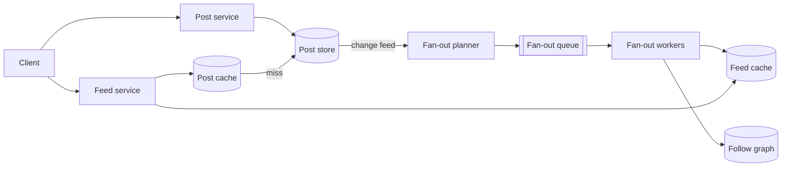
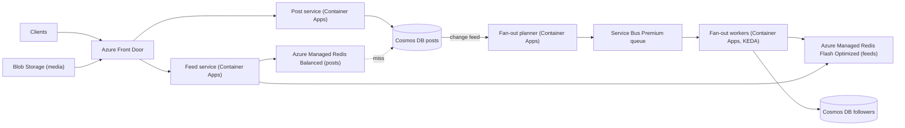

## TL;DR

Precompute each user's feed as a capped list of post IDs in Redis, filled by fan-out workers when someone they follow posts. That makes the common read a single list lookup plus a batch of cached post fetches. Skip fan-out for accounts with huge follower counts and merge their recent posts at read time instead (hybrid fan-out), because writing one post into 100 million lists is the failure mode. Cache hot posts redundantly so one viral post does not melt one cache shard. On Azure: Cosmos DB for NoSQL holds posts and the follow graph, its change feed drives fan-out through Service Bus to Container Apps workers, and Azure Managed Redis holds feeds and the post cache.

## Requirements

### Functional

- Users create posts (text plus optional media references).
- Users follow other users. Following is one-directional and needs no approval.
- Users view a feed of posts from people they follow, newest first.
- Users page through the feed with infinite scroll.

Out of scope: ranking by engagement, comments and likes, ads, and privacy controls. Mention ranking as an extension; a chronological feed is enough to exercise the hard parts.

### Non-functional

- 2 billion users.
- Feed loads in under 500 ms at p99.
- New posts appear in followers' feeds within one minute. Eventual consistency is acceptable.
- Highly available. A stale feed beats an error page.
- No limit on how many accounts a user follows, or on how many followers an account has.

## Capacity estimates

Assumptions: 1 B daily active users, 10 feed loads per user per day, 0.5 posts per user per day, 200 followers on average, 25 posts per page.

| Quantity | Arithmetic | Result |
| --- | --- | --- |
| Feed reads | 1 B × 10 ÷ 86,400 s | about 116,000 req/s average, 230,000 peak |
| New posts | 1 B × 0.5 ÷ 86,400 s | about 5,800 posts/s |
| Fan-out writes | 5,800 posts/s × 200 followers | about 1.16 M list inserts/s |
| Worst single post | 1 account × 100 M followers | 100 M list inserts for one post |
| Feed cache size | 1 B users × 200 entries × 16 B (post ID plus author ID) | 3.2 TB raw |
| Post storage per day | 500 M posts × 1 KB | 500 GB/day, about 180 TB/year |
| Post hydration reads | 230,000 feeds/s × 25 posts | about 5.75 M post lookups/s at peak |

The numbers say three things. Fan-out on write is affordable on average (about 1 M cheap list operations per second across a cluster) but catastrophic for the largest accounts. Post hydration, not feed lookup, is the biggest read load, so the post cache matters more than the feed cache. And the feed cache is terabytes, so it needs a tier that keeps cold users' feeds off RAM.

## Core entities and API

### Entities

- **User**: `id`, `name`, `followerCount`, `isHighFanout` (set when `followerCount` passes a threshold).
- **Follow**: `followerId`, `followeeId`, `createdAt`. Stored twice, once keyed by each side.
- **Post**: `id` (time-sortable, for example a ULID), `authorId`, `content`, `mediaUrls`, `createdAt`.
- **FeedEntry**: `(postId, authorId)` in a per-user list, newest first, capped at 200.

### API

```http
POST /v1/posts                  { "content": "...", "mediaIds": ["..."] }  -> 201 { "postId": "..." }
PUT  /v1/users/{id}/followers   (current user follows {id})               -> 204
DELETE /v1/users/{id}/followers                                          -> 204
GET  /v1/feed?cursor=<opaque>&limit=25                                    -> 200 { "posts": [...], "nextCursor": "..." }
```

The cursor encodes `(createdAt, postId)` of the last item returned. Offset pagination breaks when new posts arrive at the top between page loads; a cursor does not. See [API design](../01-fundamentals/api-design.md).

## High-level design



### Write path

1. The post service writes the post to the post store and returns. The client sees success in tens of milliseconds.
2. The store's change feed delivers the new post to the fan-out planner. Using the change feed instead of a separate "publish event" call avoids a dual write: the post cannot be saved without fan-out eventually happening. See [event-driven, CQRS, and event sourcing](../03-patterns/event-driven-cqrs-event-sourcing.md).
3. The planner reads the author's follower count. If the author is high-fanout, it stops. Otherwise it splits the follower list into chunks of 1,000 and enqueues one message per chunk.
4. Workers read each chunk of follower IDs and push `(postId, authorId)` onto each follower's feed list, then trim the list to 200.

### Read path

1. The feed service reads the first 25 entries of the user's feed list.
2. It also reads recent posts from the high-fanout accounts the user follows (usually a handful) and merges them in by time.
3. It hydrates the post IDs from the post cache in one batch, falling back to the post store for misses.
4. It returns the page and a cursor.

## Deep dives

### 1. Fan-out on write, on read, or both

| Approach | Read cost | Write cost | Breaks when |
| --- | --- | --- | --- |
| Fan-out on read (pull) | Query every followed account's recent posts and merge | One insert | A user follows 5,000 accounts: 5,000 lookups per page load. |
| Fan-out on write (push) | One list read | One insert per follower | An account with 100 M followers posts: 100 M writes, minutes of lag, and a storm on the cache. |
| Hybrid | One list read plus a few high-fanout lookups | One insert per follower for normal accounts only | Rarely; both extremes are bounded. |

**Pick: hybrid.** Push for accounts under a threshold (say 100,000 followers), pull for accounts over it. A typical user follows fewer than ten high-fanout accounts, so the read path adds at most a few lookups, each of which hits a hot, heavily cached "recent posts by author" list. The threshold is a tuning knob: lower it and reads get slower, raise it and the fan-out queue gets spikier.

Set `isHighFanout` with hysteresis (flip on at 100,000, off at 80,000) so an account hovering near the line does not flap between modes and leave gaps in its followers' feeds.

### 2. Users who follow many accounts

The flip side: a power user following 10,000 accounts. With push, their feed list fills normally and reads stay O(1). With pure pull, every page load fans out to 10,000 authors. This is the main reason pull alone fails. The hybrid design handles them, since only their high-fanout follows are pulled at read time.

A related trap: a new follow does not backfill. When a user follows someone, write that account's last 20 posts into the follower's feed list in the follow request's background work so the feed does not look empty.

### 3. Hot posts and uneven reads

A post from a celebrity may be read 50 million times in an hour, and every one of those reads asks the post cache for the same key. In a sharded cache that key lives on one shard, which saturates.

- **Bigger shard.** Buys a constant factor, not a fix.
- **Redundant keys.** Write hot posts under N keys (`post:123:r0` to `post:123:r7`) and have readers pick one at random. Spreads load across shards at N times the memory for those posts only.
- **In-process cache in feed service replicas.** A few-second TTL cache of the hottest posts. Each replica serves them from memory.

**Pick: in-process cache first, redundant keys for the long tail of hot posts.** A 5 second local cache across 500 feed replicas turns 50 M reads per hour into at most 500 replicas × 720 refreshes per hour = 360,000 cache reads per hour for that post. Posts are immutable after a short edit window, so staleness is limited to edits and deletes, and the requirement allows a minute. See [scaling reads](../03-patterns/scaling-reads.md).

### 4. Feed storage tier

Fan-out writes and feed reads are both list operations on a per-user key, so an in-memory list store fits. The question is cost at 3.2 TB raw.

- **All in RAM.** Fastest, most expensive. Pays for RAM to hold feeds of users who open the app once a month.
- **Feeds in a document database.** Cheap storage, but each fan-out insert becomes a document write with indexing and replication, priced per write. At 1.16 M per second that is the most expensive option.
- **RAM plus flash.** Keep keys and hot values in RAM, move cold values to NVMe.

**Pick: RAM plus flash for the feed cache, with a rebuild path.** If a user's list is missing (evicted, or new user), rebuild it on read by pulling the last day of posts from their followed accounts once, then writing the list. That makes the feed cache a cache, not a source of truth, so losing it costs latency, not data.

### 5. Fan-out pipeline failures

Each fan-out chunk is retried independently, so a worker crash halfway through a 100,000-follower post retries one chunk of 1,000, not the whole post. List pushes are not idempotent: a retried chunk inserts duplicates. Make the push idempotent by checking the list head before inserting, or dedupe at read time by post ID (cheaper, and needed anyway when merging pulled posts). See [idempotency and retries](../03-patterns/idempotency-and-retries.md).

## On Azure



| Component | Azure service | Tier or setting, and why |
| --- | --- | --- |
| Edge and media delivery | Azure Front Door | Standard or Premium. Caches media from Blob Storage with long `max-age` on versioned URLs. |
| Feed, post, planner, worker services | Azure Container Apps | Zone-redundant environment. Workers scale on Service Bus queue length through KEDA. Consider AKS if you outgrow per-environment limits. |
| Posts | Azure Cosmos DB for NoSQL | Container partitioned on `/authorId` so "recent posts by author" (the pull path) is a single-partition query. Autoscale throughput. |
| Follow graph | Azure Cosmos DB for NoSQL | Two containers: `following` on `/followerId`, `followers` on hierarchical `/followeeId, /followerId` so a 100 M-follower account can exceed the 20 GB logical partition limit. |
| Fan-out trigger | Cosmos DB change feed | Latest-version mode. Consumed with the change feed processor in the planner. |
| Fan-out queue | Azure Service Bus | Premium, for dedicated messaging units and predictable throughput during fan-out spikes. Dead-letter after the default 10 deliveries. |
| Feed lists | Azure Managed Redis | Flash Optimized (250 to 4,500 GB): moves less-used values to NVMe, which suits terabytes of mostly idle feeds. |
| Post cache | Azure Managed Redis | Balanced or Memory Optimized, all in RAM, because hydration is the hottest read. |
| Media | Azure Blob Storage | Upload directly with a SAS; see [large blobs](../03-patterns/large-blobs.md). |

### Why these choices

- **Partitioning posts on `/authorId`** turns the pull side of hybrid fan-out into a cheap single-partition query sorted by time. Point reads for hydration need both `id` and the partition key, which is why each feed entry stores `authorId` next to `postId`.
- **Hierarchical keys for followers.** A logical partition normally caps at 20 GB and 10,000 RU/s ([partitioning](https://learn.microsoft.com/azure/cosmos-db/partitioning)). With subpartitioning, a key prefix such as one celebrity's `followeeId` can exceed both ([hierarchical partition keys](https://learn.microsoft.com/azure/cosmos-db/hierarchical-partition-keys)), and a prefix query still routes only to the partitions that hold it.
- **Change feed as the outbox.** The post write and the fan-out trigger share one durable write, so there is no window where the post exists but fan-out never starts ([change feed](https://learn.microsoft.com/azure/cosmos-db/change-feed)).
- **Flash Optimized for feeds.** Azure Managed Redis Flash Optimized moves less frequently accessed data from RAM to NVMe. Microsoft notes this can reduce performance, which is acceptable for feeds of inactive users and is why the post cache stays on an all-RAM tier ([Azure Managed Redis overview](https://learn.microsoft.com/azure/redis/overview)).
- **Container Apps scaling.** KEDA scale rules on Service Bus queue depth scale workers out during a fan-out spike and back in afterwards ([scaling](https://learn.microsoft.com/azure/container-apps/scale-app)).

### Zones and regions

Turn on zone redundancy for Cosmos DB in each region and the Container Apps environment, and high availability on both Redis instances. Service Bus replicates messages across availability zones automatically where the region has them ([Service Bus reliability](https://learn.microsoft.com/azure/reliability/reliability-service-bus)). For a global product, run the read path in several regions with Cosmos DB read regions and a feed cache per region; a user's feed lists live in their home region, and Front Door routes them there. A regional outage means users in that region rebuild feeds elsewhere on first read, which the rebuild path already handles.

### Gotcha

Flash Optimized does not support Redis modules such as RediSearch or RedisBloom, and it does not support active geo-replication ([overview](https://learn.microsoft.com/azure/redis/overview)). If a later feature wants vector search over feed items or a Bloom filter for "already seen", put it on a separate in-memory instance instead of discovering the limit after migration.

See [data choices](../04-azure/data-choices.md) and [messaging choices](../04-azure/messaging-choices.md).

## Interview tips

- Lead with the fan-out trade-off and the numbers that make each extreme fail. Interviewers expect hybrid; they want to hear why.
- Say where the threshold lives and how you would tune it (fan-out queue lag versus feed read latency).
- Do not forget hydration. Many candidates design the ID list and forget that 25 post fetches per page dominates read load.
- Expect "how do you add ranking?" Fetch a larger candidate set (say 500 IDs) from the same lists, score with a model, and cache the ranked page briefly. The storage design does not change.
- Expect "what if the feed cache is lost?" Rebuild on read, so it is a latency event, not a data loss event.
- Do not store the feed in a relational table with one row per (user, post). At 1 M inserts per second you would spend the interview sharding it.

## Further reading

- [Hello Interview: Design Facebook's news feed](https://www.hellointerview.com/learn/system-design/problem-breakdowns/fb-news-feed)
- [The Coding Gopher: The outbox design pattern](https://thecodinggopher.substack.com/p/the-transactional-outbox-pattern)
- [Azure Cosmos DB change feed](https://learn.microsoft.com/azure/cosmos-db/change-feed)
- [Azure Cosmos DB hierarchical partition keys](https://learn.microsoft.com/azure/cosmos-db/hierarchical-partition-keys)
- [Caching](../02-building-blocks/caching.md), [message queues](../02-building-blocks/message-queues.md), [scaling writes](../03-patterns/scaling-writes.md)
