## Understanding the problem

**What is a rate limiter?** It caps how many requests one client can send to an API in a period of time and turns the rest away with `429 Too Many Requests`. It keeps a buggy retry loop from flooding the backends, stops one noisy customer from starving the others, and puts a ceiling on expensive calls such as sign-in attempts and SMS sends.

Two things make it hard. The check runs on every request before any real work happens, so its latency and its outages become the API's latency and outages. And one client's requests land on many gateway replicas at once, so the count has to live somewhere they all share, and updating it has to be atomic without being slow.

## Functional requirements

1. Clients should be able to send requests up to the limit a rule sets for them, such as 100 requests a minute per user on `/search`.
   - A rule counts by user ID, API key, or IP address.
2. Clients that go over a limit should get a `429` that says when to retry, and every response should say how much budget is left.
3. API owners should be able to add or change a rule and have every gateway enforce it within a minute, without a deploy.

**Below the line (out of scope)**

- **Billing quotas over months.** A monthly plan quota is metering. It tolerates minutes of lag and needs durable records, the opposite of this design.
- **Bot detection.** Telling a scraper from a person takes behavioral signals. A rate limiter only counts.
- **Client-side limiting.** You can't trust an SDK to slow itself down, so the server enforces every limit anyway.

These three are the whole contract a caller sees, a budget, a clear rejection, and rules that change without a release. Everything below the line can sit next to this system.

## Non-functional requirements

1. **The check is nearly free.** It adds under 10 ms at p99 to each request, including any network hop to shared state.
2. **It keeps up with the API.** The fleet handles 1 million requests a second from 100 million daily active users.
3. **Availability beats accuracy.** If the limiter's state is slow or down, requests keep flowing. A few extra requests getting through is better than rejecting real users. Limits that guard money or security, such as sign-in attempts and SMS sends, are the exception and fail closed.
4. **One budget per client.** A client whose requests spread over 50 gateway replicas gets one budget, not 50. Across regions, a small and bounded overshoot is acceptable.

**Below the line**

- **Exact global limits across regions.** Agreeing on every count across continents costs a cross-region round trip per request, which requirement 1 can't afford. Deep dive 5 bounds the overshoot instead.
- **Durable counters.** If the counter store loses its data, every client briefly gets a fresh budget, which is generosity, not data loss.

The property that shapes this design most is that every request pays for the check, so 1 million requests a second means 1 million reads and writes of shared state a second. Memory is small. With 2 rules per user and about 100 bytes per counter, 100 million users need about 20 GB at most, since idle counters expire. Network is small too, about 200 MB/s at 200 bytes per check and reply. Throughput is the constraint, and it decided two things. The counter store is sharded for operations per second, not for space, and each check must cost exactly one round trip, with no lock or retry loop. See [back-of-the-envelope estimation](../01-fundamentals/back-of-the-envelope.md) for the method.

:::tip
Ask who the client is before you pick a key. An IP limit punishes a whole office behind one NAT address, and a user limit does nothing for endpoints that accept anonymous traffic. Most real APIs need both.
:::

## Core entities

- **Rule.** A limit for a set of requests, such as one route for one client tier, and the identity it counts by.
- **Client.** Whoever a rule counts, identified by user ID, API key, or IP address.
- **Counter.** The live state for one client under one rule. It becomes a token bucket in deep dive 1.
- **Decision.** Allowed or denied, with the budget left and the time to retry.

I'd tell the interviewer that fields come later, next to the store that holds them.

## API

The limiter is a library in the gateway, so its main interface is a function call. Clients see headers on responses they already get, and owners manage rules over REST, which is enough because nothing pushes data to a client. See [API design](../01-fundamentals/api-design.md) for status code conventions.

Requirement 1 is the check itself. The gateway calls it once per request with the client it resolved from the auth token, the API key, or the socket address, never from a header the caller controls, or a flooder sends a fresh ID with every request.

```ts
type Decision = { allowed: boolean; remaining: number; retryAfterSeconds: number };
function check(clientId: string, rules: Rule[], cost = 1): Promise<Decision>;
```

Requirement 2 is what a rejected client sees. Clients and SDKs already honor `Retry-After`. The `X-RateLimit-*` names are a common convention, and an IETF draft standardizes `RateLimit` and `RateLimit-Policy` headers, so match what your clients expect. Allowed responses carry the same limit and remaining headers.

```http
GET /v1/search?q=redis
Authorization: Bearer <token>

429 Too Many Requests
Retry-After: 3
X-RateLimit-Limit: 100
X-RateLimit-Remaining: 0
```

Requirement 3 is a rule write. The owner comes from the token, and the API checks that this owner manages the route the rule targets. A rule states a sustained limit and a burst, which deep dive 1 turns into a token bucket.

```http
PUT /v1/rules/search-per-user
Authorization: Bearer <token>
{ "match": { "route": "/v1/search" }, "keyBy": "userId", "limit": 100, "periodSeconds": 60, "burst": 20, "failMode": "open" }

200 OK
{ "id": "search-per-user", "version": 42 }
```

## High-level design

Start with one region and the fewest boxes that enforce a limit. The algorithm, atomicity, sharding, failure handling, and regions all wait for the deep dives.

### 1) Clients can send requests up to their limit

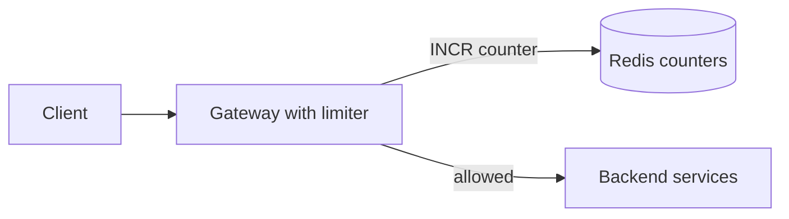

- **Client.** Any caller of the public API, signed in or anonymous.
- **Gateway with limiter.** The replicated tier every request already crosses. It authenticates and routes, and now it runs the limiter library too.
- **Redis counters.** One shared in-memory store that every gateway replica reads and writes.
- **Backend services.** Everything behind the gateway. They never see a request the limiter rejected.

1. A request reaches one of the gateway replicas.
2. The gateway authenticates it and resolves the client ID, which is the user ID from the token, the API key, or the socket address for anonymous calls.
3. It matches the request against its rules, which for now ship in the gateway's own config, and finds "100 a minute per user on `/search`".
4. It increments the counter for this client, rule, and minute with `INCR`, and sets a 60-second expiry the first time.
5. If the new count is 100 or less, it forwards the request. The only state change is one counter in Redis.

Each counter is one Redis key holding one integer. The key, such as `rl:user:42:search:202610241109`, names the client, the rule, and the minute, and the TTL clears last minute's counter on its own. That is a fixed window counter, the simplest algorithm that works. Deep dive 1 replaces it.

Why put the limiter in the gateway? It already sees every request, so one implementation protects every service, and rejected traffic never costs a backend anything. Why not count in each gateway's memory? The load balancer spreads one client across replicas, so each replica would allow the full limit on its slice. See [API gateway](../02-building-blocks/api-gateway.md).

:::warning
Don't draw a separate rate limiter service that the gateway calls over the network. That service still has to call shared state, so it adds a hop and a fleet for nothing.
:::

### 2) Clients over their limit get a 429 that says when to retry

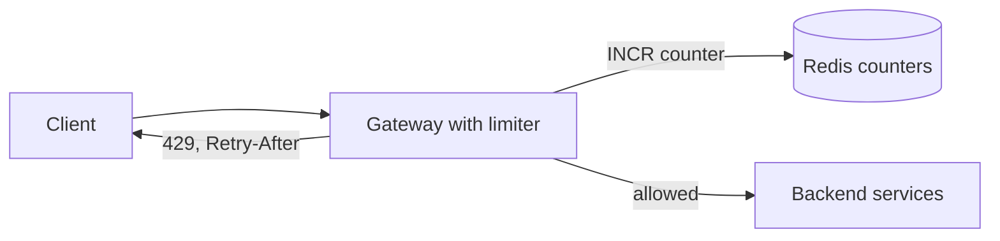

- **Gateway with limiter.** Gains the rejection path and the response headers.
- **Redis counters.** Unchanged.

1. The `INCR` returns 101 against a limit of 100.
2. The gateway answers `429 Too Many Requests` without calling the backend. It sets `Retry-After` to the seconds left in the current minute.
3. Every response, allowed or denied, carries the limit and the budget left, so a well-behaved client slows down before it hits the wall.
4. The client waits, then retries with backoff and jitter, so a thousand rejected clients don't all come back in the same second. See [idempotency and retries](../03-patterns/idempotency-and-retries.md).

A rejected request still costs a Redis call. A client stuck in a retry loop at 50,000 requests a second sends 50,000 calls a second at one counter, and deep dive 3 comes back to that.

### 3) API owners can change a rule without a deploy

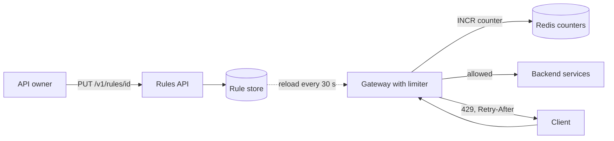

- **Rules API.** Validates a rule and stores it with a version number.
- **Rule store.** A small, durable key-value store of rules.
- **Gateway with limiter.** Now loads its rules from the store instead of its own config.

1. The owner sends `PUT /v1/rules/search-per-user` with the new limit.
2. The rules API checks that the owner manages `/v1/search`, and rejects mistakes such as a limit of 0 on every route. It writes the rule and bumps one version key.
3. Every gateway polls the version key every 30 seconds. When the version changes, the gateway reloads all rules into memory.
4. The next check uses the new limit. Counters never store the limit, so none of them needs rewriting.

The rule store holds `id`, which is also part of every counter key, `match` for the route and client tier, `keyBy`, `limit`, `periodSeconds`, `burst`, and `failMode`, which deep dive 4 uses.

Polling one version key keeps the store's load flat however many rules exist, and a change lands within one polling interval, well inside requirement 3's minute.

## Deep dives

The design works for one region on a quiet day. Now harden it against each non-functional requirement, one problem at a time.

### 1) Which algorithm keeps the budget honest without unbounded memory?

This serves requirement 4. "100 a minute" should mean 100 a minute from the client's point of view, and the state per client has to stay small across 200 million counters.

#### Bad solution: Fixed window counter

**Approach.** Keep the high-level design. One integer per client per rule per minute, reset at each minute boundary because the key expires.

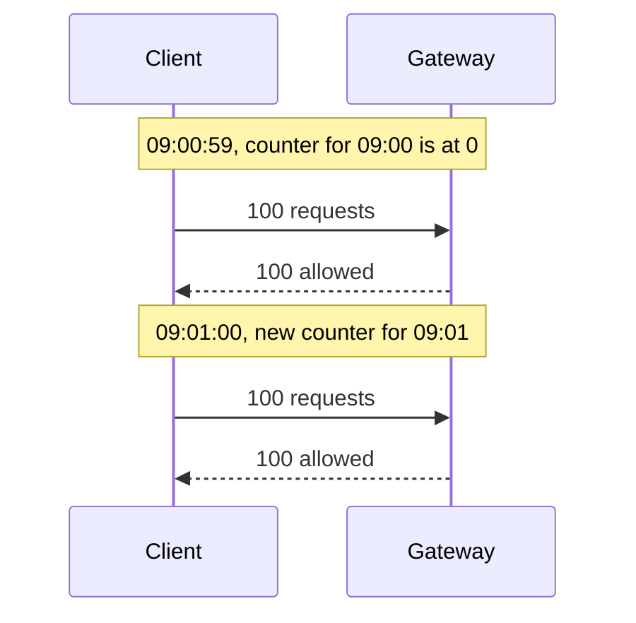

**Challenges.** The boundary breaks it. A client can send 100 requests in the last second of one minute and 100 more in the first second of the next, so 200 requests pass in two seconds against a limit of 100 a minute. Every client that was told to retry at the top of the minute also hits the backend in the same instant.

#### Good solution: Sliding window counter

**Approach.** Keep two counters, one for this minute and one for last minute. Weight last minute's count by how much of it still overlaps the 60-second window, so fifteen seconds in, the estimate is the current count plus 75% of the previous one. The exact variant, a sliding window log, stores a timestamp per request, which is 1,000 entries per client for a limit of 1,000 an hour.

**Challenges.** It assumes last minute's requests were spread evenly, so it can be slightly off either way. It also has one knob, so it can't say "allow a burst of 20, then 100 a minute", which most interactive APIs want.

#### Great solution: Token bucket

**Approach.** Each client gets a bucket that holds up to `burst` tokens and refills continuously at `limit` tokens per `periodSeconds`. A request takes one token, and an expensive call such as a bulk export can take several. The bucket stores two numbers, the token count and the time of the last refill. On each check, add the tokens earned since then, cap the total at `burst`, and try to take a token. Refill never stops, so there is no boundary to game, and an empty bucket can say exactly when the next token arrives, which is the `Retry-After`.

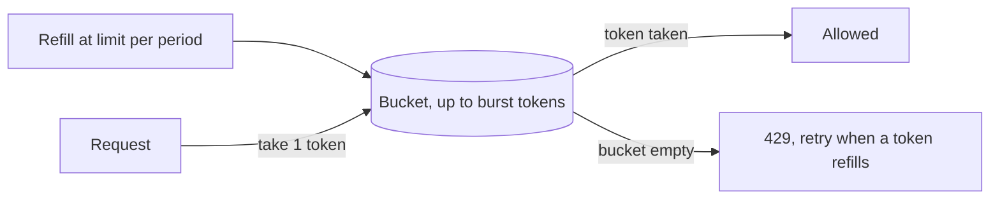

**Challenges.** Customers now reason about two numbers, which is why the API names them `limit` and `burst`. Each check also reads, calculates, and writes a token count and a timestamp, and deep dive 2 has to make that atomic.

:::info
API Management's v2 tiers enforce `rate-limit-by-key` with a token bucket, while its classic tiers use a sliding window ([rate-limit-by-key](https://learn.microsoft.com/azure/api-management/rate-limit-by-key-policy)). The token bucket is the common production choice.
:::

In a 45-minute interview I'd sketch the fixed-window boundary in a minute, then go straight to the token bucket. It uses constant memory, it handles bursts and weighted requests, and the interviewer mostly wants to hear you say why the window fails.

### 2) How do many gateways update one bucket without letting extra requests through?

This serves requirements 1 and 4. A token bucket check reads, calculates, and writes. With 50 replicas checking the same client, those steps interleave.

#### Bad solution: Read, compute, and write from the gateway

**Approach.** The gateway reads the bucket with `HMGET`, computes the refill and the decision in its own code, and writes the result back with `HSET`.

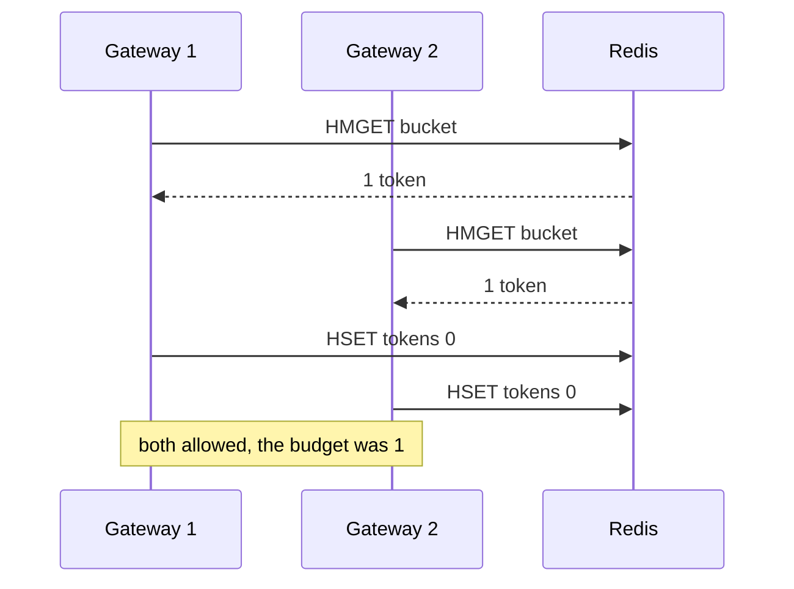

**Challenges.** Two replicas read one remaining token, both allow, and both write zero. Under load the overshoot grows with the number of replicas. Each check also costs two round trips. The refill uses each gateway's own clock, so a replica whose clock runs fast mints extra tokens.

#### Good solution: Optimistic transaction

**Approach.** Wrap the update in `WATCH`, `MULTI`, and `EXEC`. The gateway watches the bucket key, reads it, computes, and commits. If another replica changed the key in between, `EXEC` fails and the gateway starts over. A distributed lock per key is also correct, but it adds a lock service and two more round trips to every request. See [handling contention](../03-patterns/handling-contention.md).

**Challenges.** It is correct, but the busiest keys are the ones that conflict most, so a hot client turns into a retry storm on the hot path. A check now takes at least two round trips and sometimes many more, which eats the 10 ms budget. Clock skew between gateways is still there.

#### Great solution: One server-side script per check

**Approach.** Send the whole update to Redis as a Lua script. Redis runs a script to completion before any other command, so refill, decision, and write happen as one step in one round trip, and the time comes from the Redis server's clock, so gateway skew can't mint tokens. Set each key's TTL to the time an empty bucket takes to refill, so idle clients cost no memory. To check a per-route rule and a global rule together, pass both keys and compute every bucket before writing any, so a client blocked on its global limit doesn't drain its per-route budget for nothing.

```lua
-- KEYS[1] = bucket key; ARGV = capacity, refill per ms, cost, ttl ms
local cap, rate, cost, ttl = tonumber(ARGV[1]), tonumber(ARGV[2]), tonumber(ARGV[3]), tonumber(ARGV[4])
local t = redis.call('TIME')
local now = t[1] * 1000 + math.floor(t[2] / 1000)
local b = redis.call('HMGET', KEYS[1], 'tokens', 'ts')
local tokens = tonumber(b[1]) or cap
local ts = tonumber(b[2]) or now
tokens = math.min(cap, tokens + (now - ts) * rate)
local allowed, wait = 0, 0
if tokens >= cost then
  tokens = tokens - cost
  allowed = 1
else
  wait = math.ceil((cost - tokens) / rate)
end
redis.call('HSET', KEYS[1], 'tokens', tokens, 'ts', now)
redis.call('PEXPIRE', KEYS[1], ttl)
return { allowed, math.floor(tokens), wait }
```

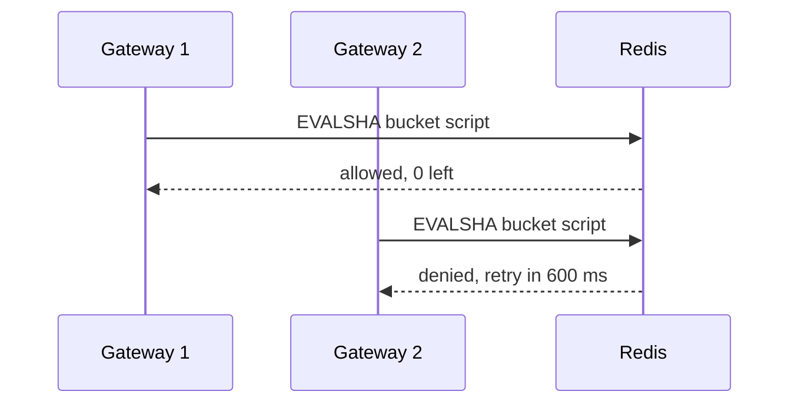

**Challenges.** The script runs on Redis's single command thread, so a slow script stalls every other check on that shard. Keep it to a handful of commands. Once Redis is sharded, every key one script touches must live on the same shard, which deep dive 3 handles. The script also becomes code you version and deploy with the gateway. Load it once and call it by its hash with `EVALSHA`.

:::tip
Say where the clock comes from. Taking time from the Redis server instead of the gateway is a one-sentence point that shows you thought about many machines touching one bucket.
:::

In a 45-minute interview I'd name the race in one sentence and go straight to the script. Interviewers often ask you to walk through it, so be ready to explain refill, cap, take, and write.

### 3) How does the counter store keep up with 1 million checks a second, even when one client floods it?

This serves requirement 2. State is 20 GB at most, so the work is almost all CPU, and one misbehaving client can aim all of its traffic at one key.

#### Bad solution: One Redis node

**Approach.** Run one Redis primary with a replica for failover. Every gateway sends every script to it.

**Challenges.** Redis executes commands on a single thread, so one node has a hard ceiling on scripts a second. Plan per-shard throughput from your own benchmark of this script, not a vendor number. If one shard sustains around 50,000 script calls a second for this workload, 1 million a second needs about 20 primaries, and one node gets you 5% of the way there.

#### Good solution: Shard by client with hash tags

**Approach.** Run Redis in cluster mode. A cluster splits keys into 16,384 hash slots and spreads the slots across shards, so 20 primaries each take about 50,000 checks a second, and each primary gets a replica. Name keys so that all of one client's buckets hash together, as in `rl:{user:42}:search` and `rl:{user:42}:global`. Redis hashes only the part inside the braces, so both keys land in the same slot and one script can update both. See [sharding and partitioning](../02-building-blocks/sharding-and-partitioning.md).

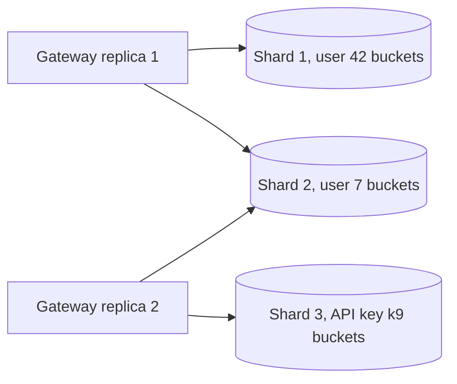

**Challenges.** All of one client's buckets share a shard, which is fine while 100 million users spread evenly. But a client sending 50,000 requests a second, nearly all denied, still runs 50,000 scripts a second, and can eat a whole shard's budget and slow every user who hashes there.

#### Great solution: Cache denials in the gateway and drop floods at the edge

**Approach.** Keep the sharded cluster and stop sending it requests that are already decided. When a check returns "denied, retry in 3 seconds", the gateway keeps that decision in process for 3 seconds and answers the client with a 429 without calling Redis. This is exact, because tokens only arrive with time, so the bucket can't allow anything sooner. With 200 gateway replicas, a flooding client now costs at most one Redis call per replica per retry interval, about 70 a second instead of 50,000. Anonymous floods need no per-user accounting, so drop them by IP at the edge.

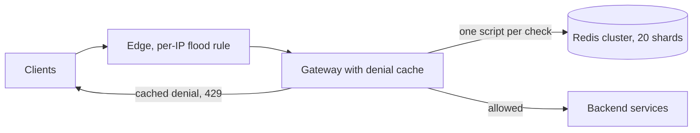

**Challenges.** A rule change that raises a limit reaches a denied client only after its cached denial expires. The edge rule counts coarsely, by IP over a fixed window, so its threshold must sit well above any real user's rate or it blocks offices and carriers that share one address. You still pay for a cluster sized for peak checks, with a replica per primary.

In a 45-minute interview I'd size the cluster out loud, mention hash tags, and add the denial cache when the interviewer asks about an abusive client, which most do.

### 4) What happens when Redis is slow or down?

This serves requirement 3. Every request waits on the check, so a sick Redis makes a sick API unless the gateway decides quickly what to do without it.

#### Bad solution: Fail closed

**Approach.** If the script errors or times out, deny the request. No client can ever exceed its limit.

**Challenges.** A cache incident becomes a full outage. Every user gets a 429 for a problem that is entirely yours, and their retries add load at the worst moment.

#### Good solution: Fail open

**Approach.** Give the Redis call a tight timeout, such as 5 ms, inside the 10 ms budget. If the call errors or times out, allow the request and emit a metric.

**Challenges.** Backends lose all protection for the length of the incident, which is when a retry storm is most likely. Every request also waits the full 5 ms before giving up, so a slow Redis adds 5 ms to every call.

#### Great solution: Fail open to a local bucket, behind a circuit breaker

**Approach.** Each gateway keeps an in-process token bucket per client per rule, at the limit divided by the number of gateway replicas. A circuit breaker counts Redis failures, and past a threshold it opens. The gateway stops calling Redis for a few seconds and checks its local buckets instead, then lets a trickle of calls through to test recovery. Rules whose `failMode` is `closed`, such as sign-in and SMS, still deny while Redis is unavailable. See [resilience patterns](../03-patterns/resilience-patterns.md).

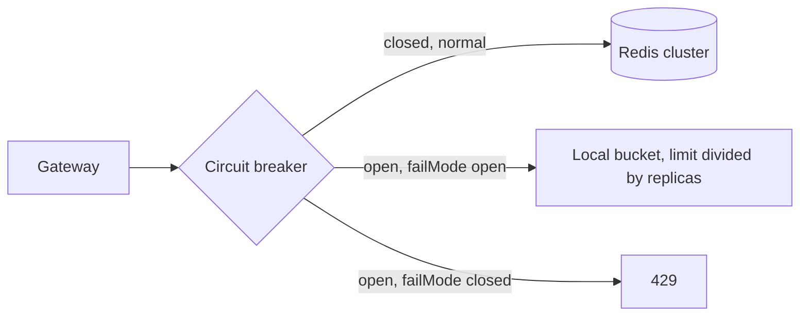

**Challenges.** The local limit is approximate. The load balancer doesn't spread one client perfectly, and autoscaling changes the replica count, so a client may get somewhat more or less than its budget during the incident. The breaker also needs testing, which means injecting Redis failures on purpose.

:::warning
"Fail open" without exceptions is a trap. If the limiter on sign-in fails open, a Redis outage becomes an open window for password guessing. Name the limits that fail closed.
:::

In a 45-minute interview I'd say "fail open, except sign-in and SMS" in the first ten minutes and describe the local fallback if asked. The exception is what shows judgment.

### 5) How do limits work across regions inside 10 ms?

This serves requirements 1 and 4. Once the API runs in three regions, an exact global count needs every region to agree on every check, and a round trip between continents takes tens to hundreds of milliseconds.

#### Bad solution: One global Redis

**Approach.** Keep one Redis cluster in one region and have every region's gateways call it.

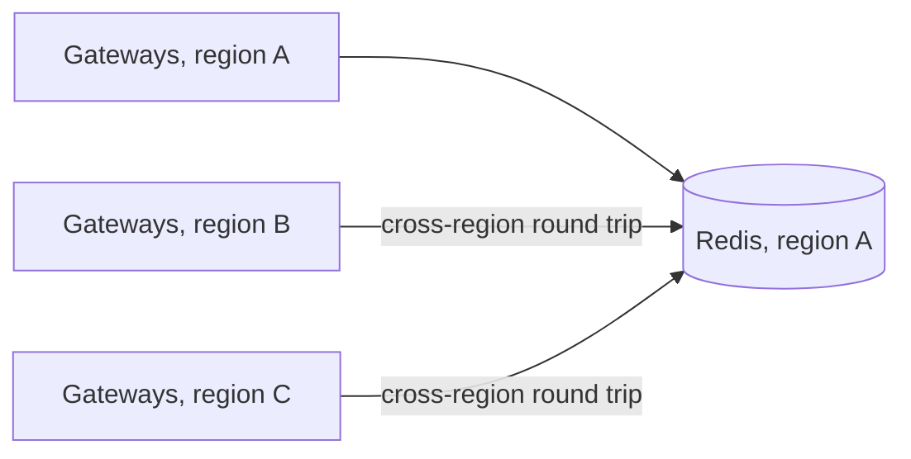

**Challenges.** It is exact, and slow for every region but one. A check from region C pays a cross-ocean round trip that blows the 10 ms budget by itself. If region A fails, every region loses its limiter at once.

#### Good solution: Per-region buckets with the limit split

**Approach.** Each region runs its own Redis and enforces the limit divided by the number of regions. With three regions and a limit of 300 a minute, each region allows 100.

**Challenges.** The total is exact, but almost every user's traffic goes to one region, so a typical user gets a third of their budget. Adding a region quietly cuts everyone's limit again.

#### Great solution: Per-region buckets with the full limit

**Approach.** Each region runs its own Redis cluster and enforces the full limit. Global routing sends each user to the nearest region, so nearly everyone gets an exact limit. Don't replicate buckets between regions, since that copies every token taken across oceans and still converges only eventually. See [multi-region active-active](../05-advanced/multi-region-active-active.md).

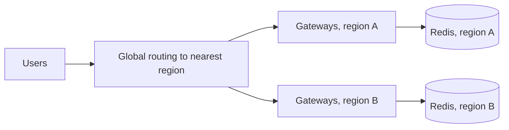

**Challenges.** A client that deliberately spreads requests across regions gets up to the limit times the number of regions, so 3× here. The bound is small and known, which requirement 4 allows. During a regional failover, users who move to another region arrive with a full bucket and get one extra burst.

In a 45-minute interview I'd spend two sentences here, the overshoot bound and why it is acceptable. Interviewers want to hear that you traded exactness for latency on purpose.

## On Azure

Three layers enforce limits, from coarse and cheap at the edge to exact and per user in the gateway. Each region runs its own gateway fleet and its own Redis, per deep dive 5.

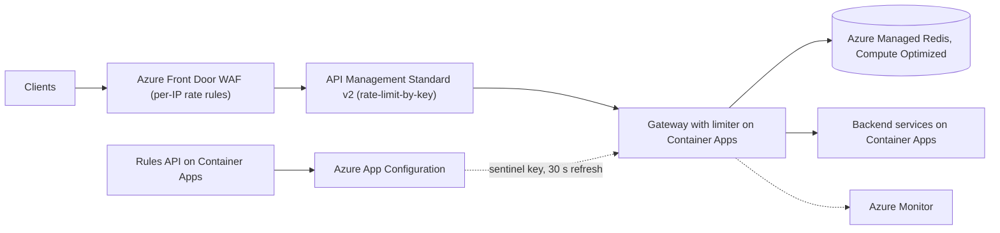

| Component | Azure service | Tier or setting, and why |
| --- | --- | --- |
| Anonymous flood control | Azure Front Door WAF policy | Custom rate-limit rule grouped by socket IP, on Front Door Standard or Premium. Fixed window of one or five minutes, so use it only for coarse thresholds. |
| Per-subscription limits | Azure API Management | `rate-limit-by-key` keyed on the subscription or a JWT claim. Standard v2, whose units spread across availability zones. |
| Exact per-user token bucket | Azure Managed Redis | Compute Optimized tier, OSS clustering policy, high availability on. One instance per region. |
| Gateway with limiter library | Azure Container Apps | Zone-redundant environment, HTTP scale rule, at least 3 replicas. Or the same library inside existing services. |
| Rule store | Azure App Configuration | Standard tier. Rules as key-values, plus one sentinel key that every rule write bumps. |
| Rules API | Azure Container Apps | A small service that validates rules before writing them. |
| 429 metrics | Azure Monitor | Alert on the 429 ratio per rule, so a bad rule change shows up in minutes. |

### Where API Management's `rate-limit-by-key` fits

APIM's built-in policy is the fastest way to ship a limit and the right answer for many products. Know its limits before you rely on it for exact quotas ([rate-limit-by-key](https://learn.microsoft.com/azure/api-management/rate-limit-by-key-policy)):

- It returns `429` with `Retry-After`, the same contract as requirement 2.
- The `renewal-period` maxes out at 300 seconds. Longer budgets need the Redis bucket or `quota-by-key`, which counts over a fixed window of at least 300 seconds and returns `403 Forbidden` instead ([quota-by-key](https://learn.microsoft.com/azure/api-management/quota-by-key-policy)).
- Each gateway, including each regional gateway, counts on its own, and the docs state that rate limiting is never completely accurate.

Use APIM for per-subscription protection that tolerates some overshoot, and the Redis token bucket for limits customers pay for or that guard expensive backends.

### Why these tiers

- **Compute Optimized Redis.** Azure Managed Redis tiers differ by memory-to-vCPU ratio, 8:1 for Memory Optimized, 4:1 for Balanced, and 2:1 for Compute Optimized ([overview](https://learn.microsoft.com/azure/redis/overview)). At 20 GB and 1 million scripts a second you are buying cores, not memory. Learn's benchmark shows a 24 GB Compute Optimized cache serving about 1.6 million 1 KB `GET`s a second against about 810,000 for Balanced, with no SLA on either ([performance](https://learn.microsoft.com/azure/redis/best-practices-performance)). A bucket script runs several commands, so size from your own benchmark of the script.
- **Not Azure Cache for Redis.** Its Basic, Standard, and Premium tiers retire on September 30, 2028, and its Enterprise and Enterprise Flash tiers on March 31, 2027 ([retirement FAQ](https://learn.microsoft.com/azure/azure-cache-for-redis/retirement-faq)).
- **OSS clustering policy.** Clients connect to each shard directly for the highest throughput. The Enterprise policy adds a single-endpoint proxy hop in front of the shards ([architecture](https://learn.microsoft.com/azure/redis/architecture)).
- **API Management Standard v2.** Standard v2 and Premium v2 both spread units across availability zones, and neither supports multi-region deployment today ([API Management reliability](https://learn.microsoft.com/azure/reliability/reliability-api-management)). Run one instance per region behind Front Door.
- **Front Door WAF for coarse limits only.** Rate-limit counters live on each Front Door server and update with a lag, so for thresholds below about 200 requests a minute some requests over the limit get through ([WAF rate limiting](https://learn.microsoft.com/azure/web-application-firewall/afds/waf-front-door-rate-limit)). That is fine for flood control and wrong for per-user budgets.
- **App Configuration Standard.** Standard allows 30,000 requests an hour per store and Developer 6,000, with 429s past the quota ([App Configuration FAQ](https://learn.microsoft.com/azure/azure-app-configuration/faq)). At 200 gateway replicas of 5,000 requests a second each, every replica checks the sentinel key at the default 30-second refresh, so the fleet makes 24,000 checks an hour, which fits Standard. Watching every rule key would multiply that by the number of rules.

### Zones and regions

Turn on high availability for Azure Managed Redis. In regions with availability zones it places nodes in different zones, with each shard's primary and replica on different nodes ([Azure Managed Redis reliability](https://learn.microsoft.com/azure/reliability/reliability-managed-redis)). Create the Container Apps environment zone-redundant, because the setting can't be changed later ([Container Apps reliability](https://learn.microsoft.com/azure/reliability/reliability-container-apps)). Deploy one Redis per region and don't geo-replicate buckets. Active geo-replication converges eventually ([active geo-replication](https://learn.microsoft.com/azure/redis/how-to-active-geo-replication)), so it would copy every token across regions without making the limit exact.

### Gotcha

Under the OSS clustering policy, all keys in a multikey command must map to the same hash slot ([architecture](https://learn.microsoft.com/azure/redis/architecture)). A script that touches `rl:user:42:search` and `rl:user:42:global` without a hash tag works on a single-node dev cache, then fails with a `CROSSSLOT` error in clustered production. Wrap the client part of every key in braces and run integration tests against a clustered cache on your tier.

See [networking and security](../04-azure/networking-and-security.md) for WAF placement and [compute choices](../04-azure/compute-choices.md) for where to run the gateway.

## What is expected at each level

### Mid-level

I expect you to put the limiter in the gateway, key it by user or API key, and keep counters in a shared Redis instead of each replica's memory. A fixed window counter is a fine start, but when I ask what happens at the minute boundary you should find the 2× burst and move to a sliding window or a token bucket. You return a 429 with `Retry-After` without being asked. I'd expect to prompt you on the race between replicas in deep dive 2 and on what happens when Redis goes down. I wouldn't hold sharding or regions against you.

### Senior

You drive the algorithm choice yourself and defend the token bucket for its constant memory, its burst separate from the sustained rate, and its weighted requests. You spot the read-modify-write race without help, fix it with a server-side script, and say why a lock or `WATCH` doesn't fit a 10 ms budget. You size Redis from throughput rather than memory and reach hash tags as soon as two rules share one script. You say "fail open" early and name the exceptions. I may need to nudge you toward the abusive client in deep dive 3 or the regional overshoot in deep dive 5.

### Staff+

You treat the limiter as part of the API's availability budget. You raise the timeout, the circuit breaker, and the local fallback unprompted, and you know which limits must fail closed. You notice that rejected traffic still costs Redis work, and you propose the denial cache along with the argument for why it is exact. You layer controls from the edge inward and say what each layer is allowed to get wrong. For regions you choose per-region buckets with the full limit, state the overshoot bound, and explain why replicating buckets buys nothing. You also think about running it, from catching a bad rule by its 429 ratio to testing scripts against a clustered Redis.

## Further reading

- [Hello Interview: Design a distributed rate limiter](https://www.hellointerview.com/learn/system-design/problem-breakdowns/distributed-rate-limiter)
- [The Coding Gopher: Why Scaling Redis is Harder Than You Think](https://thecodinggopher.substack.com/p/why-scaling-redis-is-harder-than)
- [The Coding Gopher: A Deep Dive into Redis' Architecture](https://thecodinggopher.substack.com/p/a-deep-dive-into-redis)
- [API Management rate-limit-by-key policy](https://learn.microsoft.com/azure/api-management/rate-limit-by-key-policy)
- [Azure Front Door WAF rate limiting](https://learn.microsoft.com/azure/web-application-firewall/afds/waf-front-door-rate-limit)
- [Azure Managed Redis architecture](https://learn.microsoft.com/azure/redis/architecture)
- [Caching](../02-building-blocks/caching.md), [API gateway](../02-building-blocks/api-gateway.md), [handling contention](../03-patterns/handling-contention.md)
