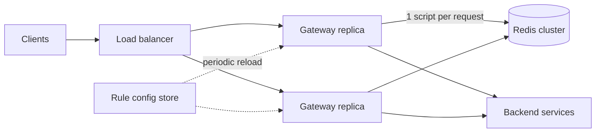
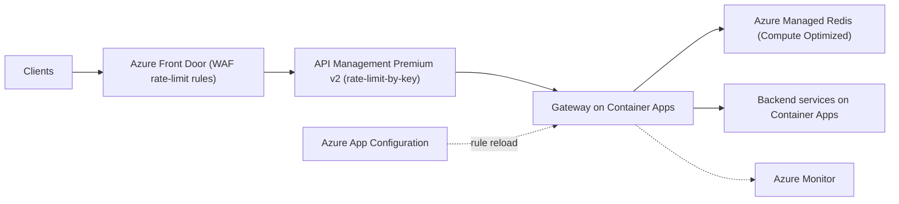

## TL;DR

Put the limiter at the edge of your system, in the gateway tier, so every service is protected without each one reimplementing it. Use a token bucket per client per rule, stored as one small hash in a shared Redis cluster and updated by one atomic script, so a check is a single round trip. Return `429 Too Many Requests` with `Retry-After`. Fail open when Redis is slow or down, with a local in-process limiter as a backstop. On Azure, layer three controls: Front Door WAF rate-limit rules for coarse per-IP floods, API Management `rate-limit-by-key` for per-subscription limits that tolerate some inaccuracy, and a token bucket in Azure Managed Redis (Compute Optimized tier) for exact per-user limits across a region.

## Requirements

### Functional

- Identify the client of each request by user ID, API key, or IP address.
- Enforce configurable rules, for example "100 requests per minute per user on `/search`" and "1,000 per hour per API key overall".
- Reject over-limit requests with `429`, and tell the client when to retry and how much budget remains.
- Change rules without redeploying services.

Out of scope: billing quotas measured over months, and bot detection. Both are adjacent, but they are separate systems.

### Non-functional

- Add under 10 ms at p99 to each request.
- Handle 1 million requests per second across the fleet, for 100 million daily active users.
- Prefer availability over strict accuracy. A limiter outage must not take the API down. Letting a few extra requests through is better than rejecting legitimate ones.
- Limits apply across all gateway instances, not per instance. A user hitting 50 gateway replicas gets one budget, not 50.

## Capacity estimates

| Quantity | Arithmetic | Result |
| --- | --- | --- |
| Limiter checks | 1 request = 1 check, 1 M req/s | 1 M Redis scripts/s |
| Rules checked per request | assume 2 (per-route and global) in one script | still 1 round trip |
| Active keys | 100 M users × 2 rules | 200 M keys |
| Memory per key | hash with 2 fields plus key name and overhead, about 100 B | |
| Total memory | 200 M × 100 B | about 20 GB |
| Network | 1 M req/s × about 200 B per request and reply | about 200 MB/s |

Memory is modest. Throughput is the constraint. Plan per shard throughput from your own benchmark, not a vendor number; a single Redis shard is single-threaded for command execution, so you scale by adding shards. If one shard sustains around 50,000 script calls per second for this workload, 1 M/s needs about 20 primary shards, plus replicas for availability. That shape (lots of CPU, little memory) decides the Azure tier later.

Bucket keys idle out with a TTL equal to the time to refill fully, so the 200 M figure is an upper bound on daily active keys, not a permanent footprint.

## Core entities and API

### Entities

- **Rule**: `id`, `match` (route pattern, client tier), `keyBy` (`userId`, `apiKey`, `ip`), `capacity` (burst size), `refillPerSecond`.
- **Bucket** (in Redis): key `rl:{<client>}:<ruleId>`, fields `tokens` (float) and `ts` (last refill time in milliseconds). The braces are a hash tag, explained in deep dive 2.

### Internal interface

The limiter is a library inside the gateway, not a network service that every request calls twice.

```ts
type Decision = { allowed: boolean; remaining: number; retryAfterSeconds: number };
function check(clientId: string, rules: Rule[], cost = 1): Promise<Decision>;
```

### Client-facing response

```http
HTTP/1.1 429 Too Many Requests
Retry-After: 3
X-RateLimit-Limit: 100
X-RateLimit-Remaining: 0
```

`Retry-After` is standard HTTP and clients and SDKs already honor it. The `X-RateLimit-*` names are a widespread convention; an IETF draft standardizes `RateLimit` and `RateLimit-Policy` headers, so match whatever your clients expect. See [API design](../01-fundamentals/api-design.md).

## High-level design



1. A request reaches any gateway replica.
2. The gateway resolves the client ID (from the auth token, API key, or socket IP) and the matching rules, cached in memory.
3. It runs one atomic script against Redis that refills and decrements every matching bucket.
4. If allowed, the request proceeds to the backend. If not, the gateway returns `429` immediately.
5. Rules live in a config store. Each gateway reloads them every few seconds, so a rule change takes effect fleet-wide within the reload interval with no deploy.

Placing the limiter in the gateway means services behind it never see rejected traffic. Placing it in each service would let each team pick its own limits but duplicates the logic. A client-side limiter is useful only as a courtesy; you cannot trust it. See [API gateway](../02-building-blocks/api-gateway.md).

## Deep dives

### 1. Choosing the algorithm

| Algorithm | State per key | Behavior | Problem |
| --- | --- | --- | --- |
| Fixed window counter | 1 integer | Count resets at each window boundary | A client can send 2× the limit across a boundary (end of one window, start of the next). |
| Sliding window log | 1 timestamp per request | Exact | Memory grows with the limit. 1,000 requests per hour means 1,000 entries per key. |
| Sliding window counter | 2 integers | Weighted mix of current and previous window | Approximate, but good. Does not express bursts explicitly. |
| Token bucket | 2 numbers | Bucket holds up to `capacity` tokens, refills at a steady rate, each request takes one | Two parameters to explain to customers. |

**Pick: token bucket.** It uses constant memory, it lets you allow short bursts (capacity) separately from the sustained rate (refill), and a request with a higher cost (a bulk export) can take more than one token. It also refills continuously, so it has no boundary spike. The sliding window counter is a reasonable second choice when you only need "N per window" semantics.

### 2. Making the check atomic across many gateways

Read-modify-write from the gateway (`HGET`, compute, `HSET`) races: two replicas read 1 token, both allow, both write 0. Three ways to fix it:

- **Optimistic transaction** with `WATCH`/`MULTI`/`EXEC`. Correct, but a hot key retries constantly under contention.
- **Distributed lock** per key. Adds two more round trips and a lock service to the hot path. Far over budget.
- **Server-side script.** Redis runs a script to completion before any other command, so the refill and decrement happen as one step.

**Pick: a server-side script.** One round trip, no retries, and the clock comes from the Redis server, so gateway clock skew cannot mint tokens.

```lua
-- KEYS[1] = bucket key, ARGV = capacity, refill_per_ms, cost, ttl_ms
local cap, rate, cost, ttl = tonumber(ARGV[1]), tonumber(ARGV[2]), tonumber(ARGV[3]), tonumber(ARGV[4])
local t = redis.call('TIME')
local now = t[1] * 1000 + math.floor(t[2] / 1000)
local b = redis.call('HMGET', KEYS[1], 'tokens', 'ts')
local tokens = tonumber(b[1]) or cap
local ts = tonumber(b[2]) or now
tokens = math.min(cap, tokens + (now - ts) * rate)
local allowed = 0
if tokens >= cost then tokens = tokens - cost; allowed = 1 end
redis.call('HSET', KEYS[1], 'tokens', tokens, 'ts', now)
redis.call('PEXPIRE', KEYS[1], ttl)
return { allowed, math.floor(tokens) }
```

In a clustered Redis, every key a single script touches must live in the same hash slot. If you check the per-route and global buckets for one user in one script, name them `rl:{user:42}:search` and `rl:{user:42}:global`. Redis hashes only the part inside the braces, so both land on the same shard. The trade-off: all of a user's buckets share one shard, which is fine because users are many and spread evenly.

### 3. Failing open or closed

If Redis is unreachable or exceeds the time budget, the gateway must decide.

- **Fail closed** rejects every request. A cache incident becomes a full outage.
- **Fail open** allows every request. Backends lose protection during the incident.
- **Fail open with a local fallback.** Each gateway keeps an in-process token bucket per client with the limit divided by the replica count. It is inaccurate (a client spread across replicas gets more), but it bounds the damage.

**Pick: fail open with a local fallback,** with a tight client timeout (for example 5 ms) and a circuit breaker so the gateway stops waiting on a sick Redis. Fail closed only for limits that protect money or security, such as sign-in attempts or SMS sends. See [resilience patterns](../03-patterns/resilience-patterns.md).

### 4. Hot keys and abusive clients

A single client sending 50,000 requests per second hits one Redis shard with all of them, even though nearly all will be rejected. Two mitigations:

- **Negative cache in the gateway.** When a check returns "denied, retry after 3 s", cache that decision in process for 3 s. Rejected traffic never reaches Redis again until the bucket could have refilled.
- **Coarse limits further out.** Floods from a single IP never need exact per-user accounting. Drop them at the edge before they reach the gateway at all.

**Pick: both.** The negative cache handles authenticated abuse, and an edge rule handles anonymous floods.

### 5. Multiple regions

A global exact limit requires every check to agree across regions, which costs a cross-region round trip (tens to hundreds of milliseconds) and blows the 10 ms budget. Options:

- **One global Redis.** Exact, slow for every region but one.
- **Per-region buckets, same limit.** Each region enforces the full limit independently. A user who somehow hits three regions gets 3×.
- **Per-region buckets, split limit.** Divide the limit by region count. Exact in total, unfair to a user whose traffic is all in one region.

**Pick: per-region buckets with the full limit.** Global routing sends a user to their nearest region, so in practice most users touch one region, and the worst case is bounded and small. See [multi-region active-active](../05-advanced/multi-region-active-active.md).

## On Azure



| Component | Azure service | Tier or setting, and why |
| --- | --- | --- |
| Anonymous flood control | Azure Front Door WAF policy | Custom rate-limit rule, grouped by socket IP. Works on Standard and Premium. Fixed window of one or five minutes, so use it only for coarse thresholds. |
| Per-subscription limits | Azure API Management | `rate-limit-by-key` keyed on subscription or a JWT claim. Premium v2 for availability zones; Standard v2 if a single zone is acceptable. |
| Exact per-user token bucket | Azure Managed Redis | Compute Optimized tier (2:1 memory to vCPU), because this workload needs CPU and connections, not memory. OSS clustering policy for the highest throughput. High availability on. |
| Gateway with limiter library | Azure Container Apps | Zone-redundant environment, HTTP scale rule, minimum 3 replicas. Or the same library inside existing services. |
| Rule storage | Azure App Configuration | Rules as key-values, reloaded by each gateway on an interval. |
| Metrics on 429 rates | Azure Monitor | Alert on 429 ratio per rule so a bad rule change is caught in minutes. |

### API Management `rate-limit-by-key`: where it fits and where it does not

APIM's built-in policy is the fastest way to ship a limit and is the right answer for many products. Know its limits before you rely on it for exact quotas ([rate-limit-by-key](https://learn.microsoft.com/azure/api-management/rate-limit-by-key-policy)):

- It returns `429` with `Retry-After`, matching the contract above.
- The `renewal-period` maxes out at 300 seconds. Hourly or daily budgets need `quota-by-key`, which returns `403` instead, or your own Redis limiter.
- Classic tiers use a sliding window; v2 tiers use a token bucket.
- Each gateway counts independently. In a multi-region deployment, every regional gateway keeps its own count, so a client spread across regions gets more than the limit. The docs state that rate limiting is never completely accurate.

So use APIM for per-subscription protection that tolerates small overshoot, and keep the Redis token bucket for limits customers pay for or that guard expensive backends.

### Why Compute Optimized, and why not Azure Cache for Redis

Azure Managed Redis tiers differ by memory-to-vCPU ratio ([overview](https://learn.microsoft.com/azure/redis/overview)). Memory Optimized is 8:1, Balanced is 4:1, and Compute Optimized is 2:1. The estimate showed about 20 GB of state and 1 M operations per second. That is the Compute Optimized profile: you are buying cores. Do not start on Azure Cache for Redis: its Basic, Standard, and Premium tiers retire on September 30, 2028 ([retirement FAQ](https://learn.microsoft.com/azure/azure-cache-for-redis/retirement-faq)).

Choose the **OSS clustering policy**. It gives the highest throughput because clients connect to shards directly. The Enterprise policy puts a single-endpoint proxy in front of the shards, which is simpler for clients but adds a hop ([architecture](https://learn.microsoft.com/azure/redis/architecture)).

### Zones and regions

Enable high availability on Azure Managed Redis; it places primary and replica shards on separate nodes spread across availability zones. Run the gateway in a zone-redundant Container Apps environment. Deploy one Redis instance per region and do not geo-replicate the buckets, per deep dive 5. Active geo-replication would copy every token decrement across regions for no accuracy gain.

### Gotcha

Under the OSS clustering policy, a multi-key script whose keys hash to different slots fails with a `CROSSSLOT` error. This works in a single-node dev cache and fails only in the clustered production instance. Always wrap the client part of the key in a hash tag, and run your integration tests against a clustered instance. Test the exact script on your tier before launch.

See [networking and security](../04-azure/networking-and-security.md) for WAF placement and [compute choices](../04-azure/compute-choices.md) for where to run the gateway.

## Interview tips

- Ask what the client identity is before choosing a key. IP limits punish users behind a corporate NAT; user limits do nothing for unauthenticated endpoints.
- Explain the boundary problem with fixed windows using numbers: a limit of 100 per minute allows 200 in the two seconds around a boundary.
- Say "fail open" out loud and give the exception (sign-in, payments).
- Expect "how do clients know when to retry?" Answer: `Retry-After` plus remaining-budget headers, and clients should back off with jitter. See [idempotency and retries](../03-patterns/idempotency-and-retries.md).
- Expect "can you avoid Redis?" Yes, for approximate limits: a local bucket per replica with the limit divided by replica count. It drifts as autoscale changes the replica count.
- Do not add a dedicated limiter microservice that every request calls over the network. It doubles hops; a library plus Redis is one hop.

## Further reading

- [Hello Interview: Design a distributed rate limiter](https://www.hellointerview.com/learn/system-design/problem-breakdowns/distributed-rate-limiter)
- [The Coding Gopher: Why scaling Redis is harder than you think](https://thecodinggopher.substack.com/p/why-scaling-redis-is-harder-than)
- [API Management rate-limit-by-key policy](https://learn.microsoft.com/azure/api-management/rate-limit-by-key-policy)
- [Azure Front Door WAF rate limiting](https://learn.microsoft.com/azure/web-application-firewall/afds/waf-front-door-rate-limit)
- [Azure Managed Redis architecture](https://learn.microsoft.com/azure/redis/architecture)
- [Caching](../02-building-blocks/caching.md), [API gateway](../02-building-blocks/api-gateway.md), [handling contention](../03-patterns/handling-contention.md)
