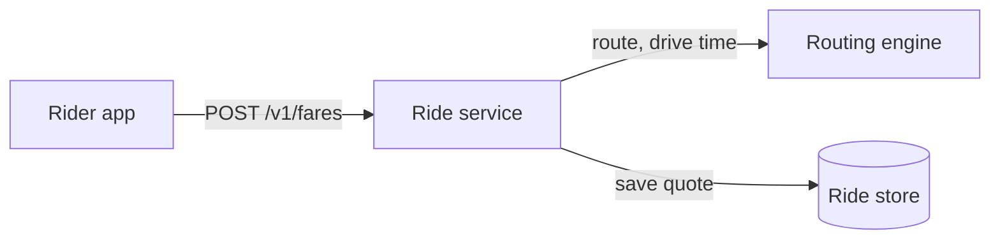
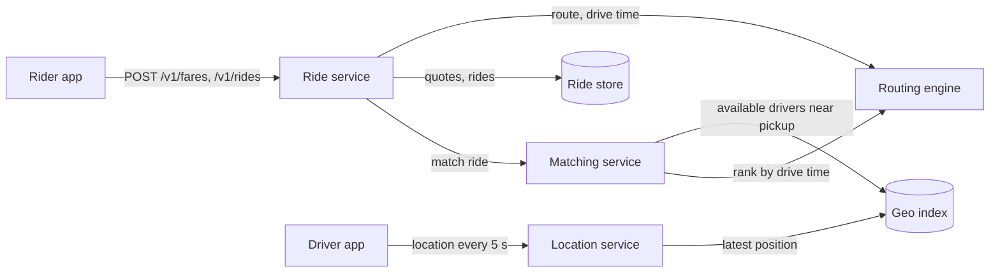
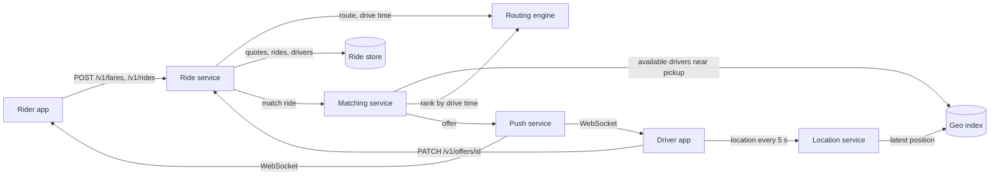
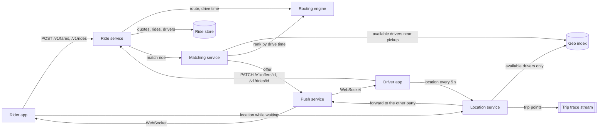
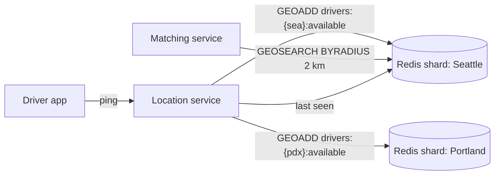
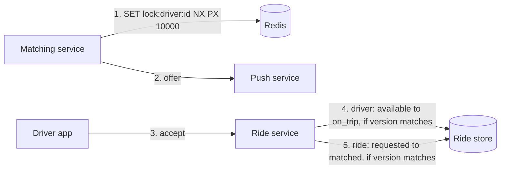
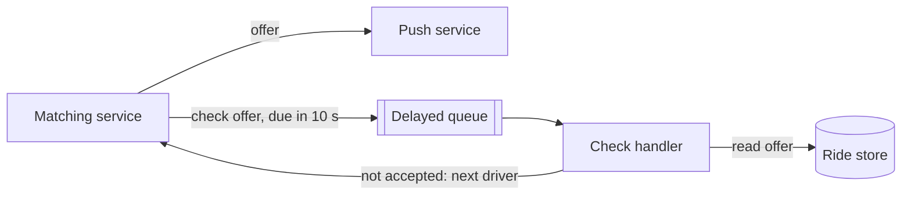
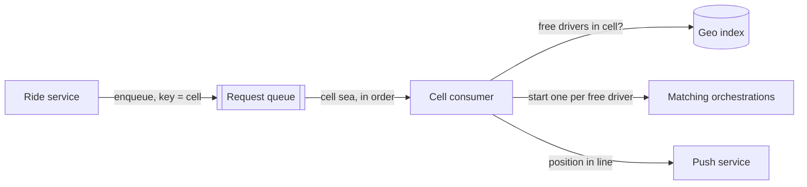
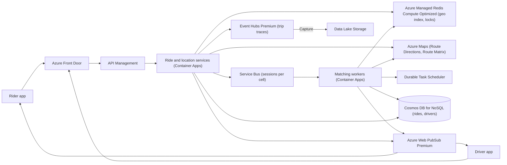

## Understanding the problem

**What is a ride-sharing service?** It connects a rider who needs a trip with a nearby driver who has a car. The rider sees a price before committing, the driver gets a few seconds to take or skip the job, and both watch each other on a map until pickup.

Two things make it hard. Millions of drivers report their position every few seconds, so the data that matching depends on changes faster than a disk-backed database wants to absorb. And an offer hands one driver to one rider for a few seconds, so offers have to be exclusive and have to time out reliably, even when the server waiting on them dies.

## Functional requirements

1. Riders should be able to enter a pickup and destination and see an estimated fare and trip time.
2. Riders should be able to request a ride and be matched with a nearby available driver.
3. Drivers should be able to accept or decline a ride offer.
4. Riders and drivers should be able to see each other's live position until pickup, then move the trip through to completion.

**Below the line (out of scope)**

- **Payments.** Charging the card after the trip is a call to a payment processor once the ride reaches `completed`, with the same webhook shape as the [ticket booking](./ticket-booking.md) case study.
- **Ratings.** A write after the trip, with no real-time path.
- **Scheduled rides.** A timer that submits a normal request later, so it reuses matching unchanged.
- **Pooled rides.** Matching several riders to one route is a separate optimization problem.
- **Surge pricing.** A natural follow-up, because it reads the same demand and supply numbers per area that matching uses. Mention it, then come back to it if there's time.

I trimmed to quote, request, offer, and pickup because that loop is the product. Everything else hangs off a completed ride.

## Non-functional requirements

1. **Match within one minute, or say so.** The rider hears "matched" or "no drivers nearby" within 60 seconds of requesting.
2. **A driver never has two rides at once.** Matching chooses consistency per driver. If the system can't prove a driver is free, the offer goes to someone else.
3. **No ride request is lost, even when a stadium empties.** Plan for 100,000 requests from one venue in 10 minutes. A lost location ping is fine, because another arrives in 5 seconds. A lost request is not.
4. **Positions are fresh within a few seconds.** Matching uses where drivers are now, and riders watch the car approach.
5. **It runs at national scale.** That means 10 million registered drivers, 2 million online at peak, and 20 million rides a day.

**Below the line**

- **Agreement between cities.** A rider in Seattle never matches a driver in Paris, so metros don't need to share any state. That lets each geography run on its own.
- **Perfect ETAs.** Drive times come from a routing engine with live traffic. Tuning them further with models is a separate system.

The location write rate shapes this design more than anything else. Two million online drivers sending one ping every 5 seconds is 400,000 pings a second. About half of them, 1 million, are on a trip, and their pings feed the rider's map and the trip record, not matching, so the index of available drivers takes about 200,000 writes a second. At about 100 bytes a driver, that index is 100 MB. Rides are a modest workload by comparison. Twenty million a day is about 230 a second, or about 2,300 at a 10x peak, with roughly two offers per match, so about 4,600 offers a second. At 2 KB a ride, that is 40 GB of ride records a day. That decided two things. The location index is tiny and write-heavy, so it lives in memory, where durability buys nothing for data that is stale in 5 seconds. And the stadium is about 170 requests a second, which the system barely notices, so it is a problem of supply in one place rather than throughput. See [back-of-the-envelope estimation](../01-fundamentals/back-of-the-envelope.md).

:::tip
Give the location write rate before you draw anything. It rules out a durable database for live positions in one sentence, and the interviewer will hold you to it.
:::

## Core entities

- **Rider.** The person requesting a trip.
- **Driver.** A person with a vehicle and a status, such as available or on a trip.
- **Fare.** A price and trip time quoted for one pickup and destination, valid for a few minutes.
- **Ride.** One trip from request to completion, with its rider, its driver, and its status.
- **Offer.** One ride offered to one driver, open for 10 seconds.
- **Location.** A driver's latest position, kept only as long as it is useful.

Fields come later, with the store that keeps each one.

## API

REST covers the requests. Offers, match status, and positions travel the other way, so both apps also hold a WebSocket open, and the server pushes to it. See [API design](../01-fundamentals/api-design.md).

Requirement 1 is a quote. The rider comes from the token in the `Authorization` header, as in every call below.

```http
POST /v1/fares
Authorization: ******
{ "pickup": { "lat": 47.6205, "lon": -122.3493 }, "destination": { "lat": 47.4502, "lon": -122.3088 } }

201 Created
{ "fareId": "fr_3h7", "estimate": 4250, "etaSeconds": 1560, "expiresAt": "2026-05-01T18:05:00Z" }
```

Requirement 2 is the request. It returns `202 Accepted`, because matching runs after the response, and the result arrives over the WebSocket. The `Idempotency-Key` header stops a double tap from requesting two cars.

```http
POST /v1/rides
Authorization: ******
Idempotency-Key: 2c9b7e51-0f4a-4d38-9e6b-8a1d3c5f7e20
{ "fareId": "fr_3h7" }

202 Accepted
{ "rideId": "rd_9x2", "status": "requested" }

410 Gone   (the fare quote expired)
```

Matching needs to know where drivers are, so the driver app reports its position. The driver comes from the token.

```http
POST /v1/drivers/me/location
Authorization: ******
{ "lat": 47.6101, "lon": -122.3421, "heading": 270, "at": "2026-05-01T18:01:05Z" }

204 No Content
```

Requirement 3 is the driver's answer to an offer that arrived over the WebSocket.

```http
PATCH /v1/offers/of_77k
Authorization: ******
{ "decision": "accept" }

200 OK
{ "rideId": "rd_9x2", "status": "matched" }

409 Conflict   (the offer expired or the ride was cancelled)
```

Requirement 4 moves the trip along. Only the ride's own driver may call it.

```http
PATCH /v1/rides/rd_9x2
Authorization: ******
{ "status": "arrived" }

200 OK
```

## High-level design

Build one requirement at a time. The first diagram has no drivers at all. Queues, locks, and timers wait for the deep dives.

### 1) Riders can see an estimated fare and trip time



- **Rider app.** The mobile client.
- **Ride service.** A stateless service that owns fares and rides.
- **Routing engine.** A map service that returns the route and drive time with live traffic.
- **Ride store.** A durable database for fares, rides, and later, drivers.

1. The rider app sends the pickup and destination.
2. The ride service asks the routing engine for the route's distance and drive time.
3. It prices the trip from distance, time, and base rates.
4. It saves the quote with a short expiry, so the price the rider accepts is the price they pay, and returns it.

The fare record needs these fields:

- `fareId`, the primary key.
- `riderId`, from the token.
- `pickup` and `destination`.
- `estimate` and `etaSeconds`.
- `expiresAt`, a few minutes out.

### 2) Riders can request a ride and get matched with a nearby driver



- **Driver app.** The driver's mobile client, reporting position while online.
- **Location service.** Takes pings and keeps only the latest position per driver.
- **Geo index.** Answers "which available drivers are within 2 km of this point?"
- **Matching service.** Finds and ranks candidates for a ride.

Positions arrive on their own schedule.

1. The driver app sends `POST /v1/drivers/me/location` every 5 seconds while online.
2. The location service overwrites that driver's entry in the geo index. Old positions aren't kept.

A request runs separately.

1. The rider app sends `POST /v1/rides` with the fare ID.
2. The ride service checks the quote hasn't expired, writes a ride with status `requested`, and returns `202`.
3. It hands the ride to the matching service with a direct call. I'd flag this on the whiteboard, because a crash here loses the request, and deep dive 4 replaces it.
4. The matching service asks the geo index for available drivers near the pickup, then asks the routing engine for each one's drive time to the pickup and ranks by it. A driver 500 m away across a river is not the nearest.

The ride record needs these fields:

- `rideId`, the primary key.
- `fareId` and `riderId`.
- `driverId`, empty until matched.
- `status`, one of `requested`, `matched`, `arrived`, `in_progress`, `completed`, or `cancelled`.
- A timestamp for each status change.

The ride store also gains a driver record with `driverId`, `vehicle`, `status` (`offline`, `available`, or `on_trip`), and `rideId`. The geo index holds only `driverId` and a position.

### 3) Drivers can accept or decline an offer



- **Push service.** Holds every app's WebSocket and delivers messages to one user.
- **Matching service.** Gains the offer loop.
- **Ride service.** Gains the accept and decline endpoint.

1. The matching service creates an offer with `offerId`, `rideId`, `driverId`, and `expiresAt` 10 seconds out, and sends it to the top-ranked driver through the push service.
2. The driver taps accept, and the app sends `PATCH /v1/offers/of_77k`.
3. The ride service checks that the offer hasn't expired, sets the driver to `on_trip`, and sets the ride to `matched` with that driver.
4. The push service tells the rider who is coming, and the geo index drops the driver from the available set.
5. On a decline, or no answer in 10 seconds, the matching service offers the ride to the next driver, until a minute has passed.

Two gaps are left, and I'd name both out loud. Two matching workers can pick the same driver for two riders in the same millisecond, which deep dive 2 closes. The 10-second wait lives in one server's memory, which deep dive 3 fixes.

### 4) Riders and drivers can see each other until pickup, and the trip runs to completion



- **Location service.** Now routes each ping by the sender's state, and accepts the rider's position while they wait.
- **Trip trace stream.** An append-only log of points during each trip, used for the final fare and disputes.

1. While a driver is matched and on the way, each driver ping goes to the push service, addressed to the rider, instead of to the geo index. The rider app's own position goes the other way, to the driver.
2. The driver taps arrived, then started. The ride service moves the ride to `arrived`, then `in_progress`.
3. During the trip the app buffers its points and the location service appends them to the trace stream, keyed by ride ID.
4. The driver taps completed. The ride service computes the final fare from the trace, sets the ride to `completed` and the driver to `available`, and the driver's next ping puts them back in the geo index.

That works for a quiet weeknight. The deep dives take it to 2 million drivers and a stadium.

## Deep dives

Each deep dive picks one non-functional requirement and finds where the design above gives way.

### 1) How do we absorb 200,000 location writes a second and still find nearby drivers in milliseconds?

This serves requirements 4 and 5. The geo index in the high-level design is a box with a promise on it.

#### Bad solution: A row per driver with latitude and longitude indexes

**Approach.** Keep a drivers table with `lat` and `lon` columns and a B-tree index on each. Every ping updates the row. A nearby search is a bounding box, `lat BETWEEN ... AND lon BETWEEN ...`, then a distance filter on the results.

**Challenges.** Two one-dimensional indexes can narrow only one coordinate at a time, so the box query reads every driver in a band of latitude and filters the rest in memory. Each ping rewrites the row and both indexes on disk, and you'd be doing 200,000 durable writes a second for data that is worthless 5 seconds later.

#### Good solution: A spatial index in a relational database

**Approach.** Store each position as a point and index it with a spatial index, an R-tree or GiST in PostGIS. A nearest-neighbor query within a radius now uses the index directly and returns in milliseconds.

**Challenges.** The queries are fixed, but the writes aren't. Every ping is still a logged, durable update that also rebalances the spatial index, and you'd scale a database cluster to hold 100 MB. Durability is the expensive part, and here it buys nothing.

#### Great solution: In-memory geo sets, one per city cell

**Approach.** Keep positions in Redis. `GEOADD` stores a member in a sorted set scored by its geohash, and `GEOSEARCH ... BYRADIUS 2 km ASC COUNT 20` returns the nearest members. Use one key per city cell for available drivers, such as `drivers:{sea}:available`. A driver who accepts a ride is removed from the set, and their next ping after the trip puts them back. Shard by metro, not by a global hash, so a radius query always hits one shard. A pickup near a cell boundary also queries the neighboring cell. See [sharding and partitioning](../02-building-blocks/sharding-and-partitioning.md).



**Challenges.** The data is ephemeral. A failover loses positions, and drivers reappear within one ping, which requirement 4 tolerates. Members of a sorted set never expire, so a driver whose app dies stays in the set. Keep a second sorted set of last-seen times per cell and prune anyone silent for 30 seconds. The busiest cell has to fit one shard's throughput, so a large metro splits into several cells. You give up any history of positions, which the trace stream covers for trips.

:::tip
Cut the write rate on the phone. Send every 4 to 5 seconds while available and moving, only after 50 m of movement or every 30 seconds while parked, and nothing while offline, deciding from the phone's motion sensors.
:::

In a 45-minute interview I'd rule out the database in one sentence citing the write rate, draw the geo sets per cell, and add adaptive pings as the cheap win.

### 2) How do we make sure a driver never gets two rides?

This serves requirement 2. Two matching workers serving riders a block apart can pick the same nearest driver in the same millisecond.

#### Bad solution: Read the status, then send the offer

**Approach.** The matching service reads the driver record, sees `available`, sends the offer, and marks the driver as offered.

**Challenges.** The read and the write are separate steps. Two workers both read `available` before either writes, both send offers, and the driver may accept both. A check followed by a separate act is a race however fast the two steps are.

#### Good solution: A conditional status write on every offer

**Approach.** Before offering, flip the driver from `available` to `offered` with a write that only succeeds if the status is still `available`. The loser gets a precondition failure and tries the next candidate. Accepting moves the driver from `offered` to `on_trip`. Declining or timing out moves them back. See [handling contention](../03-patterns/handling-contention.md).

**Challenges.** It is correct, but it puts a durable write, and often a second to undo it, in the hottest loop, at about 4,600 offers a second. A worker that crashes after the write leaves the driver stuck in `offered`, so the status needs its own expiry and something to enforce it.

#### Great solution: An expiring offer lock, with the commit guarded on the driver record

**Approach.** Split "who may be offered this driver right now" from "who got this driver". For the first, take a lock in the same Redis as the geo index with `SET lock:driver:{id} {rideId} NX PX 10000`. It is atomic, fast, and expires on its own, so a crashed worker never strands a driver. For the second, the accept does a conditional write on the driver record in the durable store, from `available` to `on_trip`, guarded by the record's version. Then it moves the ride from `requested` to `matched` with the same kind of guard, so a late accept or a rider's cancel can't also win. Write the driver first, because the driver is the scarce resource, and record this `rideId` on it. If the ride write then fails, put the driver back with a write that applies only while the driver record still names this ride, so it can never free the driver from a later one. Run both writes and the undo as steps of the ride's durable workflow from deep dive 3, not inline in the accept handler, so a crash between them resumes at the next step instead of leaving the driver stuck in `on_trip`.



**Challenges.** Two stores now take part. If Redis fails over and loses a lock, a driver can briefly get two offers, and the driver-record write still lets only one accept succeed. The other rider's matching loses a few seconds and moves on. The two conditional writes sit in different records and aren't one transaction, so the undo step has to be right.

:::warning
Don't stop at the lock. A lock that lives in a cache can vanish in a failover, so the commit needs its own guard in the durable store, and that guard belongs on the driver, not only on the ride.
:::

In a 45-minute interview I'd draw the great solution, because "what happens if the lock store fails?" is the first follow-up and the driver-record guard answers it.

### 3) How does an offer time out when the server waiting on it crashes?

This serves requirement 1. Each offer needs "wait up to 10 seconds, then try the next driver, and give up after a minute".

#### Bad solution: A timer in the worker's memory

**Approach.** The matching worker starts a 10-second timer per offer and a one-minute timer per ride. When a timer fires, it moves on.

**Challenges.** A restart, a deploy, or a zone failure loses every pending timer. The rider waits for a match that nothing is working on, and the one-minute promise breaks silently.

#### Good solution: Schedule a delayed check message

**Approach.** When the worker sends an offer, it also schedules a "check offer" message on a queue, due in 10 seconds. Whichever worker receives it reads the offer from the store and, if nobody accepted, moves to the next driver. The one-minute deadline is a second scheduled message.



**Challenges.** It survives crashes, but the matching logic is now scattered across handlers that each reload state from the database. The check message and a last-second accept can arrive together, so every handler needs the conditional writes from deep dive 2. Following one ride through the code means reading four handlers.

#### Great solution: A durable orchestration with timers

**Approach.** Write the whole matching loop as one function and run it on a durable execution framework. The framework records each step. If the worker dies, another one replays the history and resumes at the same `await`, with the timer still counting. The accept endpoint raises an `accepted` event to the ride's orchestration and answers once the orchestration reports the outcome. The orchestration runs deep dive 2's two writes and the undo as activities, so a crash between them resumes at the next one. It picks the timer or the event once, so an accept that loses to the timer writes nothing and gets `409`. The ride service fixes the deadline at 60 seconds after the request when it admits it, so time spent waiting for a worker counts, and each offer's wait shrinks to fit what is left. See [long-running tasks](../03-patterns/long-running-tasks.md).

```text
match(ride, deadline):                 # deadline was fixed before the orchestration started
  for driver in rank(find_nearby(ride.pickup)):
    wait = min(10 s, deadline - now())   # now() comes from the orchestration context
    if wait <= 0: break
    if not try_lock_and_offer(driver, ride, wait): continue   # lock and offer expire after wait
    winner = await first_of(event("accepted", driver), timer(wait))
    if winner is the event and await commit(ride, driver): notify_matched(ride, driver); return
  notify_no_drivers(ride)
```

**Challenges.** Orchestrator code replays, so it has to be deterministic. It reads time from the orchestration context, not the system clock, and does I/O only through activities. You run one more runtime and its state store, and every offer adds history, so keep one short orchestration per ride.

In a 45-minute interview I'd write this loop on the whiteboard and say the timer is persisted, since that sentence is what the question is testing.

### 4) How do we take 100,000 requests from one stadium without dropping any?

This serves requirement 3. The concert ends, and 100,000 people open the app within 10 minutes, all in one cell with a few hundred drivers.

#### Bad solution: Reject requests when matching is busy

**Approach.** When matching is saturated, answer `503` and let the app retry.

**Challenges.** It drops requests that a few minutes of waiting would have served, which breaks requirement 3. Every rejected rider retries, so load climbs exactly when supply is lowest, and nobody learns how long they'll wait.

#### Good solution: Queue every request and match as fast as workers allow

**Approach.** Replace the direct call from the high-level design with a durable queue. The ride service enqueues every request and returns `202`. Workers pull and start matching as fast as they can. See [message queues](../02-building-blocks/message-queues.md).

**Challenges.** Nothing is lost, but 100,000 matching loops start at once for a few hundred drivers. They all search the same cell, lock and offer the same drivers, fail, and retry, which burns capacity without adding a single car. Arrival order is lost, so someone who requested last can be matched first.

#### Great solution: A queue per cell, drained at the pace of supply

**Approach.** Tag each message with its cell, and let one consumer own each cell's stream in arrival order. The consumer starts a matching orchestration only when the cell has free drivers, so the loops in flight track supply rather than demand. As nearby supply runs out, it widens the search radius into neighboring cells. Riders still waiting hear their position in line and an estimated wait over the WebSocket as soon as they are queued, which is how requirement 1's "or say so" holds for them. A rider who reaches the front gets a fresh 60-second deadline for the match, since they already know to wait. Anyone who cancels is skipped. The consumer only starts orchestrations and does no matching itself, so one reader per cell is not a bottleneck at 170 requests a second.



**Challenges.** Requirement 1 still holds only in its "or say so" form, since a rider at the back of a 100,000-person line won't match in a minute and has to be told. Cell boundaries need care, because widening the radius borrows drivers from a neighbor that has its own line. The queue must support ordered, keyed delivery, which narrows your choice of broker and tier.

:::info
A stadium spike is about 170 requests a second, which the system as a whole barely notices. It is a supply problem in one cell, and no amount of compute adds drivers.
:::

In a 45-minute interview I'd say the stadium is a supply problem, then describe the per-cell queue in a few sentences.

## On Azure

Each geography, such as US West, runs as its own deployment serving the metros near it. Inside one, the design maps like this.



| Component | Azure service | Tier or setting, and why |
| --- | --- | --- |
| Geo index and offer locks | Azure Managed Redis | Compute Optimized (2:1 memory to vCPU). 100 MB taking 200,000 writes a second is CPU-bound, not memory-bound. OSS clustering for the highest throughput, with the metro name as the hash tag so a cell's set stays on one shard. High availability on. |
| Fare and ETA | Azure Maps | Route Directions for one pickup and destination. Route Matrix to rank many candidate drivers by drive time. |
| Ride request queue | Azure Service Bus | Standard or Premium with sessions. The session ID is the cell, so each cell is read in order. |
| Matching workflow | Durable Task Scheduler with the Durable Task SDK on Container Apps | Durable timers for the 10-second offer and the one-minute deadline, and an external event for "accepted". |
| Rides and drivers | Azure Cosmos DB for NoSQL | Rides partitioned on `/rideId`, drivers on `/driverId`. The accept writes the driver item, then the ride item, each with its `_etag` in if-match, so a second writer gets `412`. |
| Live updates | Azure Web PubSub | Premium_P2, for zone redundancy and up to 1,000 units per instance. Offers, match status, and positions go to one user with send-to-user. |
| Trip traces | Azure Event Hubs | Premium, partitioned by ride ID, sized below. Capture to Data Lake Storage for fare audits. |

### Tier decisions that follow from the numbers

- **Event Hubs.** One throughput unit takes up to 1 MB/s or 1,000 events/s, whichever comes first ([scalability](https://learn.microsoft.com/azure/event-hubs/event-hubs-scalability)). Sent one event per point, 200,000 trace points a second would need 200 units, and a Standard namespace tops out at 40 ([quotas](https://learn.microsoft.com/azure/event-hubs/event-hubs-quotas)). Pack 30 seconds of points per trip into one event, and 1 million trips make about 33,000 events a second and about 10 MB/s at 50 bytes a point. The event count is the limit, at about 34 units, which leaves Standard almost no headroom. Choose Premium. Learn puts one processing unit at roughly 5 to 10 MB/s of ingress ([scalability](https://learn.microsoft.com/azure/event-hubs/event-hubs-scalability#processing-units)), so start at 2 and load-test with real traces.
- **Redis.** The same reasoning as the [rate limiter](./rate-limiter.md). This workload is CPU-bound, not memory-bound, which is the Compute Optimized profile ([Azure Managed Redis overview](https://learn.microsoft.com/azure/redis/overview)).
- **Web PubSub.** One unit holds 1,000 connections. Standard and Premium_P1 stop at 100 units, and Premium_P2 scales to 1,000 units, about 1 million concurrent connections per instance ([scaling](https://learn.microsoft.com/azure/azure-web-pubsub/howto-scale-manual-scale)). Two million online drivers plus waiting riders is roughly 3 million connections nationally, so plan one P2 instance per geography and ask for more quota early, since the default is 150 units per subscription per region.
- **Durable Task Scheduler.** It is Microsoft's recommended backend for Durable Functions and the Durable Task SDKs, and it runs with apps on Container Apps, AKS, or App Service ([Durable Task Scheduler](https://learn.microsoft.com/azure/durable-task/scheduler/durable-task-scheduler)). Use durable timers, not language sleep calls, for the offer timeout ([durable timers](https://learn.microsoft.com/azure/durable-task/common/durable-task-timers)).
- **Azure Maps.** Route Directions and Route Matrix return travel times that account for real-time and historic traffic ([routing best practices](https://learn.microsoft.com/azure/azure-maps/how-to-use-best-practices-for-routing)), which is what lets matching rank by drive time instead of straight-line distance.
- **Service Bus sessions** give first-in, first-out processing per session ([sessions](https://learn.microsoft.com/azure/service-bus-messaging/message-sessions)). The Basic tier doesn't support them.

### Zones and regions

Enable zone redundancy on the Container Apps environment, which has to be set when you create it, and on Cosmos DB in each region. Turn on high availability for Azure Managed Redis. Web PubSub Premium is zone redundant automatically in regions with zones, but a zone failover drops active connections ([Web PubSub reliability](https://learn.microsoft.com/azure/reliability/reliability-web-pubsub)), so both apps reconnect and positions resume with the next ping. Event Hubs namespaces are zone redundant in all tiers when created in a region with availability zones ([Event Hubs reliability](https://learn.microsoft.com/azure/reliability/reliability-event-hubs)). Deploy per geography. A region serves the metros near it, and metros share nothing, so a regional outage affects only its own cities. That is a natural [cell-based architecture](../05-advanced/cell-based-architecture.md).

### Gotcha

If you write the orchestrations with Durable Functions, the in-process .NET model loses support on November 10, 2026. Build on the isolated worker model or the standalone Durable Task SDKs from the start ([durable timers](https://learn.microsoft.com/azure/durable-task/common/durable-task-timers)). And keep orchestrator code deterministic by reading the time from the orchestration context, such as `context.CurrentUtcDateTime` in .NET, never the system clock, or replays diverge.

See [compute choices](../04-azure/compute-choices.md) and [messaging choices](../04-azure/messaging-choices.md).

## What is expected at each level

### Mid-level

I expect you to build the quote, the request, location reporting, and the offer and accept flow without help, with a push channel rather than polling for match status. Once I give you the write rate, you should move live positions out of a durable database, even if the in-memory geo index takes a hint. When I point at two workers choosing the same driver, you should reach a conditional write. I'd expect to prompt you on what happens to the 10-second wait when a server restarts, and I wouldn't hold the stadium against you.

### Senior

You compute the location write rate yourself, split on-trip pings from the available index, and land on in-memory geo sets sharded by metro, with a reason why a global hash would scatter one radius query. In deep dive 2 you separate the offer lock from the commit and put the durable guard on the driver. You make the offer timeout durable without being asked. For the stadium you reach a queue on your own. You may need a nudge to pace matching by supply instead of starting every request at once, or toward adaptive ping intervals.

### Staff+

You run this as cells by geography and say what a Redis failover costs, about one ping of blindness per cell. You size the side systems from your own numbers, such as the trace stream's event rate against a namespace's limits and the WebSocket count against one instance's ceiling. You pace the stadium by supply, widen the radius across cells, and tell riders their place in line, then connect the same per-cell demand and supply numbers to surge pricing. You keep orchestrators deterministic and raise location spoofing, caught by flagging impossible speeds, before I do.

## Further reading

- [Hello Interview: Design a ride-sharing service like Uber](https://www.hellointerview.com/learn/system-design/problem-breakdowns/uber)
- [The Coding Gopher: A Deep Dive into Redis' Architecture](https://thecodinggopher.substack.com/p/a-deep-dive-into-redis)
- [The Coding Gopher: Why Scaling Redis is Harder Than You Think](https://thecodinggopher.substack.com/p/why-scaling-redis-is-harder-than)
- [The Coding Gopher: Intro to WebSockets](https://thecodinggopher.substack.com/p/a-deep-dive-into-websockets)
- [Durable Task Scheduler](https://learn.microsoft.com/azure/durable-task/scheduler/durable-task-scheduler)
- [Azure Maps routing best practices](https://learn.microsoft.com/azure/azure-maps/how-to-use-best-practices-for-routing)
- [Sharding and partitioning](../02-building-blocks/sharding-and-partitioning.md), [real-time updates](../03-patterns/real-time-updates.md), [stream processing](../05-advanced/stream-processing.md)
