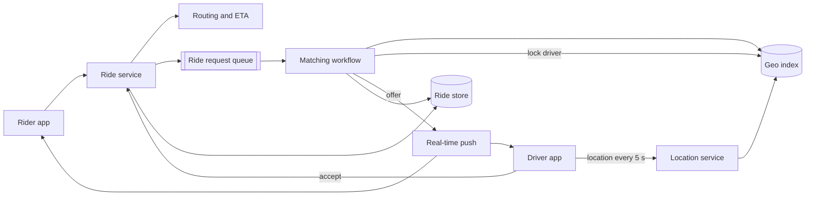
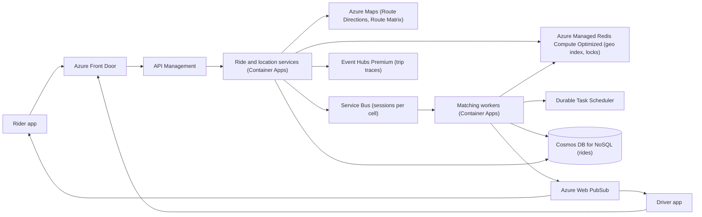

## TL;DR

Keep live driver locations in an in-memory geospatial index, sharded by metro area, and update it from driver apps every few seconds (less often when idle). When a rider requests a trip, a durable matching workflow finds the nearest available drivers, offers the ride to one at a time with a short-lived lock so no driver is offered two rides, waits up to 10 seconds for acceptance with a durable timer, and moves on if the driver declines or ignores it. A queue absorbs request spikes so none are dropped. On Azure: Azure Managed Redis (Compute Optimized) for the geo index and driver locks, Durable Task Scheduler for the matching workflow on Container Apps, Service Bus for the request queue, Cosmos DB for rides, Azure Maps for ETAs and fares, and Web PubSub for live trip updates.

## Requirements

### Functional

- A rider enters pickup and destination and sees an estimated fare and ETA.
- A rider requests a ride and is matched with a nearby available driver.
- A driver receives an offer and accepts or declines it.
- Both see each other's live location until pickup, then the trip progresses to completion.

Out of scope: payments, ratings, scheduled rides, pooled rides, and surge pricing. Surge is a natural follow-up; it reads the same supply and demand data.

### Non-functional

- Match within one minute or tell the rider no driver is available.
- A driver is never assigned two rides at once. Matching needs strong consistency per driver.
- Handle 100,000 requests from one location during a peak event (a stadium emptying).
- Location updates are fresh to within a few seconds.
- Highly available. A lost location update is fine; a lost ride request is not.

## Capacity estimates

Assumptions: 10 M registered drivers, 2 M online at peak, 1 location update every 5 s while available, 20 M rides per day, 10× peak-to-average for rides.

| Quantity | Arithmetic | Result |
| --- | --- | --- |
| Location updates | 2 M ÷ 5 s | 400,000 writes/s |
| Location index memory | 2 M drivers × 100 B | 200 MB |
| Ride requests | 20 M ÷ 86,400 s × 10 peak | about 2,300 req/s at peak |
| Stadium spike | 100,000 requests in 10 min | about 170 req/s on one cell, plus retries |
| Driver offers | 2,300 × about 2 offers per match | about 4,600 offers/s |
| Trip GPS trace | 1 M on-trip drivers ÷ 5 s | 200,000 points/s |
| Ride records | 20 M × 2 KB | 40 GB/day |

The location index is tiny but extremely write-heavy: memory is irrelevant, throughput is everything. Rides themselves are a modest transactional workload. The trip trace is a stream, not a database workload.

## Core entities and API

### Entities

- **Rider**: `id`, `name`, `paymentMethodId`.
- **Driver**: `id`, `vehicle`, `status` (`offline`, `available`, `offered`, `on_trip`).
- **DriverLocation**: `driverId`, `lat`, `lon`, `updatedAt`. Lives only in the geo index.
- **Fare**: `id`, `riderId`, `pickup`, `destination`, `estimate`, `etaSeconds`, `expiresAt`.
- **Ride**: `id`, `fareId`, `riderId`, `driverId`, `status` (`requested`, `matched`, `en_route`, `in_progress`, `completed`, `cancelled`), timestamps.

### API

```http
POST  /v1/fares            { pickup, destination }       -> 201 { fareId, estimate, etaSeconds }
POST  /v1/rides            { fareId }                    -> 202 { rideId, status: "requested" }
POST  /v1/drivers/me/location { lat, lon }               -> 204
PATCH /v1/rides/{rideId}   { action: "accept" | "decline" | "arrived" | "complete" }   (driver)
```

`POST /v1/rides` returns `202 Accepted` because matching happens asynchronously. Status changes reach the rider over a WebSocket, not by polling. Identity comes from the auth token, never from the body. See [API design](../01-fundamentals/api-design.md).

## High-level design



1. The rider asks for a fare. The ride service calls a routing engine for distance and ETA and stores a fare quote with a short expiry.
2. The rider confirms. The ride service writes a `requested` ride and enqueues it.
3. A matching workflow picks it up, queries the geo index for available drivers near the pickup, and ranks them by ETA.
4. It locks the best driver, sends the offer, and waits.
5. On accept, the ride becomes `matched` with that driver. On decline or timeout, the lock is released and the next driver gets the offer.
6. During the trip, location updates flow to the rider and to a trace stream used for fare calculation.

## Deep dives

### 1. Indexing driver locations

| Option | Writes | Nearby query | Problem |
| --- | --- | --- | --- |
| Relational table with lat/lon B-tree indexes | Row update per ping | Range scan on two columns, filter | 400,000 updates per second on disk-backed indexes; bounding-box scans are slow. |
| Spatial extension in a relational DB | Same | R-tree or GiST index, good queries | Still 400,000 durable writes per second for data that is stale in 5 s. |
| In-memory quadtree in custom servers | Fast | Fast | You build and operate a sharded, replicated in-memory service yourself. |
| In-memory store with geohash-encoded sorted sets | Fast, one command per ping | Radius search built in | Data is ephemeral, which is fine here. |

**Pick: an in-memory geospatial index** (Redis `GEOADD` and `GEOSEARCH`, which store geohash scores in a sorted set). Locations are only useful for seconds, so durability buys nothing, and an in-memory index serves both the write rate and the radius query. Losing the index on failover means drivers reappear within one update interval.

Shard by metro area, not by a global hash: a query for "drivers within 2 km of this pickup" must hit one shard. Use one sorted set per city cell (for example `drivers:{sea}:available`) and keep cells small enough that the busiest one fits a shard's throughput.

### 2. Reducing update volume

400,000 writes per second is driven by the update interval. Adaptive intervals cut it without hurting matching:

- **Available and moving:** every 4 to 5 s.
- **Available and stationary:** send only when the position changes by more than 50 m or every 30 s.
- **On trip:** every 5 s, but sent to the trace stream, not the available-drivers index.
- **Offline:** nothing.

The client decides, using the phone's motion sensors. This is cheaper than any server-side optimization and often halves real traffic.

### 3. Never double-assigning a driver

Two matching workers can pick the same nearest driver for two riders a few milliseconds apart.

- **Database conditional update** on the driver's status (`available` to `offered`). Correct, but puts a durable write in the hottest loop and still needs expiry if the driver never responds.
- **Lock with TTL in the in-memory store** (`SET lock:driver:{id} rideId NX PX 10000`). Atomic, fast, and self-expiring, so a worker crash never strands a driver.
- **Single matcher per cell.** Serialize matching for each area through one consumer. No races, but a stadium cell becomes a single-threaded bottleneck.

**Pick: the TTL lock for offers, and a conditional write for acceptance.** The lock prevents two concurrent offers. The final transition of the ride from `requested` to `matched` is a conditional write in the ride store, so even if a lock is lost in a cache failover, two rides cannot both commit the same driver. The lock is an optimization over a correct base, not the only guard. See [handling contention](../03-patterns/handling-contention.md).

### 4. Waiting for the driver: durable timeouts

Each offer needs "wait up to 10 seconds for accept, then try the next driver, give up after one minute". If that wait lives in a worker's memory and the worker restarts, the rider waits forever.

- **In-memory timers:** simple, lost on restart.
- **Delayed queue messages:** schedule a "check offer" message 10 s out. Works, but the matching logic spreads across handlers and state lives in the database.
- **Durable execution:** write the matching loop as ordinary code; the framework persists each step and resumes after a crash.

**Pick: durable execution.** The orchestration is a loop: get candidates, lock one, send offer, wait for the "accepted" event or a 10 s timer, whichever comes first. Each await is checkpointed. It reads like the business rule and survives restarts, deploys, and zone failures. See [long-running tasks](../03-patterns/long-running-tasks.md).

### 5. Peak demand from one place

100,000 requests from one stadium is not a throughput problem for the system as a whole. It is a supply problem in one cell: there are not 100,000 drivers nearby. Put requests in a queue so none are dropped, process them in order per cell, widen the search radius as nearby supply runs out, and tell riders their position. Rejecting at the API under load loses requests that the queue would have served a few minutes later.

## On Azure



| Component | Azure service | Tier or setting, and why |
| --- | --- | --- |
| Geo index and driver locks | Azure Managed Redis | Compute Optimized (2:1 memory to vCPU): 200 MB of data, 400,000 writes per second. OSS clustering, metro name as hash tag. High availability on. |
| Fare and ETA | Azure Maps | Route Directions for one pickup-destination pair; Route Matrix to rank many candidate drivers by drive time with live traffic. |
| Ride request queue | Azure Service Bus | Standard or Premium with sessions; session ID = metro cell, so each cell is processed in order. |
| Matching workflow | Durable Task Scheduler with the Durable Task SDK on Container Apps | Durable timers for the 10 s offer timeout; external event for "accepted". |
| Rides | Azure Cosmos DB for NoSQL | Partitioned on `/rideId`; accept uses an ETag precondition so only one transition to `matched` succeeds. |
| Live updates | Azure Web PubSub | Premium for zone redundancy. Offers to drivers and driver location to riders, using send-to-user. |
| Trip traces | Azure Event Hubs | Premium, sized from the arithmetic below. Capture to Data Lake Storage for fare audits. |

### Tier decisions that follow from the numbers

- **Event Hubs tier.** 200,000 trace points per second as individual events would need 200 throughput units at 1,000 events per second each ([scalability](https://learn.microsoft.com/azure/event-hubs/event-hubs-scalability)), and a Standard namespace tops out at 40 ([quotas](https://learn.microsoft.com/azure/event-hubs/event-hubs-quotas)). Pack 30 seconds of points per trip into one event: 1 M ÷ 30 s is about 33,000 events per second and about 10 MB/s. That fits under Standard's ceiling with little headroom, so choose Premium and leave room for growth.
- **Redis tier.** The same reasoning as the [rate limiter](./rate-limiter.md): this is CPU-bound, not memory-bound, which is the Compute Optimized profile ([Azure Managed Redis overview](https://learn.microsoft.com/azure/redis/overview)).
- **Durable Task Scheduler.** It is Microsoft's recommended backend for Durable Functions and the Durable Task SDKs, and it runs with apps on Container Apps, AKS, or App Service ([Durable Task Scheduler](https://learn.microsoft.com/azure/durable-task/scheduler/durable-task-scheduler)). Use durable timers, not language sleep calls, for the offer timeout ([durable timers](https://learn.microsoft.com/azure/durable-task/common/durable-task-timers)).
- **Azure Maps routing.** Route Directions and Route Matrix return travel times that account for real-time and historic traffic ([routing best practices](https://learn.microsoft.com/azure/azure-maps/how-to-use-best-practices-for-routing)). Rank candidates by drive time, not straight-line distance; a driver 500 m away across a river is not the nearest.
- **Service Bus sessions** give first-in, first-out processing per session ([sessions](https://learn.microsoft.com/azure/service-bus-messaging/message-sessions)), and the Basic tier does not support them.

### Zones and regions

Enable zone redundancy on the Container Apps environment, Cosmos DB, and Web PubSub Premium, and high availability on Redis. Event Hubs namespaces are zone redundant in all tiers when created in a region with availability zones ([Event Hubs reliability](https://learn.microsoft.com/azure/reliability/reliability-event-hubs)). Deploy per geography: a region serves the metros near it, and metros are independent, so a regional outage affects only its cities. This is a natural [cell-based architecture](../05-advanced/cell-based-architecture.md).

### Gotcha

If you write orchestrations with Durable Functions, the in-process .NET model loses support on November 10, 2026. Build on the isolated worker model or the standalone Durable Task SDKs from the start ([durable timers](https://learn.microsoft.com/azure/durable-task/common/durable-task-timers)). Also keep orchestrator code deterministic: read the time from the orchestration context, not the system clock, or replays diverge.

See [compute choices](../04-azure/compute-choices.md) and [messaging choices](../04-azure/messaging-choices.md).

## Interview tips

- Start the deep dives with the write rate of location updates. It rules out a durable database for live locations immediately.
- Separate "prevent concurrent offers" (lock with TTL) from "record the match" (conditional write). Interviewers probe what happens when the lock store fails.
- Expect "what if the driver's app is killed while an offer is out?" The timer fires, the lock expires, the next driver gets the offer.
- Expect "how do you shard?" By geography, because every query is local. A global hash would scatter one radius query across every shard.
- Do not poll for match status from the rider app; push it.
- Follow-ups: surge pricing (demand from the queue versus supply from the index, per cell), ETA accuracy (routing engine with traffic, not straight-line distance), and fraud (location spoofing checks on impossible speeds).

## Further reading

- [Hello Interview: Design a ride-sharing service like Uber](https://www.hellointerview.com/learn/system-design/problem-breakdowns/uber)
- [The Coding Gopher: A deep dive into Redis' architecture](https://thecodinggopher.substack.com/p/a-deep-dive-into-redis)
- [Durable Task Scheduler](https://learn.microsoft.com/azure/durable-task/scheduler/durable-task-scheduler)
- [Azure Maps routing best practices](https://learn.microsoft.com/azure/azure-maps/how-to-use-best-practices-for-routing)
- [Sharding and partitioning](../02-building-blocks/sharding-and-partitioning.md), [real-time updates](../03-patterns/real-time-updates.md), [stream processing](../05-advanced/stream-processing.md)
