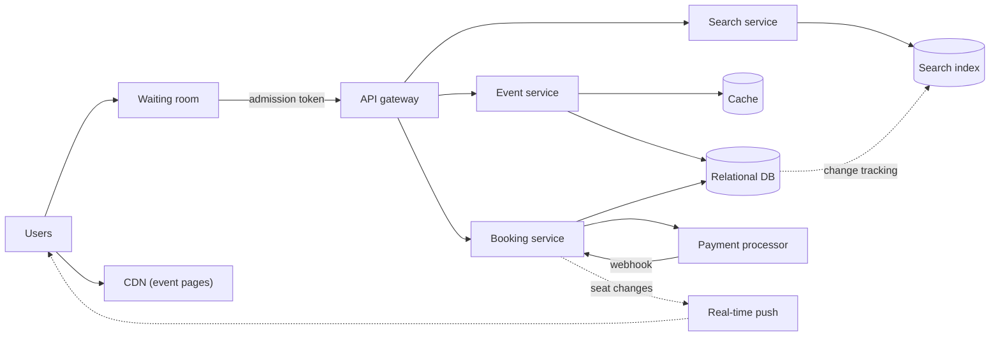
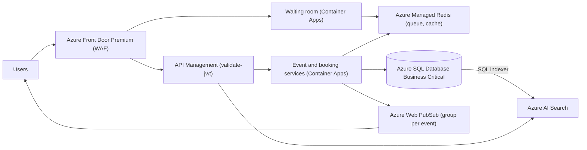

## TL;DR

Model each seat as a row with a status and a `HoldUntil` time. Reserve seats with one conditional `UPDATE` that succeeds only if the seat is available or its hold has expired, so expiry needs no cleanup job to be correct and the database's row-level atomicity prevents double booking. Confirm the booking after payment with a second conditional update. Put a virtual waiting room in front of hot on-sales so the booking path only sees as many users as there are seats to sell, and push seat-map changes instead of letting millions of clients poll. On Azure: Azure SQL Database Business Critical (zone redundant, free read replicas) for tickets and bookings, Azure AI Search for event search, Azure Managed Redis for the waiting room and caches, Web PubSub for live seat updates, and API Management validating admission tokens.

## Requirements

### Functional

- Browse an event and see its seat map and prices.
- Search events by keyword, date, location, and performer.
- Select seats, hold them while paying, and complete the purchase.

Out of scope: resale, dynamic pricing, and venue management tools. Mention dynamic pricing if asked; it changes the price column, not the concurrency design.

### Non-functional

- Strong consistency for booking: a seat is sold to at most one person.
- High availability for browsing and search. A stale seat map is acceptable for a few seconds; a down site is not.
- Survive a 10 million user spike on a single event on-sale.
- Search returns in under 500 ms.
- Read-heavy: about 100 views per booking.

## Capacity estimates

Assumptions: a stadium event with 50,000 seats, 10 M users arriving in the first 10 minutes, each user refreshing the seat map every 5 seconds without controls, a 10-minute hold.

| Quantity | Arithmetic | Result |
| --- | --- | --- |
| Uncontrolled seat-map reads | 10 M ÷ 5 s | 2 M req/s on one event |
| Seats to sell | | 50,000 |
| Bookings if it sells out in 10 min | 50,000 ÷ 600 s | about 83 bookings/s |
| Hold attempts with contention | 83 × 10 (losers retry other seats) | about 1,000 conditional updates/s |
| Ticket rows per event | 50,000 × 200 B | 10 MB |
| All events per year | 100,000 events × 20,000 seats avg × 200 B | 400 GB |

Writes are small: a single relational database handles 1,000 short conditional updates per second. The 2 M reads per second on one event are the problem. They come from people who cannot buy a seat anyway, since only 50,000 can. That observation leads to the waiting room.

## Core entities and API

### Entities

- **Event**: `id`, `venueId`, `performerId`, `name`, `startsAt`, `onSaleAt`.
- **Venue**: `id`, `name`, `location`, `seatMap`.
- **Ticket**: `id`, `eventId`, `section`, `row`, `seat`, `price`, `status` (`available`, `held`, `sold`), `heldBy`, `holdUntil`, `bookingId`.
- **Booking**: `id`, `userId`, `eventId`, `ticketIds`, `status` (`pending`, `confirmed`, `failed`), `paymentId`, `createdAt`.

### API

```http
GET  /v1/events/{eventId}                    -> event, venue, seat map with statuses
GET  /v1/search?q=...&from=...&to=...&near=lat,lon
POST /v1/bookings          { eventId, ticketIds }   -> 201 { bookingId, holdUntil } | 409 seats taken
POST /v1/bookings/{id}/confirm { paymentToken }     -> 200 { status: "confirmed" } | 410 hold expired
```

The client sends a payment token from the payment processor's client SDK, never raw card data. `POST /bookings` takes an `Idempotency-Key` header so a double-click does not create two holds. See [API design](../01-fundamentals/api-design.md).

## High-level design



1. Static event content (images, descriptions) is served from the CDN.
2. For a hot on-sale, users enter the waiting room and receive a signed admission token when their turn comes.
3. The gateway rejects booking calls without a valid token.
4. The booking service places holds and confirms bookings in the relational database.
5. Seat status changes are pushed to clients viewing that event.
6. The search index is fed from the database on a schedule.

## Deep dives

### 1. Holding seats without double booking

The window between "I picked these seats" and "my payment succeeded" can be minutes. Something must stop another user buying the same seat during that window, and release it if the first user walks away.

| Option | How it works | Failure mode |
| --- | --- | --- |
| Pessimistic lock held through checkout | `SELECT ... FOR UPDATE` and keep the transaction open while the user pays | Transactions open for minutes, connection pool exhaustion, lock waits for everyone. |
| Status plus hold expiry in the DB (implicit expiry) | Conditional `UPDATE` sets `held` and `holdUntil`; an expired hold counts as available | None for correctness. Expired holds show as held in the seat map until a reader checks the time, so compute availability as `status = 'available' OR holdUntil < now`. |
| Distributed lock with TTL in Redis | `SET seat:{id} user NX PX 600000` before touching the DB | Two systems to keep consistent. If Redis fails over and loses the key, the seat is lockable twice; the DB still needs a final check. |
| Document DB with optimistic concurrency | Read the seat, write back with an ETag precondition | Works per item. Holding several seats atomically needs a transaction scoped to one partition. |

**Pick: status plus `holdUntil` in a relational database.** One statement both checks and claims all requested seats, the row locks last milliseconds, and expiry is implied by the clock so a crashed cleanup job cannot strand seats.

```sql
BEGIN TRANSACTION;
UPDATE Tickets
SET Status = 'held', HeldBy = @userId, BookingId = @bookingId,
    HoldUntil = DATEADD(minute, 10, SYSUTCDATETIME())
WHERE EventId = @eventId
  AND TicketId IN (SELECT TicketId FROM @ticketIds)
  AND (Status = 'available' OR (Status = 'held' AND HoldUntil < SYSUTCDATETIME()));
IF @@ROWCOUNT = @requestedCount
    COMMIT TRANSACTION;
ELSE
    ROLLBACK TRANSACTION;
```

Confirmation after payment is the same shape: `SET Status = 'sold' WHERE BookingId = @bookingId AND HoldUntil > SYSUTCDATETIME()`. If zero rows change, the hold expired before payment finished. Refund the payment and tell the user. That race is rare, but it is the one an interviewer will ask about. See [handling contention](../03-patterns/handling-contention.md).

A periodic sweep can still reset expired holds to `available` to keep the table tidy, but correctness never depends on it.

### 2. Payment as a multi-step process

The payment processor is external and slow. Do not call it inside the database transaction.

1. Create the booking as `pending` and hold the seats (deep dive 1).
2. The client pays through the processor with the `bookingId` as metadata and an idempotency key.
3. The processor calls the booking service's webhook. The service confirms the seats and marks the booking `confirmed`, or releases them on failure.
4. If no webhook arrives before `holdUntil`, a reconciliation job queries the processor by `bookingId` before releasing.

The webhook can arrive twice, so confirmation must be idempotent: the conditional update already is, since a second run changes zero rows and returns the same result. See [multi-step processes](../03-patterns/multi-step-processes.md).

### 3. Surviving the on-sale spike

| Option | Effect |
| --- | --- |
| Autoscale everything | Pays for 2 M req/s of capacity to serve 50,000 buyers. The database still sees contention from everyone at once. |
| Cache the seat map aggressively | Reduces DB load, but users see seats as available that sold seconds ago, and click into failures. |
| Virtual waiting room | Admit users in batches sized to available inventory; everyone else waits on a cheap static page. |

**Pick: a virtual waiting room plus a pushed seat map.** On arrival, a user gets a queue position (a sorted set keyed by arrival time). Every few seconds an admitter lets the next batch through by issuing each a short-lived signed admission token. The gateway rejects booking calls without one. The waiting page polls its position every 10 to 30 seconds from a cache, which is cheap. Only admitted users see the live seat map, and seat changes are pushed to them, so the map is accurate without polling. Batch size is a control loop: admit more when holds are converting to sales, fewer when error rates rise.

FIFO is the usual choice. Some sellers randomize positions among everyone who arrived before the on-sale time, which removes the incentive to hammer the site early.

### 4. Search

Searching a relational table with `LIKE '%taylor%'` scans every row and cannot rank by relevance or distance. A search engine builds an inverted index with typo tolerance, facets, and geo filters. **Pick: a dedicated search index,** fed from the database by change tracking, with popular queries cached for a minute. Search results can lag writes by minutes, which is fine because an event's name and date rarely change, and availability is checked at booking time anyway. See [search](../02-building-blocks/search.md).

## On Azure



| Component | Azure service | Tier or setting, and why |
| --- | --- | --- |
| Edge | Azure Front Door | Premium for managed WAF rules and bot protection, which matter when scalpers script the on-sale. |
| Waiting room | Container Apps plus Azure Managed Redis | Sorted set per event for positions. Admission tokens signed with a key held in Key Vault. |
| Gateway | Azure API Management | `validate-jwt` checks the admission token on booking routes. Premium v2 for zone redundancy. |
| Tickets and bookings | Azure SQL Database | Business Critical, zone redundant. Read replicas at no extra charge serve seat maps with `ApplicationIntent=ReadOnly`. |
| Search | Azure AI Search | Standard S1. Add replicas for query throughput and availability; partitions only if the index outgrows storage. Azure SQL indexer with SQL integrated change tracking. Geo filters for "near me". |
| Live seat updates | Azure Web PubSub | One group per event; the booking service publishes seat status changes to the group. |
| Caches | Azure Managed Redis | Balanced tier. Event details and rendered seat-map snapshots. |

### Why Azure SQL Database Business Critical

- **Zone redundancy** is available on the vCore General Purpose, Business Critical, and Hyperscale tiers, and not on DTU Basic or Standard ([zone redundancy](https://learn.microsoft.com/azure/azure-sql/database/high-availability-sla-local-zone-redundancy)). A booking database that loses a zone during an on-sale is the headline you are designing against.
- **Read scale-out** comes with Business Critical at no extra cost. Route seat-map reads with `ApplicationIntent=ReadOnly`. Replica data can lag the primary slightly ([read scale-out](https://learn.microsoft.com/azure/azure-sql/database/read-scale-out)), which is acceptable for display because the hold statement runs on the primary.
- **The working set is tiny.** 400 GB a year of tickets fits one database. You are buying low-latency local storage and fast failover, not capacity. Hyperscale is the upgrade path if history grows into terabytes.

### Why not Cosmos DB here

Cosmos DB can do this with optimistic concurrency: writes carry the item's `_etag` in an if-match header and fail with HTTP `412` if someone else changed it ([optimistic concurrency](https://learn.microsoft.com/azure/cosmos-db/database-transactions-optimistic-concurrency)). Holding several seats atomically needs a transactional batch, which must stay inside one logical partition and is limited to 100 operations ([transactional batch](https://learn.microsoft.com/azure/cosmos-db/transactional-batch)). Partitioning tickets by `/eventId` makes that work, but puts the whole on-sale on one logical partition capped at 10,000 RU/s. Partitioning by section spreads the load but stops a user holding seats in two sections atomically. The relational design avoids that trade.

### Zones and regions

Enable zone redundancy on Azure SQL, Azure Managed Redis (high availability), API Management Premium v2, and the Container Apps environment. For regional disaster recovery, add a failover group to a paired region. Booking stays single-writer by design; a second write region would reintroduce double booking.

### Gotcha

Do not use Cosmos DB TTL as the hold-release mechanism. Expired items stop appearing in queries immediately, but physical deletion runs in the background on spare RUs and is delayed when the container is busy ([time to live](https://learn.microsoft.com/azure/cosmos-db/time-to-live)). During an on-sale the container is always busy, so a "released" hold document can block a new hold with the same id for longer than its TTL. Encode expiry in the data (`holdUntil`) and compare against the clock instead.

See [data choices](../04-azure/data-choices.md) and [networking and security](../04-azure/networking-and-security.md).

## Interview tips

- Say where the source of truth for seat status lives and make every other copy (cache, search, seat map) explicitly stale-tolerant.
- Name the implicit-expiry trick and why it beats a cleanup cron: correctness does not depend on a job running.
- Expect "what happens if payment succeeds after the hold expired?" Answer with the conditional confirm and a refund.
- Expect "how do you handle 10 M users?" Lead with the waiting room. Scaling the booking path for people who cannot buy a ticket is the wrong investment.
- Do not reach for a distributed lock service first. It adds a second source of truth and a failover hole the database does not have.
- Follow-ups: bots (WAF and bot protection plus per-account purchase limits), fairness (randomized queue), and partial availability ("hold any two adjacent seats", which is a best-available query inside the same transaction).

## Further reading

- [Hello Interview: Design a ticket booking site like Ticketmaster](https://www.hellointerview.com/learn/system-design/problem-breakdowns/ticketmaster)
- [The Coding Gopher: ACID vs BASE databases](https://thecodinggopher.substack.com/p/acid-vs-base)
- [Azure SQL Database read scale-out](https://learn.microsoft.com/azure/azure-sql/database/read-scale-out)
- [Azure AI Search SQL indexer](https://learn.microsoft.com/azure/search/search-how-to-index-sql-database)
- [API Management validate-jwt policy](https://learn.microsoft.com/azure/api-management/validate-jwt-policy)
- [Handling contention](../03-patterns/handling-contention.md), [distributed transactions](../05-advanced/distributed-transactions.md), [consistency and CAP](../01-fundamentals/consistency-and-cap.md)
