## Understanding the problem

**What is a ticket booking site?** It lets fans find a concert or a game, pick seats on a map of the venue, and pay for them before anyone else does. Most days it is a quiet catalog. On the morning a stadium tour goes on sale, millions of people arrive in the same minute to compete for a few tens of thousands of seats.

Two things make it hard. A seat can be sold once, and the fan who picked it needs minutes to pay, so something has to reserve it during checkout and give it back if they walk away. And the on-sale crowd is hundreds of times larger than the inventory, so most of the load comes from people who will never get a ticket.

## Functional requirements

1. Users should be able to search for events by keyword, date, location, and performer.
2. Users should be able to view an event with its seat map and prices.
3. Users should be able to book seats.
   - Booking holds the chosen seats while the user pays, then turns the hold into tickets.

**Below the line (out of scope)**

- **Resale and transfers.** A second market with its own pricing and fraud rules. It reuses the ticket row but not the on-sale problem.
- **Dynamic pricing.** It changes the price column, not the concurrency design, so mention it if asked and move on.
- **Venue and promoter tools.** Drawing seat maps and scheduling on-sales is back-office work with tiny traffic.
- **Order history.** Listing a user's bookings is one indexed query once bookings exist.

I trimmed to search, view, and book because a fan needs all three to get from "who's playing near me" to a ticket. Every hard problem in this system sits inside requirement 3.

## Non-functional requirements

1. **A seat is sold at most once, and nobody pays without getting a ticket.** Booking chooses consistency. If the system can't confirm a hold, the booking fails instead of guessing.
2. **Browsing stays up.** Search and event pages choose availability. A seat map may be a few seconds stale, because booking checks every seat again before it holds it.
3. **One on-sale survives 10 million fans.** Plan for a 50,000-seat stadium and 10 million users arriving in the first 10 minutes.
4. **Search answers in under 500 ms.** That covers keyword, date, and distance filters across every event on sale.

**Below the line**

- **Card data.** The payment processor's client SDK turns the card into a token, so card numbers never reach our servers.
- **Proving every buyer is human.** Bot protection at the edge and a per-account ticket limit raise the cost of scalping. A full identity check is a separate system.

The ratio of crowd to inventory shapes this design more than anything else. Without controls, 10 million users refreshing a seat map every 5 seconds is 2 million reads a second on one event. Selling 50,000 seats in 10 minutes is only 83 bookings a second. Losers retry other seats, so assume about 10 attempts per sale, which is about 1,000 short conditional updates a second, well within one relational database. A ticket row is about 200 bytes, so one event is 10 MB, and a year of 100,000 events averaging 20,000 seats is 400 GB, which also fits one database. That decided two things. Writes can live on one strongly consistent primary. And the 2 million reads a second come from people who can't buy a seat, since only 50,000 can, so they need admission control rather than more servers. See [back-of-the-envelope estimation](../01-fundamentals/back-of-the-envelope.md).

:::tip
Say "the crowd is 200 times the inventory" in your first five minutes. It justifies a single write primary and sets up the waiting room before the interviewer asks about scale.
:::

## Core entities

- **Event.** A performance by a performer at a venue on a date, with an on-sale time.
- **Venue.** A place with a location and a seat layout.
- **Ticket.** One seat at one event, with a price and a status. This is the row two people fight over.
- **Booking.** One user's purchase of one or more tickets, tied to one payment.

Fields wait for the high-level design, where each one appears next to the store that holds it.

## API

REST covers all three requirements. Live seat changes get a push channel in deep dive 4, and nothing needs one before that. See [API design](../01-fundamentals/api-design.md).

Requirement 1 is a search. It needs no login and returns a page of events with a cursor for the next page.

```http
GET /v1/events?q=jazz&from=2026-07-01&to=2026-07-31&near=47.61,-122.33&radiusKm=50

200 OK
{ "events": [ { "eventId": "evt_8k2", "name": "...", "venue": "...", "startsAt": "2026-07-18T19:30:00-07:00" } ], "next": "c2Vh..." }
```

Requirement 2 reads one event. The response carries the venue's layout plus each ticket's price and status, as a snapshot that may be a few seconds old.

```http
GET /v1/events/evt_8k2

200 OK
{ "event": { ... }, "venue": { ... }, "tickets": [ { "ticketId": "t_101", "section": "A", "row": "12", "seat": "7", "price": 14900, "status": "available" } ] }
```

Requirement 3 takes more than one call, because holding a seat and paying for it are separate steps with minutes between them. The first call holds the seats. The user comes from the token in the `Authorization` header, never from the body. The `Idempotency-Key` header makes a double click return the first hold instead of creating a second.

```http
POST /v1/bookings
Authorization: ******
Idempotency-Key: 7d1e0c44-2b9a-4f3e-8c51-6a0f9d2e4b17
{ "eventId": "evt_8k2", "ticketIds": ["t_101", "t_102"] }

201 Created
{ "bookingId": "bk_5q9", "holdUntil": "2026-05-01T10:12:00Z" }

409 Conflict   (a seat is already taken)
```

The second call pays. The client sends a token from the processor's client SDK, never card data. The answer is `202 Accepted`, because the processor confirms later.

```http
POST /v1/bookings/bk_5q9/payment
Authorization: ******
{ "paymentToken": "tok_..." }

202 Accepted
{ "status": "pending" }

410 Gone   (the hold expired before payment)
```

The client then reads the booking until it settles.

```http
GET /v1/bookings/bk_5q9
Authorization: ******

200 OK
{ "status": "confirmed", "ticketIds": ["t_101", "t_102"] }
```

## High-level design

Build one requirement at a time. Search starts as a database query, the seat map starts as a plain read, and the crowd waits for the deep dives.

### 1) Users can search for events

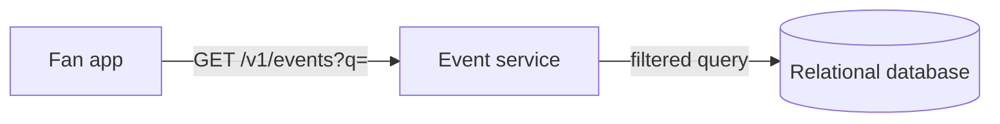

- **Fan app.** The web or mobile client.
- **Event service.** A stateless service that answers search and event reads.
- **Relational database.** One database for events, venues, tickets, and bookings. I'd pick relational from the start, because requirement 3 needs one write that checks and claims several rows at once.

1. The fan app sends the keyword, date range, and location.
2. The event service queries the events table, filters by date, joins venues to filter by distance, and matches the keyword with `LIKE`.
3. It returns the first page sorted by date. Nothing is written.

The events table needs these fields:

- `eventId`, the primary key.
- `name`, `performerId`, and `venueId`.
- `startsAt` and `onSaleAt`.

The venues table holds `venueId`, `name`, `location` as latitude and longitude, and `seatLayout`, the drawing of sections and rows.

The keyword match scans every event and can't rank the results, which will break requirement 4 once the catalog grows. I'd say so and promise deep dive 5.

### 2) Users can view an event with its seat map and prices

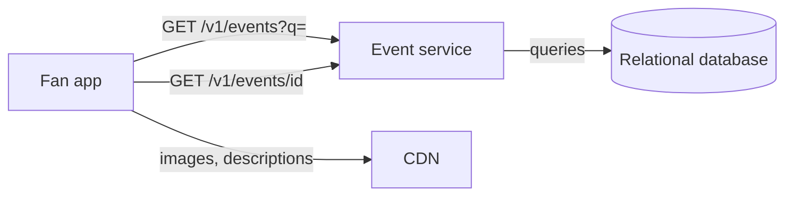

- **CDN.** Serves event images and descriptions, which don't change during an on-sale.
- **Event service.** Gains the event read.
- **Relational database.** Gains the tickets table.

1. The fan app loads the event page's static content from the CDN.
2. It sends `GET /v1/events/evt_8k2`.
3. The event service reads the event and venue rows, then every ticket row for the event, and returns them together.
4. The client draws the seat map and colors each seat by status. Nothing is written.

The tickets table is where requirement 3 happens, so its fields matter:

- `ticketId`, the primary key, and `eventId`, indexed.
- `section`, `row`, `seat`, and `price`.
- `status`, one of `available`, `held`, or `sold`.
- `heldBy`, `holdUntil`, and `bookingId`, empty until someone books.

A 50,000-seat event is 50,000 rows and 10 MB. One read is cheap. Two million a second against the database that sells the seats is not, and deep dives 3 and 4 handle that.

### 3) Users can book seats

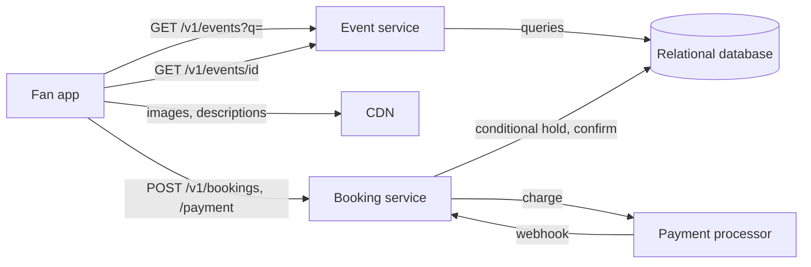

- **Booking service.** Holds seats, starts the payment, and confirms the booking. It is the only writer of ticket status.
- **Payment processor.** An external service that charges the card and calls us back with the result.
- **Relational database.** Gains the bookings table.

Holding seats takes three steps.

1. The fan app sends `POST /v1/bookings` with the event and the ticket IDs.
2. The booking service inserts a booking with status `pending`. In the same transaction, one conditional update flips every requested ticket to `held` with a `holdUntil` 10 minutes out, but only tickets that are still `available`.
3. If the update changed as many rows as the user asked for, the service commits and returns `201` with `holdUntil`. If not, it rolls back and returns `409`, so nobody is left holding half an order.

Paying takes four.

1. The fan app sends `POST /v1/bookings/bk_5q9/payment` with the processor's token.
2. The booking service asks the processor to charge, passing the `bookingId` as metadata and as the idempotency key, and returns `202`.
3. The processor calls the webhook with the outcome. On success the booking service flips the held tickets to `sold` and the booking to `confirmed`. On failure it sets the tickets back to `available` and the booking to `failed`.
4. The fan app reads `GET /v1/bookings/bk_5q9` until the status settles.

The bookings table needs these fields:

- `bookingId`, the primary key.
- `userId`, from the token.
- `eventId` and `ticketIds`.
- `status`, one of `pending`, `confirmed`, or `failed`.
- `paymentId`, the processor's reference, set by the webhook.

Two questions are still open. What releases a hold when the user walks away, and what happens when payment and hold disagree? I'd name both and pick them up in the deep dives.

## Deep dives

That design sells tickets on a quiet Tuesday. Each deep dive takes one non-functional requirement and finds where the design gives way under it.

### 1) How do we hold seats during checkout without ever selling one twice?

This serves requirement 1. Between "I picked these seats" and "my payment went through" there can be several minutes. Something has to keep everyone else off those seats for that long and give them back if the user walks away.

#### Bad solution: Keep the transaction open while the user pays

**Approach.** Open a transaction, lock the seat rows with `SELECT ... FOR UPDATE`, and keep it open until the payment returns. Then mark the seats sold and commit. The database guarantees nobody else touches those rows in the meantime.

**Challenges.** The lock lasts as long as the user takes to type a card number. Every shopper ties up a connection for minutes, so a few thousand of them exhaust the pool, and anyone else reading those rows waits. If the user closes the tab, the seats stay locked until something kills the transaction. Database transactions are built to last milliseconds.

#### Good solution: Claim each seat with an expiring key in Redis

**Approach.** Before touching the database, the booking service writes one key per seat with `SET seat:{ticketId} {bookingId} NX PX 600000`. `NX` makes the write fail if someone already holds the seat, and the 10-minute expiry releases it if the user walks away. The database is written once, when the sale completes.

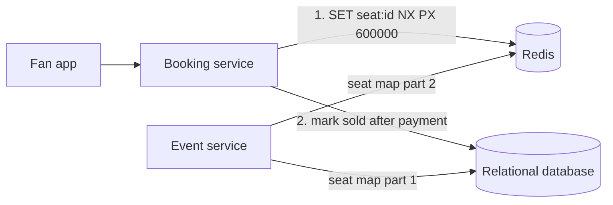

**Challenges.** Seat status now lives in two places, so the seat map has to merge database rows with Redis keys. Several seats need several keys to succeed or fail together, which one `SET NX` per key doesn't give you. Worse, if Redis fails over before a key reaches the replica, a second user can claim a seat the first is paying for. The database still needs a final check at sale time, so the lock adds a system without removing one.

#### Great solution: Put the hold deadline on the seat row

**Approach.** Keep the hold in the database, as the high-level design does, and make the deadline part of the row. One statement checks and claims every requested seat, and it treats a hold whose `HoldUntil` has passed as available. The row locks last milliseconds, and expiry needs no job to run.

```sql
BEGIN TRANSACTION;
UPDATE Tickets
SET Status = 'held', HeldBy = @userId, BookingId = @bookingId,
    HoldUntil = DATEADD(minute, 10, SYSUTCDATETIME())
WHERE EventId = @eventId
  AND TicketId IN (SELECT TicketId FROM @ticketIds)
  AND (Status = 'available' OR (Status = 'held' AND HoldUntil < SYSUTCDATETIME()));
IF @@ROWCOUNT = @requestedCount
    COMMIT TRANSACTION;
ELSE
    ROLLBACK TRANSACTION;
```

Confirming after payment has the same shape. `SET Status = 'sold' WHERE BookingId = @bookingId AND HoldUntil > SYSUTCDATETIME()` succeeds only while the hold is alive. The seat map computes availability the same way, as `Status = 'available' OR HoldUntil < now`, so an abandoned hold shows as free the moment it lapses. See [handling contention](../03-patterns/handling-contention.md).

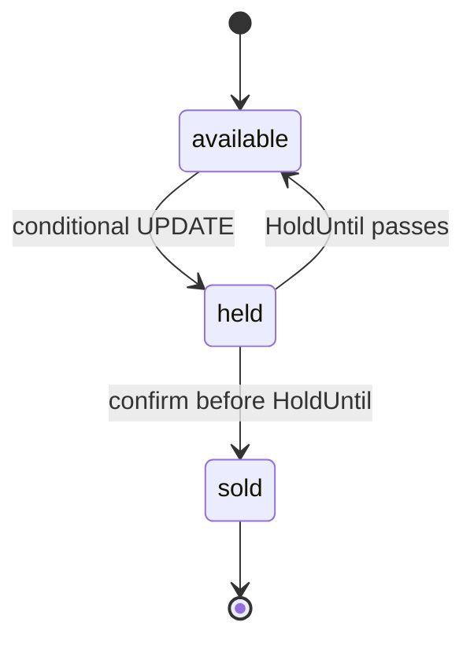

**Challenges.** An expired hold still says `held` until something writes the row, so every reader has to apply the clock rule. A periodic sweep can reset expired holds to keep the table tidy, but correctness never depends on it. Every hold for the on-sale also lands on one primary. That is fine at 1,000 updates a second, and it is why deep dives 3 and 4 keep everyone else away from it.

:::warning
Don't reach for a distributed lock service first. It adds a second source of truth and a failover hole that the database's own row atomicity doesn't have.
:::

In a 45-minute interview I'd go straight to the deadline on the row, name the Redis lock as the alternative I rejected, and spend the saved minutes on payment.

### 2) What happens when the payment and the hold disagree?

This serves the second half of requirement 1. The processor is external, slow, and calls back when it likes, so the hold and the charge can end up telling different stories.

#### Bad solution: Charge the card inside the database transaction

**Approach.** Hold the seats, call the processor, wait for the answer, then mark the seats sold, all in one transaction.

**Challenges.** It has every problem of the open transaction in deep dive 1, plus a call to a third party in the middle. If the processor times out, you don't know whether the card was charged. Rolling back frees the seats while the money may have moved, and retrying may charge twice.

#### Good solution: Confirm from the processor's webhook

**Approach.** Split the flow in two, as the high-level design does. The booking service asks the processor to charge with the `bookingId` as the idempotency key, so a retried request never charges twice. The processor reports the result to a webhook, and the handler runs the conditional confirm. The webhook can arrive more than once, which is safe, because a second confirm changes zero rows and returns the same answer. See [multi-step processes](../03-patterns/multi-step-processes.md).

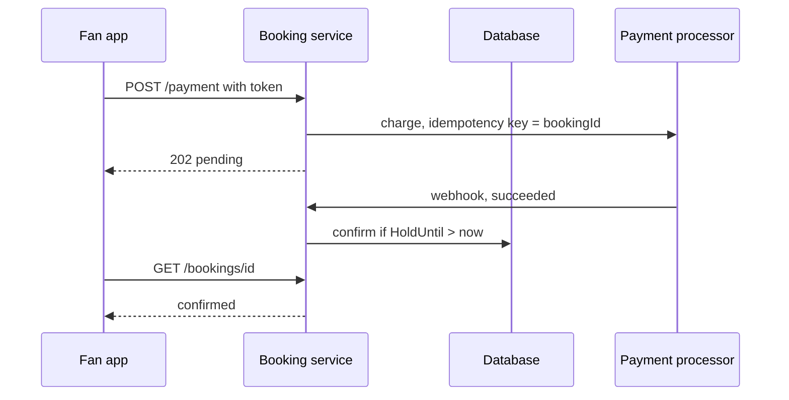

**Challenges.** Two cases slip through. The webhook can arrive after `HoldUntil`, when the confirm changes zero rows and the seats may already belong to someone else, yet the card was charged. And the webhook can be lost, so a paid booking sits in `pending` until the hold lapses and the seats go back on sale.

#### Great solution: Confirm only a live hold, refund the rest, and reconcile before release

**Approach.** Handle each disagreement on purpose. When the confirm changes zero rows because the hold expired, the booking service refunds the charge by `bookingId` and tells the user the seats were released. To catch lost webhooks, a reconciler picks up each `pending` booking shortly before its `HoldUntil` and asks the processor for the charge status by `bookingId`. If the charge succeeded, it confirms while the hold is still alive. If it failed or never started, the hold lapses on its own. The processor owns the truth about money and the ticket row owns the truth about seats, and only the webhook handler and the reconciler compare the two.

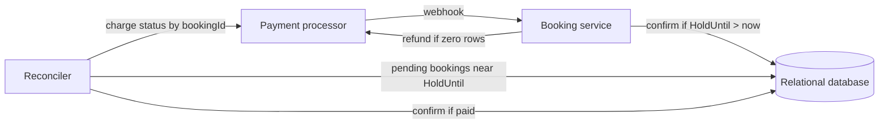

**Challenges.** A refund is worse than a failed checkout, so make the hold long enough that late payments are rare and show the time left on the payment page. The reconciler is one more job to run, and it calls the processor hardest during the on-sale. Some teams extend a hold by a minute while a payment is in flight, trading a little inventory for fewer refunds.

In a 45-minute interview I'd draw the webhook flow, then add the refund and the reconciler in two sentences. Expect "what if the payment succeeds after the hold expired?" and answer it before the interviewer finishes asking.

### 3) How do we keep 10 million fans from flattening the on-sale?

This serves requirement 3. Ten million users arrive for 50,000 seats. Every one of them loads the seat map and tries to book, and at most one in 200 can succeed.

#### Bad solution: Autoscale every tier

**Approach.** Put each service behind an autoscaler, add read replicas, and let capacity follow the crowd.

**Challenges.** You pay for 2 million requests a second to sell 50,000 seats. Scale-out also lags a crowd that arrives in seconds. The booking database still sees every user fight over the same rows at once, so contention grows with the crowd no matter how many service replicas you add.

#### Good solution: Rate-limit at the edge

**Approach.** Cap requests per client at the edge and answer the excess with `429 Too Many Requests`. The services only see traffic they can handle. The [rate limiter](./rate-limiter.md) case study covers the mechanics.

**Challenges.** It protects the servers, not the fans. Whoever retries fastest wins, which rewards scripts over people. Every rejected user retries, often in a tight loop, so the edge fights a retry storm for the whole on-sale. And users see an error instead of an honest estimate of their wait.

#### Great solution: Send everyone through a waiting room

**Approach.** Before the on-sale opens, route everyone for that event to a waiting room instead of the event page. On arrival each user gets a position in a Redis sorted set scored by arrival time. Every few seconds an admitter takes the next batch from the front and gives each user a short-lived signed admission token. The gateway rejects booking calls and the live seat map without a valid token for that event. The waiting page polls its position every 10 to 30 seconds and is answered from cache, which costs almost nothing per user.

Batch size is a control loop. Admit more users when holds are turning into sales, and fewer when error rates or failed holds rise. The aim is that the booking path only ever sees about as many users as there are seats left.

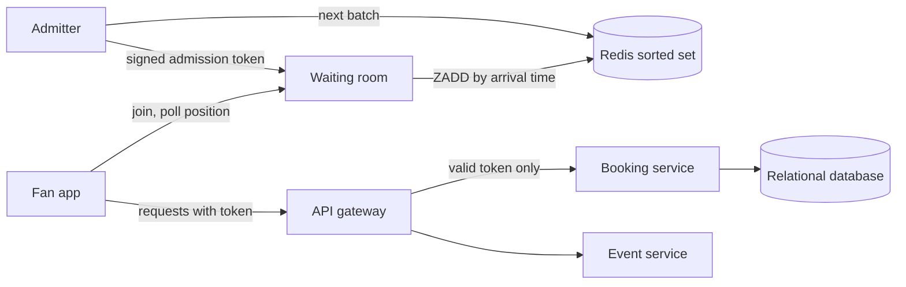

**Challenges.** The waiting room is now the front door to the on-sale, so it needs the same zone redundancy as the database. The signing key has to live in a secret store and rotate. Tokens must expire within minutes so they can't be shared or resold. First come, first served is the usual order. Some sellers instead randomize positions among everyone who arrived before the on-sale time, which removes the reason to hammer the site early.

:::tip
When the interviewer asks about 10 million users, lead with the waiting room. Scaling the booking path for people who can't buy a ticket is the wrong investment, and saying so shows you did the math.
:::

In a 45-minute interview I'd rule out autoscaling and rate limiting in a sentence each and spend the time on the waiting room.

### 4) How do admitted fans see an accurate seat map without hammering the database?

This serves requirement 2. Even behind the waiting room, admitted users stare at a seat map while seats disappear around them. A stale map sends them clicking into `409` after `409`.

#### Bad solution: Read every ticket row from the primary on every refresh

**Approach.** Keep the high-level design. Each refresh reads all 50,000 ticket rows from the database that also takes the holds.

**Challenges.** Every reader competes with the hold statements for the same rows and the same CPU. If 50,000 admitted users refresh every 5 seconds, the primary serves 10,000 full seat maps a second while trying to sell seats.

#### Good solution: Serve a one-second snapshot from a read replica

**Approach.** Build the seat map once and share it. A small job reads the event's ticket statuses from a read replica about once a second, writes a compact snapshot of seat IDs and statuses to Redis, and every client reads the snapshot. The primary sees no seat-map traffic at all. See [scaling reads](../03-patterns/scaling-reads.md).

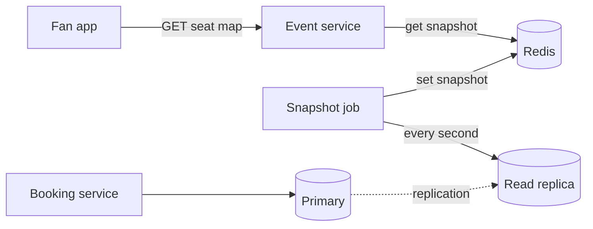

**Challenges.** The map is up to a second old plus however far the replica lags. That is acceptable only because the hold statement runs on the primary and checks every seat again. Clients still poll, so 50,000 users refreshing every few seconds send thousands of requests a second to learn, mostly, that nothing changed.

#### Great solution: Push seat changes to admitted users

**Approach.** Keep the snapshot for the first load, then push changes. Each admitted user opens a WebSocket and joins a group for the event. Whenever the booking service holds, sells, or releases seats, it publishes the changed seat IDs and statuses to that group, and the client patches its map. Held seats carry their `holdUntil`, and the client flips them back to available on its own clock, because a lapsed hold produces no write to publish. Only admitted users join, so the group is sized to the inventory rather than the crowd. See [real-time updates](../03-patterns/real-time-updates.md).

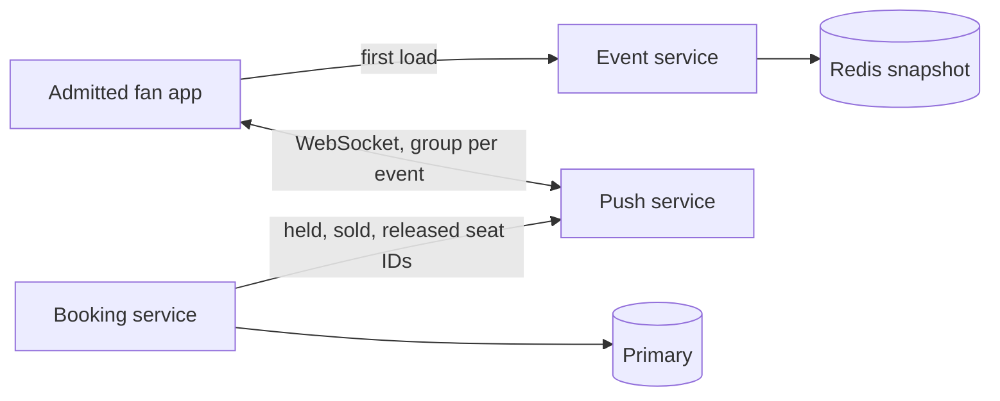

**Challenges.** An open socket costs more than an occasional poll. Admitted users fit in about 100,000 connections, while pushing to all 10 million waiting users would take 100 times that to announce seats they can't book yet. A client that reconnects has missed whatever was sent meanwhile, so it reloads the snapshot first.

In a 45-minute interview I'd mention the snapshot in a sentence and draw the push, since the waiting room is what makes the push affordable.

### 5) How does search answer in under 500 ms?

This serves requirement 4. The high-level design matches keywords with `LIKE` on the events table.

#### Bad solution: Match keywords with LIKE

**Approach.** Keep the high-level query, `WHERE Name LIKE '%jazz%'` with date and distance filters, sorted by date.

**Challenges.** A leading wildcard can't use an index, so every search scans every event. It can't rank by relevance, forgive a typo, or count results by city for facets. Distance filtering on raw latitude and longitude scans again. And all of it runs on the primary that is selling tickets.

#### Great solution: A search index fed by change tracking

**Approach.** Copy events into a search engine that builds an inverted index over names and performers, with typo tolerance, relevance ranking, facets, and geo filters for "near me". Change tracking in the database feeds it, so only changed rows move. Cache the most popular queries for a minute. Results can lag writes by minutes, which is fine, because an event's name and date rarely change and availability is checked at booking time anyway. See [search](../02-building-blocks/search.md).

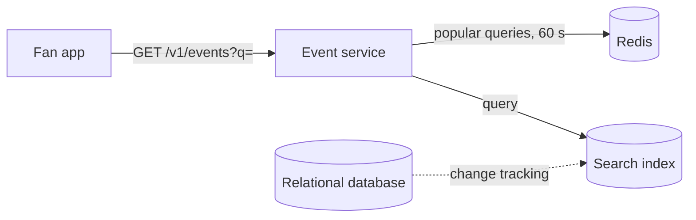

**Challenges.** It is one more system to run, and a new or edited event takes minutes to appear. The indexer also has rules about table design, covered in the Azure gotcha. A full-text index inside the database would avoid the second system but would run on the on-sale's primary.

In a 45-minute interview I'd skip the bad answer and name the index and its feed in two sentences, since search is the least risky part of this system.

## On Azure

One region with three availability zones runs the whole design. A failover group keeps a copy of the database in a second region for disaster recovery.

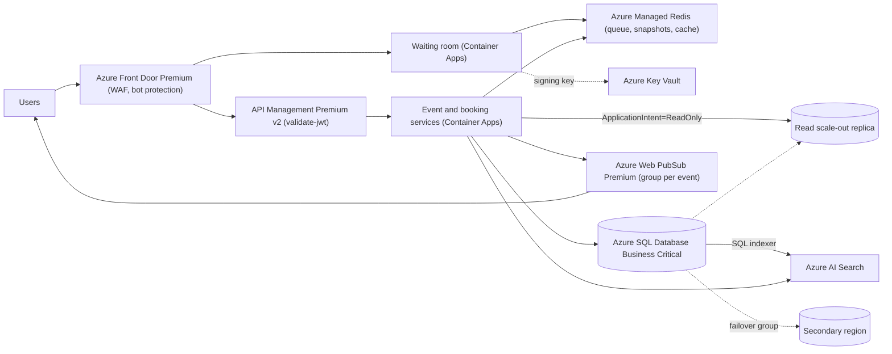

| Component | Azure service | Tier or setting, and why |
| --- | --- | --- |
| Edge | Azure Front Door | Premium. Microsoft-managed WAF rule sets and bot protection need Premium ([tier comparison](https://learn.microsoft.com/azure/frontdoor/standard-premium/tier-comparison)), and both matter when scalpers script the on-sale. |
| Waiting room | Azure Container Apps plus Azure Managed Redis | A sorted set per event holds positions. Admission tokens are JWTs signed with a key held in Azure Key Vault. |
| Gateway | Azure API Management | Premium v2, with units spread across availability zones. The `validate-jwt` policy checks the admission token's signature, expiry, and event claim on booking and seat-map routes. |
| Tickets and bookings | Azure SQL Database | Business Critical, zone redundant. Read scale-out at no extra charge serves the seat-map snapshot job through `ApplicationIntent=ReadOnly`. |
| Search | Azure AI Search | Standard S1. Add replicas for query throughput and availability, and partitions only if the index outgrows storage. Azure SQL indexer with SQL integrated change tracking, and geo filters for "near me". |
| Live seat updates | Azure Web PubSub | Premium_P1. One group per event, joined only by admitted users. One unit holds 1,000 connections and P1 scales to 100 units, so 100,000 admitted users fit one instance ([performance guide](https://learn.microsoft.com/azure/azure-web-pubsub/concept-performance)). Pushing to all 10 million would take 10,000 units. |
| Caches | Azure Managed Redis | Balanced tier (4:1 memory to vCPU), high availability on. Event details, seat-map snapshots, and popular search results. |

### Why Azure SQL Database Business Critical

- **Zone redundancy** is available on the vCore General Purpose, Business Critical, and Hyperscale tiers, and not on DTU Basic or Standard ([zone redundancy](https://learn.microsoft.com/azure/azure-sql/database/high-availability-sla-local-zone-redundancy)). A booking database that loses a zone during an on-sale is the headline you are designing against.
- **Read scale-out** comes with Business Critical at no extra cost. Route the snapshot job's reads with `ApplicationIntent=ReadOnly`. Replica data typically trails the primary by tens of milliseconds to single-digit seconds, with no fixed upper bound ([read scale-out](https://learn.microsoft.com/azure/azure-sql/database/read-scale-out)). That is fine for display, because holds and confirms run on the primary.
- **The working set is tiny.** 400 GB a year of tickets fits one database. You are buying low-latency local storage and fast failover, not capacity. Hyperscale is the upgrade path if history grows into terabytes.

### Why not Cosmos DB here

- **Conditional writes are per item.** Cosmos DB writes can carry the item's `_etag` in an if-match header and fail with HTTP `412` if someone else changed it ([optimistic concurrency](https://learn.microsoft.com/azure/cosmos-db/database-transactions-optimistic-concurrency)). Holding several seats at once needs a transactional batch, which must stay inside one logical partition and is limited to 100 operations ([transactional batch](https://learn.microsoft.com/azure/cosmos-db/transactional-batch)).
- **The partition key fights the batch.** Partitioning tickets by `/eventId` keeps a batch legal but puts the whole on-sale on one logical partition, capped at 10,000 RU/s. Partitioning by section spreads the load but stops a user holding seats in two sections atomically. The relational design avoids that trade.
- **TTL doesn't replace the deadline.** Expired items drop out of query results at once, but physical deletion runs in the background on leftover RUs and is delayed when the container lacks them ([time to live](https://learn.microsoft.com/azure/cosmos-db/time-to-live)). An on-sale leaves no RUs to spare, so you'd still keep `holdUntil` in the data.

### Zones and regions

Enable zone redundancy on Azure SQL, Azure Managed Redis (high availability), API Management Premium v2, and the Container Apps environment, which has to be zone redundant from creation. Web PubSub Premium is zone redundant automatically in regions with zones, but a zone failover drops active connections ([Web PubSub reliability](https://learn.microsoft.com/azure/reliability/reliability-web-pubsub)), so the client reconnects and reloads the snapshot as deep dive 4 describes.

For regional disaster recovery, add a failover group to a second region. With the Microsoft-managed failover policy, the grace period can't be set below one hour ([failover groups](https://learn.microsoft.com/azure/azure-sql/database/failover-group-sql-db)). If an hour without sales during an on-sale is too long, own the failover decision in your runbook. Booking stays single-writer by design, because a second write region would bring back double selling.

:::info
Geo-replication is asynchronous, so a forced failover can lose recent transactions, holds and confirms included. Before reopening sales, match the processor's recent charges against bookings by `bookingId` and restore any paid booking the failover lost.
:::

### Gotcha

SQL integrated change tracking, the policy that lets the Azure AI Search indexer pick up only changed rows and detect deletes, has table rules. The table can't be clustered, the primary key must be a single column, and deletion detection needs that key to be non-clustered ([SQL indexer](https://learn.microsoft.com/azure/search/search-how-to-index-sql-database)). Your events table almost certainly has a clustered primary key. Learn's workaround of rebuilding it as non-clustered often degrades performance, so keep a narrow table dedicated to the indexer and write it in the same transaction as the event.

See [data choices](../04-azure/data-choices.md) and [networking and security](../04-azure/networking-and-security.md).

## What is expected at each level

### Mid-level

I expect you to get search, the event page, and booking working on a relational database without help, and to land on a conditional update for holds, even if you start with a long transaction and I have to point at the open connection. Once I ask, you should see that payment can't sit inside a database transaction. I'd expect to prompt you on what releases an abandoned hold, and a cleanup job is an acceptable first answer. I wouldn't hold the waiting room or the pushed seat map against you.

### Senior

You say early that the crowd outnumbers the seats 200 to 1, and you use it to justify a single write primary. You put the hold deadline on the row on your own, apply the clock rule wherever availability is read, and explain why a Redis lock adds a second source of truth. You split payment into charge and webhook and answer the late payment with a conditional confirm and a refund before I ask. When I raise 10 million users, you reach for admission control, not autoscaling, with tokens checked at the gateway. You may need a nudge on lost webhooks or on scoping the push to admitted users.

### Staff+

You treat the on-sale as an operation you will run. You raise lost webhooks yourself and reconcile with the processor before releasing a hold. You run admission as a feedback loop, weigh arrival order against a randomized queue, and bring up bots, per-account limits, and "any two adjacent seats", which is a best-available query inside the hold transaction. You size the push channel from admitted users, not the crowd. You keep booking single-writer across regions, say what a forced failover costs mid-on-sale, and never let a hold or confirm touch a read replica.

## Further reading

- [Hello Interview: Design a ticket booking site like Ticketmaster](https://www.hellointerview.com/learn/system-design/problem-breakdowns/ticketmaster)
- [The Coding Gopher: ACID vs BASE Databases](https://thecodinggopher.substack.com/p/acid-vs-base)
- [The Coding Gopher: Intro to Webhooks](https://thecodinggopher.substack.com/p/intro-to-webhooks)
- [The Coding Gopher: Polling vs. Long Polling vs. SSE vs. WebSockets vs. Webhooks](https://thecodinggopher.substack.com/p/polling-vs-long-polling-vs-sse-vs)
- [Azure SQL Database read scale-out](https://learn.microsoft.com/azure/azure-sql/database/read-scale-out)
- [Azure AI Search SQL indexer](https://learn.microsoft.com/azure/search/search-how-to-index-sql-database)
- [API Management validate-jwt policy](https://learn.microsoft.com/azure/api-management/validate-jwt-policy)
- [Handling contention](../03-patterns/handling-contention.md), [distributed transactions](../05-advanced/distributed-transactions.md), [consistency and CAP](../01-fundamentals/consistency-and-cap.md)
