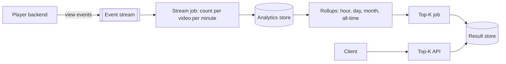

## TL;DR

Do not count one view at a time in a database. Pre-aggregate views per video into 1-minute counts in a stream processor partitioned by video ID, write those small rows to an analytics store, and roll them up into hourly, daily, monthly, and all-time totals. Compute each window's top 1,000 once, when the window closes, and store the 1,000-row result where the API can read it in a few milliseconds. For all-time, update the list every minute using only the videos that got views in that minute: counts only go up, so nothing else can enter the list. On Azure: Event Hubs Dedicated for ingest, Stream Analytics for 1-minute tumbling windows, Azure Data Explorer materialized views for rollups, a Container Apps job to compute lists, and Cosmos DB to serve them. For a game leaderboard with a few million players, a Redis sorted set is the whole answer.

## Requirements

### Functional

- Query the top K most-viewed videos for the last hour, last day, last month, and all time, with K up to 1,000.
- Windows are tumbling and aligned to the clock: "last hour" at 10:06 means 09:00 to 10:00.

Out of scope: arbitrary time ranges, per-category or per-country lists (mention that they multiply the number of lists, not the design).

### Non-functional

- Exact counts. No approximation unless the interviewer relaxes this.
- A view is reflected in results within 1 minute (all-time list); window lists are available within 1 minute of the window closing.
- Queries return in tens of milliseconds.
- Handle 70 billion views a day, the published daily view count of a large short-video platform.
- No lost views if a processing node fails.

## Capacity estimates

Assumptions: 100-byte view events, 4 B videos in total, 5 M distinct videos viewed in any given minute, 2× peak to average.

| Quantity | Arithmetic | Result |
| --- | --- | --- |
| Average view rate | 70 B ÷ 86,400 s | about 810,000 views/s |
| Peak view rate | 810,000 × 2 | about 1.6 M views/s |
| Ingest bandwidth at peak | 1.6 M × 100 B | about 160 MB/s |
| Views per minute | 810,000 × 60 | about 48.6 M |
| Rows after 1-minute pre-aggregation | 5 M distinct videos per minute ÷ 60 | about 83,000 rows/s, a 10× cut |
| All-time counters | 4 B videos × 16 B (8 B ID, 8 B count) | 64 GB before index overhead |
| One Redis sorted set of every video | 4 B members × about 100 B each | about 400 GB in a single key |
| A served result | 1,000 × about 40 B | about 40 KB per list |

Two numbers drive the design. 810,000 increments per second is too many to send to a database one at a time, and much of it lands on a few viral videos. And a single sorted structure holding every video is hundreds of gigabytes in one key, which cannot be split across shards.

## Core entities and API

### Entities

- **View event**: `viewId`, `videoId`, `eventTime`.
- **MinuteCount**: `videoId`, `windowEnd`, `views`.
- **WindowTotal**: `videoId`, `window` (`hour`, `day`, `month`, `all`), `bucket` (for example `2026-10-14T09`), `views`.
- **TopKList**: `window`, `bucket`, `computedAt`, `items: [{ videoId, views }]` (1,000 entries).

### API

```text
GET /views/top?window=hour|day|month|all&k=100
  -> 200 { window, bucket, computedAt, items: [{ videoId, views }] }
```

A view is not an API call into this system. Views arrive as events on a stream produced by the video player backend.

## High-level design



1. The player backend publishes a view event to a stream partitioned by `videoId`.
2. A stream job counts views per video in 1-minute tumbling windows, waiting up to 30 seconds for late events, and writes one row per video per minute.
3. The analytics store keeps rollups by hour, day, month, and all time, updated as rows arrive.
4. When a window closes, the top-K job computes its top 1,000 and writes the list. Every minute it refreshes the all-time list.
5. The API reads one precomputed list and returns the first K entries.

## Deep dives

### 1. Counting 810,000 views per second exactly

| Option | How it works | Trade-off |
| --- | --- | --- |
| Increment a counter per view in a database | `UPDATE counts SET views = views + 1` per event | 810,000 writes per second, and a viral video makes one row a hot key. |
| Pre-aggregate in the stream | Partition by `videoId`; each partition counts its videos for 1 minute and emits one row per video | Writes drop to distinct videos per minute; adds up to a minute of delay, which the requirement allows. |
| Approximate with a count-min sketch and a heap | Fixed-size sketch per window plus a heap of candidates | Tiny memory, but counts are overestimates and the list can be wrong near the cutoff. |

**Pick: pre-aggregate in the stream.** It keeps counts exact and moves the write load from "views per second" to "distinct videos per minute." Partitioning by `videoId` also means a viral video's views are counted in one place, in memory, instead of contending on one database row. Keep the count-min sketch as the answer to "what if exact is too expensive?" See [stream processing](../05-advanced/stream-processing.md) and [scaling writes](../03-patterns/scaling-writes.md).

### 2. Turning counts into a top-K list

| Option | Works when | Breaks when |
| --- | --- | --- |
| Sort at query time | Small data | `top 1000` over 1.5 B monthly rows on every request is seconds, not tens of milliseconds. |
| One sorted set per window | Members per window in the low millions (a game leaderboard) | Hundreds of millions of members: one key, one shard, hundreds of GB, and every update hits that shard. |
| Per-partition heaps, then merge | You run a stateful stream engine with custom code | You have to write and operate the state, checkpoints, and merge yourself. |
| Rollups plus compute at window close | Windows are tumbling | Sliding windows would need recomputation every minute. |

**Pick: rollups in an analytics store, plus computing each list once when its window closes.** A closed hour never changes again, so its top 1,000 needs computing once, not on every request. The per-partition heap approach is also exact, and worth explaining: because the stream is partitioned by `videoId`, every video's full count lives in one partition, so the global top 1,000 is always inside the union of each partition's local top 1,000. Pick it if you already run a stream engine with keyed state.

Note that daily lists cannot be built from 24 hourly top-1,000 lists: a video ranked 1,001st every hour may be first for the day. Roll up the per-video counts, not the lists.

### 3. The all-time list every minute

Rescanning 4 B all-time totals every minute is wasteful. Counts only increase, so a video can enter the all-time top 1,000 only in a minute when it received views. Each minute:

1. Take the videos in that minute's counts (about 5 M).
2. Look up their new all-time totals.
3. Merge them with the current 1,000-entry list, replacing stale totals, and keep the top 1,000.

This is exact and touches about 0.1% of videos per minute.

### 4. Late and duplicate events

- **Late events.** Count by event time with a 30-second late-arrival tolerance, which fits inside the 1-minute budget. An event later than that is assigned to the window it arrived in, not dropped, so totals stay exact even if the hour boundary blurs by seconds.
- **Duplicates.** At-least-once delivery means a stream job can write the same minute row twice after a restart. Make the rollup deduplicate on `(videoId, windowEnd)` before summing. Duplicate view events from clients are the player backend's problem: it should emit one event per `viewId`. See [idempotency and retries](../03-patterns/idempotency-and-retries.md).

## On Azure


| Component | Azure service | Tier or setting, and why |
| --- | --- | --- |
| View stream | Azure Event Hubs | Dedicated, up to 1,024 partitions per hub. Kafka endpoint so existing producers need no new client. |
| Replay copy | Event Hubs Capture | Writes Avro files to Data Lake Storage for backfills and reprocessing. |
| 1-minute counts | Azure Stream Analytics | `TumblingWindow(minute, 1)`, `PARTITION BY PartitionId`, `TIMESTAMP BY eventTime`, late-arrival policy 30 s with adjust. |
| Rollups | Azure Data Explorer | Deduplication materialized view on `(videoId, windowEnd)`, with hourly, daily, monthly, and all-time sum views built on it. |
| List computation | Azure Container Apps jobs | Scheduled every minute; computes closed windows and the all-time merge. |
| Serving | Azure Cosmos DB for NoSQL | One item per list, partition key `/window`; point reads by `window` and `bucket`. |
| API | Azure Container Apps | In-process cache of the current lists for 10 seconds. |

### Why these choices

- **Event Hubs tier.** One throughput unit allows 1 MB/s or 1,000 events/s of ingress, and Standard caps at 40 TUs: 40,000 events/s, about 5% of the average load ([scalability](https://learn.microsoft.com/azure/event-hubs/event-hubs-scalability), [quotas](https://learn.microsoft.com/azure/event-hubs/event-hubs-quotas)). Dedicated also gives 1,024 partitions, enough to spread hot videos and to parallelize the stream job.
- **Stream Analytics over self-managed Flink.** Stream Analytics has tumbling windows and event-time handling built in, and guarantees exactly-once processing ([windowing](https://learn.microsoft.com/azure/stream-analytics/stream-analytics-window-functions), [introduction](https://learn.microsoft.com/azure/stream-analytics/stream-analytics-introduction)). Azure's managed Flink offering, HDInsight on AKS, was retired in January 2025 ([HDInsight on AKS](https://learn.microsoft.com/previous-versions/azure/hdinsight-aks/overview)), so Flink today means running it yourself on AKS. Choose that only if you need per-partition heaps or other custom keyed state.
- **Late arrivals are adjusted, not dropped.** Stream Analytics can either drop an event that arrives later than the policy or adjust its event time to fit ([event ordering policies](https://learn.microsoft.com/azure/stream-analytics/event-ordering)). Adjust keeps counts exact.
- **Azure Data Explorer materialized views** always return up-to-date results, combining the materialized part with recent records not yet processed ([materialized views](https://learn.microsoft.com/kusto/management/materialized-views/materialized-view-overview)). A view can be built on another view only if the first is a `take_any(*)` deduplication view, which is exactly the shape needed here.
- **Cosmos DB for lists.** A 40 KB list is a single point read by `id` and partition key, the cheapest Cosmos DB operation. Front Door can also cache the response for a few seconds, since everyone sees the same list.

### Zones and regions

Event Hubs and Stream Analytics are zone redundant automatically in regions with availability zones ([Event Hubs reliability](https://learn.microsoft.com/azure/reliability/reliability-event-hubs), [Stream Analytics reliability](https://learn.microsoft.com/azure/reliability/reliability-stream-analytics)); turn on zone redundancy for Container Apps and Cosmos DB. Stream Analytics has no built-in multi-region failover, so a second region means a second identical job. Lists are read-mostly and identical for everyone, so add Cosmos DB read regions and serve from the nearest one. If the primary region fails, the lists stop updating but still serve. Rebuild counts from Capture files in the secondary region if the outage is long.

### Gotcha

Stream Analytics guarantees exactly-once *processing*, but exactly-once *delivery* only for outputs that support it, such as Cosmos DB or Azure SQL. Other outputs, including Azure Data Explorer, can receive duplicate rows after a job restart ([event delivery guarantees](https://learn.microsoft.com/stream-analytics-query/event-delivery-guarantees-azure-stream-analytics)). A sum view built directly on the raw table would count a duplicated minute twice and quietly inflate totals. Build the rollups on a deduplication view keyed on `(videoId, windowEnd)`, and test it by restarting the job mid-window.

See [data choices](../04-azure/data-choices.md), [messaging choices](../04-azure/messaging-choices.md), and [compute choices](../04-azure/compute-choices.md).

## Interview tips

- Pin down windows first: tumbling or sliding, exact or approximate, how stale. Each choice changes the design, and interviewers are testing whether you ask.
- Say the arithmetic out loud: 810,000 views per second, and "one sorted set for all videos is hundreds of GB in one key."
- Explain why you cannot merge hourly top-K lists into a daily one.
- Expect "what about a viral video?" Partitioning by `videoId` keeps its count in one in-memory partition; pre-aggregation turns millions of events into one row per minute.
- For a game leaderboard (scores for a few million players), skip the pipeline: `ZINCRBY` to update, `ZREVRANGE` for the top K, `ZREVRANK` for "my rank." Azure Managed Redis supports this, and active geo-replication can share one leaderboard globally ([Azure Managed Redis](https://learn.microsoft.com/azure/redis/overview)).
- Follow-ups: sliding windows (hopping windows of 1 minute summed over 60 buckets), per-country lists, and approximate counting when exact is too expensive.

## Further reading

- [Hello Interview: Design YouTube's top K videos feature](https://www.hellointerview.com/learn/system-design/problem-breakdowns/top-k)
- [The Coding Gopher: A deep dive into Redis](https://thecodinggopher.substack.com/p/a-deep-dive-into-redis)
- [Stream Analytics windowing functions](https://learn.microsoft.com/azure/stream-analytics/stream-analytics-window-functions)
- [Azure Data Explorer materialized views](https://learn.microsoft.com/kusto/management/materialized-views/materialized-view-overview)
- [Event streaming](../02-building-blocks/event-streaming.md), [stream processing](../05-advanced/stream-processing.md), [caching](../02-building-blocks/caching.md)
