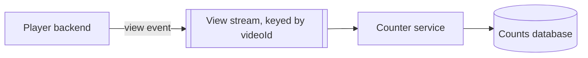
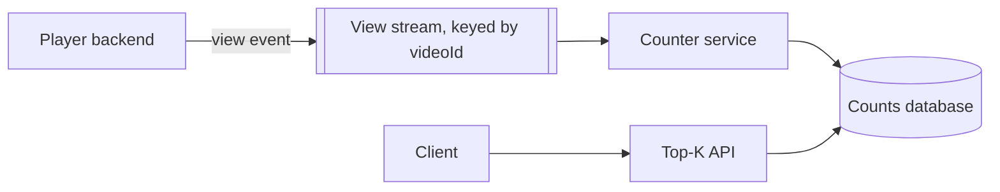
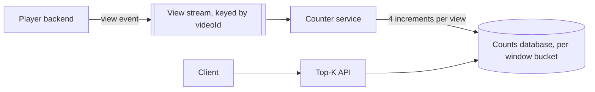
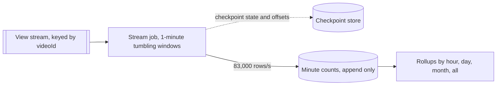
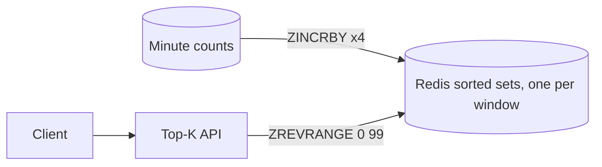
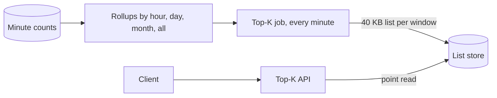
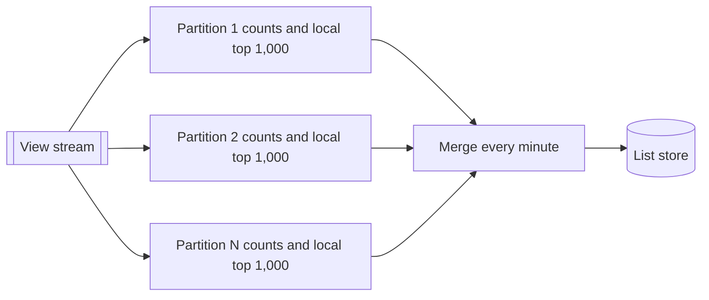
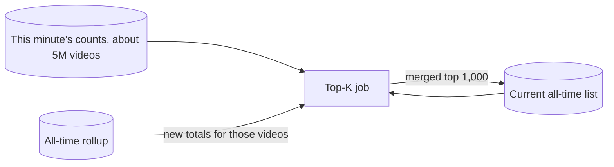
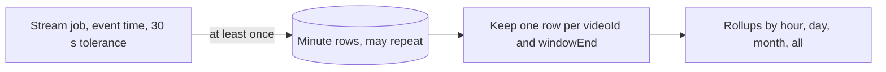
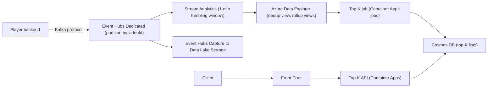

## Understanding the problem

**What is a top-K videos service?** It shows the $K$ most-viewed videos for a window of time, such as the last hour or all time, on a platform where every play counts as a view. Viewers browse it, creators watch it, and it has to agree with the view counts shown elsewhere in the product.

Two things make it hard. Views arrive at hundreds of thousands a second and must be counted exactly, so no database can take one write per view. And a ranking compares the counts of billions of videos, while a read has to come back in tens of milliseconds.

## Functional requirements

1. The player backend should be able to report every view of every video as it happens.
2. Clients should be able to get the all-time top $K$ most-viewed videos, with $K$ up to 1,000.
3. Clients should be able to get the top $K$ for the last full hour, day, or month.
   - Windows are tumbling and aligned to the clock. "Last hour" at 10:06 means 09:00 to 10:00.

**Below the line (out of scope)**

- **Arbitrary time ranges.** "Top videos from March 3 to March 17" can't be computed ahead of time, so it needs a separate query path over the counts.
- **Sliding windows.** "The last 60 minutes, updated every minute" means recomputing every list every minute instead of once when a window closes.
- **Per-category or per-country lists.** They multiply the number of lists, not the design.
- **Bot and fraud filtering.** An upstream system decides which plays count. This one counts what it's given.
- **$K$ above 1,000.** Nobody reads past the first page, and a fixed $K$ keeps each stored list small.

These three cover what a viewer sees, a list per window plus the stream that feeds it. The items below the line either break the assumption that windows close, belong to an upstream system, or only multiply lists.

## Non-functional requirements

1. **Exact counts.** The list matches the view counts shown on each video. No sampling or sketches unless the interviewer relaxes this.
2. **Fresh.** A view shows up in the all-time list within 3 minutes, and an hour, day, or month list is ready within 2 minutes of its window closing.
3. **Fast reads.** A query returns in tens of milliseconds.
4. **Scale.** 70 billion views a day, the published daily view count of a large short-video platform, across 4 billion videos.
5. **No lost or double-counted views.** A failed processing node loses nothing and counts nothing twice.

**Below the line**

- **Read throughput.** Everyone sees the same list, so a short cache absorbs any read rate.
- **Strong consistency between windows.** The hourly and all-time lists may disagree by up to a minute while the pipeline catches up.

The properties that shape this design are the write rate and the size of the set being ranked. 70 billion views a day is about 810,000 a second on average and 1.6 million at a 2× peak, and at 100 bytes an event that is about 160 MB/s. That decided that no database takes a write per view, so counting has to aggregate in memory first. Ranking all 4 billion videos in one sorted structure at about 100 bytes per entry is about 400 GB in one key, which can't be split across shards. That decided that lists are computed once and stored, not ranked on demand. Reads are the easy part. See [back-of-the-envelope estimation](../01-fundamentals/back-of-the-envelope.md).

:::tip
Ask "exact or approximate?" in the first two minutes. Approximate counts allow a count-min sketch and a far smaller design, and the interviewer's answer decides the rest of the hour.
:::

## Core entities

- **View.** One play of one video, with the time it happened.
- **Video count.** How many views one video got in one window, such as the 09:00 hour or all time.
- **Top-K list.** The 1,000 most-viewed videos for one window, with their counts and when the list was computed.

I'd tell the interviewer that fields come later, next to the store that holds them.

## API

Views don't arrive over an HTTP API. The player backend already knows when a play counts, so it publishes an event to a stream, and this system consumes it. Lists are read over REST. Every viewer sees the same list, so the read needs no user identity and responses can be cached. Lists change at most once a minute, so clients poll and nothing needs a push channel. See [API design](../01-fundamentals/api-design.md).

Requirement 1 is a view event on the `views` topic, keyed by `videoId` so every view of one video lands on one partition. The `viewId` lets the player backend send each view exactly once.

```json
topic: views   key: v_8f3k2
{ "viewId": "9b1e7c", "videoId": "v_8f3k2", "eventTime": "2026-10-14T09:59:58.120Z" }
```

Requirement 2 is a read of the all-time list. `computedAt` tells the client how fresh it is.

```http
GET /v1/top-videos?window=all&k=100

200 OK
{ "window": "all", "computedAt": "2026-10-14T10:06:00Z", "items": [{ "videoId": "v_8f3k2", "views": 91234567890 }] }
```

Requirement 3 is the same read for a closed window. The response names the bucket it covers, here the 09:00 hour.

```http
GET /v1/top-videos?window=hour&k=100

200 OK
{ "window": "hour", "bucket": "2026-10-14T09", "computedAt": "2026-10-14T10:01:12Z", "items": [{ "videoId": "v_2kd91", "views": 48211093 }] }
```

## High-level design

Start with the simplest pipeline that returns a correct list, then let the deep dives fix its throughput and latency.

### Data flow

1. The player backend publishes a view event to a stream partitioned by `videoId`.
2. A counter consumes the stream and adds each view to the video's counts.
3. A client asks for a window, and the API returns the top $K$ videos by count for it.

### 1) The player backend can report every view



- **Player backend.** Decides a play counts, for example after a few seconds of watching, and publishes one event.
- **View stream.** A durable, partitioned log. Every view of one video goes to the same partition, in order.
- **Counter service.** Consumers that read the stream and update counts.
- **Counts database.** One row per video.

1. A viewer watches long enough, and the player backend publishes `{ viewId, videoId, eventTime }`.
2. The stream appends it to the partition for `videoId`.
3. A counter consumer reads it and runs `UPDATE video_counts SET views = views + 1 WHERE videoId = ?`.
4. The consumer commits its offset, so a restarted consumer resumes after this event.

The counts database holds `video_counts` with two fields, `videoId` and `views`.

Why a stream instead of calling the counter over HTTP? The stream absorbs spikes, keeps every event for replay after a bug, and lets more consumers read the same views later. See [event streaming](../02-building-blocks/event-streaming.md).

### 2) Clients can get the all-time top K



- **Top-K API.** A stateless service that reads ranked counts.
- **Counts database.** Gains an index on `views`.

1. The client sends `GET /v1/top-videos?window=all&k=100`.
2. The API runs `SELECT videoId, views FROM video_counts ORDER BY views DESC LIMIT 100`. The index on `views` lets the database read the first 100 entries instead of sorting every row.
3. The API returns the list. Nothing changes state on a read.

### 3) Clients can get the top K for the last hour, day, or month



- **Counter service.** Now increments four rows per view, one per window.
- **Counts database.** Counts per video per window bucket instead of per video.

1. A view at 09:59:58 arrives at the counter.
2. The counter increments four rows for that video, for the hour bucket `2026-10-14T09`, the day `2026-10-14`, the month `2026-10`, and `all`.
3. At 10:06 a client asks for the last hour. The API works out that the last full hour is `2026-10-14T09`.
4. It runs `SELECT videoId, views FROM window_counts WHERE window = 'hour' AND bucket = '2026-10-14T09' ORDER BY views DESC LIMIT 100`.

The database now holds `window_counts`, keyed by `videoId`, `window`, and `bucket`, with a `views` field and an index on `(window, bucket, views)`.

This is correct and far too slow. Four increments per view is 3.2 million writes a second at average load, viral videos turn single rows into hot spots, and a month bucket can hold a row for over a billion videos.

## Deep dives

The design returns the right answer for a small site. Now make it hold up at 70 billion views a day.

### 1) How do we count 810,000 views a second exactly, without losing any?

This serves requirements 1, 4, and 5. The counts have to be exact and survive crashes, and no database takes millions of row updates a second.

#### Bad solution: One database increment per view

**Approach.** Keep the high-level design. Each view becomes four `UPDATE` statements, and the consumer commits its offset after them.

**Challenges.** The database needs 3.2 million writes a second at average load. A viral video makes one row the target of thousands of increments a second, and every increment waits on that row's lock. Failure handling is wrong in both directions. If the consumer crashes after the update and before the commit, the view is counted twice on replay, and committing first loses it instead.

#### Good solution: Batch in the consumers

**Approach.** Partitioning by `videoId` means one consumer sees every view of a given video. Each consumer sums views per video in memory for a second, then writes one increment per video per window and commits its offsets. A viral video with 50,000 views in that second becomes one write instead of 50,000. See [scaling writes](../03-patterns/scaling-writes.md).

**Challenges.** It is fast, but no longer exact. A crash after the batch is written and before the offsets commit re-adds the whole batch on replay. Fixing that means storing offsets and counts in one transaction and restoring both together, which is writing a stream processor by hand. The database still takes four increments per video per second.

#### Great solution: A stream job with one-minute windows and checkpoints

**Approach.** Run a stream processing job that counts views per video in one-minute tumbling windows by event time. The job checkpoints its in-memory counts together with its input offsets, so after a crash it restores both and replays from the same point, which counts every view exactly once. When a minute closes, it emits one row per video viewed in it, `(videoId, windowEnd, views)`. At about 5 million distinct videos a minute, that is about 83,000 rows a second, a tenth of the view rate. The rows append to an analytics store, which keeps rollups summing them by hour, day, month, and all time. See [stream processing](../05-advanced/stream-processing.md).



**Challenges.** Counts reach the store up to a minute late, plus however long the job waits for stragglers. That is why requirement 2 gives the all-time list 3 minutes, and deep dive 3 adds up the whole path. Exactly-once processing inside the job doesn't make delivery to the store exactly once, which deep dive 4 handles. You also run a stateful stream engine, or rent one.

:::info
If the interviewer relaxes exactness, a count-min sketch plus a heap per window finds the top $K$ in fixed memory. Its counts are overestimates, so videos near the cutoff can come out in the wrong order.
:::

In a 45-minute interview I'd name the hot-row and double-count problems with the first rung, then go straight to the stream job, because "pre-aggregate per minute, exactly once" is the idea this question tests.

### 2) How do we answer a top-K query in tens of milliseconds?

This serves requirement 3. The rollups hold exact counts, but ranking them is a different job from storing them.

#### Bad solution: Sort the rollups on every request

**Approach.** The API queries the rollup for the requested bucket with `ORDER BY views DESC LIMIT k` on every request, as in the high-level design.

**Challenges.** A month bucket holds a row for every video viewed that month, up to about 1.5 billion. Finding its top 1,000 takes seconds, not tens of milliseconds. An index on `views` doesn't save it, because a column that changes thousands of times a second keeps moving its index entries. And every request repeats the same work for a list that is identical for everyone.

#### Good solution: One Redis sorted set per window

**Approach.** Keep a sorted set for each window bucket, such as `top:hour:2026-10-14T09`. For each minute row, the job runs `ZINCRBY` on the video's member in each of the four sets. A read is `ZREVRANGE key 0 99 WITHSCORES`, which costs $O(\log N + K)$ and returns in about a millisecond.



**Challenges.** A sorted set is one key, and one key lives on one shard. For a game leaderboard with a few million players, this is the right answer. Here, the all-time set holds 4 billion members at about 100 bytes each, about 400 GB in one key, more than any shard holds. Every update to it lands on that one shard too.

#### Great solution: Rollups, plus a list computed once per window

**Approach.** A closed hour never changes again, so compute its top 1,000 once, right after it closes, and store the result. A top-K job runs every minute. It finds windows that have just closed, queries the rollup for that bucket's top 1,000, and writes the list. At 1,000 entries of about 40 bytes, a list is about 40 KB. The API serves each request with one point read by `window` and `bucket`, and caches the list in process for a few seconds. The all-time window never closes, so deep dive 3 keeps it fresh.



**Challenges.** The job does heavy work at window boundaries. Ranking a month's billion-plus rollup rows can take longer than the 2-minute target allows, so maintain the monthly list during the month the same way deep dive 3 maintains the all-time list. The design depends on windows that close, so sliding windows would break it. You also run two stores, the analytics store and the list store.

:::warning
Don't build the daily list by merging 24 hourly top-1,000 lists. A video ranked 1,001st every hour never appears in any of them but can be first for the day. Roll up the counts, not the lists.
:::

In a 45-minute interview I'd mention the sorted set as the game-leaderboard answer, size the all-time set to show why it fails here, and land on computing each list when its window closes.

### 3) How does the all-time list stay within 3 minutes of fresh?

This serves requirement 2. The all-time window never closes, so the list from deep dive 2 has to be recomputed, and the rollup it ranks covers 4 billion videos.

#### Bad solution: Rerank every all-time total each minute

**Approach.** Every minute, run the same top-1,000 query over the all-time rollup.

**Challenges.** At 16 bytes per video, the all-time totals are 64 GB before index overhead. Scanning them 1,440 times a day keeps a large cluster busy just to find a list where at most a few entries changed.

#### Good solution: Per-partition heaps in the stream job

**Approach.** Because the stream is partitioned by `videoId`, each video's full count lives in exactly one partition. Each partition keeps every video's all-time count as keyed state, plus a heap of its local top 1,000. The global top 1,000 is always inside the union of the local lists, so every minute a merge step takes 1,000 candidates from each partition and keeps the best 1,000.



**Challenges.** It is exact and fast, but the stream job now holds 4 billion counters as keyed state and runs custom heap code. Managed SQL-style stream services don't offer that, so this means running your own stream engine, such as Flink, and its state, checkpoints, and upgrades.

#### Great solution: Merge only the videos that changed this minute

**Approach.** Counts only go up, so a video can enter the all-time top 1,000 only in a minute when it got views. Every minute, the top-K job takes the roughly 5 million videos in that minute's counts, looks up their new all-time totals, and merges them into the current 1,000-entry list. Fresh totals replace stale ones, and the job keeps the top 1,000. That touches about 0.1% of videos a minute and stays exact.



**Challenges.** It depends on counts never decreasing. If fraud cleanup ever subtracts views, a video can fall out of the list and the job can't know which video should replace it, so you fall back to the full rerank as an occasional batch. Looking up 5 million totals a minute, about 83,000 a second, has to finish well inside the minute, because most of requirement 2's budget is gone before the job starts. A view waits up to 60 seconds for its minute to close, 30 for stragglers, about 10 to land in the store, up to 20 for the next run, and up to 10 in the API cache. That is 130 of the 180 seconds, so the run has to finish in well under 50. A closed hour skips the first 60 and fits its 2 minutes with the same run time.

In a 45-minute interview I'd state the "counts only go up" argument and the 0.1% figure. It's a short answer that shows you reasoned about the data instead of throwing compute at it.

### 4) How do late and duplicate events keep counts exact?

This serves requirements 1 and 5. Phones send views after going offline, consumers retry, and jobs restart mid-window, so the same minute can be counted twice or a view can arrive after its window closed.

#### Bad solution: Count by arrival time and trust delivery

**Approach.** Assign each view to the minute it reaches the stream job, and sum every row the job writes.

**Challenges.** A view that arrives late lands in the wrong hour, so a backlog after an outage piles into whichever hour the job catches up in. Delivery from the job to the store is at least once, so after a restart the store can receive a minute's rows twice and every rollup counts them twice.

#### Good solution: Count by event time with a late-arrival tolerance

**Approach.** Window by the view's `eventTime` and let the job wait 30 seconds for stragglers before closing a minute, which deep dive 3's freshness budget already counts. A view later than that is adjusted into the window that is still open, not dropped, so no view is lost and totals stay exact, though an hour's edge can blur by a few seconds. See [time, clocks, and ordering](../05-advanced/time-clocks-and-ordering.md).

**Challenges.** Duplicates still get through. A restarted job can deliver the same minute row twice, and the sums count both.

#### Great solution: Event time plus deduplication of minute rows

**Approach.** Keep event time and the tolerance, and put a deduplication step between the minute rows and the rollups. Each minute row has a natural key, `(videoId, windowEnd)`, so the store keeps one copy per key and the rollups sum only those. Duplicate plays from the client are the player backend's job, and it sends one event per `viewId`. See [idempotency and retries](../03-patterns/idempotency-and-retries.md).



**Challenges.** The deduplication step costs storage and compute on 83,000 rows a second. It assumes a replayed row carries the same count as the first copy, which holds when the job restarts from a checkpoint and replays deterministically. Test that by killing the job mid-window and comparing totals.

In a 45-minute interview I'd cover this in two sentences, event time with a tolerance and a dedup keyed on `(videoId, windowEnd)`, unless the interviewer pushes on exactly-once delivery.

## On Azure

The stream job, analytics store, and list store map onto managed services. Views enter through the Kafka endpoint, so existing producers need no new client.



| Component | Azure service | Tier or setting, and why |
| --- | --- | --- |
| View stream | Azure Event Hubs | Dedicated, 2 capacity units, up to 1,024 partitions per event hub. Kafka endpoint for existing producers. |
| Replay copy | Event Hubs Capture | Writes Avro files to Data Lake Storage for backfills and reprocessing. |
| 1-minute counts | Azure Stream Analytics | `TumblingWindow(minute, 1)` and `TIMESTAMP BY eventTime`. Partition key column `videoId` set on the input. Late arrival 30 s, action Adjust. |
| Minute rows and rollups | Azure Data Explorer | Low-latency ingestion on the minute table. A deduplication materialized view on `(videoId, windowEnd)`, with hourly, daily, monthly, and all-time sum views built on it. |
| List computation | Azure Container Apps jobs | Scheduled with cron `*/1 * * * *`. Computes closed windows and the all-time merge. |
| Serving | Azure Cosmos DB for NoSQL | One item per list, partition key `/window`, `id` set to the bucket. Point reads only. |
| API | Azure Container Apps | Caches current lists in process for 10 seconds, behind Front Door. |

### Why these choices

- **Event Hubs Dedicated.** One Standard throughput unit takes in 1 MB/s or 1,000 events a second, and a Standard namespace caps at 40 TUs, 40,000 events a second or about 5% of average load ([scalability](https://learn.microsoft.com/azure/event-hubs/event-hubs-scalability), [quotas](https://learn.microsoft.com/azure/event-hubs/event-hubs-quotas)). Even with producers batching, the 160 MB/s peak would need 160 TUs. Premium is positioned for workloads up to about 160 MB/s per namespace, which leaves no headroom at peak ([Premium overview](https://learn.microsoft.com/azure/event-hubs/event-hubs-premium-overview)). One Dedicated capacity unit ingests roughly 100 to 200 MB/s ([Dedicated overview](https://learn.microsoft.com/azure/event-hubs/event-hubs-dedicated-overview)), so plan on 2 and confirm with a load test.
- **Stream Analytics over self-managed Flink.** Stream Analytics has tumbling windows and event-time handling built in and processes exactly once ([windowing](https://learn.microsoft.com/azure/stream-analytics/stream-analytics-window-functions), [introduction](https://learn.microsoft.com/azure/stream-analytics/stream-analytics-introduction)). One job scales to 66 SU V2, roughly 400 MB/s ([parallelization](https://learn.microsoft.com/azure/stream-analytics/stream-analytics-parallelization)), so the 160 MB/s peak fits if the query parallelizes by partition. At compatibility level 1.2, you get that by setting the partition key column on the input instead of writing `PARTITION BY PartitionId`. Azure's managed Flink, HDInsight on AKS, retired on January 31, 2025 ([HDInsight on AKS](https://learn.microsoft.com/previous-versions/azure/hdinsight-aks/overview)), so Flink means running it yourself. Choose that only for the per-partition heaps of deep dive 3.
- **Late arrivals adjusted, not dropped.** Stream Analytics either drops an event later than the policy or adjusts its timestamp to fit, and the default tolerance is 5 seconds ([event ordering](https://learn.microsoft.com/azure/stream-analytics/event-ordering)). Set it to 30 seconds with Adjust so no view is lost.
- **Azure Data Explorer materialized views.** They always return current results by combining the materialized part with records not yet processed ([materialized views](https://learn.microsoft.com/kusto/management/materialized-views/materialized-view-overview)). A view can sit on another view only if the first is a `take_any(*)` deduplication view, which is exactly this shape. A view query can't use `top` or `sort` ([create materialized view](https://learn.microsoft.com/kusto/management/materialized-views/materialized-view-create)), so the views only sum, and the top-K job ranks with `top` at query time.
- **Low-latency ingestion.** Data Explorer batches ingestion by default for up to 5 minutes, which alone breaks both freshness targets in requirement 2. Enable streaming ingestion or shorten the batching policy on the minute table ([Stream Analytics output to Data Explorer](https://learn.microsoft.com/azure/stream-analytics/azure-database-explorer-output)).
- **Cosmos DB for lists.** A 40 KB list sits well under the 2 MB item limit ([limits](https://learn.microsoft.com/azure/cosmos-db/concepts-limits)), and a point read by `id` and partition key costs fewer RUs than a query ([request units](https://learn.microsoft.com/azure/cosmos-db/request-units)). Front Door can also cache the response for a few seconds, since everyone sees the same list.
- **The game-leaderboard variant.** If the interviewer shrinks the problem to a few million players, an Azure Managed Redis sorted set is the whole answer. With active geo-replication, Learn describes one sorted set serving a global leaderboard ([active geo-replication](https://learn.microsoft.com/azure/redis/how-to-active-geo-replication)).

### Zones and regions

Event Hubs and Stream Analytics are zone-redundant automatically in regions with availability zones ([Event Hubs reliability](https://learn.microsoft.com/azure/reliability/reliability-event-hubs), [Stream Analytics reliability](https://learn.microsoft.com/azure/reliability/reliability-stream-analytics)). Turn on zone redundancy for Container Apps and Cosmos DB. Stream Analytics has no built-in multi-region failover, so a second region means a second identical job. Lists are read-mostly and the same for everyone, so add Cosmos DB read regions and serve from the nearest one. If the primary region fails, lists stop updating but keep serving. For a long outage, rebuild counts from the Capture files in the secondary region.

### Gotcha

Stream Analytics guarantees exactly-once processing but only at-least-once delivery, except to outputs that support exactly-once, such as Cosmos DB, Azure SQL with a unique key, and Azure Table. Azure Data Explorer isn't one of them, so after a job restart it can receive duplicate rows ([event delivery guarantees](https://learn.microsoft.com/stream-analytics-query/event-delivery-guarantees-azure-stream-analytics)). A sum view built on the raw table would count a duplicated minute twice and quietly inflate totals. Build the rollups on the deduplication view keyed on `(videoId, windowEnd)`, and test it by restarting the job mid-window.

See [data choices](../04-azure/data-choices.md), [messaging choices](../04-azure/messaging-choices.md), and [compute choices](../04-azure/compute-choices.md).

## What is expected at each level

### Mid-level

I expect you to put a stream between the player and the counters, partition it by video, and see that one database write per view won't survive 810,000 views a second. Pre-aggregating per minute is the key move, and I'd accept it with some prompting. For reads you should reject sorting on every request and propose a sorted set or a precomputed list. I'd likely need to steer you on the all-time list in deep dive 3 and on duplicates in deep dive 4, and I wouldn't hold the Azure tier math against you.

### Senior

You drive the counting design to a stream job with one-minute windows and say how checkpoints make it exact. You size the all-time sorted set yourself and explain why one 400 GB key fails, then compute lists when windows close. You know why merging hourly lists into a daily one is wrong. You raise late events and event time on your own. I might prompt you toward the "counts only go up" merge in deep dive 3, or on where duplicates enter after a restart.

### Staff+

You treat exactness as a property of the whole pipeline, from `viewId` at the player to checkpointed state in the job to deduplication before the rollups, and you name where each duplicate can enter. You present per-partition heaps and the incremental merge as alternatives and pick by what the team can operate. You check that every stage meets the freshness target, including ingestion latency into the analytics store, and you plan replay from the captured stream for a bad deploy or a lost region. You ask early whether counts can ever decrease, because the incremental merge depends on it.

## Further reading

- [Hello Interview: Design YouTube's top K videos feature](https://www.hellointerview.com/learn/system-design/problem-breakdowns/top-k)
- [The Coding Gopher: A deep dive into Redis](https://thecodinggopher.substack.com/p/a-deep-dive-into-redis)
- [The Coding Gopher: Partitioning, Sharding, and Chunking Explained](https://thecodinggopher.substack.com/p/partitioning-sharding-and-chunking)
- [Stream Analytics windowing functions](https://learn.microsoft.com/azure/stream-analytics/stream-analytics-window-functions)
- [Azure Data Explorer materialized views](https://learn.microsoft.com/kusto/management/materialized-views/materialized-view-overview)
- [Event streaming](../02-building-blocks/event-streaming.md), [stream processing](../05-advanced/stream-processing.md), [caching](../02-building-blocks/caching.md)
