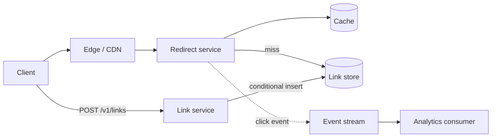
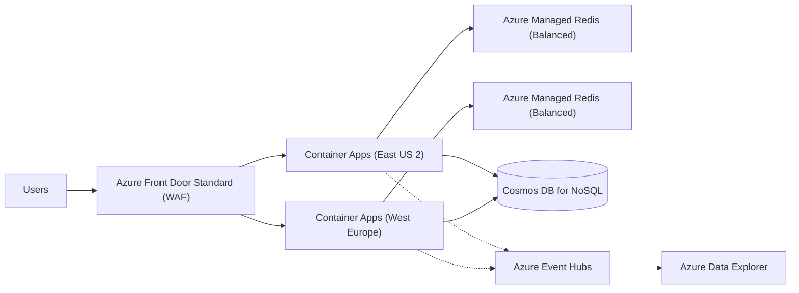

## TL;DR

A URL shortener is a key-value lookup with a 1,000:1 read-to-write ratio. Generate a random 7-character base62 code and let the database reject duplicates with a conditional insert, so no counter service sits on the write path. Serve redirects from a cache in front of a point-read store and answer with `302 Found` so you keep click data and can expire or edit links. Push click events to a stream off the hot path. On Azure: Front Door in front of Container Apps in two regions, Azure Managed Redis for hot codes, and Cosmos DB for NoSQL partitioned on the short code with a single write region.

## Requirements

### Functional

- A user submits a long URL and gets back a short URL.
- A user can request a custom alias (`sho.rt/launch-day`).
- A user can set an expiration time.
- Anyone who opens a short URL is redirected to the original.

Out of scope: user accounts beyond an API key, link analytics dashboards, and spam scanning. Mention them, then park them.

### Non-functional

- Every short code is unique. Two long URLs never share a code, and a custom alias is granted to one requester only.
- Redirect latency under 100 ms at the 99th percentile, measured at the edge.
- 99.99% availability for redirects. Creating links can tolerate more downtime than following them.
- Scale to 1 billion stored links and 100 million daily active users.
- Eventual consistency between regions is fine for reads. A link created in one region may take a second to resolve in another.

The asymmetry matters: reads must be fast and always up, writes must be correct. That split drives every choice below.

## Capacity estimates

Assumptions: 100 million DAU, about 10 redirects per user per day, 1 million new links per day, 500 bytes per stored record (long URL up to 2 KB but usually far less, plus code, owner, timestamps).

| Quantity | Arithmetic | Result |
| --- | --- | --- |
| Redirects per day | 100 M users × 10 | 1 B/day |
| Average redirect rate | 1 B ÷ 86,400 s | about 11,600 req/s |
| Peak redirect rate | 11,600 × 5 (peak factor) | about 58,000 req/s |
| Creates per second | 1 M ÷ 86,400 s | about 12 writes/s |
| Storage for 1 B links | 1 B × 500 B | 500 GB |
| Code space, 7 chars base62 | 62^7 | about 3.5 trillion codes |
| Hot set in cache | top 10 M codes × 500 B | 5 GB |

Two conclusions fall out. Writes are trivial, so the write path can afford a round trip to check uniqueness. Reads are the whole problem: 58,000 lookups per second must mostly hit memory. With a 90% cache hit ratio, the database sees about 5,800 point reads per second. In Cosmos DB a 1 KB point read costs 1 RU ([request units](https://learn.microsoft.com/azure/cosmos-db/request-units)), so that is roughly 6,000 RU/s of read load plus a small write load, well inside one container's autoscale range.

At 1 billion links in 3.5 trillion codes, the chance that a fresh random code collides with an existing one is 1 B ÷ 3.5 T, about 0.03%. A retry is rare enough to ignore for latency.

See [back-of-the-envelope estimation](../01-fundamentals/back-of-the-envelope.md) for the method.

## Core entities and API

### Entities

- **Link**: `code` (primary key), `longUrl`, `ownerId`, `createdAt`, `expiresAt` (nullable), `isCustom`.
- **User**: `id`, `apiKey`. Kept minimal.
- **ClickEvent**: `code`, `timestamp`, `referrer`, `country`. Written to a stream, never to the link table.

### API

```http
POST /v1/links
Authorization: Bearer <api-key>
{ "longUrl": "https://learn.microsoft.com/azure/cosmos-db/partitioning", "alias": "launch-day", "expiresAt": "2026-12-31T00:00:00Z" }

201 Created
{ "shortUrl": "https://<short-domain>/launch-day", "code": "launch-day" }
409 Conflict   (alias taken)

GET /{code}
302 Found
Location: https://learn.microsoft.com/azure/cosmos-db/partitioning
Cache-Control: private, max-age=300
```

Use `302 Found` rather than `301 Moved Permanently`. Browsers cache a 301 with no expiry, so after the first click you never see that user again, cannot count clicks, and cannot make an expired or edited link stop working. A short `private, max-age` keeps repeat clicks fast in the browser without letting shared caches hold stale redirects. See [API design](../01-fundamentals/api-design.md) for status code conventions.

## High-level design

The system has two paths that share only the database.

The **write path**: the client calls the link service, which validates the URL, generates or accepts a code, and inserts the record with a conditional create. If the store says the key exists, the service retries with a new random code (or returns `409` for a custom alias).

The **read path**: the edge receives `GET /{code}` and forwards it to the redirect service in the nearest region. The service checks the cache, falls back to a point read on the store, populates the cache, and returns a 302. It also publishes a click event to a stream without waiting for an acknowledgement on the request path.



Splitting the redirect service from the link service lets you scale and deploy them separately. The redirect service is stateless and read-only, so you can run many replicas and roll it without draining anything.

## Deep dives

### 1. Generating unique short codes

The code must be short, unique, and hard to enumerate.

| Option | How it works | Trade-off |
| --- | --- | --- |
| Hash the long URL | MD5 or SHA-256 of the URL, base62, take 7 chars | Same URL always maps to the same code, which you may not want (two users, different expirations). Truncation still collides, so you need a check anyway. |
| Global counter plus base62 | `INCR` a counter, base62-encode the number | Guaranteed unique with no retry. But the counter is a single point of coordination, codes are sequential and guessable, and in two regions you need range allocation or a shared counter across the WAN. |
| Random code plus conditional insert | 7 random base62 chars, insert only if absent | No coordinator. Uniqueness comes from the store's primary key. Rare retries. |

**Pick: random code with a conditional insert.** The store already enforces uniqueness on the primary key, so you get correctness for free and remove a stateful service from the write path. At 12 writes per second and a 0.03% collision rate, retries cost nothing. Random codes are also not enumerable, which stops scrapers walking `aaaaaa1`, `aaaaaa2`, and so on.

If an interviewer pushes on the counter approach, the fix for its weaknesses is range allocation: each service instance claims a block of 1,000 numbers with one `INCRBY`, then hands them out locally. That cuts counter traffic by 1,000× but still leaves a stateful dependency to keep available in every region. To hide sequence, run the number through a reversible permutation (a small Feistel network) before encoding.

Custom aliases use the same conditional insert with the alias as the key. The store's conflict response is the uniqueness check. See [idempotency and retries](../03-patterns/idempotency-and-retries.md) for making `POST /v1/links` safe to retry with an idempotency key.

### 2. Fast redirects

Three layers each remove load from the next.

1. **Primary key lookup.** The code is the primary key and the partition key, so a redirect is a single point read, not a query. No secondary index is involved.
2. **Cache-aside in an in-memory store.** Popular links follow a power law. A 5 GB cache holding the top 10 million codes absorbs most traffic. Set a TTL on cache entries (for example one hour) and delete the entry when a link is edited or deleted. See [caching](../02-building-blocks/caching.md).
3. **Edge.** The edge terminates TLS close to the user and routes to the nearest healthy region, which removes a cross-ocean round trip. Whether to also cache redirect responses at the edge is a separate decision with a cost: an edge-cached redirect cannot be revoked until it expires or you purge it.

**Pick: point read plus regional cache, edge for routing and TLS, edge caching off for the redirect route.** The cache gets you under 100 ms; edge caching would shave a few more milliseconds but makes deletes and expirations slow to take effect. If a product requirement later demands it, turn it on with an explicit short `s-maxage`.

Hot keys deserve one sentence in an interview: a viral link can send tens of thousands of requests per second to one cache shard. Add a small in-process cache (a few seconds of TTL) in each redirect replica so the hottest codes never leave the process.

### 3. Expiration

Two choices: a sweeper job that scans for `expiresAt < now` and deletes, or a store-level TTL. A sweeper needs an index on `expiresAt` and a scheduler. A store TTL removes both. **Pick: store TTL**, plus a cheap check of `expiresAt` in the redirect service so a link stops working the second it expires even if cleanup lags. Cache entries use `min(1 hour, expiresAt - now)` as their TTL.

### 4. Click analytics without slowing redirects

Writing a click row synchronously would turn every read into a write and double latency. Instead the redirect service sends the event to a stream with a fire-and-forget producer and a local buffer. Losing a handful of clicks during a crash is acceptable for this product; if it is not (paid analytics), see the [ad click aggregator](./ad-click-aggregator.md) for exactly-once counting. See [event streaming](../02-building-blocks/event-streaming.md).

### 5. Scaling to multiple regions

Reads scale by adding read replicas of the store and cache in each region. Writes are where it gets subtle. If two regions both accept writes, two users in different regions can claim the same alias within the same second, and the store resolves the conflict after the fact, so one of them silently loses. Keep a **single write region** with automatic failover. At 12 writes per second the extra cross-region latency on create (around 100 ms) is invisible, and uniqueness stays a local check. See [multi-region active-active](../05-advanced/multi-region-active-active.md) for when that trade flips.

## On Azure



| Component | Azure service | Tier or setting, and why |
| --- | --- | --- |
| Edge, TLS, routing | Azure Front Door | Standard. Global anycast entry, health-probe failover between regions. Choose Premium if you need managed WAF rule sets, bot protection, or Private Link to origins. Do not start on Front Door (classic), which retires March 31, 2027. |
| Redirect and link services | Azure Container Apps | Consumption plan, zone-redundant environment, HTTP scale rule, minimum 2 replicas per region so a zone loss never drops to zero. |
| Hot-code cache | Azure Managed Redis | Balanced tier (4:1 memory to vCPU) sized for about 10 GB with high availability on, which spreads primary and replica across zones. Not Azure Cache for Redis, whose Basic, Standard, and Premium tiers retire September 30, 2028. |
| Link store | Azure Cosmos DB for NoSQL | Container partitioned on `/id` where `id` is the short code. Autoscale throughput, zone redundancy on in each region, one write region plus read regions, service-managed failover. TTL enabled on the container with per-item override. |
| Click stream | Azure Event Hubs | Standard, 2 throughput units to start (1 TU is 1 MB/s or 1,000 events/s in). Kafka endpoint if consumers already speak Kafka. |
| Click analytics | Azure Data Explorer | Ingest from Event Hubs, query by code and time. Optional for the interview. |

### Why these SKUs

- **Cosmos DB `/id` partitioning.** Each link is its own logical partition, so writes spread evenly and every redirect is a 1 RU point read. A logical partition caps at 20 GB and 10,000 RU/s ([partitioning](https://learn.microsoft.com/azure/cosmos-db/partitioning)); a single link never approaches either.
- **Insert, not upsert.** Create items with insert semantics. Cosmos DB returns `409 Conflict` when the id already exists in that partition, which is the uniqueness check from deep dive 1. An upsert would overwrite another user's link.
- **Single write region.** With multiple write regions, Cosmos DB can accept two inserts with the same id in two regions and resolve the conflict later with last-writer-wins ([conflict types](https://learn.microsoft.com/azure/cosmos-db/conflict-resolution-policies)). That breaks the alias guarantee.
- **TTL for expiry.** Set `ttl` per item in seconds. Expired items stop appearing in query responses immediately, but physical deletion runs in the background on leftover RUs ([time to live](https://learn.microsoft.com/azure/cosmos-db/time-to-live)). That is why the redirect service also checks `expiresAt`.
- **Write cost.** Inserting a 1 KB item without indexing costs about 5.5 RU ([request cost](https://learn.microsoft.com/azure/cosmos-db/optimize-cost-reads-writes)). Exclude `longUrl` from the indexing policy since you never query on it; at 12 writes per second this is small either way.

### Zones and regions

Turn on zone redundancy for the Cosmos DB account in each region (no latency cost, per [Cosmos DB reliability](https://learn.microsoft.com/azure/reliability/reliability-cosmos-db)), for the Container Apps environment, and for Azure Managed Redis (high availability). Two regions behind Front Door give regional failover for redirects. Creates fail over when Cosmos DB promotes a read region.

### Gotcha

If you later enable caching on the Front Door route that serves redirects, always send an explicit `Cache-Control` header. When a cacheable response arrives without one, Front Door assigns a random cache lifetime between one and three days ([Front Door caching](https://learn.microsoft.com/azure/frontdoor/front-door-caching)), so a deleted or expired link can keep working for days.

See [data choices](../04-azure/data-choices.md) and [regions, zones, and resiliency](../04-azure/regions-zones-and-resiliency.md) for the general reasoning.

## Interview tips

- State the read-to-write ratio in the first five minutes. It justifies the cache, the point-read key design, and spending a round trip on uniqueness.
- Expect "301 or 302?" Answer with the analytics and revocation trade-off, not just the status code definitions.
- Expect "what if two people pick the same alias at the same time?" The answer is a conditional insert on the primary key, and a single write region so the check is local.
- Do not over-engineer the ID generator. A distributed snowflake-style ID service is the wrong tool for 12 writes per second.
- Likely follow-ups: hot links (in-process cache), abuse (rate limit creates per API key, see the [rate limiter](./rate-limiter.md)), and malicious destination URLs (scan asynchronously and flag, do not block the create).
- Do not store click counts on the link record. Updating one row per click turns a read-heavy system into a write-heavy one and creates hot partitions.

## Further reading

- [Hello Interview: Design a URL shortener like Bitly](https://www.hellointerview.com/learn/system-design/problem-breakdowns/bitly)
- [The Coding Gopher: System Design Interview: URL Shortener](https://thecodinggopher.substack.com/p/designing-a-url-shortener)
- [Azure Cosmos DB partitioning](https://learn.microsoft.com/azure/cosmos-db/partitioning)
- [Azure Front Door caching](https://learn.microsoft.com/azure/frontdoor/front-door-caching)
- [Azure Managed Redis overview](https://learn.microsoft.com/azure/redis/overview)
- [Caching](../02-building-blocks/caching.md), [consistent hashing](../02-building-blocks/consistent-hashing.md), [scaling reads](../03-patterns/scaling-reads.md)
