## Understanding the problem

**What is a URL shortener?** It is a service that trades a long URL for a short one on its own domain, then sends everyone who opens the short link on to the original page. People paste these links into posts, chat messages, and printed QR codes, so a link that took one request to create may be opened millions of times.

Two things make it hard. Reads outnumber writes by about 1,000 to 1, so the redirect path has to answer from memory, and every cache you add for speed makes it harder to take a link back. And every code must be unique, even when two people ask for the same alias in the same second.

## Functional requirements

1. Users should be able to turn a long URL into a short link on our domain.
   - Optionally, they can pick a custom alias such as `sho.rt/launch-day` instead of a generated code.
2. Users should be able to open a short link and land on the long URL.
3. Users should be able to retire a link they own.
   - Either set an expiry time when they create it, or delete it later.

**Below the line (out of scope)**

- **Accounts and teams.** An API key per owner is enough to prove who may delete a link. Sign-up and team management are a separate design.
- **Editing a destination.** It reuses the cache invalidation that delete needs (deep dive 3), so it costs interview time without teaching anything new.
- **Click dashboards.** The redirect still records a click event (deep dive 5), so a dashboard can come later without touching the redirect path.
- **Abuse controls.** Rate-limit creates per API key, as in the [rate limiter](./rate-limiter.md). Scan destinations for malware after the create returns, and flag bad links instead of blocking the request.

I trimmed to create, follow, and retire because an owner needs all three before the product is worth anything. Everything else reuses that machinery or is a system of its own.

## Non-functional requirements

1. **Every code is unique.** A code resolves to exactly one long URL, and a custom alias goes to whoever asked first. Generated codes are not sequential, so nobody can find links by counting up. Creates choose consistency. If the system can't confirm a code is free, the create fails.
2. **Redirects are fast.** The 99th percentile stays under 100 ms, measured at the edge, through a peak of about 58,000 redirects a second.
3. **Redirects stay up.** Redirects are 99.99% available, which allows about 52 minutes of downtime a year. They choose availability over consistency, so a link created in one region may take about a second to resolve in another. Creates can tolerate a longer outage.
4. **Retired links stop working within five minutes.** The bound covers every cache between the visitor and the database, the browser's included.
5. **It holds 1 billion links.** It serves 100 million daily active users, each opening about 10 links a day.

**Below the line**

- **Exact click counts.** A crash may drop a second of click events. Billing-grade counting is the [ad click aggregator](./ad-click-aggregator.md)'s problem.
- **Instant revocation.** Five minutes is the bound. Anything tighter means giving up browser caching of redirects entirely.

The read/write skew shapes this design more than anything else. Requirement 5 works out to 1 billion redirects a day, or about 11,600 a second on average. Assume the peak is five times the average and you get the 58,000 a second in requirement 2. Creates run about 1 million a day, which is 12 a second. That decided two things. The write path can afford an extra round trip to prove a code is free. The read path can't afford any round trip it doesn't need. See [back-of-the-envelope estimation](../01-fundamentals/back-of-the-envelope.md) for the method.

:::tip
Say the 1,000-to-1 ratio in your first five minutes. Every later choice cites it, from the cache to the single write region.
:::

## Core entities

- **Link.** A short code mapped to a long URL, with an owner and an optional expiry.
- **Owner.** The API key holder who created a link and may delete it.
- **Click.** One visit to a short link, kept for analytics and never stored on the link itself.

I'd tell the interviewer that fields come later, next to the store that holds them.

## API

Plain REST covers all three requirements, since nothing pushes data to a client. See [API design](../01-fundamentals/api-design.md) for the status code conventions.

Requirement 1 is a create. The owner comes from the API key in the `Authorization` header, never from the body, so nobody can create links in someone else's name. The `Idempotency-Key` header makes a retried create return the first result instead of a second link.

```http
POST /v1/links
Authorization: Bearer <api-key>
Idempotency-Key: 3f6c1a90-5b2e-4c1d-9a7e-0d4b8e2f7a11
{ "longUrl": "https://learn.microsoft.com/azure/cosmos-db/partitioning", "alias": "launch-day", "expiresAt": "2026-12-31T00:00:00Z" }

201 Created
{ "code": "launch-day", "shortUrl": "sho.rt/launch-day", "expiresAt": "2026-12-31T00:00:00Z" }

409 Conflict   (alias taken)
```

Requirement 2 is the redirect. It needs no authentication, because anyone holding the link may follow it.

```http
GET /launch-day
Host: sho.rt

302 Found
Location: https://learn.microsoft.com/azure/cosmos-db/partitioning
Cache-Control: private, max-age=300
```

Requirement 3 is a delete, plus the optional `expiresAt` on the create. The delete returns 404 for someone else's link instead of 403, so the API never confirms which codes exist.

```http
DELETE /v1/links/launch-day
Authorization: Bearer <api-key>

204 No Content
404 Not Found   (no such link, or not yours)
```

## High-level design

Build one requirement at a time, starting with the fewest boxes that work. Caches, extra regions, and click data wait for the deep dives.

### 1) Users can turn a long URL into a short link

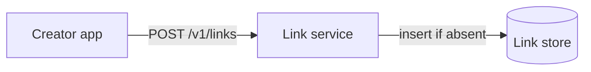

- **Creator app.** The owner's web page or script that calls the API.
- **Link service.** A stateless service that validates input, picks a code, and writes the link.
- **Link store.** A key-value table of links, keyed by short code.

1. The creator app sends `POST /v1/links` with the long URL, an optional alias, an optional expiry, and its API key.
2. The link service resolves the API key to an owner ID and checks the long URL. It must use `http` or `https` and be at most 2 KB.
3. The service picks a code. An alias becomes the code, after a check that it isn't one of our own routes, such as `v1`. Otherwise the service calls `newCode()`, which I'd draw as a box and promise to open in deep dive 1.
4. The service inserts the link with insert-if-absent semantics, so the store refuses a code that already exists. A refused alias returns `409 Conflict`. A refused generated code gets a fresh code and another try.
5. The service returns `201 Created` with the short URL. The only state change is one new row in the link store.

The link store needs only these fields:

- `code`, the primary key.
- `longUrl`, the destination.
- `ownerId`, taken from the API key.
- `expiresAt`, null when the link never expires.

A row is about 500 bytes. The long URL can reach 2 KB but is usually far shorter. A billion links is about 500 GB, which any partitioned key-value store holds, so storage size won't drive any decision below.

### 2) Users can open a short link and land on the long URL

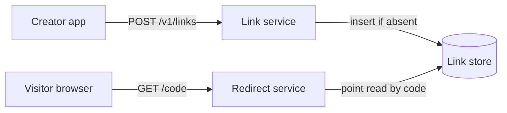

- **Visitor browser.** Anyone who opens a short link. No login.
- **Redirect service.** A second stateless service that only reads.
- **Link store.** The same table, now read by code.

1. The browser sends `GET /launch-day` to `sho.rt`.
2. The redirect service reads the row by its primary key. A point read needs no index, and its cost doesn't grow with the table.
3. If the row exists, the service answers `302 Found` with the long URL in `Location`. If not, it answers `404 Not Found`.
4. The browser follows `Location`. The path writes nothing.

I'd put redirects in their own service from the start. They see 1,000 times the traffic of creates, never write, and hold no session, so you can run many replicas and roll a deploy without draining anything.

Keep step 4 that way. I'd write "click events" in a corner of the whiteboard and come back to them in deep dive 5.

:::warning
A `301 Moved Permanently` looks right, since the link never moves, but browsers cache a 301 with no expiry. After the first click you never see that visitor again, so you can't count their clicks, and a deleted or expired link keeps working for them. Answer `302 Found` with a short `private, max-age`, which keeps repeat clicks fast in the browser without letting shared caches hold the redirect.
:::

Every redirect still reaches the database. At 58,000 a second that won't meet requirement 2, and deep dive 2 fixes it.

### 3) Users can expire or delete a link

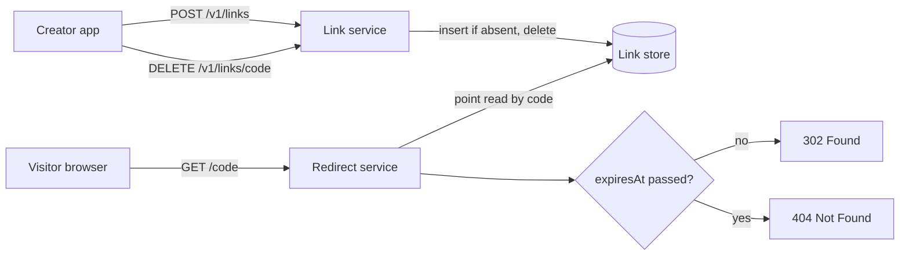

- **Link service.** Gains the delete endpoint and an ownership check.
- **Redirect service.** Gains an expiry check on every read.
- **Link store.** Unchanged, because `expiresAt` was already there.

When an owner deletes a link:

1. The creator app sends `DELETE /v1/links/launch-day` with its API key.
2. The link service reads the row and compares its `ownerId` with the owner behind the key. If there is no row, or the owners differ, it answers 404.
3. If they match, it deletes the row and answers 204. The next redirect for that code finds nothing and gets a 404.

When a link expires:

1. The redirect service compares `expiresAt` with the current time on every read. A past expiry gets the same 404 as a missing row.
2. Expired rows stay in the store for now. Deep dive 3 cleans them up and keeps both paths correct once caches exist.

Why 404 and not `410 Gone`? Once cleanup removes a row, the service can't tell an expired link from one that never existed. Answering 404 in every case keeps the behavior the same before and after cleanup.

## Deep dives

The design works. Now harden it against each non-functional requirement, one problem at a time.

### 1) How do we hand out codes that never collide and can't be guessed?

This serves requirement 1. A code has to be unique, short enough to type, and impossible to predict from the one before it. Six base62 characters give $62^6 \approx 57$ billion codes, which a billion links would already fill to 1.8%. Seven give $62^7 \approx 3.5$ trillion, so plan on seven.

:::warning
Don't design a distributed ID generator in the style of Snowflake here. That design mints time-ordered IDs on many machines at once, and this system creates 12 links a second.
:::

#### Bad solution: Hash the long URL and keep seven characters

**Approach.** Run the long URL through SHA-256, encode the digest in base62, and keep the first seven characters. The same input always produces the same code, and no state is involved.

**Challenges.** Determinism is the problem. Two owners who shorten the same page get the same code, so they share one expiry, and one owner's delete breaks the other's link. Seven characters of a hash also collide across different URLs, so you still need a uniqueness check and a fallback such as salting and hashing again. At that point the hash buys you nothing a random number doesn't.

#### Good solution: Lease blocks from a shared counter

**Approach.** Keep one counter in Redis. Each link-service instance claims a block of 1,000 numbers with a single `INCRBY` and hands them out from memory, which cuts counter traffic by a factor of 1,000. Encode each number in base62. To hide the sequence, first pass the number through a reversible permutation, such as a small Feistel network, so consecutive links don't get neighboring codes.

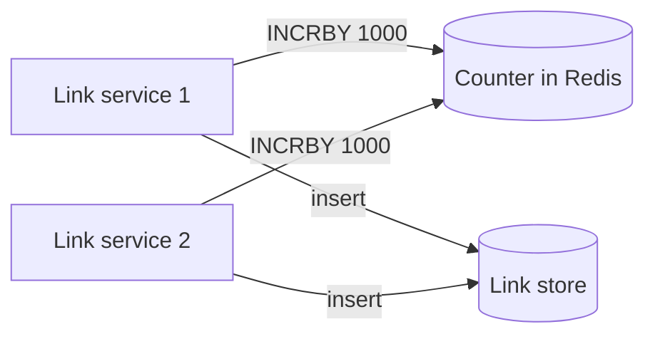

**Challenges.** Codes are unique by construction, but the counter is now a stateful service that every create depends on. In two regions you either give each region a disjoint range or pay a cross-region round trip for every block. A crashed instance loses the rest of its block, which only leaves gaps. A custom alias can also take a code the counter reaches later, so the store must still reject duplicates.

#### Great solution: Random codes with insert-if-absent

**Approach.** Draw seven base62 characters from a cryptographic random generator, then insert with create-only semantics. The store's primary key is the uniqueness check. If the store reports the key exists, draw again. Custom aliases use the same insert, and a refusal becomes the 409. With 1 billion links in 3.5 trillion codes, a fresh code collides about 0.03% of the time. At 12 creates a second that is one retry roughly every five minutes, and no extra service sits on the write path.

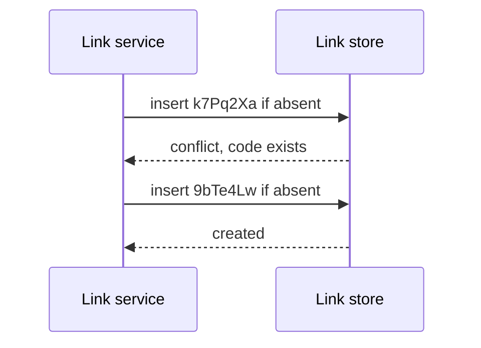

**Challenges.** It depends on the store offering an atomic insert-if-absent, which holds only while one region accepts writes (deep dive 4). Retries climb as the space fills. At 350 billion links one create in ten would retry, and you'd move to eight characters, about 218 trillion codes. A client that retries after a timeout could also mint a second link for one request, which is why the create takes an `Idempotency-Key` (see [idempotency and retries](../03-patterns/idempotency-and-retries.md)).

In a 45-minute interview I'd go straight to the great solution and give the counter one sentence, since it adds a stateful dependency to solve a problem the primary key already solves.

### 2) How do we answer 58,000 redirects a second with p99 under 100 ms?

This serves requirement 2. The high-level design reads the store on every click, and the numbers say that can't last.

#### Bad solution: Read the store on every click

**Approach.** Keep the high-level design. The code is both the primary key and the partition key, so each redirect is one point read. In Cosmos DB, which the Azure section picks, a point read of a 1 KB item costs 1 [request unit](https://learn.microsoft.com/azure/cosmos-db/request-units) (RU).

**Challenges.** At peak that is 58,000 RU/s spent on redirects alone. All clicks for one code also land in one logical partition, which Cosmos DB caps at 10,000 RU/s, so a single viral link gets throttled while the rest of the database sits idle. A visitor on another continent pays a cross-ocean round trip on every click.

#### Good solution: Cache-aside in Redis

**Approach.** Put Redis next to the redirect service. On each click the service reads Redis first. On a miss it does the point read, writes the long URL to Redis with a one-hour TTL, and answers. Clicks follow a power law, so a small hot set carries most of the traffic. The top 10 million codes at 500 bytes each is 5 GB, which fits one cache with room to spare. At a 90% hit ratio the store sees about 5,800 reads a second at peak. See [caching](../02-building-blocks/caching.md) for the pattern.

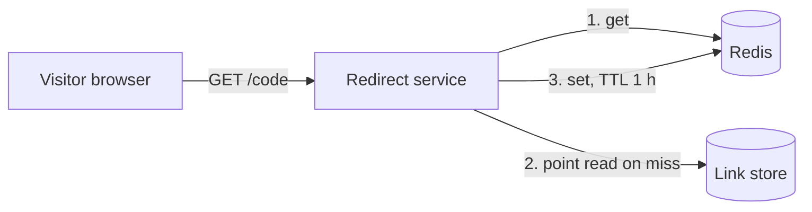

**Challenges.** A viral link now lands on one Redis shard instead of one database partition, and tens of thousands of requests a second for one key can saturate that shard. Distant visitors still cross an ocean. A cached link also outlives its expiry or delete until the TTL runs out, which deep dive 3 handles.

#### Great solution: Route at the edge and keep the hottest codes in process

**Approach.** Put a global edge in front. It terminates TLS close to the visitor and routes each request to the nearest healthy region, which removes the cross-ocean round trip. Inside each redirect-service replica, keep a small in-memory map of the hottest codes with a TTL of a few seconds, so a viral link never leaves the process. Leave edge caching off for the redirect route. See [CDN and edge](../02-building-blocks/cdn-and-edge.md) for what the edge can and can't hold.

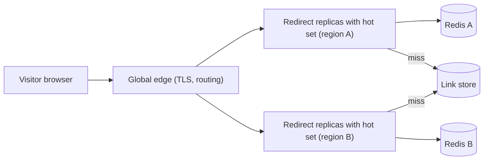

**Challenges.** You now run two regions, which deep dive 4 has to make safe. The in-process copy can serve a deleted link for a few seconds. With edge caching off, every click reaches a region. Edge caching would save a few more milliseconds, but an edge-cached redirect keeps working until it expires or you purge it, which works against requirement 4.

In a 45-minute interview I'd draw the good solution and add the in-process hot set when the interviewer asks about a viral link, because that is the follow-up they are waiting for.

### 3) How does a deleted or expired link stop working within five minutes?

This serves requirement 4. Deep dive 2 put three caches between a visitor and the store: the browser, Redis, and the in-process hot set. Each one can keep a retired link alive. The edge holds nothing, because its caching is off.

:::tip
Name the layer that holds a redirect longest. Here it is the browser, at `max-age=300`, and that number sets the five-minute bound in requirement 4.
:::

#### Bad solution: Sweep nightly and let caches age out

**Approach.** Run a scheduled job each night that finds rows whose `expiresAt` has passed and deletes them. Cache only the long URL in Redis, with a fixed one-hour TTL, and let entries age out on their own.

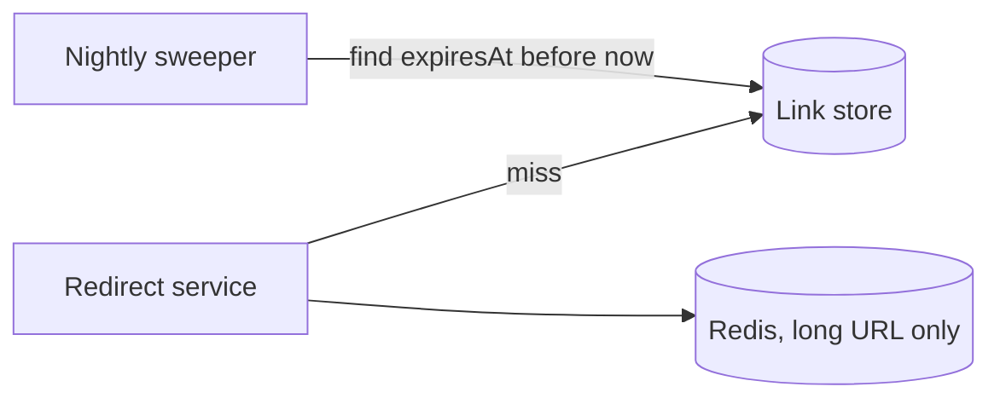

**Challenges.** The job needs a secondary index on `expiresAt` and a scheduler to run it. A cached entry doesn't carry the expiry, so a link that expired at 10:00 keeps redirecting from Redis until 10:59, and a deleted link lives just as long. That misses the five-minute bound by a factor of twelve.

#### Good solution: Carry the expiry in every copy and let the store expire rows

**Approach.** Cache the whole record, long URL and `expiresAt` together, so the redirect service checks expiry on every hit at every layer. Set each Redis TTL to the smaller of one hour and the time left before expiry, and cap the browser's `max-age` the same way. Drop the sweeper and give each row a store-level TTL instead. The store removes expired rows itself, so you need neither the index nor the scheduler.

**Challenges.** Expiry is now exact at every layer. Deletes are not. A delete has no end time known in advance, so a deleted link still lives in Redis for up to an hour.

#### Great solution: Delete through every regional cache

**Approach.** Keep the good solution and make deletes active. After the link service deletes the row, it deletes the key from Redis in every region. It repeats those cache deletes a few seconds later, because a redirect in the far region may have missed Redis, read a replica the delete hadn't reached yet, and put the dead link back. The in-process hot set expires within seconds, and the browser holds the 302 for at most 300 seconds, so the worst case is five minutes.

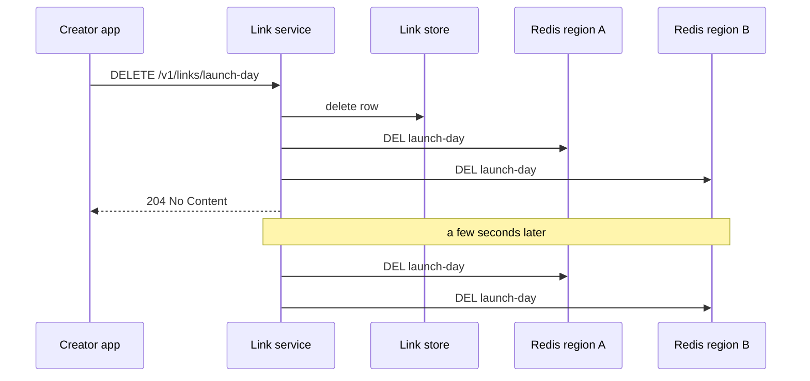

**Challenges.** A delete now costs a call into every region, and the link service must retry it when a region is unreachable. If a region stays cut off, its Redis keeps the dead link until the one-hour TTL. If that is unacceptable, shorten the Redis TTL to five minutes and pay for more misses.

In a 45-minute interview I'd present the good solution and describe the delete fan-out in two sentences, because the replica race is a detail most interviewers save for staff candidates.

### 4) How do redirects survive a region outage without two people winning one alias?

This serves requirements 1 and 3, which pull in opposite directions. Availability wants every region to do everything, and uniqueness wants one place to decide. One regional outage can spend the whole 52-minute yearly budget, so redirects need a second region.

#### Bad solution: Accept writes in every region

**Approach.** Run the full stack in two regions and let each region's database accept creates locally. Creates are fast everywhere, and either region can take all the traffic if the other fails.

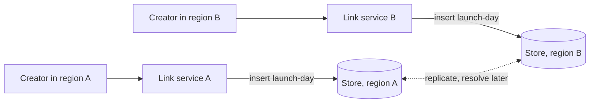

**Challenges.** Two owners can claim `launch-day` in the same second, one in each region. Each local insert succeeds and both get a 201. The database finds the conflict only when it replicates, and under last-writer-wins one owner's link silently disappears. That breaks requirement 1 to speed up a write path that handles 12 creates a second.

#### Good solution: One region, spread across zones

**Approach.** Run everything in one region, with each tier spread across that region's availability zones. Inserts stay local and atomic, and users never notice the loss of one datacenter.

**Challenges.** A full region outage takes redirects down with it, and an outage of an hour spends the yearly budget. Visitors on other continents also pay a cross-ocean round trip on every click, which works against requirement 2.

#### Great solution: One write region, redirects served everywhere

**Approach.** Run the redirect service, Redis, and a read replica of the store in each region, behind the global edge. Send every create and delete to a single write region, and serve redirects from the local replica. Creates pay an extra cross-region hop of around 100 ms, which nobody notices at 12 a second, and insert-if-absent stays a local, atomic check. If the write region fails, the store promotes the read region and creates resume there.

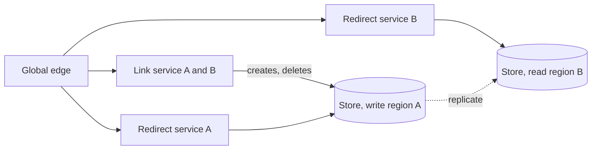

**Challenges.** Replication lag means a brand-new link may 404 in the far region for about a second, so never cache a miss. Failover is not instant. Creates fail until the promotion finishes, while redirects carry on from the surviving region. You also pay for a second region that mostly serves reads. See [multi-region active-active](../05-advanced/multi-region-active-active.md) for when the trade flips toward writing everywhere.

In a 45-minute interview I'd name the alias race, pick the great solution, and move on, because the points come from explaining why the bad solution loses a user's link.

### 5) How do we record clicks without adding a write to every redirect?

This serves requirement 2. Dashboards are below the line, but you can't backfill clicks you never recorded, so the redirect has to capture them from day one without slowing down.

#### Bad solution: Increment a counter on the link row

**Approach.** After each redirect, add one to a `clicks` field on the link's row.

**Challenges.** It turns a read-heavy system into a write-heavy one, with 58,000 writes a second at peak, each costing several times a point read. Every click on a viral link updates one row in one partition, so the hottest links hit the partition's throughput cap first. The write also sits on the redirect path and adds its latency to every click.

#### Good solution: Fire-and-forget events on a stream

**Approach.** The redirect service appends each click, with its code, time, referrer, and country, to an in-memory buffer and returns the 302 without waiting. A background task flushes the buffer to an event stream about once a second, packed into one message per replica. A separate consumer reads the stream and loads an analytics store that answers clicks per code over time. See [event streaming](../02-building-blocks/event-streaming.md) for the building block.

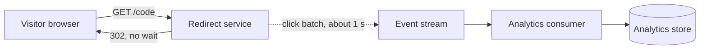

**Challenges.** A replica that crashes loses up to a second of clicks, which the below-the-line list allows. Counts lag by seconds. If clicks ever become billable, you need exactly-once counting, which the [ad click aggregator](./ad-click-aggregator.md) covers.

In a 45-minute interview I'd give this two sentences, because the interviewer mostly wants to hear that a click never touches the link row.

## On Azure

Two regions, East US 2 and West Europe, each run the stateless services and a cache. One Cosmos DB account spans both, with East US 2 as its only write region.

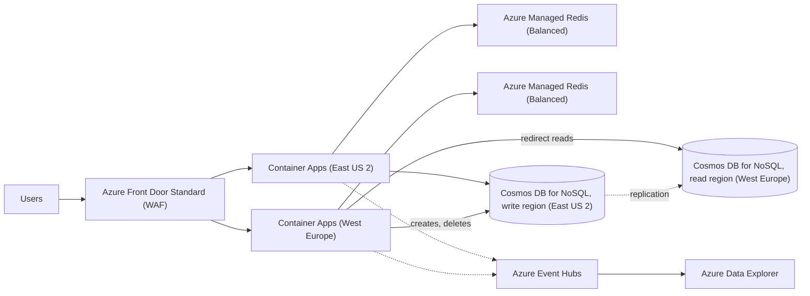

| Component | Azure service | Tier or setting, and why |
| --- | --- | --- |
| Global edge, TLS, routing | Azure Front Door | Standard. Global anycast entry, health-probe failover between regions, and custom WAF rules. Choose Premium if you need Microsoft-managed WAF rule sets, bot protection, or Private Link to origins. Don't start on Front Door (classic), which retires March 31, 2027. Caching stays off on the redirect route. |
| Redirect and link services | Azure Container Apps | Consumption plan, zone-redundant environment, HTTP scale rule, and at least 2 replicas per region so a zone loss never drops a region to zero. |
| Regional cache | Azure Managed Redis | Balanced tier (4:1 memory to vCPU), sized for about 10 GB so the 5 GB hot set has headroom, with high availability on. Not Azure Cache for Redis, whose Basic, Standard, and Premium tiers retire September 30, 2028. |
| Link store | Azure Cosmos DB for NoSQL | Container partitioned on `/id`, where `id` is the short code. Autoscale throughput, zone redundancy in each region, one write region plus a read region, service-managed failover, and TTL on with a per-item override. |
| Click stream | Azure Event Hubs | Standard. One throughput unit (TU) takes in up to 1 MB/s or 1,000 events/s, whichever comes first. Packing each replica's clicks into one event a second makes bytes the limit. At about 200 bytes a click, the 58,000/s peak is 11.6 MB/s, so plan about 12 TUs. Sent one event per click, the same peak would need about 58. |
| Click analytics | Azure Data Explorer | Ingests from Event Hubs and answers clicks per code over time. Optional in the interview. |

### Why these tiers

- **Partition on the code.** Each link is its own logical partition, so writes spread evenly and every redirect is a 1 RU point read. A logical partition caps at 20 GB and 10,000 RU/s ([partitioning](https://learn.microsoft.com/azure/cosmos-db/partitioning)). One link never nears the storage cap, and the caches keep a viral link far below the throughput cap. Cosmos DB enforces `id` uniqueness only within a partition key value, so using the code as both `id` and partition key makes the check global.
- **Insert, not upsert.** Create items with insert semantics. Cosmos DB returns `409 Conflict` when the id is already taken in that partition ([status codes](https://learn.microsoft.com/rest/api/cosmos-db/http-status-codes-for-cosmosdb)), which is the uniqueness check from deep dive 1. An upsert would overwrite another owner's link.
- **Single write region.** With multiple write regions, Cosmos DB can accept two inserts with the same id in two regions and resolve the insert conflict afterward, by default with last-writer-wins on the `_ts` timestamp ([conflict types](https://learn.microsoft.com/azure/cosmos-db/conflict-resolution-policies)). That is the bad solution from deep dive 4.
- **TTL for expiry.** Set `ttl` per item in seconds, overriding the container default. Expired items stop appearing in query responses immediately, but physical deletion runs in the background on leftover RUs ([time to live](https://learn.microsoft.com/azure/cosmos-db/time-to-live)). The redirect service still checks `expiresAt`, so it never depends on deletion timing.
- **Request units.** With a 90% hit ratio, the 58,000/s peak sends about 5,800 point reads a second to Cosmos DB, roughly 6,000 RU/s. Inserting a 1 KB item without indexing costs about 5.5 RU ([request cost](https://learn.microsoft.com/azure/cosmos-db/optimize-cost-reads-writes)), so 12 creates a second add well under 100 RU/s. Exclude `longUrl` from the indexing policy, since nothing queries it.

### Zones and regions

Turn on zone redundancy for the Cosmos DB account in each region. Learn reports no discernible effect on latency ([Cosmos DB reliability](https://learn.microsoft.com/azure/reliability/reliability-cosmos-db)). Do the same for the Container Apps environment, and decide at creation, because the setting can't change afterward ([Container Apps reliability](https://learn.microsoft.com/azure/reliability/reliability-container-apps)). Azure Managed Redis with high availability places its nodes in different zones ([Azure Managed Redis reliability](https://learn.microsoft.com/azure/reliability/reliability-managed-redis)). Two regions behind Front Door give redirects regional failover. Creates fail over when Cosmos DB promotes the read region, and service-managed failover can take an hour or more. That is why requirement 3 lets creates tolerate a longer outage than redirects.

### Gotcha

If you later turn on caching for the Front Door route that serves redirects, always send an explicit `Cache-Control` header. When a cacheable response arrives without one, Front Door picks a random cache lifetime between one and three days ([Front Door caching](https://learn.microsoft.com/azure/frontdoor/front-door-caching)), so a deleted or expired link can keep working for days.

See [data choices](../04-azure/data-choices.md), [compute choices](../04-azure/compute-choices.md), and [regions, zones, and resiliency](../04-azure/regions-zones-and-resiliency.md) for the general reasoning.

## What is expected at each level

### Mid-level

I expect you to build the create and redirect paths without help. That means a POST that stores a row keyed by code, and a GET that reads it by primary key and answers with a redirect. Your uniqueness answer has to hold, whether it is a counter or a conditional insert, even if you start from a hash and I have to point at the collision. If I ask why 302 and not 301, you should reason it out from browser caching. I'd expect to prompt you toward the cache in deep dive 2, and sizing it from the hot set is a plus. I wouldn't hold deep dives 3 to 5 against you.

### Senior

You state the read/write skew early and drive deep dives 1 and 2 yourself. You compare the leased counter with random codes on concrete terms, such as the counter's cross-region dependency against a 0.03% retry rate, and you commit to one. You size the cache from the 5 GB hot set and bring up the viral link before I do. In deep dive 3 I want the revocation trade, meaning why edge caching stays off and why the cached record carries `expiresAt`. You may need a nudge toward the alias race in deep dive 4, but once you see it you should reach a single write region.

### Staff+

You treat this as a system you will run. You raise the alias race under multi-region writes unprompted, choose a single write region, and say what failover costs. Creates stop while the store promotes a region, and redirects carry on. You trace a delete through every cache layer, including the replica refill race, and put a number on the worst case. You catch that a click counter on the link row would make this a write-heavy system and route clicks to a stream instead. You also cover abuse on your own, with random codes against enumeration, create limits per API key, and malware scanning that doesn't block the create.

## Further reading

- [Hello Interview: Design a URL shortener like Bitly](https://www.hellointerview.com/learn/system-design/problem-breakdowns/bitly)
- [The Coding Gopher: System Design Interview: URL Shortener](https://thecodinggopher.substack.com/p/designing-a-url-shortener)
- [The Coding Gopher: Why Scaling Redis is Harder Than You Think](https://thecodinggopher.substack.com/p/why-scaling-redis-is-harder-than)
- [Azure Cosmos DB partitioning](https://learn.microsoft.com/azure/cosmos-db/partitioning)
- [Azure Front Door caching](https://learn.microsoft.com/azure/frontdoor/front-door-caching)
- [Azure Managed Redis overview](https://learn.microsoft.com/azure/redis/overview)
- [Caching](../02-building-blocks/caching.md), [consistent hashing](../02-building-blocks/consistent-hashing.md), [scaling reads](../03-patterns/scaling-reads.md)
