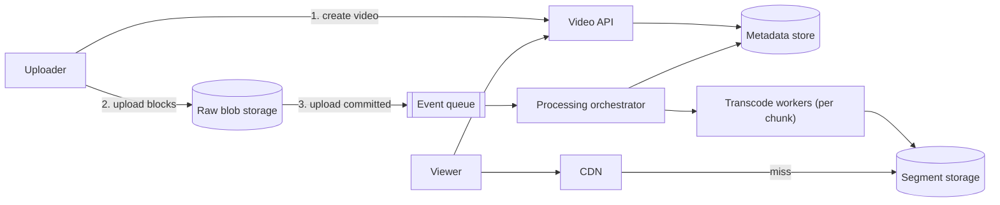
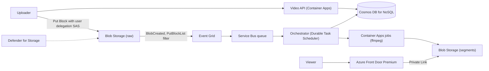

## TL;DR

Clients upload large files directly to blob storage in parallel blocks, so uploads resume after a dropped connection and no app server touches the bytes. A storage event starts a processing workflow that splits the video into chunks, transcodes each chunk into several bitrates in parallel, and packages the result as short segments with a manifest. Players fetch the manifest and switch bitrate per segment as bandwidth changes (adaptive bitrate streaming). Segments are immutable, so the CDN caches them for a year. On Azure: Blob Storage with user delegation SAS and block uploads, Event Grid into Service Bus, a Durable Task orchestration fanning out to Container Apps jobs running ffmpeg, Cosmos DB for metadata, and Azure Front Door Premium with Private Link to the storage origin. Azure Media Services retired in 2024, so the pipeline is yours to run.

## Requirements

### Functional

- Users upload videos, including very large files (tens of GB).
- Users watch videos with quality that adapts to their connection.
- Users see video metadata (title, description, uploader) and processing status.
- Users resume an interrupted upload.

Out of scope: live streaming, recommendations, comments, and monetization. Live reuses the segment-and-manifest model with a different ingest path; mention it and move on.

### Non-functional

- Playback starts within 2 seconds and rebuffers rarely.
- Uploads of large files are reliable on poor networks.
- Highly available for playback; uploads and processing may lag during incidents.
- Scale to 1 M uploads and 100 M views per day.
- Processing completes in minutes, not hours, even for long videos.

## Capacity estimates

Assumptions: average upload 5 minutes long and 300 MB raw; renditions total about half the raw size; average view 5 minutes at 3 Mb/s average delivered bitrate; 1 vCPU-minute to transcode one minute of video into one rendition.

| Quantity | Arithmetic | Result |
| --- | --- | --- |
| Raw ingest per day | 1 M × 300 MB | 300 TB/day |
| Ingest bandwidth | 300 TB ÷ 86,400 s | about 3.5 GB/s, 28 Gb/s |
| Rendition storage per day | 300 TB × 0.5 | 150 TB/day |
| Storage growth per year | (300 + 150) TB × 365 | about 164 PB/year before tiering raw files |
| Delivered bytes per day | 100 M × 300 s × 3 Mb/s ÷ 8 | about 11 PB/day |
| Average egress | 11 PB ÷ 86,400 s | about 130 GB/s, about 1 Tb/s |
| Transcode compute | 1 M × 5 min × 5 renditions × 1 vCPU-min | 25 M vCPU-min/day, about 17,000 vCPUs busy around the clock |

Egress dominates cost and design: 1 Tb/s on average can only come from a CDN. Storage growth makes tiering of raw originals mandatory. Transcoding is a large, bursty batch workload that should scale to zero between bursts.

## Core entities and API

### Entities

- **Video**: `id`, `ownerId`, `title`, `description`, `status` (`uploading`, `processing`, `ready`, `failed`), `durationSeconds`, `manifestUrl`, `createdAt`.
- **Upload**: `videoId`, `blobName`, `blockSize`, `totalBlocks`, `expiresAt`.
- **Rendition**: `videoId`, `resolution`, `bitrate`, `codec`, `segmentPrefix`.
- **WatchProgress**: `userId`, `videoId`, `positionSeconds`.

### API

```http
POST /v1/videos             { title, description, sizeBytes }   -> 201 { videoId, uploadUrl, blockSize }
POST /v1/videos/{id}/complete { blockIds: [...] }                -> 202 { status: "processing" }
GET  /v1/videos/{id}                                             -> 200 { title, status, manifestUrl, ... }
PUT  /v1/users/me/progress/{videoId} { positionSeconds }         -> 204
```

`uploadUrl` is a short-lived signed URL scoped to one blob. The client uploads blocks to it directly. Playback needs no API call beyond metadata: the player fetches `manifestUrl` and segments from the CDN. See [API design](../01-fundamentals/api-design.md).

## High-level design



### Upload path

1. The client creates a video record and receives a signed upload URL.
2. It splits the file into blocks (for example 8 MB), uploads several in parallel, and retries any that fail.
3. It commits the block list. Storage emits a "blob created" event only now, when the file is complete.

### Processing path

1. The orchestrator probes the file, splits it into chunks at keyframes (for example 1 minute each), and fans out one transcode task per chunk per rendition.
2. Workers write fixed-length segments (for example 4 s) for each rendition.
3. The orchestrator writes the manifests, extracts thumbnails, and marks the video `ready`.

### Playback path

The player loads the manifest from the CDN, picks a starting rendition, and requests segments. After each segment it measures throughput and buffer level and may switch rendition for the next one.

## Deep dives

### 1. Large, resumable uploads

| Option | How it works | Problem |
| --- | --- | --- |
| Upload through the API server | Client streams to the app, app writes to storage | App servers carry 28 Gb/s of bytes they never inspect; a timeout loses the whole upload. |
| Single direct PUT to storage | One request with a signed URL | No resume. A 20 GB upload over a phone connection rarely succeeds in one go. |
| Direct block upload with a signed URL | Client uploads numbered blocks, then commits the list | Client logic is more complex, and uncommitted blocks need cleanup. |

**Pick: direct block upload.** Each block is a separate request, so a failure costs one block, not the file. Blocks can upload in parallel to saturate the client's uplink. To resume, the client asks storage which blocks already arrived and sends only the rest. The API servers handle only small JSON requests. See [large blobs](../03-patterns/large-blobs.md).

### 2. Streaming format: progressive download or adaptive segments

- **Progressive download** of a single MP4: simple, but one bitrate. Viewers on slow links stall; viewers on fast links waste quality.
- **Adaptive bitrate (HLS or DASH):** several renditions, each cut into short segments, with a manifest that lists them. The player switches rendition at segment boundaries.

**Pick: adaptive bitrate, packaged as CMAF** (fragmented MP4 segments) so one set of segment files serves both HLS manifests (Apple devices) and DASH manifests (most other players). Packaging once halves storage and CDN cache footprint compared with separate HLS and DASH segment sets. Segment length is a trade-off: 2 s segments switch faster and start sooner; 6 s segments mean fewer requests and better compression. 4 s is a reasonable middle.

A typical ladder: 240p at 400 kb/s, 480p at 1.2 Mb/s, 720p at 3 Mb/s, 1080p at 6 Mb/s, and 4K at 16 Mb/s only for 4K sources. Skip renditions above the source resolution.

### 3. A processing pipeline that finishes in minutes

Transcoding a 2-hour film sequentially into five renditions takes hours. Options:

- **One job per video** that runs ffmpeg for each rendition. Simple, slow for long videos, and a crash at 90% restarts from zero.
- **A chain of queues** (probe, then transcode, then package). Easier to scale each stage, but parallelism within a video is awkward, and the "is everything done?" check needs its own state.
- **A DAG run by a durable orchestrator**: split into chunks, fan out chunk-by-rendition tasks in parallel, fan in, then package.

**Pick: a durable fan-out, fan-in orchestration.** A 2-hour video split into 120 one-minute chunks across five renditions is 600 independent tasks, so it finishes in roughly the time of the slowest task plus packaging. Each task retries alone. The orchestrator's checkpointed state answers "what is left?" without a separate tracking table. See [long-running tasks](../03-patterns/long-running-tasks.md) and [multi-step processes](../03-patterns/multi-step-processes.md).

Split at keyframes (closed GOPs) so chunks decode independently, and force keyframes at segment boundaries in every rendition so the player can switch cleanly.

### 4. Delivering 1 Tb/s

Segments never change once written, so give them `Cache-Control: public, max-age=31536000, immutable` and put the video ID and a version in the path. A re-encode writes to a new path and updates the manifest, so no purge is ever needed. Manifests for on-demand video are also immutable after `ready`; give them a shorter TTL anyway so a fix (for example, adding a rendition) propagates within minutes.

Popularity is a power law. The first viewer in each edge location pulls from origin; everyone after hits the edge cache. Long-tail videos rarely stay cached, which is why the origin must sustain a meaningful share of traffic on its own. See [CDN and edge](../02-building-blocks/cdn-and-edge.md).

### 5. Cost of storing everything forever

At about 164 PB per year, keeping raw originals on the hot tier is the largest avoidable cost. Keep originals (you need them to re-encode with a future codec) but move them to a cold tier after processing. Keep renditions hot for recent and popular videos, and cool for the long tail.

## On Azure



| Component | Azure service | Tier or setting, and why |
| --- | --- | --- |
| Upload target | Azure Blob Storage | Block blobs. User delegation SAS limited to one blob, write-only, valid for hours. |
| Upload events | Azure Event Grid to Service Bus | BlobCreated filtered to `PutBlockList` so processing starts only on a complete file. Service Bus adds retries and a dead-letter queue. |
| Orchestration | Durable Task Scheduler | Fan-out, fan-in over chunk tasks; checkpointed progress per video. |
| Transcoding | Azure Container Apps jobs | Event-driven jobs running ffmpeg, one execution per chunk task, scaling to zero when the queue is empty. Move to AKS if you need custom node types for hardware encoding. |
| Segments | Azure Blob Storage | Hot tier for recent and popular renditions; lifecycle rules move cold ones down. |
| Raw originals | Azure Blob Storage | Lifecycle rule moves to the cold tier after processing (90-day minimum retention applies). |
| Metadata and progress | Azure Cosmos DB for NoSQL | `videos` on `/id`, `progress` on `/userId`. |
| Delivery | Azure Front Door | Premium, for Private Link to the storage origin and managed WAF rules. |
| Malware scanning | Microsoft Defender for Storage | Scan on upload before processing. |

### Why these choices

- **No Media Services.** Azure Media Services retired on June 30, 2024 ([retirement notice](https://learn.microsoft.com/previous-versions/azure/media-services/latest/azure-media-services-retirement)). Encoding and packaging run on your own compute, and delivery is a CDN in front of storage.
- **Block blob limits fit.** A block blob holds up to 50,000 blocks of up to 4,000 MiB each, about 190.7 TiB ([scalability targets](https://learn.microsoft.com/azure/storage/blobs/scalability-targets)). With 8 MiB blocks, a single blob can reach about 390 GiB, so pick the block size from the file size the client reports: `ceil(size ÷ 50,000)` rounded up to a convenient multiple.
- **Resume window.** Uploaded but uncommitted blocks are kept for one week, and a blob can have up to 100,000 uncommitted blocks ([Put Block](https://learn.microsoft.com/rest/api/storageservices/put-block)). The client resumes by calling Get Block List for the uncommitted list ([Get Block List](https://learn.microsoft.com/rest/api/storageservices/get-block-list)) and uploading the missing blocks.
- **Event on commit only.** Filtering BlobCreated to `PutBlockList` (and `PutBlob`, `CopyBlob`) fires only after the blob is fully committed ([blob events](https://learn.microsoft.com/azure/storage/blobs/storage-blob-event-overview)), so the pipeline never sees half a file.
- **Jobs, not apps, for transcoding.** Container Apps jobs start in response to events, do one unit of work, and stop ([jobs](https://learn.microsoft.com/azure/container-apps/jobs)). That matches a task that runs for minutes and should cost nothing when idle.
- **Cold tier for originals.** The cool tier expects at least 30 days of storage and the cold tier at least 90 ([access tiers](https://learn.microsoft.com/azure/storage/blobs/access-tiers-overview)). Originals that may be re-encoded once a year fit cold, not archive, because archive requires rehydration before any read.
- **Immutable segment caching.** Front Door honors `s-maxage`, then `max-age`, then `Expires`, and caches for at most 366 days ([caching](https://learn.microsoft.com/azure/frontdoor/front-door-caching)). Versioned paths make purge unnecessary.

### Zones and regions

Use zone-redundant storage (ZRS) for raw uploads in progress and geo-zone-redundant storage for segments and originals if you need regional durability. Front Door serves from its edge regardless of origin region. Run processing in one or two regions; it is a batch pipeline and can fail over by redirecting the Event Grid subscription.

### Gotcha

Defender for Storage malware scanning covers blobs up to 50 GB ([malware scanning](https://learn.microsoft.com/azure/defender-for-cloud/introduction-malware-scanning)). If you accept uploads larger than that, a scan result will not arrive for those files. Decide up front whether to cap upload size at 50 GB, or treat oversized uploads as unscanned and keep them away from anything that would serve the original file to other users.

See [blob storage](../02-building-blocks/blob-storage.md), [compute choices](../04-azure/compute-choices.md), and [cost optimization](../04-azure/cost-optimization.md).

## Interview tips

- Separate the three paths (upload, processing, playback) on the whiteboard. Each has a different bottleneck: client network, compute, and egress.
- Say "segments plus manifest" and explain why the player, not the server, chooses bitrate.
- Expect "how do you handle a 50 GB upload on hotel Wi-Fi?" Blocks, parallelism, resume from the server's view of received blocks.
- Expect "how long does processing take for a 3-hour video?" Chunked parallel transcoding makes it roughly independent of length.
- Do not put video bytes through your API servers or your database. Both are common early mistakes.
- Follow-ups: codecs (AV1 and HEVC renditions for devices that support them, at extra compute cost), view counting (see the [ad click aggregator](./ad-click-aggregator.md) for exactly-once counting), and copyright fingerprinting as another fan-out task.

## Further reading

- [Hello Interview: Design a video streaming platform like YouTube](https://www.hellointerview.com/learn/system-design/problem-breakdowns/youtube)
- [The Coding Gopher: Partitioning, sharding, and chunking explained](https://thecodinggopher.substack.com/p/partitioning-sharding-and-chunking)
- [Azure Blob Storage scalability targets](https://learn.microsoft.com/azure/storage/blobs/scalability-targets)
- [Reacting to Blob Storage events](https://learn.microsoft.com/azure/storage/blobs/storage-blob-event-overview)
- [Large blobs](../03-patterns/large-blobs.md), [CDN and edge](../02-building-blocks/cdn-and-edge.md), [long-running tasks](../03-patterns/long-running-tasks.md)
