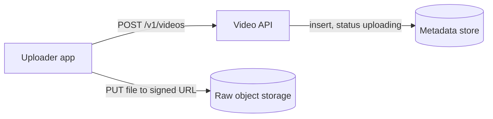
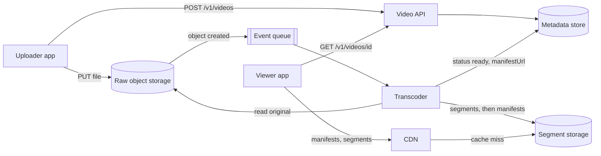
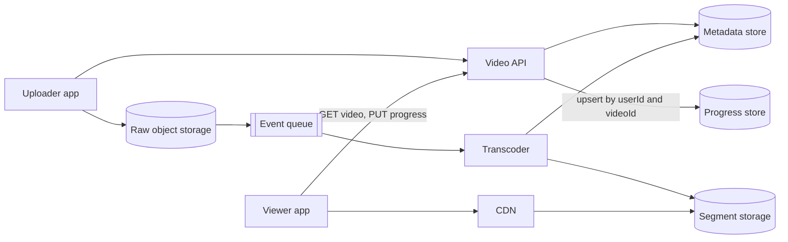
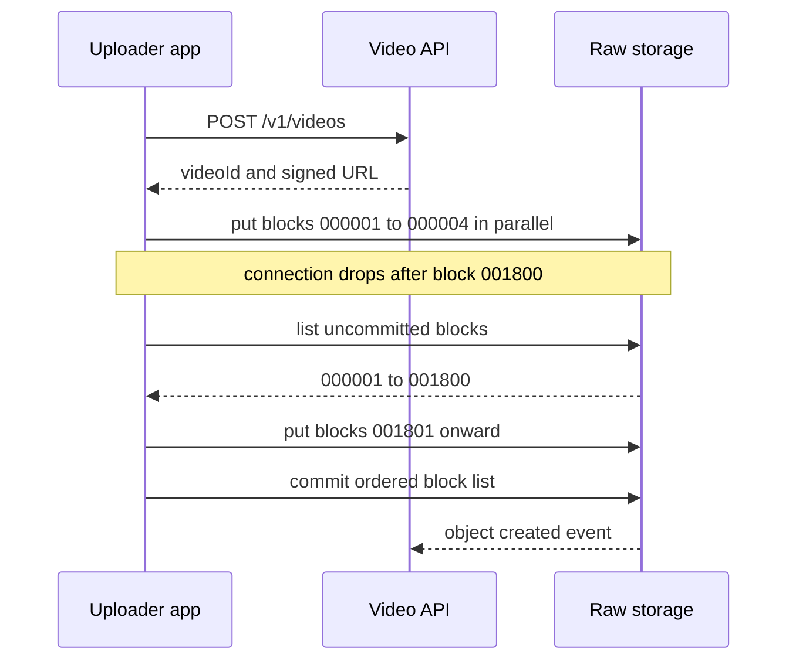
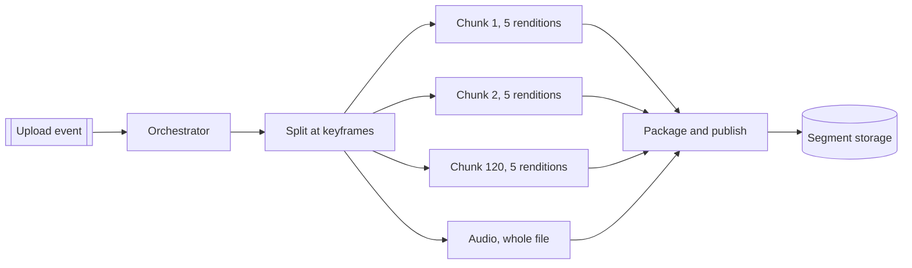
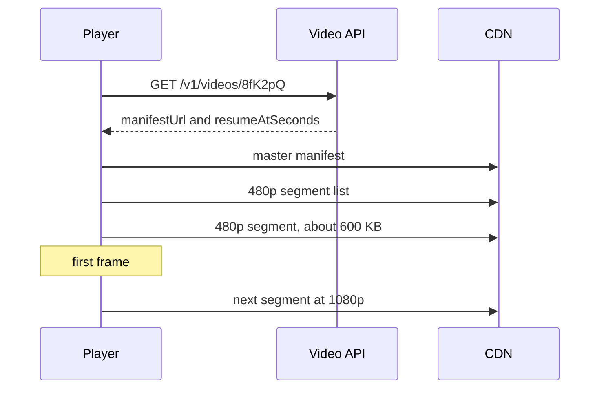
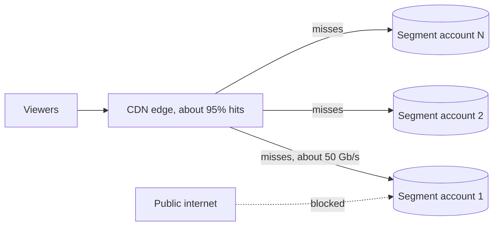
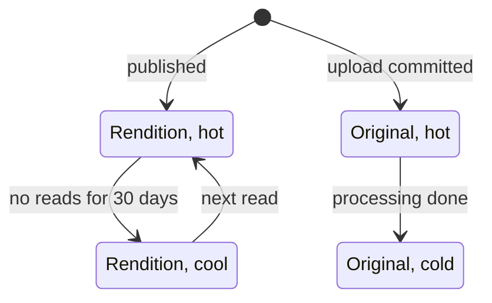
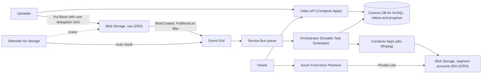

## Understanding the problem

**What is a video streaming platform?** It is a service where people upload videos and anyone can watch them, on a phone on a train or a TV on fiber. Think YouTube. The uploader hands over one large file. The platform turns it into copies at several qualities, and each viewer's player pulls whichever copy its connection can keep up with.

Two things make it hard. The bytes are enormous at both ends, with about 300 TB arriving every day and about 11 PB leaving. And a raw upload is useless to viewers until it has been transcoded, which for a two-hour film is hours of compute that has to finish in minutes.

## Functional requirements

1. Users should be able to upload a video, including files of tens of gigabytes.
   - An upload that drops partway resumes from where it stopped.
2. Users should be able to watch a video at a quality that fits their connection.
   - The uploader sees processing status through the same read.
3. Users should be able to stop a video on one device and resume it on another.

**Below the line (out of scope)**

- **Live streaming.** It reuses segments and manifests, but ingest is a continuous feed with a latency budget of seconds. That is its own design.
- **Search and recommendations.** They read the metadata store and never touch video bytes. See [search](../02-building-blocks/search.md).
- **Comments, likes, and subscriptions.** Ordinary social features with the shape of a [news feed](./news-feed.md).
- **View counts.** Counting 100 million views a day without double counting is the [ad click aggregator](./ad-click-aggregator.md)'s problem.
- **Copyright matching.** It becomes one more task in the processing fan-out (deep dive 2), so I'd mention it and move on.

I trimmed to upload, watch, and resume because those are the paths that move bytes, plus the one per-user write that watching creates. Everything else reads metadata or reuses the pipeline.

## Non-functional requirements

1. **Uploads survive bad networks.** A file of up to 50 GB uploads over a flaky connection, and a drop costs a few megabytes of rework, not a restart.
2. **Playback starts fast and keeps going.** The first frame appears within 2 seconds of pressing play, and the player rebuffers for less than 1% of watch time.
3. **Playback stays up.** Watching is 99.99% available and chooses availability over consistency, so a newly published video may take a few minutes to appear everywhere. Uploads and processing may pause during an incident.
4. **New videos are playable in about 10 minutes.** The bound holds whatever the length, so a two-hour film is ready about as fast as a five-minute clip.
5. **It handles 1 million uploads and 100 million views a day.** Every video is kept forever.

**Below the line**

- **Startup under a second.** It needs segments fetched before the user presses play, which is a client feature with its own bandwidth cost.
- **Per-title encoding.** Tuning the quality ladder for each video saves bytes but needs a trial encode first. A fixed ladder meets every requirement here.

The bytes shape this design more than anything else. Assume an average upload is 5 minutes long and 300 MB raw. A million a day is 300 TB, or about 28 Gb/s of ingest around the clock. Assume a view lasts 5 minutes at an average of 3 Mb/s. A hundred million views is about 11 PB a day, or about 1 Tb/s of egress. That decided two things. Upload bytes go straight from the client to object storage, because no fleet of API servers should carry 28 Gb/s. Playback bytes come from a CDN, because 1 Tb/s has to be served from close to the viewers. See [back-of-the-envelope estimation](../01-fundamentals/back-of-the-envelope.md) for the method.

:::tip
Draw upload, processing, and playback as three separate paths in your first ten minutes. Their bottlenecks are different, namely the client's network, compute, and egress.
:::

## Core entities

- **Video.** One upload and its metadata, with a status that moves from uploading to ready.
- **Rendition.** One encoded quality of a video, stored as short segments and listed in a manifest.
- **Watch progress.** How far one user got in one video.

An upload in flight needs no entity of its own, because deep dive 1 lets storage track which pieces arrived. I'd tell the interviewer that fields come later, next to the store that holds them.

## API

Plain REST covers all three requirements, and video bytes never pass through it in either direction. The user always comes from the bearer token, never from the body. See [API design](../01-fundamentals/api-design.md) for the conventions.

Requirement 1 starts with a create. The response carries a signed URL that lets the client write exactly one object, so the bytes go straight to storage.

```http
POST /v1/videos
Authorization: Bearer <token>
{ "title": "Trip to Lisbon", "description": "Day 3", "sizeBytes": 21474836480 }

201 Created
{ "videoId": "8fK2pQ", "uploadUrl": "https://<upload-host>/raw/8fK2pQ?<signature>", "uploadUrlExpiresAt": "2026-07-01T18:00:00Z", "blockSize": 8388608 }

400 Bad Request   (sizeBytes over 50 GB)
```

Requirement 1 also needs a way to finish a long upload after the signed URL runs out. The video row already exists, so this call only signs a fresh URL.

```http
POST /v1/videos/8fK2pQ/upload-url
Authorization: Bearer <token>

200 OK
{ "uploadUrl": "https://<upload-host>/raw/8fK2pQ?<signature>", "uploadUrlExpiresAt": "2026-07-01T22:00:00Z" }

409 Conflict   (upload already committed)
```

Requirement 2 is a read. It returns the manifest URL for viewers and the status for the uploader. For a signed-in viewer it also returns where they left off, so the player needs a single API call before it starts.

```http
GET /v1/videos/8fK2pQ
Authorization: Bearer <token>

200 OK
{ "title": "Trip to Lisbon", "status": "ready", "durationSeconds": 1342, "manifestUrl": "https://<cdn-host>/v/8fK2pQ/1/master.m3u8", "resumeAtSeconds": 612 }
```

Requirement 3 is a write the player sends while it plays. It is a PUT, so a retried heartbeat does no harm.

```http
PUT /v1/users/me/progress/8fK2pQ
Authorization: Bearer <token>
{ "positionSeconds": 642 }

204 No Content
```

## High-level design

Build one requirement at a time, starting with the fewest boxes that work. Resumable uploads, parallel transcoding, and cache rules wait for the deep dives.

### 1) Users can upload a video



- **Uploader app.** The web page or mobile app that picks the file and sends it.
- **Video API.** A stateless service for metadata. It never sees video bytes.
- **Metadata store.** A key-value table of videos, keyed by video ID.
- **Raw object storage.** A bucket of original uploads, one object per video.

1. The uploader app sends `POST /v1/videos` with the title, description, and file size.
2. The Video API rejects files over 50 GB, then inserts a video row with a random ID and status `uploading`.
3. The API signs a URL that allows a write to exactly one object, `raw/{videoId}`, for a few hours, and returns it.
4. The app sends the file to that URL in one PUT. The API's servers never carry the 28 Gb/s of ingest.
5. When the object is complete, storage emits an object-created event. Nothing consumes it yet. Step 2 adds the consumer.

The metadata store needs only these fields for now:

- `id`, the primary key, random so that new rows don't cluster.
- `ownerId`, taken from the token.
- `title`, `description`, and `sizeBytes`.
- `status`, one of `uploading`, `processing`, `ready`, or `failed`.
- `createdAt`.

A row is under 1 KB. A million new rows a day is about 365 GB a year, which any partitioned key-value store holds.

:::warning
Never route video bytes through the API servers or into the database. It is the most common early mistake in this problem, and the ingest math rules it out before you draw the box.
:::

### 2) Users can watch a video at a quality that fits their connection

A raw upload can't be streamed as is. It might be a 4K file at 50 Mb/s in a codec the viewer's phone can't decode. The fix is adaptive bitrate (ABR) streaming. Encode each video into a ladder of renditions at different resolutions and bitrates, cut each rendition into segments a few seconds long, and publish a manifest that lists them. The player reads the manifest and picks a rendition for every segment.



- **Event queue.** Holds one message per completed upload until a worker takes it, and redelivers it if the worker dies.
- **Transcoder.** A pool of workers that turn one original into every rendition.
- **Segment storage.** Object storage for segments and manifests, laid out by path.
- **CDN.** Edge caches near viewers that serve segments and fall back to segment storage on a miss.
- **Viewer app.** A player in a browser, phone, or TV.

1. The object-created event lands on the queue. A transcoder worker takes it and sets the video's status to `processing`.
2. The worker reads the original and encodes each rung of the ladder, from 240p up to the source resolution. It cuts each rendition into segments.
3. The worker writes segments under `v/{videoId}/{version}/{rendition}/` and the manifests last, so no manifest ever points at a missing segment.
4. The worker sets status `ready` and stores the manifest URL on the video row. The uploader, polling `GET /v1/videos/{id}`, sees the change.
5. A viewer's app calls the same GET and gets the manifest URL.
6. The player fetches the manifests and then segments from the CDN. Each is a plain HTTP GET that any CDN can cache.

The video row gains two fields:

- `manifestUrl`, set when the video is ready.
- `durationSeconds`, read from the original during transcoding.

The manifest is the rendition table. It lists each rendition's resolution, bitrate, codec, and segment URLs, so the metadata store doesn't repeat them.

### 3) Users can resume watching on another device



- **Progress store.** A key-value table of playback positions, one row per user and video.

1. While a video plays, the player sends `PUT /v1/users/me/progress/{videoId}` every 30 seconds, and once more on pause or close.
2. The API upserts one row keyed by user ID and video ID. Last write wins, which is what a user expects when two devices play at once.
3. When the user opens the video on another device, the GET reads both stores and returns `resumeAtSeconds` with the manifest URL.
4. The player starts by fetching the segment that contains that position.

The interval decides the write rate. A hundred million five-minute views is 30 billion watch-seconds a day. A heartbeat every 10 seconds would be 3 billion writes a day, about 35,000 a second. Every 30 seconds it is 1 billion, about 11,600 a second, and a resume lands at most 30 seconds early. 
The progress store holds these fields:

- `userId`, the partition key, so one user's history sits together.
- `videoId`, unique within the user.
- `positionSeconds` and `updatedAt`.

## Deep dives

The design works for a 1 GB clip and a few thousand viewers. Now harden it against each non-functional requirement, one problem at a time.

### 1) How does a 20 GB upload survive a hotel Wi-Fi connection?

This serves requirement 1. At 20 Mb/s of upstream, a 20 GB file takes about 2.2 hours to send. Over that long, a flaky network will drop it at least once.

#### Bad solution: Stream the upload through the API

**Approach.** The app sends the file to the Video API, which writes it to storage as it arrives and marks the video uploaded when the last byte lands.

**Challenges.** The API fleet now carries 28 Gb/s on average and holds a connection open for hours per upload, so it scales with bytes instead of requests. A drop at 19 GB starts the upload over from zero.

#### Good solution: One signed PUT straight to storage

**Approach.** The high-level design. The app sends the whole file to the signed URL in a single request, and the bytes skip the API.

**Challenges.** One request is still one point of failure. A drop at 19 GB starts over, and on a hotel network the retry drops too. Object stores also cap a single-request upload. Azure Blob Storage, which the Azure section picks, takes at most 5,000 MiB in one Put Blob, about 5.2 GB, so a 20 GB file can't go up this way at all.

#### Great solution: Parallel blocks, resumed from the server's list

**Approach.** The app cuts the file into 8 MiB blocks with fixed-length IDs, such as the block number padded to six digits. It uploads four blocks at a time, each with a checksum the store verifies, and retries a failed block on its own. To finish, it sends the ordered list of block IDs, and the store assembles the object. To resume, the app asks the store which blocks it holds and sends the rest. A 50 GB file is about 6,000 blocks, far under the 50,000 a block blob allows, so one block size fits every file under the cap.



**Challenges.** Azure discards uncommitted blocks after a week with no activity, so a resume has a one-week window. The signed URL can run out mid-upload, since 50 GB at 10 Mb/s takes about 11 hours, so the app asks for a fresh one and carries on. Storage also can't enforce the declared size, so a client could commit far more than 50 GB. The pipeline must check the object's real size before it spends any compute.

:::tip
Make the store, not the client, the record of which blocks arrived. A progress file on a laptop dies with the laptop, and the store's block list doesn't.
:::

In a 45-minute interview I'd go straight to blocks, because the first follow-up to a single PUT is always what happens at 19 GB.

### 2) How does a two-hour film become playable in about 10 minutes?

This serves requirement 4. Assume encoding one minute of video into one rendition costs one vCPU-minute. A two-hour film in five renditions is then 600 vCPU-minutes, or 10 hours on one core.

#### Bad solution: One worker per video

**Approach.** The high-level design. One worker takes the message and runs the encoder for every rendition, start to finish.

**Challenges.** Encoders use many threads, but even 8 cores take about 75 minutes for the film. A crash at minute 70 starts over, because the worker kept its progress in memory. Wall-clock time grows with length, which is exactly what requirement 4 rules out.

#### Good solution: A pipeline of stages with a queue between each

**Approach.** Split the work by rendition. A first stage probes the file and posts one message per rendition. Five workers encode in parallel, and a last stage packages and publishes when all five finish. Each stage has its own queue, so a crash retries only that stage's message.

**Challenges.** The slowest rendition still encodes the whole film on one worker, about 120 vCPU-minutes or 15 minutes on 8 cores, and that grows with length. Fan-in is now your problem. Something must know when the fifth rendition finishes, so you keep a counter per video and handle two workers finishing at once.

#### Great solution: Fan out over keyframe-aligned chunks with a durable orchestrator

**Approach.** Split the source at keyframes into chunks of about one minute. A two-hour film becomes 120 chunks, and 120 chunks in 5 renditions is 600 tasks of about one vCPU-minute each. Audio is one more task, encoded whole, because audio frames don't line up with video chunk boundaries. A durable orchestrator, a workflow engine that checkpoints every step, fans the tasks out to a worker pool and fans in to package and publish when all 601 finish. With enough free workers, wall-clock time is the split, a couple of minutes of encoding, and packaging, whatever the length. Copyright matching and thumbnails become more tasks in the same fan-out. See [long-running tasks](../03-patterns/long-running-tasks.md).



**Challenges.** A chunk that doesn't start on a keyframe can't be decoded on its own, and each chunk's encode must place keyframes at segment boundaries, or the seams show as glitches. The orchestrator is another stateful system to run. The fleet is large. A million five-minute uploads in five renditions is 25 million vCPU-minutes a day, about 17,000 vCPUs busy around the clock, so it scales with queue depth over the day rather than to zero. Most uploads are short and split into only 25 tasks, so per-task overhead such as starting a container and fetching the chunk becomes a real share of the work.

In a 45-minute interview I'd draw the fan-out and spend the time on keyframes and fan-in, since why you can't cut anywhere is the usual follow-up.

### 3) How does playback start within 2 seconds and stay smooth?

This serves requirement 2. Startup is a chain of requests, and every one of them counts against the 2 seconds.

#### Bad solution: Progressive download of one file

**Approach.** Encode one 720p MP4 and let the player download it with range requests, starting playback once a few seconds are buffered.

**Challenges.** One bitrate fits nobody. A phone on a weak signal stalls at 3 Mb/s, and a TV on fiber gets a soft picture. If the file's index sits at the end, the player must fetch that first before it can play or seek.

#### Good solution: Adaptive bitrate with separate HLS and DASH outputs

**Approach.** Encode a ladder and cut each rendition into segments of 6 to 10 seconds. A typical H.264 ladder runs 240p at 400 kb/s, 480p at 1.2 Mb/s, 720p at 3 Mb/s, 1080p at 6 Mb/s, and 2160p at 16 Mb/s for 4K sources only. Package twice, as HLS with MPEG-TS segments for Apple devices and as DASH for the rest.

**Challenges.** Two packagings mean two copies of every segment, which doubles segment storage and splits the CDN cache between formats. Long segments make the first download long. A player that starts on the top rung spends its whole budget on one 10-second 1080p segment, which is 7.5 MB and takes 6 seconds on a 10 Mb/s connection.

#### Great solution: CMAF, short segments, and a low first rung

**Approach.** Package once as CMAF, fragmented MP4 segments that both HLS and DASH manifests can point at, so each segment is stored and cached once. Use 4-second segments with a keyframe at every boundary, so the player can switch rendition at any segment. Start on a low rung and climb. A 4-second 480p segment is about 600 KB, which arrives in about half a second at 10 Mb/s. The player moves up as its measured throughput allows.



**Challenges.** Short segments mean more requests and more objects. A five-minute video has 75 segments per rendition, so the platform writes about 375 million segment objects a day, which deep dive 5 has to pay for. A keyframe every 4 seconds costs some compression efficiency. Older devices that play only MPEG-TS lose out, so you either keep a small TS ladder for them or drop them.

:::tip
The player chooses the bitrate, not the server. The server publishes the ladder, and the client switches per segment from its own throughput and buffer, which is why plain HTTP and a CDN are enough.
:::

In a 45-minute interview I'd name CMAF and the low first rung and draw the startup sequence, because it turns 2 seconds into four requests you can budget.

### 4) How do we deliver 1 Tb/s?

This serves requirements 3 and 5. Egress averages about 1 Tb/s, and a premiere can put a million viewers on the same video at once.

#### Bad solution: Serve segments straight from object storage

**Approach.** Point players at segment storage. It is durable, it speaks HTTP, and there is no cache to invalidate.

**Challenges.** Origins have limits. One Azure Storage account in a large region allows 200 Gbps of egress by default, so even the average needs five accounts running flat out. A premiere with a million viewers asks for the same 4-second segment about 250,000 times a second, while a single block blob targets 3,000 requests a second. Distant viewers pay a long round trip on every segment.

#### Good solution: A CDN with default caching

**Approach.** Put a CDN in front of segment storage and let it cache with whatever headers storage sends. Most requests now end at an edge near the viewer.

**Challenges.** Without explicit headers the CDN guesses the lifetime. Azure Front Door picks a random one to three days when no `Cache-Control` arrives, so it re-fetches segments that never change and holds manifests for days. When a new video goes viral, every edge misses on its first request and they all hit the origin together. Storage also stays reachable from the internet, so anyone who finds its URL can skip the cache.

#### Great solution: Immutable versioned paths and a private, sharded origin

**Approach.** Never change the bytes at a URL. Every segment path includes a version number, and a re-encode publishes a new version under a new path. Segments then carry `Cache-Control: public, max-age=31536000, immutable` and stay cached for a year. Manifests get a 5-minute TTL, so a takedown reaches every edge quickly. Spread segments over several storage accounts by a hash of the video ID, and lock storage so only the CDN can read it. Random video IDs also spread segment names across storage partitions, where sequential IDs would pile every new upload onto one. Assume a 95% hit ratio, and the origin sees about 50 Gb/s on average instead of 1 Tb/s. See [CDN and edge](../02-building-blocks/cdn-and-edge.md).



**Challenges.** The long tail still misses, since most videos are watched rarely, and 95% is an assumption to measure, not a promise. Versioned paths make the API decide which version a viewer gets, so rolling back a bad publish means pointing the video row at the old version. A takedown still needs a purge of the video's path.

In a 45-minute interview I'd state immutable segments, the hit-ratio math, and why storage stays private, which covers what most interviewers want here.

### 5) How do we afford to keep every video forever?

This serves requirement 5. Originals add 300 TB a day and renditions about half as much again, so storage grows by about 164 PB a year. Most of it is rarely watched after its first few weeks.

#### Bad solution: Keep everything in the hot tier

**Approach.** One tier for every object. Reads are cheapest, and nothing ever moves.

**Challenges.** Hot storage has the highest price per gigabyte, and the bill grows by 450 TB a day that mostly nobody reads. Originals are read once, by the transcoder, and then sit untouched until the next re-encode.

#### Good solution: Move objects down by age

**Approach.** Lifecycle rules move originals to a cold tier once processing finishes and move renditions to a cool tier 30 days after creation. Both tiers stay online, so a read still works, at a higher price per read.

**Challenges.** Age isn't popularity. A two-year-old video that goes viral is served from the cool tier, and the rule never moves it back.

#### Great solution: Tier by last access, and keep originals out of archive

**Approach.** Track each object's last read. Renditions not read for 30 days move to cool, and a read moves them back to hot. Originals go to cold, not archive, because archive is offline. Reading an archived object needs a rehydration that can take up to 15 hours, and a re-encode for a new codec has to read every original.



**Challenges.** Per-object operations cost money at this object count. With 375 million segment objects a day, every tier change and every last-access update is a billed transaction. One fix is to store each rendition as a single file and serve segments by byte range, which cuts the object count about 75 times. The CDN also hides popularity, since a video that is hot at the edge rarely reads from the origin and can drift to cool. That is fine, because origin reads are exactly what is rare then.

In a 45-minute interview I'd spend a minute here, name access-based tiering and the archive trap, and move on.

## On Azure

One region runs uploads, processing, and metadata. Front Door serves playback from its edge everywhere, and the segment accounts replicate to a second region.



| Component | Azure service | Tier or setting, and why |
| --- | --- | --- |
| Upload target | Azure Blob Storage | Block blobs in a ZRS account. User delegation SAS limited to one blob, write-only, valid for a few hours. |
| Upload events | Azure Event Grid to Service Bus | BlobCreated filtered to `PutBlockList` and `PutBlob`, so processing starts only on a committed file. Service Bus adds retries and a dead-letter queue. |
| Orchestration | Durable Task Scheduler | Fan-out and fan-in over chunk tasks, with a checkpoint per task. Managed, with a dashboard, and no storage account to run. |
| Transcoding | Azure Container Apps jobs | Event-driven jobs running ffmpeg, one execution per chunk task, scaled by Service Bus queue depth. Move to AKS with a Spot node pool to cut cost, or if you need custom node types for hardware encoding. |
| Segments | Azure Blob Storage | Several RA-GZRS accounts, picked by a hash of the video ID. Hot tier with last-access rules down to cool. |
| Raw originals | Azure Blob Storage | Lifecycle rule moves them to cold after processing. Never archive. |
| Metadata and progress | Azure Cosmos DB for NoSQL | `videos` partitioned on `/id`. `progress` partitioned on `/userId` with `id` set to the video ID, so a heartbeat is an upsert of one item. |
| Delivery | Azure Front Door | Premium, for Private Link to the storage origins and managed WAF rules. |
| Malware scanning | Microsoft Defender for Storage | On-upload scanning of the raw account, with results sent through Event Grid. |

### Why these choices

- **No Media Services.** Azure Media Services retired on June 30, 2024 ([retirement notice](https://learn.microsoft.com/previous-versions/azure/media-services/latest/azure-media-services-retirement)). Encoding and packaging run on your own compute, and delivery is a CDN in front of storage.
- **Block blob limits fit.** A block blob holds up to 50,000 blocks of up to 4,000 MiB each, and a single Put Blob takes at most 5,000 MiB ([scalability targets](https://learn.microsoft.com/azure/storage/blobs/scalability-targets)). Fixed 8 MiB blocks need about 6,000 for 50 GB. Every block ID in a blob must be the same length.
- **Resume window.** Uncommitted blocks are discarded a week after the last Put Block ([Put Block](https://learn.microsoft.com/rest/api/storageservices/put-block)). The client resumes with Get Block List and `blocklisttype=uncommitted` ([Get Block List](https://learn.microsoft.com/rest/api/storageservices/get-block-list)).
- **User delegation SAS.** Microsoft recommends it because Entra credentials secure it instead of the account key ([SAS overview](https://learn.microsoft.com/azure/storage/common/storage-sas-overview)).
- **Event on commit only.** Filtering BlobCreated to `PutBlockList` and `PutBlob` fires only after the blob is fully committed ([blob events](https://learn.microsoft.com/azure/storage/blobs/storage-blob-event-overview)), so the pipeline never sees half a file.
- **Jobs, not apps, for transcoding.** An event-driven Container Apps job starts from a Service Bus scale rule, does one unit of work, and stops ([jobs](https://learn.microsoft.com/azure/container-apps/jobs)). The environment's core quota counts every active replica, so request an increase before launch ([quotas](https://learn.microsoft.com/azure/container-apps/quotas)). AKS Spot nodes have no SLA and are evicted when Azure needs the capacity ([Spot node pools](https://learn.microsoft.com/azure/aks/spot-node-pool)), which suits chunk tasks the orchestrator retries.
- **Account shards.** A standard account in a large region such as East US 2 targets 200 Gbps of egress and 40,000 requests a second by default ([account limits](https://learn.microsoft.com/azure/storage/common/scalability-targets-standard-account)). At a 95% hit ratio the origin averages about 50 Gb/s and 4,300 requests a second, so egress sets the count, and four accounts leave room for peaks.
- **Immutable segment caching.** Front Door honors `s-maxage`, then `max-age`, then `Expires`, and caches for at most 366 days ([caching](https://learn.microsoft.com/azure/frontdoor/front-door-caching)). Private Link to a Blob Storage origin needs Premium ([Private Link](https://learn.microsoft.com/azure/frontdoor/private-link)).
- **Cold, not archive, for originals.** Cool expects at least 30 days, cold 90, and archive 180, and archive rehydration can take up to 15 hours ([access tiers](https://learn.microsoft.com/azure/storage/blobs/access-tiers-overview)). Last-access rules need access tracking on, and auto-tier back to hot moves a blob at most once in 30 days ([lifecycle management](https://learn.microsoft.com/azure/storage/blobs/lifecycle-management-overview)).

### Zones and regions

Raw uploads use ZRS, which writes every block synchronously to three or more zones ([redundancy](https://learn.microsoft.com/azure/storage/common/storage-redundancy)), so a zone loss doesn't cost anyone an upload. Segment accounts use RA-GZRS, which adds a readable copy in a secondary region. Put each account's secondary endpoint in the Front Door origin group at a lower priority ([origins](https://learn.microsoft.com/azure/frontdoor/origin)), and cache misses keep working through a regional outage. Processing runs in one region and may pause during an outage, as requirement 3 allows.

### Gotcha

Defender for Storage scans blobs up to 50 GB, and scan time varies with file size, type, and load ([malware scanning](https://learn.microsoft.com/azure/defender-for-cloud/introduction-malware-scanning)). Start transcoding without waiting for the scan, and have the orchestrator hold `ready` until a clean result arrives, or a slow scan eats the 10-minute target. Take the result from Event Grid, not the blob index tags, because Learn notes the tags aren't tamper-resistant.

See [compute choices](../04-azure/compute-choices.md), [cost optimization](../04-azure/cost-optimization.md), and [networking and security](../04-azure/networking-and-security.md) for the general reasoning.

## What is expected at each level

### Mid-level

I expect you to keep video bytes off the API servers with a signed upload URL, and to explain segments and a manifest for playback. A single transcoding worker is fine at first, as long as you can say why a two-hour film is slow on it. I'd expect to prompt you toward resumable blocks and the CDN, and sizing egress is a plus. I wouldn't hold the caching headers or storage tiers against you.

### Senior

You do the ingest and egress math early and let it place direct uploads and the CDN before I ask. You reach parallel blocks with a server-side block list and can explain a resume. You split transcoding into chunk tasks and know the cuts have to land on keyframes. You explain why the player chooses the bitrate and how a low first rung meets the 2-second start. You may need a nudge on fan-in or cache headers.

### Staff+

You treat this as a system you will run and pay for. You set immutable versioned paths and a private origin, and you put a number on origin traffic from an assumed hit ratio. You catch that 25 million vCPU-minutes a day means a fleet that never scales to zero, and you bring up Spot capacity and per-task overhead for short videos. You raise access-based tiering, the archive trap, and the cost of per-object operations. You also gate `ready` on the malware scan and check the committed size without my prompting.

## Further reading

- [Hello Interview: Design a Video Streaming Platform Like YouTube](https://www.hellointerview.com/learn/system-design/problem-breakdowns/youtube)
- [The Coding Gopher: The Top 10 Most Common System Design Questions, Explained](https://thecodinggopher.substack.com/p/the-top-10-most-common-system-design)
- [The Coding Gopher: Partitioning, Sharding, and Chunking Explained](https://thecodinggopher.substack.com/p/partitioning-sharding-and-chunking)
- [Azure Blob Storage scalability targets](https://learn.microsoft.com/azure/storage/blobs/scalability-targets)
- [Reacting to Blob Storage events](https://learn.microsoft.com/azure/storage/blobs/storage-blob-event-overview)
- [Azure Front Door caching](https://learn.microsoft.com/azure/frontdoor/front-door-caching)
- [Durable Task Scheduler](https://learn.microsoft.com/azure/durable-task/scheduler/durable-task-scheduler)
- [Large blobs](../03-patterns/large-blobs.md), [CDN and edge](../02-building-blocks/cdn-and-edge.md), [long-running tasks](../03-patterns/long-running-tasks.md)
