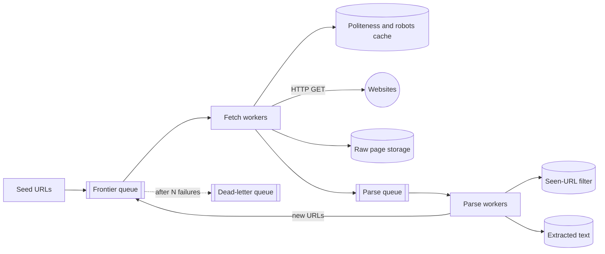
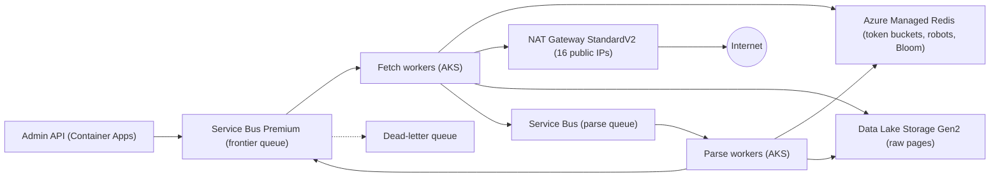

## TL;DR

Split the crawler into a URL frontier (a durable queue), fetch workers, and parse workers. Fetchers check a per-domain politeness limiter before every request, honor robots.txt, store raw pages in large batched files in a data lake, and hand off to parsers. Parsers extract links, normalize them, drop ones already seen using a Bloom filter, and enqueue the rest. Failures retry with exponential backoff through delayed messages and land in a dead-letter queue after a few attempts. On Azure: Service Bus Premium as the frontier, Azure Managed Redis for per-domain token buckets, robots.txt cache, and RedisBloom, AKS for fetch and parse workers, Data Lake Storage Gen2 for pages, and a zone-redundant NAT Gateway with 16 public IPs for outbound traffic.

## Requirements

### Functional

- Start from a set of seed URLs and crawl outward by following links.
- Store the HTML of each fetched page and extract its text for downstream use (for example a search index or a training corpus).
- Respect robots.txt rules and crawl-delay hints.

Out of scope: rendering JavaScript, recrawl scheduling for freshness, and ranking. Mention that JavaScript rendering needs a headless browser fleet, at roughly 10× the cost per page.

### Non-functional

- Crawl 10 billion pages in under 5 days.
- Politeness: never send more than about one request per second to a single domain unless it allows more.
- Fault tolerance: a crashed worker or a down website must not lose progress or stop the crawl.
- No duplicate work: each URL fetched once per crawl, and identical content stored once.
- Scale horizontally by adding workers.

## Capacity estimates

Assumptions: 10 B pages, 5 days, 500 KB average HTML response, 500 ms average fetch time including DNS and TLS.

| Quantity | Arithmetic | Result |
| --- | --- | --- |
| Crawl window | 5 days × 86,400 s | 432,000 s |
| Fetch rate | 10 B ÷ 432,000 s | about 23,000 pages/s |
| Concurrent fetches (Little's law) | 23,000 pages/s × 0.5 s | about 11,500 in flight |
| Download bandwidth | 23,000 × 500 KB | about 11.5 GB/s, 92 Gb/s |
| Raw storage | 10 B × 500 KB | 5 PB |
| URL dedup filter | 10 B URLs × 9.6 bits (1% false positives) | about 12 GB |
| Exact URL set, for comparison | 10 B × 16 B hash, before overhead | 160 GB or more |

The fetch rate is not the hard part; 11,500 concurrent connections fit on a few dozen machines. The hard parts are doing it politely across millions of domains, at 92 Gb/s of outbound connections, without exhausting source ports or overwhelming DNS.

## Core entities and API

### Entities

- **FrontierItem**: `url`, `domain`, `depth`, `attempt`, `notBefore`.
- **DomainState**: `domain`, `robotsRules`, `robotsFetchedAt`, `crawlDelay`, `tokens`, `lastFetchAt`.
- **PageRecord**: `urlHash`, `url`, `fetchedAt`, `status`, `contentHash`, `storagePath` (file plus offset).
- **Seen set**: Bloom filter of normalized URL hashes.

### Interfaces

A crawler has no public API. Its interfaces are the queues between stages:

```text
frontier queue:   { url, domain, depth, attempt }
parse queue:      { url, storagePath, offset, length, contentHash }
admin API:        POST /crawls { seeds, maxDepth, domainAllowList }  -> { crawlId }
                  GET  /crawls/{id}/stats                            -> pages/s, errors, queue depth
```

## High-level design



1. Seeds go into the frontier queue.
2. A fetch worker takes a URL, checks the domain's robots rules and politeness budget, fetches the page, appends it to a raw storage file, and enqueues a parse task.
3. A parse worker reads the page, extracts text and links, normalizes the links, filters already-seen ones, and enqueues new URLs.
4. Failures go back to the frontier with a delay, and to the dead-letter queue after several attempts.

Separating fetch from parse matters: fetch is network-bound, parse is CPU-bound, so they scale differently, and a parser bug can be fixed and re-run over stored pages without re-fetching 5 PB from the web.

## Deep dives

### 1. Politeness

A naive crawler pulling URLs in discovery order hits the same domain hundreds of times a second, because pages link mostly within their own site. That gets you blocked and can take small sites down.

| Option | How it works | Trade-off |
| --- | --- | --- |
| Per-domain queues with one consumer each | Classic Mercator-style frontier: back queues keyed by host, a heap of "next allowed time" | Precise, but you build and operate a custom stateful frontier with millions of queues. |
| Partition a log by domain | All URLs for a domain go to one partition, whose consumer enforces delay locally | No shared state, but one slow domain blocks every other domain in that partition (head-of-line blocking). |
| Shared queue plus per-domain rate limiter | Any worker can take any URL; before fetching, it takes a token from the domain's bucket; if none, it re-enqueues the URL with a delay | Re-enqueue churn on hot domains, but stateless workers and no head-of-line blocking. |

**Pick: shared queue plus a per-domain token bucket** (the same structure as the [rate limiter](./rate-limiter.md)), with a jittered delay on re-enqueue so a thousand URLs for one domain do not all come back at the same instant. Default to 1 request per second per domain, lowered by a robots.txt `Crawl-delay`, raised only for domains on an allow list.

**robots.txt** is fetched once per domain, cached for 24 hours, and checked before every fetch. If robots.txt returns a server error, treat the whole domain as disallowed for that period; if it returns 404, treat it as allow-all. Identify the crawler with a clear User-Agent and a contact URL.

### 2. Fault tolerance and retries

- **Worker crash.** The queue holds a lock on each message while a worker processes it. If the worker dies, the lock expires and another worker gets the message. No progress is lost beyond one URL.
- **Website errors.** A `5xx` or timeout is retried with exponential backoff: re-enqueue with a delay of 1 minute, then 5, then 30. After a few attempts the message goes to a dead-letter queue for inspection instead of retrying forever.
- **Permanent errors.** A `404` or `410` is recorded and not retried.

The alternative of retrying immediately in the worker holds a connection slot hostage and hammers a site that is already struggling. Delayed re-enqueue frees the worker. See [resilience patterns](../03-patterns/resilience-patterns.md) and [message queues](../02-building-blocks/message-queues.md).

### 3. Deduplication

Two kinds of duplicates: the same URL discovered from many pages, and different URLs serving identical content (tracking parameters, mirrors, `http` versus `https`).

**URLs.** Normalize first: lowercase the host, remove default ports, sort query parameters, strip known tracking parameters and fragments. Then:

- **Exact set in a database** with the URL hash as primary key. Exact, but 10 B inserts and lookups against durable storage.
- **Exact set in memory.** 160 GB or more, workable but costly.
- **Bloom filter.** About 12 GB for 1% false positives. A false positive skips a URL that was not actually seen, losing 1% of pages; it never causes a duplicate fetch.

**Pick: Bloom filter** for the crawl's seen set. Losing about 1% of pages is acceptable for a broad crawl, and the memory saving is more than 10×. If a customer needs completeness for specific domains, keep an exact set for those domains only.

**Content.** Store a hash of the normalized page body with each page record. Before storing a new page, check the content hash; if it exists, record the URL as an alias and skip storage. Near-duplicate detection (SimHash) is a good follow-up.

### 4. Storing 10 billion pages

10 B individual 500 KB objects means 10 B object metadata entries and 10 B write requests. Instead, each fetch worker appends pages to a large file (for example 1 GB, in a WARC-like format of header plus body per record) and rolls to a new file when full. The page record stores the file path, offset, and length. That turns 10 B writes into about 5 million files and makes downstream batch processing efficient. See [blob storage](../02-building-blocks/blob-storage.md).

### 5. DNS and outbound connections

At 23,000 fetches per second across millions of domains, DNS resolution becomes a bottleneck and a reliability risk. Run a caching resolver on every worker node and respect TTLs. Outbound TCP connections each consume a source port on the NAT device; reusing connections to the same host (HTTP keep-alive and HTTP/2) cuts port use and TLS handshake time.

## On Azure



| Component | Azure service | Tier or setting, and why |
| --- | --- | --- |
| Frontier and parse queues | Azure Service Bus | Premium for dedicated messaging units. Scheduled messages implement backoff and politeness delays; default max delivery count of 10 before dead-lettering, lowered to 5 for this workload. |
| Duplicate submissions | Service Bus duplicate detection | `MessageId` = hash of normalized URL, window of a few hours, to absorb bursts of the same link from many pages. |
| Politeness, robots cache, seen filter | Azure Managed Redis | Memory Optimized or Balanced, in-memory tier (not Flash) because RedisBloom is required. OSS clustering; domain as hash tag so a domain's keys share a shard. |
| Workers | Azure Kubernetes Service | Separate node pools for fetch (network-heavy) and parse (CPU-heavy), spread across zones. Node-local caching DNS resolver. |
| Outbound | Azure NAT Gateway | StandardV2 (zone redundant) with 16 public IPs, about 1 M SNAT ports. |
| Raw pages and text | Azure Data Lake Storage Gen2 | Hierarchical namespace on, large append files per worker, partitioned by crawl and date. |
| Page records | Parquet files in the same lake | Queried by Spark or Azure Data Explorer later; no transactional database needed. |

### Why these choices

- **Scheduled messages as the delay mechanism.** Service Bus lets you set `ScheduledEnqueueTimeUtc` so a message becomes visible only at that time ([message sequencing and timestamps](https://learn.microsoft.com/azure/service-bus-messaging/message-sequencing)). That is exactly "come back in 30 seconds" for politeness and "come back in 5 minutes" for backoff, with no separate delay queue.
- **Dead-lettering.** A message moves to the dead-letter queue once its delivery count exceeds `MaxDeliveryCount`, which defaults to 10 ([dead-letter queues](https://learn.microsoft.com/azure/service-bus-messaging/service-bus-dead-letter-queues)). Lower it so a broken site does not cost ten attempts per URL.
- **Duplicate detection window.** Service Bus drops messages with a `MessageId` seen within the configured window, from 20 seconds up to 7 days ([duplicate detection](https://learn.microsoft.com/azure/service-bus-messaging/duplicate-detection)). It is a cheap first filter in front of the Bloom filter, not a replacement for it.
- **RedisBloom needs an in-memory tier.** Azure Managed Redis supports RedisBloom on every tier except Flash Optimized ([overview](https://learn.microsoft.com/azure/redis/overview)). A 12 GB filter fits comfortably in a Balanced or Memory Optimized instance.
- **NAT Gateway SKU.** Standard NAT Gateway is zonal; StandardV2 is zone redundant with higher throughput ([NAT Gateway overview](https://learn.microsoft.com/azure/nat-gateway/nat-overview)). A crawler that loses its only outbound path when a zone fails stops entirely.
- **Data Lake Storage Gen2** is Blob Storage with the hierarchical namespace enabled, which gives directory semantics and Hadoop-compatible access for the downstream jobs that read these files ([Data Lake Storage overview](https://learn.microsoft.com/azure/storage/blobs/data-lake-storage-introduction)).

### Zones and regions

Spread AKS node pools across three zones, use NAT Gateway StandardV2, enable Redis high availability, and use ZRS for the lake. A crawl is a batch job: run it in one region. If the region fails, resume elsewhere from the lake and the queue's dead-letter contents; losing hours of crawl progress is acceptable.

### Gotcha

SNAT port exhaustion. Each public IP on NAT Gateway provides 64,512 SNAT ports, and a gateway takes up to 16 IPs, a bit over 1 M ports ([SNAT with NAT Gateway](https://learn.microsoft.com/azure/nat-gateway/nat-gateway-snat)). That sounds like plenty for 11,500 concurrent fetches. But each new connection to the same destination needs a different port, and a closed port goes through a reuse cooldown before it can connect to that destination again. A crawler that opens a fresh connection per request to a popular CDN-hosted domain can run out of ports for that destination while the total looks healthy. Keep connections alive, use HTTP/2 where sites support it, and alert on SNAT connection failures, not just total port usage. Also enable client-side DNS caching: Azure throttles DNS queries per VM ([name resolution](https://learn.microsoft.com/azure/virtual-network/virtual-networks-name-resolution-for-vms-and-role-instances)).

See [networking and security](../04-azure/networking-and-security.md) and [messaging choices](../04-azure/messaging-choices.md).

## Interview tips

- Compute the fetch rate and the concurrency with Little's law early. It shows the fleet is modest and moves the conversation to politeness and dedup, which is where interviewers want to go.
- Say "fetch and parse are separate stages" and give the re-parse argument.
- Expect "how do you avoid hammering one site?" Per-domain token bucket, robots.txt, crawl-delay, jittered re-enqueue.
- Expect "what if a worker dies mid-fetch?" Message lock expiry and redelivery; fetch and store are idempotent per URL and crawl.
- Do not store each page as its own object or each URL as its own database row without discussing the 10 B scale.
- Follow-ups: crawler traps (calendar pages that generate infinite URLs; cap depth and URLs per domain), freshness (recrawl popular pages more often), and JavaScript rendering.

## Further reading

- [Hello Interview: Design a web crawler](https://www.hellointerview.com/learn/system-design/problem-breakdowns/web-crawler)
- [The Coding Gopher: The top 10 most common system design questions, explained](https://thecodinggopher.substack.com/p/the-top-10-most-common-system-design)
- [Azure Service Bus dead-letter queues](https://learn.microsoft.com/azure/service-bus-messaging/service-bus-dead-letter-queues)
- [SNAT with Azure NAT Gateway](https://learn.microsoft.com/azure/nat-gateway/nat-gateway-snat)
- [Message queues](../02-building-blocks/message-queues.md), [idempotency and retries](../03-patterns/idempotency-and-retries.md), [networking essentials](../01-fundamentals/networking-essentials.md)
