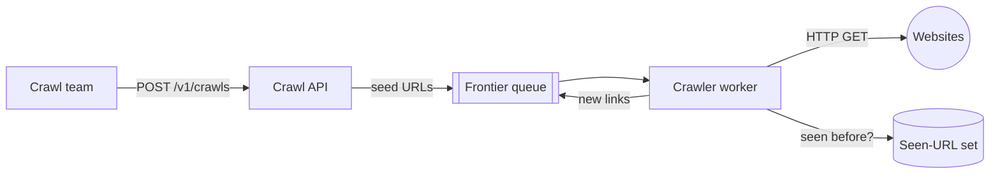
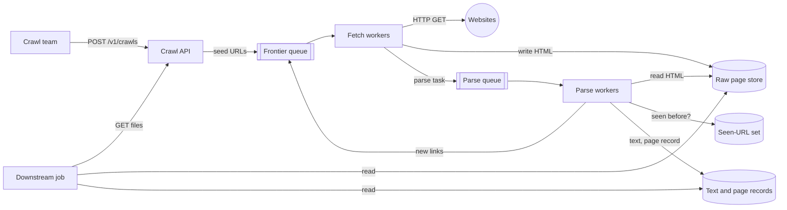
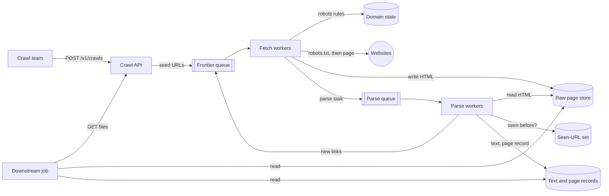
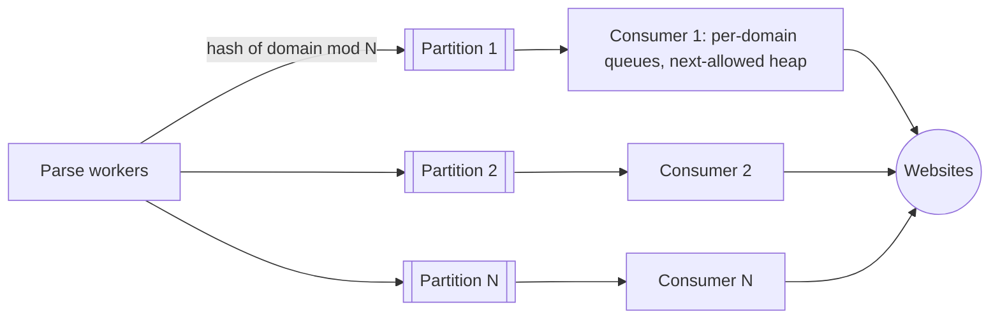
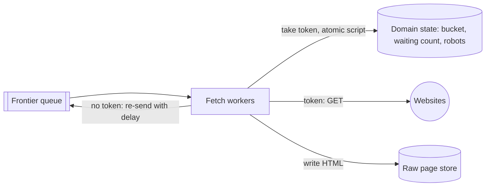
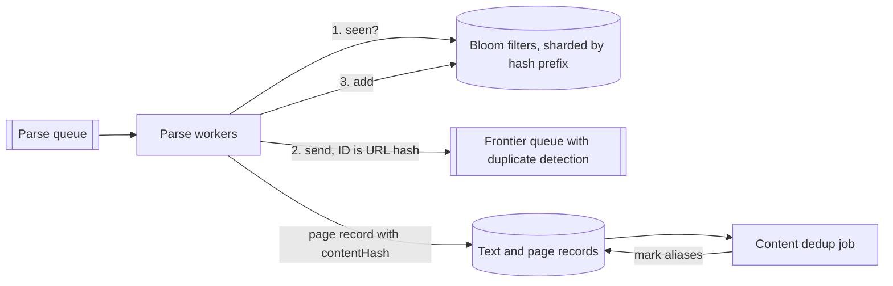
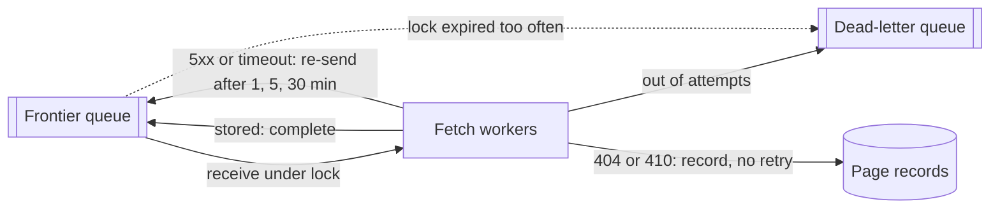
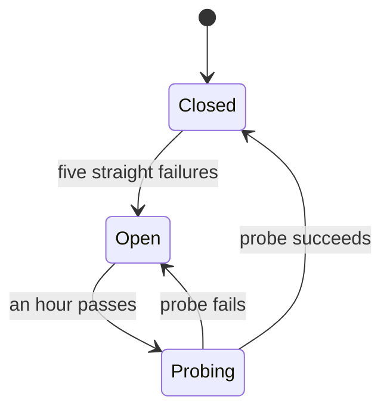
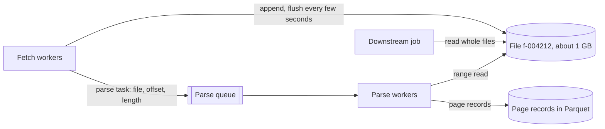
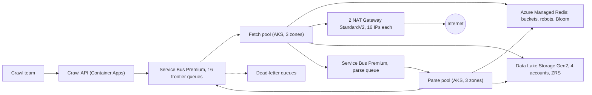

## Understanding the problem

**What is a web crawler?** It is a fleet of workers that starts from a few seed URLs, downloads each page, pulls out its links, and keeps going until it has fetched the part of the web it was asked for. The output is raw HTML and extracted text, which another team turns into a search index or a training corpus.

Fetching fast is the easy part. The hard part is staying welcome. Pages link mostly to their own site, so a naive crawler hammers one domain while thousands wait, and site owners block crawlers that do that. Scale is the other problem. At 10 billion pages, every per-URL question, such as "have I seen this?", gets asked tens of thousands of times a second.

## Functional requirements

1. Users should be able to start a crawl from a list of seed URLs and have it follow links outward.
   - Optionally, they can cap the link depth or restrict the crawl to a list of domains.
2. Users should be able to read the raw HTML and the extracted text of every page the crawl fetched.
3. Site owners should be able to block or slow the crawler with their robots.txt file.

**Below the line (out of scope)**

- **JavaScript rendering.** Pages that build their content in the browser need a fleet of headless browsers, at roughly 10 times the cost per page. Name it and move on.
- **Recrawling for freshness.** It is a scheduler on top of this design, not a change to it.
- **Ranking and indexing.** The crawl hands off files. Search is the downstream team's design.
- **Images, video, and pages behind a login.** They multiply storage and raise legal questions the interview doesn't need.

Three groups touch a crawler. The crawl team starts it, downstream teams read its output, and site owners decide what it may fetch. Everything below the line runs on top of this pipeline or needs a different fetcher, so I kept one requirement per group.

## Non-functional requirements

1. **It finishes 10 billion pages in five days.** Throughput grows by adding workers, and no single machine sits on the hot path.
2. **It is polite.** It sends about one request a second to any domain at most. A robots.txt `Crawl-delay` lowers that rate, an operator's allow list may raise it, and a robots.txt disallow always wins.
3. **It never loses progress.** A crashed worker or a failing site costs a retry, nothing more. A URL leaves the frontier only after its page is stored and handed to a parser.
4. **It does no duplicate work.** Each URL is fetched at most once per crawl, and downstream readers get each distinct page body once. Losing about 1% of pages to that check is acceptable.

**Below the line**

- **Completeness.** A broad crawl samples the web, so skipping 1% of URLs or the tail of a huge site is fine.
- **Per-fetch latency.** Nobody waits on one page. Throughput is the only speed that matters.

Politeness shapes this design more than speed does, and the math shows why. Five days is 432,000 seconds, so 10 billion pages is about 23,000 fetches a second. At 0.5 s per fetch including DNS and TLS, Little's law puts about 11,500 requests in flight, which a few dozen machines with non-blocking IO can hold. Requirement 2 is the real constraint. At one request a second, a domain yields at most 432,000 pages over the crawl, so 23,000 fetches a second needs at least 23,000 domains in flight at every moment, interleaved without a central scheduler. At a pessimistic 500 KB a page, the crawl also downloads 11.5 GB/s, which is 92 Gb/s, and stores 5 PB. Those two numbers decide deep dive 4 and the network on Azure. See [back-of-the-envelope estimation](../01-fundamentals/back-of-the-envelope.md) for the method.

:::tip
Do the Little's law step out loud. Once the interviewer sees that 11,500 concurrent fetches fit on a few dozen machines, the conversation moves to politeness and duplicates, which is where the points are.
:::

## Core entities

- **Crawl.** One run, with its seeds, depth cap, and domain list.
- **URL.** A normalized address, either waiting in the frontier or already fetched.
- **Domain.** A host, with its robots rules and its own rate limit.
- **Page.** One fetched response, with its raw HTML, extracted text, and status.

I'd hold off on fields until the design gives each entity a store.

## API

The crawl team's calls are plain REST, a handful a day. Site owners talk back in the other direction, where the crawler is the client. See [API design](../01-fundamentals/api-design.md) for the status code conventions.

Requirement 1 starts a crawl. The caller comes from the bearer token, and the response returns at once because the crawl runs for days.

```http
POST /v1/crawls
Authorization: Bearer <token>
{ "seeds": ["news.example/", "docs.example/start"], "maxDepth": 15, "onlyDomains": ["news.example", "docs.example"] }

202 Accepted
{ "crawlId": "c-0193", "status": "running" }
```

Requirement 2 reads the results. Downstream jobs read terabytes, so the API lists finished files and readers stream them straight from storage with their own credentials. The cursor returns only files closed since a job's last run.

```http
GET /v1/crawls/c-0193/files?after=f-004211
Authorization: Bearer <token>

200 OK
{ "files": [ { "id": "f-004212", "path": "raw/c-0193/2026-05-02/f-004212.warc", "records": 2041, "bytes": 1073741824 } ], "next": "f-004212" }
```

Requirement 3 is the request the crawler sends before it touches a new domain. It names itself in the `User-Agent` with a contact URL, so an owner who spots it in their logs knows whom to email.

```http
GET /robots.txt
Host: shop.example
User-Agent: ExampleBot/1.0 (+https://<placeholder>/bot)

200 OK
User-agent: *
Disallow: /cart/
Crawl-delay: 5
```

## High-level design

### Data flow

1. The crawl team posts seed URLs, which land in the frontier queue.
2. A fetch worker takes a URL, checks the domain's robots rules and rate limit, and downloads the page.
3. The fetch worker stores the raw HTML and queues a parse task.
4. A parse worker extracts text and links, normalizes the links, and drops the ones already seen.
5. New links go back into the frontier, and the loop runs until the frontier drains or the depth cap stops it.

We'll get there in three steps, one per requirement. Rate limits, deduplication at this scale, and retries wait for the deep dives.

### 1) Users can start a crawl from seed URLs and follow links outward



- **Crawl API.** Validates a crawl request and writes the seeds.
- **Frontier queue.** A durable queue of URLs waiting to be fetched.
- **Crawler worker.** Stateless. It fetches one URL, reads its links, and queues the new ones. Run as many as throughput needs.
- **Seen-URL set.** Every URL this crawl has queued, so no URL goes in twice.

1. The crawl team sends `POST /v1/crawls`. The API saves the settings, normalizes each seed, and puts it in the frontier at depth 0.
2. A worker takes a URL and sends an HTTP GET.
3. It parses the HTML and resolves every link against the page's URL, so `../about` becomes a full address.
4. It normalizes each link. Lowercase the host, drop the default port and the fragment, sort the query parameters, and strip tracking parameters such as `utm_source`. Otherwise `Shop.example:443/a?b=1&a=2` and `shop.example/a?a=2&b=1` look like two pages.
5. It drops links outside `onlyDomains` or past `maxDepth`, checks the rest against the seen set, and adds each new one to the set and to the frontier one level deeper.
6. Only then does it complete its own frontier message, so a crash replays the page instead of losing its links.

Each frontier message carries only what a worker needs:

- `crawlId`, the crawl the URL belongs to.
- `url`, already normalized.
- `domain`, the host, which every per-site decision keys on.
- `depth`, link hops from the nearest seed.
- `attempt`, failed fetches so far, starting at 0.

The worker throws the HTML away after step 6. The next requirement keeps it.

### 2) Users can read the raw HTML and extracted text



- **Fetch workers.** Download pages and store the bytes, mostly waiting on the network.
- **Raw page store.** Object storage for the HTML as it arrived, one object per page for now.
- **Parse queue.** One task per stored page.
- **Parse workers.** Extract a stored page's text and links, and run the link steps from requirement 1.
- **Text and page records.** Extracted text, plus one record per fetched URL saying where its bytes live.

1. A fetch worker takes a URL, downloads it, and writes the body to the raw page store.
2. It queues a parse task with the URL, the storage path, and a hash of the body, then completes the frontier message.
3. A parse worker reads the HTML back and extracts the visible text.
4. It writes the text and a page record, runs the link steps, and completes the parse task.
5. A downstream job calls the files endpoint and reads straight from storage.

The page record holds:

- `urlHash`, the record's key.
- `url`, for people reading the data.
- `fetchedAt` and `status`, the HTTP status or a reason such as `robots-disallowed`.
- `contentHash`, a hash of the body, which deep dive 2 uses to find copies.
- `storagePath`, where the raw bytes live.

:::tip
Say why fetch and parse are separate stages. Fetching waits on the network and parsing burns CPU, so each fleet scales on its own signal. And when the parser has a bug, you fix it and re-run it over stored pages instead of downloading 5 PB again.
:::

### 3) Site owners can block or slow the crawler with robots.txt



- **Domain state.** A fast key-value store with one entry per domain, shared by all fetch workers.
- **Fetch workers.** Now check the domain's rules before every request.

1. A fetch worker takes a URL and reads the domain's entry.
2. If there is none, or it is over 24 hours old, the worker first sends `GET /robots.txt` and stores the result.
   - A `200` is parsed and cached for 24 hours.
   - A `404` means the site has no rules, so everything is allowed.
   - A `5xx` or a timeout means the site may be in trouble, so the whole domain counts as disallowed until the next check.
3. If the rules disallow the path, the worker writes a page record with status `robots-disallowed` and completes the message without fetching.
4. Otherwise it fetches the page as before.

The domain entry holds:

- `robotsRules`, the parsed lines that apply to our user agent.
- `robotsFetchedAt`, for the 24-hour refresh.
- `crawlDelay`, the seconds between requests the owner asked for, if any.

`crawlDelay` is stored, and nothing enforces it yet. That is deep dive 1.

## Deep dives

The pipeline works end to end. Now make it hold up against each non-functional requirement.

### 1) How do we keep every domain under one request a second without stalling the crawl?

This serves requirement 2 without giving up requirement 1. A domain's URLs arrive in bursts of hundreds, and 23,000 domains must be in flight at once.

#### Bad solution: Each worker sleeps between requests to the same domain

**Approach.** Each fetch worker remembers when it last fetched each domain, and sleeps out the rest of the second if it took that domain's URL less than a second ago.

**Challenges.** The limit is per worker, and there are hundreds of workers. If 300 of them pull URLs for one site out of a burst, that site gets 300 requests a second while each worker obeys its own rule. Sleeping workers also hold their fetch slots, so throughput drops exactly when a big site shows up.

#### Good solution: Partition the frontier by domain

**Approach.** Hash each domain to one of N frontier partitions, each with exactly one consumer. A domain's URLs all reach the same consumer, which can enforce the delay locally. Inside, it keeps a queue per domain and a heap ordered by each domain's next allowed time, and fetches from the domain at the top. This is the frontier of Mercator, the classic research crawler.



**Challenges.** Each consumer is now a stateful scheduler you build and run, and a crash means rebuilding its queues and heap from the partition. The bigger problem is head-of-line blocking. A partition is read in order, so when one huge domain floods it, the consumer must read past thousands of that domain's URLs to find other work, buffering them or sitting idle. Each partition's throughput depends on which domains hashed there.

#### Great solution: Shared frontier with a per-domain token bucket

**Approach.** Keep one shared frontier that any worker reads, and move politeness into the domain-state store. Each domain gets a token bucket that refills at its allowed rate, one token a second by default, slower if `crawlDelay` says so, and faster only for allow-listed domains. Before fetching, a worker runs a small script in the store that takes a token atomically. With a token, it fetches. Without one, the script returns the wait until the next token, and the worker re-sends the URL to the frontier as a delayed message and moves on. The bucket is the one from the [rate limiter](./rate-limiter.md) case study.

Spread the delays out. If 600 of a domain's URLs are waiting at one a second, delaying each by a second brings all 600 back at once. Keep a count of each domain's waiting URLs beside its bucket, and delay each URL to a random time in the next 600 seconds. The same counters enforce a cap on pages per domain, which stops crawler traps such as a calendar that links to the next day forever.



**Challenges.** Hot domains churn, because a URL that returns before its token is delayed again, costing a send and a store call. Spreading the delays keeps that to about one extra round per URL. Every fetch also calls the domain-state store, 23,000 times a second, so it has to be fast and replicated. And the bucket's rate is a ceiling, not a health check. A site timing out at one request a second keeps getting one a second, which deep dive 3 fixes.

In a 45-minute interview I'd draw the great solution and give partitioning one sentence about head-of-line blocking, because a shared limiter is what keeps every worker stateless.

### 2) How do we fetch each URL once when every page links to dozens more?

This serves requirement 4. If pages average 50 links, parsers check over a million links a second against a set that grows to 10 billion entries.

:::warning
Get the direction of a Bloom filter's error right. A false positive says "seen" about a new URL, so the crawl skips a page. It never says "new" about a seen URL, so it can't cause a second fetch.
:::

#### Bad solution: A table keyed by URL hash

**Approach.** Make each normalized URL's hash the primary key of a database table. A parser inserts each link with insert-if-absent, and a successful insert means the URL is new.

**Challenges.** That is a million durable writes a second into a 10-billion-row table that only answers yes or no. Batching lowers the request rate but not the cost, and each parse waits on the slowest insert in its batch.

#### Good solution: An exact set in memory

**Approach.** Keep the hashes in an in-memory store such as Redis, sharded by hash. A parser checks a page's links with one call per shard, and an atomic add-if-absent says which are new.

**Challenges.** It is exact and fast, but big. Ten billion 16-byte hashes are 160 GB before per-entry overhead, which multiplies that. You pay for that memory all crawl long to protect pages that requirement 4 said you can afford to lose.

#### Great solution: A sharded Bloom filter, with the queue catching races

**Approach.** Replace the set with a Bloom filter. At 1% false positives it needs about 9.6 bits per entry, so 10 billion URLs fit in about 12 GB, more than ten times smaller. Split it into many filters by a prefix of the URL hash so the load spreads across shards. A parser handles each link in three steps.

1. Ask the filter whether it has seen the URL. If it has, drop the link.
2. Send the URL to the frontier with its hash as the message ID. The queue's duplicate detection drops a second message with the same ID inside a short window, which catches two parsers finding the same link at the same moment.
3. Add the URL to the filter.

Sending before adding is deliberate. If the parser crashes between steps 2 and 3, its task is redelivered, the filter still says new, and the queue drops the second send. Adding first and then crashing would mark the URL seen without ever queuing it.

For content copies, such as mirrors and one article under two URLs, the page record already holds `contentHash`. A batch job groups records by it after each file closes and marks every record after the first as an alias, so downstream readers get each body once. An inline check would need a second set of 10 billion hashes on the fetch path, and all it would save is some storage. Near-duplicates that differ only in a date or an ad need SimHash, a good follow-up to offer.



**Challenges.** About 1% of new URLs are wrongly called seen and never fetched, and you can't tell which. If a customer needs completeness for certain domains, keep an exact set for those alone. The duplicate window must stay short because duplicate detection slows sends, so the filter does the real work and the queue only covers races. Content copies are still downloaded and stored.

In a 45-minute interview I'd go straight to the Bloom filter and its size, because 12 GB against 160 GB is the number the interviewer is waiting for, and add the send-then-add order if there's time.

### 3) How does the crawl keep going when workers crash and sites fail?

This serves requirement 3. Over five days, workers get killed and restarted, and millions of sites time out, return errors, or vanish.

#### Bad solution: Take the message and retry inside the worker

**Approach.** A worker deletes the URL from the queue as soon as it receives it, then retries a failed fetch in a loop before giving up.

**Challenges.** A worker that crashes mid-fetch loses the URL for good, which breaks requirement 3 outright. The loop also holds a fetch slot while it waits and keeps hitting a site that is already struggling.

#### Good solution: Lock the message, back off with delays, dead-letter the rest

**Approach.** Receive under a lock instead. The frontier hides the message while a worker holds it, and the worker completes it only after the page is stored and the parse task sent. If the worker dies, the lock expires and another worker gets the URL. On a `5xx` or a timeout, the worker re-sends the URL as a delayed message with `attempt` raised by one, after 1 minute, then 5, then 30, and completes the original. After the last attempt it moves the URL to a dead-letter queue, where messages that keep crashing workers also land. A `404` or `410` goes into the page record and is never retried. A redelivered page may be fetched twice, so raw objects and page records are keyed by crawl and URL hash, and a second write replaces the first. See [idempotency and retries](../03-patterns/idempotency-and-retries.md).



**Challenges.** Each URL fails on its own schedule. When a site with 100,000 queued URLs goes down, each makes its own attempts, hundreds of thousands of requests at a failing server, and each spends a politeness token a working page could have used.

#### Great solution: Add a circuit breaker per domain

**Approach.** Keep the good solution and count failures per domain in the domain-state store. After, say, five straight timeouts or server errors, open the domain's breaker and push its next token an hour out, so every URL for that domain gets delayed through the politeness path instead of fetched. After the hour, one URL goes through as a probe. Success closes the breaker. Failure keeps it open another hour. See [resilience patterns](../03-patterns/resilience-patterns.md).



**Challenges.** It costs more state per domain and two more thresholds to tune. A slow but healthy site can trip the breaker and lose an hour. While a breaker is open, the domain's URLs still cycle through the frontier, costing queue operations with nothing fetched.

In a 45-minute interview I'd present the good solution and add the breaker when the interviewer asks about a big site going down, because lock expiry and backoff are what requirement 3 needs.

### 4) How do we store 5 PB without making 10 billion writes?

This serves requirements 1 and 3. Storage has to absorb 23,000 pages a second, and downstream jobs have to read the result without listing billions of objects.

#### Bad solution: One object per page

**Approach.** Keep the high-level design. Each fetch writes one object keyed by crawl and URL hash, and each parse reads it back.

**Challenges.** That is 23,000 writes and 23,000 reads a second, about 46,000 requests, and 10 billion objects with their own metadata. A downstream job that wants the whole crawl has to list and open 10 billion objects.

#### Good solution: Append pages to large files

**Approach.** Each fetch worker appends pages to an open file, each record a small header with the URL, status, and length followed by the body. That is the layout of WARC, the format web archives use. At about 1 GB, roughly 2,000 pages, the worker closes the file and starts another. The parse task and the page record carry the file, offset, and length, and the parser reads that range. Page records go into columnar files such as Parquet, which batch jobs scan cheaply. 5 PB in 1 GB files is about 5 million files. Workers flush every few seconds, so writes fall from 23,000 a second to one per worker every few seconds. Parsers still make one range read per page. See [blob storage](../02-building-blocks/blob-storage.md).



**Challenges.** A worker that crashes mid-file leaves a partial last record, so readers must detect and skip it. A URL fetched twice now leaves two records in append-only files, so readers keep the latest record per URL hash. Parse tasks wait for their bytes to flush, which adds a few seconds per page. And 92 Gb/s into 5 PB is still more than one storage account takes by default, which the Azure section spreads across accounts.

In a 45-minute interview I'd skip straight to the append files and quote the file count, because one object per page at 10 billion is the trap the interviewer is checking for.

## On Azure

Everything runs in one region across three zones. Service Bus Premium holds the queues, AKS runs both fleets, Azure Managed Redis holds domain state and the Bloom filters, and Data Lake Storage Gen2 holds the pages.



| Component | Azure service | Tier or setting, and why |
| --- | --- | --- |
| Crawl API | Azure Container Apps | A few calls a day. Validates Microsoft Entra ID tokens for the crawl team and downstream jobs. |
| Frontier and parse queues | Azure Service Bus | Premium, starting at 2 messaging units (MUs). 16 frontier queues picked by a hash of the domain, plus a parse queue. Scheduled messages for every delay, max delivery count lowered from 10 to 5, and duplicate detection on the frontier queues with the default 10-minute window. |
| Domain state and seen filter | Azure Managed Redis | Balanced or Memory Optimized, because RedisBloom doesn't run on Flash Optimized. OSS clustering with the domain as the hash tag for bucket, counter, breaker, and robots keys, so one script touches one shard. Data persistence on. |
| Fetch and parse workers | Azure Kubernetes Service (AKS) | Separate node pools for network-heavy fetch and CPU-heavy parse, each across three zones. A caching DNS resolver on every node. |
| Outbound internet | Azure NAT Gateway | StandardV2. Two gateways, each on its own fetch subnet with 16 public IPs. |
| Pages, text, page records | Azure Data Lake Storage Gen2 | Hierarchical namespace on, ZRS, files spread across four storage accounts by a hash of the file ID. Page records in Parquet, read later by Spark or Azure Data Explorer. |

### Why these choices

- **Scheduled messages carry every delay.** A message sent with `ScheduledEnqueueTimeUtc` doesn't appear in the queue until that time ([message sequencing and timestamps](https://learn.microsoft.com/azure/service-bus-messaging/message-sequencing)). One mechanism covers the politeness delay, the backoff, and the breaker's hour.
- **Dead-lettering.** A message moves to the dead-letter queue once its delivery count exceeds `MaxDeliveryCount`, which defaults to 10, and an application can also dead-letter one explicitly ([dead-letter queues](https://learn.microsoft.com/azure/service-bus-messaging/service-bus-dead-letter-queues)). The worker does that after its last backoff, and a count of 5 makes a page that crashes workers cost five crashes, not ten.
- **A short duplicate window.** Duplicate detection drops a message whose `MessageId` arrived within the window, 10 minutes by default and anywhere from 20 seconds to 7 days. It costs throughput, so Learn advises keeping the window as small as possible for high-throughput entities ([duplicate detection](https://learn.microsoft.com/azure/service-bus-messaging/duplicate-detection)). Ten minutes covers the race in deep dive 2, and the Bloom filter covers everything older.
- **Sixteen frontier queues.** A Premium queue holds at most 80 GB, and a namespace holds 1 TB per MU ([quotas](https://learn.microsoft.com/azure/service-bus-messaging/service-bus-quotas)). At my estimate of 500 bytes a message, one queue holds about 160 million URLs, and a broad frontier reaches billions. Sixteen hold about 2.5 billion in 1.28 TB, which needs at least 2 MUs, and picking the queue by domain keeps every copy of a URL where duplicate detection sees it. Premium has no fixed operations limit, so load-test at 23,000 fetches a second and add MUs, which come in 1, 2, 4, 8, or 16, while CPU stays above 75% ([Premium messaging](https://learn.microsoft.com/azure/service-bus-messaging/service-bus-premium-messaging)).
- **RedisBloom needs an in-memory tier.** Azure Managed Redis runs RedisBloom on Memory Optimized, Balanced, and Compute Optimized, not Flash Optimized ([overview](https://learn.microsoft.com/azure/redis/overview)). Memory Optimized has twice Balanced's memory per vCPU, which suits a filter and domain table that are heavy on memory and light on compute.
- **Two NAT gateways.** StandardV2 is zone redundant and carries up to 100 Gbps per gateway, against 50 Gbps for Standard, and different subnets can use different gateways ([NAT Gateway overview](https://learn.microsoft.com/azure/nat-gateway/nat-overview)). One gateway would run at 92% on an average day. Two run under half. StandardV2 needs StandardV2 public IPs and can't be upgraded from Standard, so choose it at creation.
- **Four storage accounts.** Data Lake Storage Gen2 is Blob Storage with the hierarchical namespace on, which gives Spark jobs directories and Hadoop-compatible access ([Data Lake Storage overview](https://learn.microsoft.com/azure/storage/blobs/data-lake-storage-introduction)). A standard account in a major region defaults to 60 Gbps of ingress, 40,000 requests a second, and 5 PiB, with increases by request ([scalability targets](https://learn.microsoft.com/azure/storage/common/scalability-targets-standard-account)). One account can't take 92 Gb/s, and 5 PB would nearly fill it. Four take about 23 Gb/s and 1.25 PB each.

### Zones and regions

Spread both AKS node pools across three zones ([AKS availability zones](https://learn.microsoft.com/azure/aks/reliability-availability-zones-configure)). In regions with availability zones, Service Bus turns on zone redundancy automatically in every tier and replicates message data across zones ([Service Bus reliability](https://learn.microsoft.com/azure/reliability/reliability-service-bus)). Turn on high availability and data persistence for Azure Managed Redis, so a restart doesn't wipe the Bloom filter, and use ZRS for the lake, which Microsoft recommends for Data Lake Storage ([storage redundancy](https://learn.microsoft.com/azure/storage/common/storage-redundancy)).

A crawl is a batch job, so run it in one region and let a region outage pause it. The dead-letter queues share the frontier's namespace, so they offer no way out of a failed region. When the region returns, the queues and the lake are intact. Restarting elsewhere loses hours of progress, which is cheaper than a second region for a five-day job.

### Gotcha

Duplicate detection includes scheduled messages. If a worker delays a URL by re-sending it with the same `MessageId` inside the window, Service Bus reports the send as accepted and drops the message ([duplicate detection](https://learn.microsoft.com/azure/service-bus-messaging/duplicate-detection)). The URL is gone, and nothing errors. Give each re-send its own ID, the URL hash plus a re-send counter carried in the message. Two parsers sending the same link still collide, and a crash between a re-send and its complete still yields one copy.

SNAT ports run out per destination, not in total. Each public IP gives 64,512 SNAT ports and a gateway takes up to 16 IPs, a bit over 1 million ports ([SNAT with NAT Gateway](https://learn.microsoft.com/azure/nat-gateway/nat-gateway-snat)). But each new connection to the same destination needs a different port, and a released port waits through a cooldown before it can reach that destination again. Thousands of domains behind one CDN share its addresses, so a crawler that opens a fresh connection per request can exhaust ports for that CDN while the total looks healthy. Reuse connections with keep-alive and HTTP/2, and alert on SNAT connection failures. Keep the caching DNS resolver on every node too, because Azure throttles DNS queries per VM ([name resolution for VMs](https://learn.microsoft.com/azure/virtual-network/virtual-networks-name-resolution-for-vms-and-role-instances)).

See [networking and security](../04-azure/networking-and-security.md), [messaging choices](../04-azure/messaging-choices.md), and [compute choices](../04-azure/compute-choices.md) for the general reasoning.

## What is expected at each level

### Mid-level

I expect you to get the loop working on your own, with a frontier queue, workers that fetch and extract links, a seen set, and somewhere to keep pages. You normalize URLs before checking them and read robots.txt before fetching, even if I ask what happens when robots.txt errors. I'd expect to prompt you on politeness across many workers in deep dive 1, and a per-worker sleep you repair once I point at the 300 workers is fine here. Splitting fetch from parse and sizing the Bloom filter are pluses. I wouldn't hold deep dives 3 and 4 against you.

### Senior

You do the throughput math early and use it to say the fleet is small and the real problems are politeness and duplicates. You separate fetch from parse and give the re-parse reason. You drive deep dives 1 and 2 yourself, land on a shared limiter with delayed re-sends, and say why partitioning by domain blocks. You size the Bloom filter against the exact set and know a false positive skips a page and never fetches one twice. You reach message locks and delayed retries in deep dive 3 without prompting, and you catch that one object per page doesn't survive 10 billion writes.

### Staff+

You treat the crawl as five days of operations. You derive that 23,000 domains must be in flight at once and let that shape the frontier. You raise crawler traps and the page cap before I do. You order the dedup steps so a crash can't lose a URL, and you know the duplicate window would swallow your own delayed re-sends. You bring up the breaker for a site that goes down with 100,000 URLs queued. And you check the math against platform limits, such as 92 Gb/s through NAT and into storage, SNAT ports per destination, DNS throttling, and queue size.

## Further reading

- [Hello Interview: Design a web crawler](https://www.hellointerview.com/learn/system-design/problem-breakdowns/web-crawler)
- [The Coding Gopher: The top 10 most common system design questions, explained](https://thecodinggopher.substack.com/p/the-top-10-most-common-system-design)
- [The Coding Gopher: I/O bound or CPU bound?](https://thecodinggopher.substack.com/p/io-bound-or-cpu-bound)
- [The Coding Gopher: epoll and kqueue, how operating systems learned to wait efficiently](https://thecodinggopher.substack.com/p/epoll-and-kqueue-how-operating-systems)
- [Azure Service Bus duplicate detection](https://learn.microsoft.com/azure/service-bus-messaging/duplicate-detection)
- [Azure Service Bus dead-letter queues](https://learn.microsoft.com/azure/service-bus-messaging/service-bus-dead-letter-queues)
- [SNAT with Azure NAT Gateway](https://learn.microsoft.com/azure/nat-gateway/nat-gateway-snat)
- [Message queues](../02-building-blocks/message-queues.md), [idempotency and retries](../03-patterns/idempotency-and-retries.md), [networking essentials](../01-fundamentals/networking-essentials.md)
