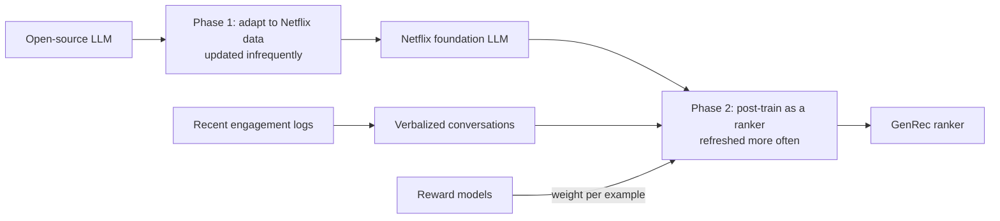
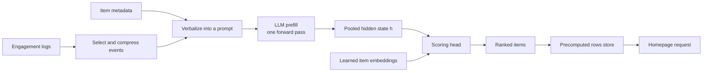

## TL;DR

- GenRec replaces a ranker built on many hand-crafted features with a fine-tuned LLM that reads the member's history, context, and item details as text. The paper calls this a move from feature engineering to context engineering.
- The LLM never writes out a title. A scoring head compares its pooled hidden state with a learned embedding per catalog item, so one forward pass scores every candidate and the output can only contain real items.
- Reward models that stand in for long-term satisfaction weight each training example. That gets part of what reinforcement learning offers at the cost of supervised training.
- Serving cost is roughly model size times context length. Netflix cut the prompt from about 5,000 to about 1,700 tokens with negligible quality loss, and serving cost fell to about a third.
- With about 40× fewer Phase-2 labeled examples than production, GenRec beat it offline and won a 4-week A/B test on about 10% of traffic. The test covered batch-computed surfaces only, and the paper reports relative lifts, not absolute metrics or latency.

## Why it matters

**Source.** Ying Li and colleagues at Netflix, "GenRec: An LLM-Backed Recommendation Ranker at Netflix", arXiv:2608.10257, 9 pages, v2 posted 21 August 2026 (v1 posted 10 August 2026). Read the [paper on arXiv](https://arxiv.org/abs/2608.10257). Three of the authors also wrote a shorter Netflix TechBlog post, [GenRec: Towards LLM-Native Recommendation at Netflix](https://netflixtechblog.com/genrec-towards-llm-native-recommendation-at-netflix-f20be6f643e3), published 30 July 2026. Where the two differ, this page follows the paper and says so.

Most large recommenders run in two stages. Candidate generation pulls a manageable set out of the full pool with cheap methods such as embedding similarity and popularity. A ranker then orders that set with a heavier model. The [news feed case study](../06-case-studies/news-feed.md) has the same shape.

The ranker is where engineering cost piles up. Netflix's production ranker uses a large number of hand-crafted features, and each one is a small data product. Someone writes the aggregation over the logs, keeps it fresh, and makes sure training sees only data from before each impression. That last property is leakage control. A feature computed with later data teaches the model the answer, so it looks great offline and fails online. The paper names aggregation, freshness, interaction design, and leakage control as the infrastructure a traditional stack needs. Each new content type, such as games or live events, and each new surface means another round of features.

An LLM is attractive because it reads heterogeneous inputs as text, already knows about titles and genres from pretraining, and can serve several tasks by changing the prompt. Used naively, it fails. The paper says off-the-shelf LLMs over-recommend popular content, hallucinate titles that aren't in the catalog, ignore business constraints, and personalize poorly. The usual research approach, generative retrieval, emits item IDs token by token with beam search, and the paper calls that latency prohibitive at scale for large candidate sets. GenRec keeps the LLM as an encoder of the member's situation and moves ranking into a small head over catalog embeddings.

## How it works

### Two phases of training

Phase 1 adapts an open-source LLM to Netflix's domain. It runs infrequently and is less constrained by cost. Phase 2 post-trains that model for ranking, is refreshed more often to track new launches and shifting tastes, and must be cheap to serve. The paper covers Phase 2.

The split puts expensive work on a slow cadence and cheap work on a fast one. Starting from the Phase-1 model instead of an off-the-shelf LLM improves offline ranking metrics by about 10% to 20%. Phase 2 adds a further 35% to 50% measured at the Phase-1 training cutoff, rising to about 80% two weeks later as Phase 1 goes stale.

### Requests become text

A request is a member $u$, a context $\tau$ (device, surface, locale, time of day), a time $t$, and the member's history $H$. The output is a ranking $\pi$ that should maximize expected long-term member utility, and it feeds several surfaces and downstream systems.

A verbalizer $V$ turns the request into a prompt, $x = V(H, \{M_i\}_{i \in C}, \tau)$, where $M_i$ is the metadata of item $i$ in the catalog $C$. Training data is logs reshaped into chat conversations. The user turn carries context, profile, history, item details, and the task. The assistant turn is what the member did, such as a play and its length, an abandon, or a thumbs rating.

### Context engineering under a token budget

Netflix members generate hundreds of billions of interaction events, per the paper, and one member's history can easily exceed the prompt's token budget. The paper's phrase is "the prompt becomes the new feature vector", and it applies four rules.

- **Retain** high-signal events in full, such as long plays and thumbs-up ratings.
- **Omit** low-signal events, such as very short plays and noisy views and clicks.
- **Compress** repetitive behavior, so a binge is summarized instead of listed event by event.
- **Elaborate** on new releases and cold-start items, where the model has little engagement to go on.

Short-to-medium-term history stays detailed, and older history is dropped or compressed into a brief interest summary.

Prompt length is then a budget to tune in three steps. Select and compress events with the rules above. Sweep the number of events and find the elbow, where more events stop improving the metric. Then tune verbosity, such as engagement detail, wording, and whether to keep few-shot examples. The prompt fell from about 5,000 tokens to about 1,700 with negligible loss in mean reciprocal rank (MRR), the paper's offline metric.

### Scoring the catalog in one pass

GenRec keeps the foundation model's decoder-only Transformer and adds three pieces.

1. **Pooled representation.** The hidden state at a pooling position becomes a $d$-dimensional vector $h$ that summarizes the member and context. The paper doesn't say which position.
2. **Catalog-aware scoring.** Each item has a learned $d$-dimensional embedding $e_i$, and a scoring head computes $s_i = \phi(h, e_i)$.
3. **Catalog softmax.** $p(i \mid x) = \exp(s_i) / \sum_{j} \exp(s_j)$ over the catalog, and the ranking is the items sorted by score. When the catalog is too large to score exhaustively, the paper says scoring can be combined with sampled softmax.

The LLM, the head, and the embeddings train jointly. Because the head scores only items with embeddings, GenRec can't recommend a title outside the catalog. That follows from the design. The paper doesn't report it as a measurement.

This is why serving is **prefill-only**. [LLM serving and inference](../05-advanced/llm-serving-and-inference.md) splits LLM work into prefill, which reads all prompt tokens in parallel, and decode, which generates output tokens one at a time. GenRec needs only prefill to get $h$, and the head scores every candidate from that vector. Nothing is decoded.

### Reward-weighted loss

$$
L = \alpha L_{\text{ranking}} + \beta L_{\text{language}} + \gamma L_{\text{misc}}, \quad \alpha + \beta + \gamma = 1, \quad \alpha, \beta, \gamma \ge 0
$$

The ranking term is cross-entropy over the catalog or candidate set, with high-quality engagements as positives. Thresholds and denoising differ by content type. The language term is next-token loss on the verbalized text. It preserves language ability and prompt steering and leaves room for generated explanations later. The miscellaneous term covers auxiliary tasks. Inference uses only the ranking task.

Rewards enter as weights. GenRec uses two kinds of reward model from an existing Netflix framework. One proxies long-term satisfaction, such as returning, exploring the catalog, and sustained engagement. The other rebalances exposure across content types and launch stages (pre-launch, new, and evergreen). Each example gets one scalar weight that scales its ranking loss, so examples that predict a satisfied member count more and over-represented content counts less. RL in the style of GRPO gave additional gains in preliminary experiments, but its training overhead pushed it to future work.

### Serving cost

GenRec runs on vLLM in Netflix's internal LLM serving stack. Inference cost is "roughly proportional to the product of model size and context length", and GenRec is "largely compute-bound". Smaller or distilled models shrink the first factor, context compaction shrinks the second, and prefill-only inference avoids decode. The paper also lists KV caching and prefix caching. Cutting the prompt to about a third cut serving cost to about a third.

### What the experiments show

- **Offline.** With about 40× fewer Phase-2 labeled examples than production, GenRec scored about +1.6% relative MRR over it, and MRR kept rising with more data and input signals.
- **Online.** An A/B test on key batch-compute surfaces ran for 4 weeks on about 10% of traffic, in a low-data, low-signal configuration. Short-term and long-term metrics improved with statistical significance. The PDF's chart shows a short-term homepage engagement metric at +0.115% (p = 3.1×10⁻¹⁰) and the core long-term metric at +0.006% relative (p = 0.025), which the paper calls "statistically meaningful at Netflix scale".
- **Scaling.** Data scaled from 1× to 20× of the smallest configuration on backbones of about 1B and about 10B parameters, and MRR rose monotonically. At a fixed training budget the larger model won. The authors pick a "sweet spot" on the quality and cost frontier rather than maximum quality.

## Trade-offs

| GenRec gains | GenRec pays |
| --- | --- |
| A new content type needs a description, not a feature pipeline | GPU time on every member's prompt, scaling with model size times context length |
| Beat production with about 40× fewer Phase-2 labeled examples | Phase 1 goes stale, so Phase 2 must be retrained often |
| One backbone can serve several surfaces through the prompt | Depends on an in-house foundation model worth 10% to 20% offline |
| Outputs limited to real catalog items, with no decoding | A ranking comes from a hidden state, not features you can inspect |
| Long-term goals through reward weights, without an RL loop | Reward models join the system and can be gamed by the ranker that learns from them |

**Batch, not real time.** The online test covered batch-compute surfaces, where precomputing hides prefill latency. Reranking on each request puts the forward pass on the request path, and the paper doesn't test that.

**Tiny online lifts.** +0.006% is significant at Netflix's sample size and would be noise for most teams.

**What the paper doesn't report.** No absolute metric values, latency figures, GPU type or count, catalog size, refresh cadence for either phase, or member count beyond "hundreds of millions". It doesn't name the pooling position or the head's exact form. Treat any such number as your own assumption.

**Where the blog differs.** The blog says GenRec matches or beats production with 10× to 40× fewer Phase-2 labels depending on configuration. The paper ties about 40× to the +1.6% MRR result. The blog says prompts maximize shared prefixes for prefix caching, while the paper mentions prefix caching only as a general lever. The blog suggests a dot product or small MLP for the head, which the paper doesn't specify. This page follows the paper.

## Applied use cases

### Design homepage recommendations for a streaming service

For "design Netflix's homepage", take playback from the [video streaming case study](../06-case-studies/video-streaming.md) and treat recommendations as a precomputed feed, as in the [news feed case study](../06-case-studies/news-feed.md). Candidate generation narrows the catalog, a ranker orders it, and a batch job writes each member's rows to a key-value store. A homepage load is one point read by member ID, with a [cache](../02-building-blocks/caching.md) in front.

An LLM ranker belongs in the batch job, where GenRec was tested. Size it with the [back-of-the-envelope](../01-fundamentals/back-of-the-envelope.md) method. Every input is an assumption except the prompt length, which is the paper's.

- **Load.** 300 million members, one 1,700-token prompt each per day, is about 5.1 × 10¹¹ tokens per day, or 5.9 million tokens per second over 86,400 seconds.
- **Throughput.** Assume 20,000 prefill tokens per second per GPU for a 10B model. At about 2 × parameters FLOPs per token, that is 4 × 10¹⁴ FLOP per second sustained. Benchmark it before you trust it.
- **GPU time.** 5.1 × 10¹¹ / 20,000 / 3,600 is about 7,100 GPU-hours per day, or 0.085 GPU-seconds per member.
- **Fleet.** Over 24 hours that is about 295 GPUs, or 37 VMs at 8 GPUs each, the GPU count of an ND H100 v5 VM. In a 6-hour nightly window it is about 1,180 GPUs, or 148 VMs.
- **The head is cheap.** With an assumed 20,000-item catalog and $d$ = 4,096, the dot products cost about 1.6 × 10⁸ FLOP per member, against 3.4 × 10¹³ for the prompt. The prompt is the cost.
- **Levers.** At the original 5,000 tokens, GPU time triples to about 20,800 GPU-hours. A 1B model, if throughput scales inversely with size, needs about 710.
- **Storage and reads.** 200 ranked items at 8 bytes is 1.6 KB per member, about 480 GB in total. Two homepage loads per member per day is about 6,900 reads per second, and 21,000 at an assumed 3× peak.

**What to measure.** Offline MRR against the current ranker on a time-split holdout, GPU-hours per run, cost per member per day, the age of rows at read time, and then engagement and retention in an A/B test.

**What breaks.** Titles that launch between runs have no learned embedding, so a cold-start path such as a rule-based row has to place them. A failed run leaves stale rows, so keep and serve the previous run's output. A job that overruns its window delays everyone, so size the fleet with headroom.

### Use an LLM as a scorer, not a text generator

Many work features ask an LLM to pick from a fixed set, such as routing a ticket to one of 40 queues or reranking search results. The usual first version prompts a chat model and parses its text answer. It decodes on every call, sometimes returns a label outside the set, needs retries on malformed output, and gives no score to threshold.

GenRec's alternative is a small open model with a head on its pooled hidden state, trained on your labeled history and served prefill-only. vLLM supports this as a pooling model. Its `classify` task returns class probabilities from the last token's hidden state by default, and a classifier with a single output can serve as a reranker that scores a query and document pair. The [RAG and agents page](../05-advanced/ai-systems-rag-and-agents.md) puts a reranker after hybrid retrieval, and the [search page](../02-building-blocks/search.md) shows the optional reranker slot.

**What to measure.** Accuracy or MRR against the prompt-and-parse version on the same holdout, calibration (whether 0.9 scores are right about 90% of the time), prompt tokens, p95 latency, and GPU-seconds per 1,000 requests.

**What breaks.** A new label means a new head output and retraining, just as a new title needs a new embedding. The model can't explain itself unless you keep a language term in training, as GenRec does. vLLM's docs warn that its pooling support isn't guaranteed to be faster than Hugging Face Transformers, so benchmark the serving win.

### Engineer context under a token budget

Any LLM feature that builds a prompt from history faces GenRec's selection problem, whether it's a support assistant reading a ticket thread, an agent with memory, or a RAG app choosing how many chunks to include.

1. List the signals you could include and mark each high or low signal for the task.
2. Retain high-signal items, omit low-signal ones, compress repeats, and add detail only where the model lacks other evidence.
3. Sweep the amount of history, such as 5, 10, 20, and 50 events, plot quality against tokens, and pick the elbow.
4. Tune wording and verbosity at that length, and try dropping few-shot examples.
5. Put stable content first so requests share a prefix for prefix caching, as [LLM serving and inference](../05-advanced/llm-serving-and-inference.md) describes.

**What to measure.** Quality on a fixed evaluation set at each budget, tokens per request at p50 and p95, and cost per 1,000 requests. The paper's result is the shape to look for, where a third of the tokens keeps nearly all the quality.

**What breaks.** Compression can drop the one rare event that mattered, such as a single escalation in a long thread. The elbow moves as data changes, so rerun the sweep. A summary built from data after the decision point leaks the answer, the same failure feature pipelines guard against.

## On Azure

| Need | Recommended service | Setting that matters |
| --- | --- | --- |
| Verbalize logs into prompts | Microsoft Fabric or Azure Databricks | Spark jobs that write prompt files to storage |
| Post-train with a custom head and loss | Azure Machine Learning jobs on a GPU compute cluster | Minimum nodes set to 0 |
| Score every member on a schedule | Azure Machine Learning batch endpoints | Scale-to-zero clusters and Spot capacity |
| Serve an LLM scorer online | AKS with KAITO or a GPU node pool, or an online endpoint with a custom container | NVIDIA Ampere or newer for KAITO |
| Serve precomputed rows | Azure Cosmos DB, with Azure Managed Redis in front if needed | Member ID as the partition key |

**Data pipeline.** Fabric Data Engineering provides Apache Spark with notebooks and scheduled jobs over OneLake. Azure Databricks offers Spark, Delta Lake, and MLflow. Either can run the verbalizer. [Data choices](../04-azure/data-choices.md) covers the analytics decision.

**Post-training.** An Azure Machine Learning compute cluster distributes training or batch inference over GPU nodes, and a minimum of 0 nodes avoids charges when idle. The ND H100 v5 series has one size, Standard_ND96isr_H100_v5, with 8 NVIDIA H100 GPUs at 80 GB each. The NCads H100 v5 series has 1 or 2 PCIe H100 GPUs at 94 GB each, enough for a small model. Microsoft Foundry fine-tuning offers Managed Training (SFT, DPO, or RFT, depending on the model) and Programmed Training in preview, which lets you control losses, rewards, and rollouts. The Foundry page doesn't mention custom scoring heads or item embeddings, so a GenRec-style head is better trained as an Azure Machine Learning job with your own training code. Use Foundry when the output stays text.

**Batch scoring.** Batch endpoints run asynchronous jobs in parallel on a compute cluster and write results to storage, and Learn points to them when you don't need low latency. Compute is provisioned when a job starts and released when it ends, and the endpoint itself isn't charged. Low-priority VMs were retired on 31 March 2026, and configurations that request them now get Spot VMs. A lost node's mini-batches are rescheduled while finished ones are kept, but there is no job-level checkpointing. Learn doesn't document running vLLM inside the scoring script, so treat that as a pattern to prove with a small run first. [Cost optimization](../04-azure/cost-optimization.md) covers Spot's 30-second eviction notice.

**Online serving.** The AI toolchain operator (KAITO) add-on for AKS integrates with vLLM and exposes OpenAI-compatible APIs. It needs NVIDIA GPUs with CUDA compute capability 8.0 or later, which rules out T4 and V100. For most GPU workloads, Learn recommends AKS-managed GPU node pools, where AKS maintains the driver, device plugin, and DCGM metrics exporter. You can't add a GPU size to an existing node pool. A Spot node pool can only be a secondary pool, has no SLA, and carries a taint your pods must tolerate. Azure Machine Learning online endpoints also accept custom containers such as Triton Inference Server. Learn doesn't document running vLLM that way. [Compute choices](../04-azure/compute-choices.md) covers when AKS is worth it.

**Serving the rows.** A member's rows are one key-value read, which fits Cosmos DB partitioned by member ID. Reading a 1 KB item by ID and partition key costs 1 request unit, so the 1.6 KB row from the estimate costs slightly more. Add Azure Managed Redis in front if the read rate justifies it, as the [caching page](../02-building-blocks/caching.md) describes.

## Interview tips

**Bring it up at the ranking step.** Sketch the two stages first, then offer GenRec as a modern ranker. "Netflix published an LLM ranker that reads the member's history as a prompt and scores the catalog with a head on one forward pass. It ran on batch surfaces, so I'd put it in the nightly job, not on the request path." That names the idea, its cost model, and its limit.

**Traps to avoid.**

- **Saying it replaces candidate generation.** GenRec can rank the full Netflix catalog. The estimate above suggests why that is affordable, since the head costs far less than the prompt. With millions of items you still retrieve first, and the paper's loss also covers a given candidate set, with sampled softmax for very large catalogs.
- **Ignoring serving cost.** Say "cost scales with model size times prompt length" and give an estimate.
- **Assuming real time.** The paper tested batch surfaces. Per-request reranking is an extension with its own latency budget, better served by a small distilled model on the top few dozen items.
- **Quoting numbers the paper didn't report.** It gives no latency, GPU count, or absolute MRR. Quote "about 40× fewer labeled examples" and "+1.6% relative MRR", and label the rest as assumptions.

**Follow-ups to expect.**

- **Cold start.** A new title has no embedding until the next Phase-2 refresh. Elaborate its metadata in prompts and place it with a rule-based row until then.
- **Freshness.** The Phase-2 gain was 35% to 50% at the Phase-1 cutoff and about 80% two weeks later, as Phase 1 aged. Say how often each phase retrains and how often scoring runs.
- **Cost per member per day.** 1,700 tokens at an assumed 20,000 tokens per second per GPU is about 0.085 GPU-seconds.
- **Evaluation.** Offline MRR picks what goes to an A/B test, and the A/B test decides. Netflix ran 4 weeks on about 10% of traffic and tracked short-term and long-term metrics.
- **Reward hacking and feedback loops.** The ranker learns from engagement it caused. The long-term and rebalancing weights push back. Also keep exploration traffic and watch catalog coverage.
- **Rollback.** Keep the previous model and the previous run's rows. Switch the batch endpoint's default deployment back and serve yesterday's rows.

## Further reading

- [GenRec: An LLM-Backed Recommendation Ranker at Netflix](https://arxiv.org/abs/2608.10257), the paper on arXiv
- [GenRec: Towards LLM-Native Recommendation at Netflix](https://netflixtechblog.com/genrec-towards-llm-native-recommendation-at-netflix-f20be6f643e3), the Netflix TechBlog post
- [vLLM pooling models](https://docs.vllm.ai/en/latest/models/pooling_models/) and [classification usages](https://docs.vllm.ai/en/latest/models/pooling_models/classify/)
- [What are batch endpoints?](https://learn.microsoft.com/azure/machine-learning/concept-endpoints-batch) and [Create compute clusters](https://learn.microsoft.com/azure/machine-learning/how-to-create-attach-compute-cluster)
- [Deploy a model in a custom container to an online endpoint](https://learn.microsoft.com/azure/machine-learning/how-to-deploy-custom-container)
- [Fine-tuning in Microsoft Foundry](https://learn.microsoft.com/azure/foundry/fine-tuning/overview)
- [AI toolchain operator add-on for AKS](https://learn.microsoft.com/azure/aks/ai-toolchain-operator), [Use GPUs on AKS](https://learn.microsoft.com/azure/aks/use-nvidia-gpu), and [Add a Spot node pool to AKS](https://learn.microsoft.com/azure/aks/spot-node-pool)
- [ND H100 v5 size series](https://learn.microsoft.com/azure/virtual-machines/sizes/gpu-accelerated/ndh100v5-series) and [NCads H100 v5 size series](https://learn.microsoft.com/azure/virtual-machines/sizes/gpu-accelerated/ncadsh100v5-series)
- [What is Microsoft Fabric?](https://learn.microsoft.com/fabric/fundamentals/microsoft-fabric-overview) and [What is Azure Databricks?](https://learn.microsoft.com/azure/databricks/introduction/)
- [Request units in Azure Cosmos DB](https://learn.microsoft.com/azure/cosmos-db/request-units)
