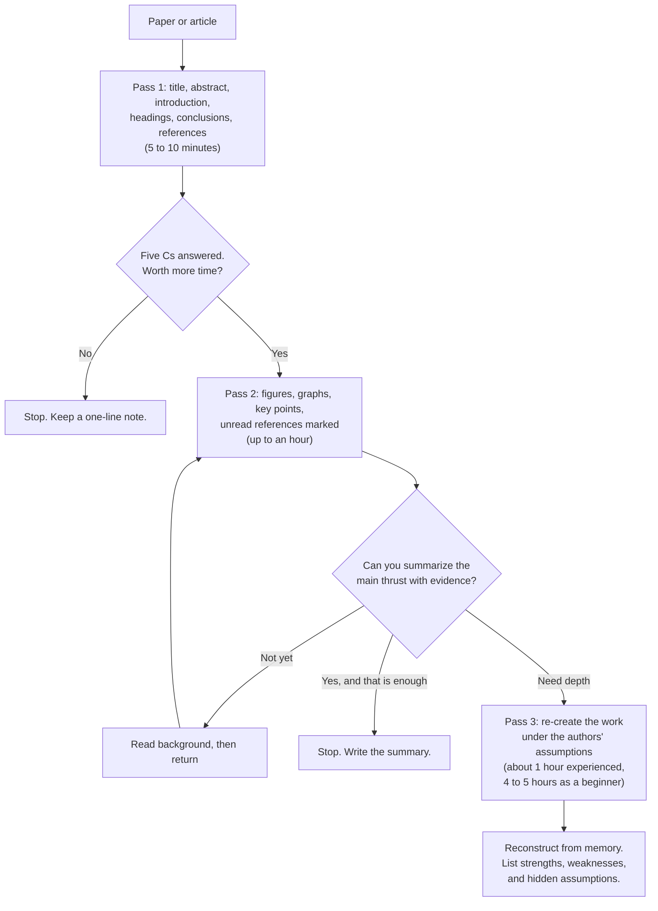

## TL;DR

- Keshav's "How to Read a Paper" replaces cover-to-cover reading with up to three passes. Each pass has a goal, a time budget, and a point where you can stop.
- The first pass takes 5 to 10 minutes and tells you what kind of paper it is and whether to keep going. The second pass takes up to an hour and gives you the content, enough to summarize the paper with its evidence. The third pass re-creates the work in your head and exposes the assumptions the paper does not state.
- For a distributed-systems paper, each pass has a concrete target. First find the problem and workload, then the mechanism and failure model, and last the evaluation and what its numbers depend on.
- The useful output is one claim plus the assumption it rests on. That pair is what an interviewer probes and what a design review needs before it adopts a technique.
- Every later page in this section follows the same order, so this page is the method for reading them and the papers behind them.

## Why it matters

**Source.** S. Keshav, [How to Read a Paper](http://ccr.sigcomm.org/online/files/p83-keshavA.pdf), ACM SIGCOMM Computer Communication Review, volume 37, number 3, July 2007. Keshav wrote it at the David R. Cheriton School of Computer Science, University of Waterloo.

Keshav's starting point is that researchers spend hundreds of hours a year reading papers, yet nobody teaches them how. Graduate students learn by trial and error, waste effort, and get frustrated. The default habit is to start at the first line and read to the end. That habit spends the same attention on a related-work paragraph as on the one figure that carries the result, and it buries you in details before you know whether the paper deserves the time.

Engineers outside research hit the same wall from a different side. The papers behind Dynamo, Spanner, Raft, and the storage systems you rent from a cloud provider come up in interviews, in design reviews, and in vendor pitches. Most engineers either skip them or read them once from the top and keep only the abstract. A systems paper is hard to read that way because the conditions under which its claims hold usually sit late in the paper. The fault model, the workload, and the hardware appear in a design-choices or evaluation section, after the claim has already landed in your head without them.

The three-pass method fixes the order. You decide early whether to invest, you get the structure before the details, and you finish by testing the assumptions. That order is also the order an interviewer uses when they ask follow-up questions.

## How it works

The method has three passes. Each one builds on the one before and ends at a decision.



### Pass 1: decide whether to read it

The first pass is a fast scan. Keshav budgets 5 to 10 minutes for it. Read the title, the abstract, and the introduction with care. Read the section and subsection headings and skip their contents. Read the conclusions. Glance at the references and note the ones you already know.

At the end you should be able to answer what Keshav calls the five Cs:

1. **Category.** What kind of paper is it? A measurement study, an analysis of an existing system, or a description of a research prototype?
2. **Context.** Which other papers does it build on, and which theory does it use?
3. **Correctness.** Do the assumptions look valid?
4. **Contributions.** What are its main contributions?
5. **Clarity.** Is it well written?

You can stop here. A paper outside your area, or one whose assumptions you already reject, needs nothing more. Keshav also notes that most reviewers and readers make only this one pass, which is a reason to write clear headings and abstracts yourself.

### Pass 2: get the content

The second pass reads the paper with more care but skips details such as proofs. Take notes in the margin as you go. Spend real time on the figures and graphs. Check that the axes have labels and that results carry error bars, because Keshav treats those as the line between rushed work and good work. Mark unread references that look important.

Keshav budgets up to an hour. Afterward you should be able to summarize the main thrust of the paper, with its supporting evidence, to someone else. If you still cannot follow it, Keshav names several possible causes. The subject may be new to you, with unfamiliar terminology. The authors may use a proof or experimental technique you don't understand. The paper may be poorly written, or you may simply be tired. You then choose to set it aside, read background material and come back, or push on to the third pass.

### Pass 3: re-create the work

The third pass is where understanding happens. Keshav describes it as a virtual re-implementation. You make the same assumptions as the authors and rebuild the work yourself. Comparing your version with theirs shows you both the innovations and the hidden failings. Challenge every assumption in every statement, and ask how you would have presented each idea.

Keshav estimates 4 to 5 hours for a beginner and about an hour for an experienced reader. The test of success is that you can rebuild the structure of the paper from memory and name its strong and weak points, including implicit assumptions, missing citations, and problems with the experiments or analysis.

### Reading a distributed-systems paper

Keshav's method is general. For the papers this section covers, each pass has specific things to pull out. The table lists them.

| Pass | Extract | Questions to answer |
| --- | --- | --- |
| 1 | Problem and workload | What does the system store or compute? For whom, at what scale, and with what read and write mix? Is it a production system, a prototype, or a measurement? |
| 2 | Core mechanism | What happens on one write and one read, step by step? Where is the write acknowledged? Who orders operations? |
| 2 | Guarantee | What consistency, durability, or latency does it promise, and at what scope: one key, one partition, one cluster, or one region? |
| 2 | Failure model | Which failures does the design tolerate: disk, node, rack, network partition, datacenter, region? Which does it not mention? |
| 3 | Assumptions | What must be true about clocks, networks, hardware, and the workload for the mechanism to work? |
| 3 | Evaluation method | What cluster size, hardware, workload, and baseline produced the results? Are there error bars and tail percentiles, or only averages? |
| 3 | What the numbers depend on | Which one input, if it changed, would change the headline result the most? |

Write the answers on one card per paper. A plain text template is enough:

```text
Paper:        title, venue, year
Claim:        one sentence a colleague could repeat
Workload:     who uses it, scale, read and write mix
Mechanism:    the write path and the read path in three sentences
Failure model: what it tolerates, and what it leaves out
Evidence:     the one figure or table that supports the claim
Depends on:   the assumption the claim rests on
Breaks when:  the condition that would make the claim false
```

### A worked read: the Azure Storage paper

The 2011 paper on Windows Azure Storage (WAS) shows why the order matters.

**Pass 1.** The abstract says WAS stores Blobs, Tables, and Queues, with local and geographic replication. The introduction says it had been in production since November 2008 and lists strong consistency as a key design feature, alongside a global namespace and disaster recovery. The category is a description of a production system. The introduction also says WAS provides strong consistency, high availability, and partition tolerance, which the CAP theorem says are hard to have together. That sentence earns a second pass.

**Pass 2.** The mechanism has three layers. A front-end layer routes requests. A partition layer understands Blobs, Tables, and Queues, splits objects into ranges by partition name, and orders transactions. A stream layer stores the bits as append-only extents and keeps them durable. Replication happens twice. Intra-stamp replication in the stream layer is synchronous and sits on the write path, so a write succeeds only after it is durable inside the storage stamp. Inter-stamp replication in the partition layer is asynchronous and runs in the background, so a copy in another region can lag. By default each extent has three replicas inside a stamp, spread across fault domains.

**Pass 3.** Section 8 explains the CAP claim, and it carries the assumption. WAS provides all three properties *within a storage stamp*, for a specific fault model. The partitions the authors saw inside a stamp were node failures and top-of-rack switch failures. When a rack drops out, the stream layer writes to extents on other racks and the partition layer moves its ranges to servers on healthy racks. The claim is true for that fault model and that scope. It says nothing about a partition between regions, where replication is asynchronous and a failover can lose recent writes.

That last sentence is the one to carry into an interview or a design review. The claim, its scope, and the fault model it relies on belong together.

### Surveying a new area

Keshav also applies the passes to a literature survey. Find three to five recent papers with an academic search engine and do one pass on each. Read their related-work sections, and look for a recent survey paper. If there is none, look for papers and authors that the bibliographies share. Those are the key work and the key researchers in the area. Check where those researchers publish to find the top venues, scan the recent proceedings, and make two passes over the resulting set. Use the same steps when you pick which papers to read before a design that is new to you.

## Trade-offs

| You gain | You pay |
| --- | --- |
| Pass 1 lets you drop a paper after 10 minutes instead of an evening | Clarity is one of the five Cs, so a badly written paper with a correct idea is easy to drop too early |
| Pass 2 gives a summary you can repeat with evidence | A good summary feels like understanding, so you can repeat a claim you cannot defend |
| Pass 3 exposes the assumptions behind the claim | It costs hours per paper, so it only pays for the few papers your design or interview depends on |
| A fixed order makes reading time predictable across a stack of papers | The method assumes a structured paper with an abstract, sections, and an evaluation |

Two limits matter for engineers today. First, the method was written for researchers who review papers and survey a field. An engineer applying it to a production decision also has to check how the system changed after publication. The WAS paper describes the system as of 2011. Today's storage redundancy options, such as zone-redundant storage, are documented on Microsoft Learn, not in the paper. Read the paper for the mechanism and Learn for current options and limits.

Second, much of what engineers read now is not a peer-reviewed paper. Engineering blog posts, design docs, and vendor whitepapers often skip the evaluation section and the failure model. Run the same three passes anyway. If pass 2 cannot find a failure model or pass 3 cannot find the evaluation setup, record that gap as a finding. Missing evidence is information about the claim.

## Applied use cases

### Turn a consensus paper into a two-minute interview explanation

You want to bring consensus into a system design interview as a deep dive, and you have read about Raft without being able to explain it under pressure.

Pass 1 gives you the problem. A group of servers must agree on one ordered log while some of them crash. Pass 2 gives you the mechanism and its scope. The site's page on [consensus with Raft and Paxos](../05-advanced/consensus-raft-paxos.md) lays out terms, leader election with randomized timeouts, `AppendEntries`, and commit after a majority stores an entry. Pass 3 is the part most candidates skip. Re-create the commit rule and ask what must be true for it to be safe. The answer is that any two majorities overlap, so a new leader always meets a member that holds every committed entry. Then ask what it costs. Every write waits for a majority round trip and a disk flush, and the minority side of a partition cannot commit.

Fill in the card and turn it into a script of about five sentences that cover the problem, the mechanism, the guarantee, the assumption, and the cost. Measure yourself against three tests. Can you say it in two minutes without notes? Can you rebuild the argument from memory, from the problem through the commit rule to its cost? That adapts Keshav's third-pass test, which asks you to reconstruct the paper's structure. Can you answer "what happens during a partition" and "how do you scale writes" without improvising?

The explanation breaks when you recite the name and skip the overlap argument, or quote the paper's timeout values without saying what network delays they assume. Practice the follow-ups as much as the script.

### Check a vendor's consistency claim at work

A vendor's whitepaper says its database is strongly consistent, highly available, and partition tolerant. Your team is about to put payment records on it.

Pass 1 tells you whether the document is a design paper with an evaluation or a marketing piece. Pass 2 finds the write path. Look for the exact point where the write is acknowledged and how many replicas hold it at that moment. Then find the failure model, the list of failures the authors tested. Pass 3 asks the question the WAS paper answers. Within what scope, and for which faults, do all three properties hold? Compare that scope with your own deployment. A claim that holds inside one cluster tells you nothing about the cross-region failover your design depends on. The trade-off itself is covered in [consistency and CAP](../01-fundamentals/consistency-and-cap.md), and the replication modes in [replication](../02-building-blocks/replication.md).

Then test the claim on your own workload in a staging environment. Inject the failures your fault model includes, such as killing a node, isolating a rack or zone, and failing over a region. Measure the acknowledged writes lost, the seconds during which writes were refused, and the change in p99 latency during and after each fault.

The evaluation breaks when the vendor's fault model is narrower than yours and nobody writes that down. It also breaks when the published numbers come from a cluster size or read and write mix far from your own. Record both on the card before the decision meeting.

### Decide whether a published technique fits your workload

Your team proposes moving a growing OLTP database to a design that separates compute from storage, citing the Socrates paper behind Azure SQL Database Hyperscale.

Pass 1 confirms the category and the problem. Socrates is a database-as-a-service architecture that Microsoft built because a monolithic database engine could not meet cloud expectations for availability, cost, and performance. Pass 2 gets the mechanism, which Microsoft Learn's Hyperscale architecture page also describes. Compute nodes run the query engine and keep a local SSD cache. Page servers each own a slice of the pages and replay log records to stay current. A log service accepts log records from the primary and sends them to page servers and secondary replicas. Azure Storage holds the data files for durability and backups.

Pass 3 asks what the benefit depends on. A page that misses the compute node's cache must come from a page server over the network, so the read path depends on how much of your working set fits in that cache. Writes flow through the log service, so write throughput depends on log throughput, not on a local disk. Estimate both before you migrate, using the methods in [back-of-the-envelope estimation](../01-fundamentals/back-of-the-envelope.md). Measure the hot working set against the cache size, the cache-miss read latency, the peak log generation rate, and the time to add a replica.

The fit breaks when the team adopts the architecture for the paper's headline result without checking these inputs against its own workload. Use [data choices on Azure](../04-azure/data-choices.md) to compare the other service tiers before you commit.

## On Azure

Microsoft has published papers on the systems behind some Azure services. Reading them with three passes tells you the consistency scope, the replication path, and the failure behavior. Those three facts decide which service and which configuration fit a design.

| Paper | Azure service | What the paper explains | Configuration it informs |
| --- | --- | --- | --- |
| Windows Azure Storage, SOSP 2011 | Azure Storage (Blob, Table, and Queue storage) | Synchronous replication inside a stamp, asynchronous replication across regions, strong consistency inside a stamp | Redundancy option: LRS, ZRS, GRS, GZRS, and read access to the secondary |
| Socrates, SIGMOD 2019 | Azure SQL Database Hyperscale | Compute separated from the log service, page servers, and storage | Replica count, read scale-out, and storage redundancy |

**Azure Storage.** The paper's split between synchronous and asynchronous replication is still visible in today's options. Microsoft Learn's [data redundancy page](https://learn.microsoft.com/azure/storage/common/storage-redundancy) says that LRS replicates within one datacenter and ZRS writes synchronously across three or more availability zones. With ZRS, a write succeeds only after it is written to all replicas across the three availability zones. If a zone is temporarily unavailable, the write succeeds once it reaches every available zone. GRS and GZRS copy data to the secondary region asynchronously, and Learn warns that a primary-region failure can lose data that has not reached the secondary yet. Geo priority replication sets a recovery point objective of 15 minutes or less for block blobs. If your design cannot lose acknowledged writes in a regional disaster, geo-redundant storage alone does not meet that requirement. That is the same conclusion as pass 3 of the paper. See [regions, zones, and resiliency](../04-azure/regions-zones-and-resiliency.md) for how to place the rest of the design.

**Azure SQL Database Hyperscale.** Microsoft Research's [Socrates publication page](https://www.microsoft.com/en-us/research/publication/socrates-the-new-sql-server-in-the-cloud/) states that Socrates is available in Azure as SQL DB Hyperscale. Learn's [Hyperscale architecture page](https://learn.microsoft.com/azure/azure-sql/database/hyperscale-architecture) gives the current limits: up to 128 TB for one database, up to 128 GB of data per page server, up to four high-availability replicas per primary or named replica, and up to 30 named replicas. The storage redundancy you choose, LRS, ZRS, RA-GRS, or RA-GZRS, applies for the lifetime of the database. Pick it at creation. You cannot change it on an existing database. Moving to another option means migrating to a new database through active geo-replication, a database copy, or a point-in-time restore, as Learn's [backup settings page](https://learn.microsoft.com/azure/azure-sql/database/automated-backups-change-settings) describes.

**Paper versus Learn.** Use the paper for the mechanism and failure model, and Learn for the current names, limits, and options. Papers describe one moment in a system's life. Learn is updated as the service changes. When the two disagree on a limit, Learn wins. When Learn does not explain why a limit exists, the paper usually does. The [Azure service map](../04-azure/azure-service-map.md) shows where these services sit among the rest.

## Interview tips

- Cite a paper the way you would cite a colleague. Name it, explain the mechanism in your own words, then say why it applies here. For example, "Azure Storage's 2011 paper replicates synchronously inside a cluster and asynchronously across regions. I'd split replication the same way here, because the cross-region link is too slow for the write path."
- Never drop a name without the mechanism. "We'll do it like Dynamo" or "use Raft" invites "how?", and an answer that stops at the name costs more credibility than never mentioning the paper.
- State the scope with the claim. "Strongly consistent within a region, asynchronous across regions" answers the follow-up before the interviewer asks it.
- Expect "what assumption does this rely on?" Answer with the failure model or workload from your third pass, such as "partitions inside one cluster are node and rack failures."
- Expect "what would break at 10x?" Name the input your numbers depend on, such as cache hit rate, the number of replicas in a write quorum, or single-leader write throughput, and say what happens when it moves.
- Expect "how would you know it's failing in production?" Name the metric, such as replication lag, acknowledged writes lost during a failover drill, or p99 latency on cache misses.
- Say how deep you went. "I've read the design sections, not the evaluation" is better than defending a number you never checked.
- Pair a paper with its current product. Knowing that the Socrates paper became Hyperscale, and what Hyperscale's limits are today, shows you connect research to a service decision.

## Further reading

- [How to Read a Paper](http://ccr.sigcomm.org/online/files/p83-keshavA.pdf), S. Keshav, ACM SIGCOMM Computer Communication Review, 2007
- [Windows Azure Storage: A Highly Available Cloud Storage Service with Strong Consistency](https://sigops.org/s/conferences/sosp/2011/current/2011-Cascais/printable/11-calder.pdf), Calder et al., SOSP 2011
- [Socrates: The New SQL Server in the Cloud](https://www.microsoft.com/en-us/research/publication/socrates-the-new-sql-server-in-the-cloud/), Antonopoulos et al., SIGMOD 2019
- [Data redundancy in Azure Storage](https://learn.microsoft.com/azure/storage/common/storage-redundancy)
- [Hyperscale distributed functions architecture](https://learn.microsoft.com/azure/azure-sql/database/hyperscale-architecture)
